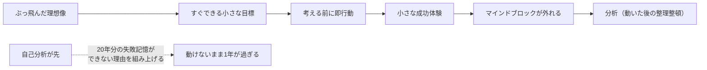

# 40代の挑戦に自己分析は逆効果（宮﨑達也の「行動が先、分析は後」）

> **TL;DR**: 40代の自己分析は20年分の失敗記憶から「できない理由」を説得力高く組み上げる作業になるので、「自己分析→目標→行動」ではなく「ぶっ飛んだ理想像→小さな目標→即行動→小さな成功体験→マインドブロック解除」の順に動き、分析は動いた後の整理整頓に回せ、と46歳で上場企業を辞めて起業した宮﨑達也（株式会社 DIL 代表取締役）が X の記事で説く。

宮﨑は起業して2年の時点で当時の自分に伝えたいこととして、「ちゃんと自己分析してから挑戦しよう」は40代が絶対にやってはいけない準備運動だ、と書く。20代なら意味があるが、40代の自己分析は「ほぼ100%」できない理由のアーカイブ作業になる、というのが宮﨑の診断である。

## 40代の自己分析が罠になる理由

40代の脳には20年分の失敗の記憶（仕事で恥をかいた・上司に評価されなかった・人間関係のストレスで眠れなかった夜）が詰まっており、家族を養う責任や住宅ローンの残高からは逃げられない。これを丁寧に棚卸しすると「あの時◯◯だったから今回も無理」「△△が苦手だから諦めたほうがいい」「□□のリスクを冒すにはもう若くない」と、できない理由が勝手にまとわりついてくる、と宮﨑は書く。厄介なのは40代の自己分析は理論武装の質が異常に高いことで、20年分のサンプルデータが揃っているぶん20代の言い訳とは説得力が違う。分析した結果、自分で自分を動けなくさせる。これが40代の挑戦に立ちはだかる最も厄介な壁だ、と宮﨑は位置づける。

## 順番を逆にする

宮﨑の結論は順番の入れ替えである。①ぶっ飛んだ理想像をイメージする、②すぐできる小さな目標に分解する、③考える前に即行動する、④小さな成功体験を作る、⑤その積み重ねでマインドブロックを外す。「自己分析→目標→行動」ではなく「理想像→小さな目標→即行動→成功体験→分析」の順で、おじさんのマインドブロックは動かないと外れない、頭で外そうとすると20年分の重力が引き戻してくる、と宮﨑は説明する。一度動いて小さくても結果を出して初めて「あ、いけるんだ」が体感として入る。

宮﨑自身は起業して最初の3か月、完璧な事業計画は一切作らず「1人のお客様の成果を出す、その内容を再現する」という小さな勝ち筋だけを追い、これを20回ほど積み上げた頃からようやく「できない理由」が口から出なくなった、と書く。

## 分析は動いた後の整理整頓

40代にとっての自己分析は「動いた後の整理整頓」であるべきで「動く前の準備運動」にしてはいけない、と宮﨑はまとめる。順番を間違えると考えるほど動けなくなり、動けないまま1年が過ぎる。分析する時間があるなら一つでも動いたほうが未来が変わるとして、「分析より先に行動を一個」を勧める。

## 著者と利害

記事末尾のプロフィールによれば、宮﨑は株式会社 DIL 代表取締役で、メタボ・降格・借金生活の30代を経て46歳で共同創業し、X も筋トレも起業も40代デビュー、毎月 X オフ会「バズ会食」を開催している。記事は川岸宏司の記事と同じ経営者向け X 顧問コミュニティ（記事時点で220社・2年以内に1000社目標と記載）の案内で締められる。同じ DIL の川岸の記事は [[concepts/kirikuchi-seven-techniques]] にあり、宮﨑の文章をその7技法で読むと、「ほぼ100%」「20年分」「20回」は電卓型、起業3か月の回想は再現VTR型に当たると考えられる。

## 位置づけ（wiki 側の読み）

[[concepts/one-day-life-reset]] の Dan Koe（ともとやま）は、動けない理由を「隠れた目的」として紙に書いて言語化する発掘（朝の14問）を処方の起点に置くのに対し、宮﨑は40代ではその発掘自体が「できない理由のアーカイブ」になるとして行動を先に置く。説明の置き場（隠れた目的か、失敗記憶の重力か）と処方の順番（言語化→行動か、行動→整理か）が逆向きで、Koe の「平均的な火曜日」を書くビジョン法は宮﨑の「ぶっ飛んだ理想像」に当たる。[[concepts/career-agency-variables]] でもとやまが、難易度の高い「何をやるか」でなく今日から自分次第の「どうやるか・なぜやるか」から着手せよと説くのは、宮﨑の「すぐできる小さな目標」と同じ着手点の選び方と読める。[[concepts/performance-habits-40s]] の @antoshia2n が40代の活力を「足し算でなく引き算」で保つ自己管理論であるのに対し、本ページは40代の挑戦の順番論で、どちらも「頑張って準備する」を退ける点が共通する。

## 観察ログ（未検証）

- 2026-11-12 宮﨑: 小さな勝ち筋を「20回ほど」積み上げた頃に「できない理由」が口から出なくなった（本人の回想・単一ソース）

## 問い

- 自分の「できない理由」のうち、20年分のサンプルから組み上げた理論武装はどれか。それを一つ選んで「すぐできる小さな目標」に分解すると何になるか
- Koe の朝の14問（分析先行）と宮﨑の即行動（行動先行）は年代で使い分けるものか、それとも分析の深さを調整するものか

## 関連

- [[concepts/one-day-life-reset]] — Dan Koe ともとやまの「隠れた目的を言語化してから動く」処方。本ページの「動いてから分析する」と順番が逆向き
- [[concepts/career-agency-variables]] — もとやまの「今日から自分次第の変数から着手する」論。「すぐできる小さな目標」と同じ着手点の選び方
- [[concepts/performance-habits-40s]] — @antoshia2n の40代の「引き算」自己管理論。準備を足さない点で共通する40代論
- [[concepts/kirikuchi-seven-techniques]] — 同じ DIL の川岸宏司による文章の7技法。本ページの数字と回想はその電卓型・再現VTR型に当たる
