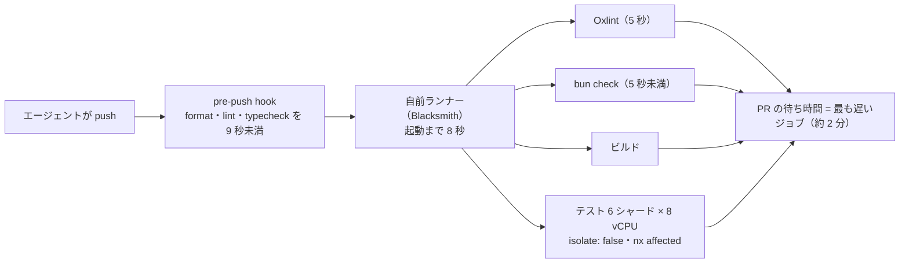

# エージェント時代の CI 高速化（Boardy の 40 分→2 分）

> **TL;DR**: コードを書く速さが 10 倍になっても CI が同じなら待つのは CI になる、として Boardy の head of engineering の owen（@owengretzinger）が CI を製品として扱い、ランナー移行・Oxlint・型検査器の乗り換え・シャード・isolate: false・セットアップ監査・全並列・affected 限定・pre-push hook の 9 手で PR の CI 待ちを最長 40 分から 2 分にした手順書。「この記事をエージェントに渡して同じことをさせろ」と書く。

1 年前の Boardy では PR が CI を最長 40 分待っていた。owen がこれを問題にしたのは、出荷する PR がすべてコーディングエージェントで書かれるようになったからで、エージェントは push に疲れない。push して CI を待ち、赤いチェックを直して再 push する。書く速さが 10 倍になっても CI が同じなら待っているのは CI だ、と owen は書く。そこでこの 1 か月、CI を製品のように扱い、作業の大半は Slack の社内エージェントに携帯から指示して進めたという。記事中のコード片（ランナー指定の 1 行・設定値）と、Linear の同趣旨の投稿への参照は、キャッシュには本文が収録されていない。

## 9 の手順（owen の記事からの転記）

1. **GitHub の既定ランナーをやめる**。ジョブはマシンが割り当たるまで最長 11 分待っていたが、今は 8 秒で始まる。ジョブごとに 1 行の変更で、Boardy は Blacksmith を使う。Vercel CI や boat.dev など他にも選択肢が出ており、どれでも既定より良い。小さなジョブも含め全部を移すこと。Boardy は数秒で終わる 2 つの最小ジョブを GitHub に残したところ、それがパイプラインで最も遅い部分になった。マシンを 10 分待つ 5 秒のジョブは 10 分のジョブである。ランナーだけで 40 分が約 10 分になり、以下はその残りを削る手順である
2. **ESLint を Oxlint に置き換える**。lint は 2 分から 5 秒になった。エージェントは厳しいルールに腹を立てないので、有効にできるルールは全部有効にする（owen はこれを「成功のブラックホール」を強制すると呼ぶ）
3. **速い型検査器が出るたびに乗り換える**。1 か月に 3 回替えた。サーバーのコールド型検査は tsc で 70 秒、TypeScript 7 で 13 秒、bun check で 5 秒未満になり CI はこれを使う。ローカルでは tsrs が 0.6 秒。owen は Jarred（Bun の作者）が bun check の最大 7 倍高速化を投稿したのを夕食中に見て、その投稿を社内 Slack エージェントに貼ったところ 6 分後に自社リポでのベンチマークが返り、その 20 分後に PR がマージされたという
4. **テストを大きいマシンにシャードする**。8 分のテストターゲットを 1 つ、それぞれ専用 DB を持つ 8 vCPU マシン 6 台に分けた。シャード数よりマシンの大きさが効いた。各シャードは CPU の大半をモジュールの読み込みに使いテスト実行にはほとんど使っていなかったので、シャードでなくコアを買った
5. **テストファイルごとにアプリを読み直すのをやめる**。Vitest はファイルごとに新しいワーカーを与えるので、全ファイルが NestJS アプリ全体を一から import していた。isolate: false にすると各シャードは 100 秒から 35 秒になった。Linear も同じことを見つけている。テスト同士が漏れ始めるので、ファイルごとに状態を戻すフックを足し、テストが何を片付けるべきかをエージェントに伝える
6. **セットアップを直す**。サーバーのテストジョブは先週 168 秒だったのが今は 74 秒で、中のテストはほとんど変わっていない。ほぼ全部がセットアップで、誰も見ない部分である（エージェントも最初は見逃した）。最大の削減は監査から出た。エージェントに直近 150 回の実行を取らせ、全ジョブを待ち・セットアップ・実行に分けさせると、テストジョブの半分が依存キャッシュを使えていなかった。GitHub は PR のキャッシュをそのブランチに閉じるのに、main からキャッシュを種として用意するものが無く、大半の PR がコールドで始まっていた。このバグは 1 年間あったが、誰も CI を見ていなかったので気づかず、見ていたエージェントは直さずに再試行していた。さらに 3 点。node_modules をキャッシュする（復元 13 秒が 33 秒のインストールを置き換える）。shallow clone でなく filter: blob:none の blobless clone を使う（shallow は git 履歴を読むものを壊す。checkout は 36 秒から 12 秒）。並列度をコア数に合わせる（4 vCPU のジョブが 8 タスクを同時に走らせていた。並列度を半分にしても同じ速さで、flaky なテストが 1 つ消えた）。テストの削除も試し、エージェントにサーバーの 20,000 件のテストケースを監査させたが、削る価値のあるものはほとんど無く、時間はそもそもテストにかかっていなかった
7. **全部を並列に走らせる**。lint・型検査・ビルド・テストが同時に走り、PR の時間は最も遅いものと同じになる。次に最も遅いジョブが他に何をしているかを見る。最初のテストシャードはマイグレーション検査と他アプリのテストも走らせていたので常に最後に終わっていた。それらを別ジョブに移して 2 分削った
8. **PR が触ったものだけ走らせる**。nx affected で PR が変えたプロジェクトだけテストし、main では毎晩全スイートを回す。そしてスキップのロジック自体をテストする。意図的にサーバーの変更を Nx から隠したところ、6 シャード全部がテストをスキップして緑を報告した。今はそれが起きると実行が失敗する
9. **push の前に検査を走らせる**。pre-push hook が変更ファイルに format・lint・型検査を 9 秒未満で走らせる。型エラーに当たったエージェントは CI を待たず数秒でローカルで直す。AGENTS.md の 1 行でなく hook に置くこと。エージェントは手順を飛ばすからである

## 費用と次のボトルネック

CI の請求は月 230 ドルから 4,300 ドルになったが、エージェントを速くするために使う金としては最も安い、と owen は書く。エージェントがコードを書き CI が 2 分で終わる今、ループで最も遅いのは自分がマージを押すことで、数十のエージェントセッションが同時に走ると仕事を完了線まで運ぶのに時間がかかることがある。次に取り組む最大のボトルネックは自分だ、と記事は締める。

## 位置づけ（wiki 側の読み）

「CI/CD がボトルネックになるので Blacksmith で速くする」は @k1ito が [[concepts/github-runner-agent-factory]] で 1 行で書いた結論で、本ページはその 1 行を 9 手に展開した手順書と読める。Anthropic が [[concepts/agent-scale-source-control]] で「コードを書く速さが律速でなくなると人間の規模で作られた開発基盤が詰まる」と述べたのと同じ観察を、ソース管理でなく CI の側で、スタートアップ規模で実行した記録でもある。FurtherAI の [[concepts/ai-native-engineering-org]] は同じ CI 段階で「同じ 17 分で 20 倍のテスト」とテスト量を目的変数にしており、Boardy が待ち時間を目的変数にしたのと対になる。

手順 5 の isolate: false はテスト間の状態漏れを受け入れて速度を取る選択で、[[concepts/parallel-e2e-testing]] が per-test のデータ独立を第一原則に置いたのとは逆向きのトレードオフである。owen が「状態を戻すフック」と「何を片付けるかをエージェントに伝える」で補っているのは、独立性を設計でなく後片付けで担保する形と考えられる。手順 9 の「AGENTS.md の 1 行でなく hook に置け」は、[[concepts/claude-code-instruction-methods]] が「決定論的な強制は hook」と整理した振り分けの、CI 前段での実例である。手順 6 の「エージェントは直さずに再試行していた」は、エージェントが CI の遅さを症状として受け入れ原因を直さない、という観察で、agent-trust-inverse-pyramid の「訂正はどの層で直すか」を人間が決めない限りエージェントは再試行で済ませる、と読める（推論）。

記事の最後の「次のボトルネックは自分がマージを押すこと」は、Imprint の [[concepts/small-change-auto-approval]] や Claude Code チームの [[concepts/agent-era-code-review]] が低リスク変更の無人マージで答えた問題にちょうど到達した地点にあたる。

## 観察ログ（未検証）

- 2026-10-30: PR の CI 待ちが最長 40 分→2 分、CI 費用が月 230 ドル→4,300 ドル（owen の自社数値）
- 2026-10-30: テストジョブの半分が依存キャッシュを 1 年間使えていなかった（GitHub の PR キャッシュがブランチ単位で main から種が無い）。他リポでも起きうる構造なので自分の CI でも確かめる

## 問い

- この wiki の GitHub Actions（テスト・公開）は待ち・セットアップ・実行のどこに時間を使っているか。手順 6 の「直近の実行を取って 3 分割する監査」をそのまま回せる
- 手順 8 の「スキップのロジック自体をテストする」は、変更を隠して全シャードが緑になることを検出する仕掛けである。affected 系の最適化を入れるなら最初から対で入れるべきか
- isolate: false で速度を取る選択と parallel-e2e-testing の per-test 独立は、ユニット層と E2E 層で使い分けるべきものか

## 関連

- [[concepts/github-runner-agent-factory]] — 「CI/CD がボトルネックなので Blacksmith で高速化」と 1 行で結論した @k1ito の構成。本ページはその展開版
- [[concepts/ai-native-engineering-org]] — FurtherAI の出荷工程の月ごとの自動化。6 月の CI 段階で同じ 17 分にテスト量を 20 倍にした、待ち時間でなく量を取った対照例
- [[concepts/agent-scale-source-control]] — 人間の規模で作られた開発基盤が詰まる、という同じ観察を Anthropic がソース管理で報告した事例
- [[concepts/parallel-e2e-testing]] — per-test データ独立を第一原則に置く E2E の並列化設計。本ページの isolate: false とは逆向きのトレードオフ
- [[concepts/claude-code-instruction-methods]] — 決定論的な強制は hook に置くという公式フレーム。手順 9 の「AGENTS.md でなく pre-push hook」はその実例
- [[concepts/agent-trust-inverse-pyramid]] — 訂正をどの層で直すかを決める @poteto の指針。エージェントが CI の遅さを再試行で済ませていた観察と対応
- [[concepts/small-change-auto-approval]] — 「次のボトルネックは自分がマージを押すこと」への Imprint の答え
- [[concepts/agent-era-code-review]] — 同じ問題への Claude Code チームの答え。必須 CI を多層レビューの 1 層として位置づける
