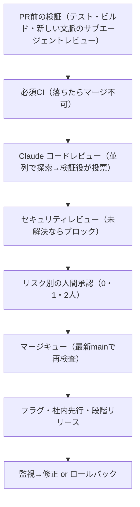

# エージェント時代のコードレビュー（Claude Code チームの多層レビュー）

> **TL;DR**: コードの約90%を Claude が書く Claude Code チームは、レビューを「人間が読んだか」から「この変更で何が壊れうるか・どの検査で捕まえるか」へ組み替え、読む作業の大半を機械に移して人間の承認はリスク別にした。その結果、2026年6〜9月にマージ PR 数は2倍超になり、revert（取り消し）された割合は40%超減ったと Anthropic が報告する。

エージェントが書くと変更の数が一気に増え、1行ずつ人が読むレビューは回らなくなる。Anthropic のモノレポでは1日に入る変更が5月の約2,500件から9月には3万件超になった（ソース管理側の対応は [[concepts/agent-scale-source-control]]）。Claude Code チーム（@ClaudeDevs と claude.dev ブログ）は、レビューを「最後の関門」から「書いている間に走り続けるスペルチェック」に変え、人間が見る前にほとんどの変更が Claude に少なくとも1回レビュー・修正されている状態を作ったと書く。最適化の目標は「revert とインシデントを増やさない範囲で、人間のレビュー時間を最小にする」ことで、人間の時間は PR あたりの承認数（中央値と95パーセンタイル）・コメント数・人待ち時間で測り、revert 率とインシデント率をガードレールに置く。レビュー時間を削っても修正時間に移っただけなら節約になっていない、という理屈である。

## 6層の検査とその下のロールバック（Anthropic の整理）

各層が一部の問題を捕まえ一部を見逃し、全層をすり抜けたものはロールバックで処理する、という多層防御として Anthropic は説明する。

1. **PR を出す前に作業を検証する** —— Claude に実行できる検査（テスト・ビルド・デザインと比べるスクリーンショット）を渡し、「終わった」と言わせずに出力を見せさせる。続けて新しい文脈のサブエージェントに diff をレビューさせる。多くのメンバーはバグ探し・diff の簡素化・E2E の振る舞い確認の社内スキルも PR 前に回す。Claude Code を作った Boris Cherny は、検証手段を渡すことが良い結果を得るうえで「おそらく最も重要」で最終結果を2〜3倍良くすると見積もっている。自動レビューが同じ指摘を繰り返すときは、スキル・lint ルール・指示ファイルという発生源で直す
   - `CLAUDE.md` はプロジェクトの技術スタック・規約・目標と非目標を書く。全レビューが読み込むので短く保ち、他の文書へ案内する。レビュアーは CLAUDE.md の規約違反と、CLAUDE.md の記述を古くする変更も指摘する
   - `REVIEW.md` はコードオーナーが書く、レビュアー向けの「この領域で何が大事か」。良いものは短く、そのリポでの失敗の姿（ドキュメントなら「嘘をつく」、設定なら「誤ったルーティング」）を書き、nit（些細な指摘）の数に上限を置き、スキップするパスを挙げ、名前からの推測でなくファイルと行を証拠に求め、件数から始まり直すものが無ければそう言うサマリーを求める。レビュアーが実際に従っているかは別途確かめる
2. **全 PR に AI レビュー** —— diff をリポ全体と PR の意図に照らし、問題を解いているか・システムに合うか・他を壊さないかを問う。バグ修正なら根本原因を探す。公開版の Code Review for Claude Code は Team・Enterprise プランで一般提供され、`/code-review` コマンドはローカルで軽量版を回す。Research Preview 開始時に、実質的なレビューコメントが付く社内 PR の割合は16%から54%に上がったという。リポごとに Quick・Standard・Deep を選べ、Deep は見逃し1件のコストが追加のレビュー時間を上回る所で使う。複数のエージェントが並列にバグを探し、別のグループが各指摘に投票して十分な数が本物と認めたものだけを投稿する。スタイル・診断・掃除だけの指摘は捨てる（このフィルタは自社 PR で A/B テストしてから採用）。残った指摘は重大度順のインラインコメントになり、Important・Nit・Pre-existing のタグが付くので、PR が持ち込んでいない既存バグが作者のせいに見えない。指摘には必ず「直す」か「理由を書いてスレッドを閉じる」で答える
3. **ブロックできるセキュリティレビュー** —— バグレビューかセキュリティレビューの指摘が1件でも未解決なら PR はマージできない。誤検知は短い理由を書いて閉じることで解消し、後続コミットで直れば指摘は自動で消える。OSS の GitHub Action か `/security-review` コマンドで同じ構成を組める
4. **ブロックする自動チェック** —— lint・型・全プラットフォームのテスト・ビルド。典型的な CLI の PR は人が見る前に数十の検査を通る。PR テンプレートは「どうテストしたか」「どう戻すか」を問い、Claude が埋めてもよいが変更を依頼した人が署名する
5. **リスク別の人間承認** —— 下表のとおり（ソースの表の転記）

   | リスク | 例 | 人間の承認 |
   | --- | --- | --- |
   | Low | ドキュメント・文言・社内限定機能・フラグ下の追加的変更 | 自動レビューとセキュリティチェックが緑なら不要 |
   | Medium | 通常のプロダクト変更、キャッシュ・自動アップデーター・システムプロンプトなど要注意領域の変更 | 1人 |
   | High | 最高リスクのコードと、常に2人を要する少数のパス | 2人 |

   段は作者でなく変更が決める。分類器が変更を読んで段を選び、2つ目の分類器が「段は不要と言っていても、この変更には人が要るか」を問う。オーナーが要注意と登録したものと CI のワークフローファイルは常に人を要する。軽い経路は信頼済み作者リスト（主に所有チーム）だけが使え、エージェントの承認は人間の枠を埋めない。エージェントが書いた PR では、エージェントに指示した人が必要レビュアーの1人に数えられる。承認は特定のコミットに紐づき、システムが保証できない新コミット（エージェントの push・手で解決したマージ）が入れば承認し直す
6. **マージキュー・フラグ・段階リリース** —— マージキューは変更を当てた最新 main で全検査を再実行し、単独では通る2つの PR が組み合わさって main を壊すのを防ぐ。新しい振る舞いは通常フラグの下で Anthropic 社員に先に出し、公開リリースは `latest` チャネルが先行して `stable` が追う

最後に**速い検知と速いロールバック**がある。フラグはデプロイなしで切れ、週替わりのオンコールがあり、インシデントレビューは「どの層が捕まえるべきだったか」を問う。承認条件を数値の変化で自動的に締める仕組み（サーキットブレーカー）はまだ無く、人間ゼロのマージを広げる前に欲しいとエンジニアが言っている、と Anthropic は認めている。「遅くすればエラー率は下がるが、それは何もかも減らしているからだ」という同僚の言葉を引き、遅くするより検知と修正を速くする方を選ぶと書く。

## レビュアー自体を良くするループ

- **インシデントを eval（評価セット）にする** —— 過去にインシデントを起こした PR を fix-forward・revert ごと集め、そのコードを知るエンジニアがバグと位置を確認したセットに、レビュアーを毎日走らせる。レビュアーのプロンプト・ツール・モデルを変えるたびに全件で採点し、スコアが上がれば残し、上がらなければ捨てる
- **ノイズは人の反応で測る** —— 非バグを大量に指摘すればバグはいくらでも捕まえられるので、そのチェックとして、各コメントを PR 上の人がどう扱ったか（直した・間違いと言った・意図的と言った・どうでもいいと判断した）で分類する。クリーンだと分かっている PR にも走らせ、人に有害な変更をさせうる指摘の頻度を数える。書かれた優先順位は「本物のバグを捕まえる」が1位、「レビュー往復を減らす」が2位
- **作者がエージェントだとノイズは高くつく** —— 人は nit を数秒で流せるが、エージェントは直してしまい、コミットとレビューがもう1往復増える
- **レビューは収束しなければならない** —— エージェントの作者とエージェントのレビュアーは互いを無限に忙しくできる。ある CLI の PR は一晩で50往復を超え、作者が止めた。レビュアーが繰り返し指摘した箇所を git blame すると、約59%は初回パスの時点から既にあったコードで、新しいバグでなく古いバグを毎回少しずつ見つけていた。チームは既定で何往復も回す習慣を自ら作っていたと認め、収束対策として**3往復で上限**（以降は作者にアプローチの再考を求める）・**最初の数パス後は差分だけ再レビュー**・**バグの類型で指摘**（作者が1行でなく全箇所を直す）・**投稿済み指摘を繰り返さない**を入れた。往復数は再現率と並べて追う
- 既存コードにも毎晩レビューエージェントを走らせ、古いバグが別の所で顔を出す前に捕まえる

## 人間に残る5つの判断

Anthropic は、人の仕事が「全 diff を読むこと」から機械が苦手な判断へ移ったとして次の5つを挙げる。

- **そもそも作るべきか**（方向・センス・範囲）—— レビューのボトルネック解消を宣言したあるチームも、チーム外からの変更には人のレビューを残し「これをやるべきか」を誰かが問うようにした
- **リスクの高いコード**（課金・自動アップデーター・CI ワークフロー）
- **他の人が真似するパターンを決めるアーキテクチャ**
- **証拠を読むこと**（テスト出力・実行したコマンドと結果・スクリーンショット・レビュアーの指摘）。検査が何を見逃すか言えないなら、素早い承認でなく本当のレビューを求める
- **結果を所有すること** —— 誰が打ったかに関係なく、出荷される全変更に責任を持つ人がいる

コードレビューのもう1つの仕事である「チームにコードベースの理解を広げる」については、正式なプロセスは無いと Anthropic は書く。全体のメンタルモデルを持つ人はおらず、要るとも考えていない。ある部分を理解したい人は、その切り出した範囲の解説を Claude に書かせる（数分で、今のコードを反映する）。人によっては、その部分を自分の学び方に合わせて可視化する小さなアーティファクトを作らせる。1行の文言変更の diff を読んでもほぼ何も学べないが、これから変えるモジュールの解説からは多くを学べる、というのが理由である。

「着地させた人が所有する（you land it, you own it）」も規範で、小中規模の変更で問題が出たら通常は着地させた人が直す。これが悪い方へ転ばないよう、変更を小さく保つ・すべてを数分で戻せるようにする・被害範囲でハードルを決める・テレメトリと社内利用で回帰を早く表に出す・責めでなくシステムを見る、を組み合わせる。エージェントで始めるのが安くなったぶん着地すべきでない作業も増えるので、方向転換は完成した PR へのブロッキングコメントでなく、スレッドの早い段階で出すのがコツだという。

## 導入の手順（Anthropic の推奨）

- **PR の前**: エージェントが実行できる検査を短い `CLAUDE.md` に書き、フォーマッタと lint を走らせる hook を足す。`/code-review` と `/security-review` をローカルで回すか、新しい文脈のサブエージェントにレビューさせる。`REVIEW.md` を置き、繰り返すレビューコメントをそこへ移す
- **全 PR で**: CI を必須にし、PR テンプレートに「Testing」「Risk」「How to revert」を足す。AI レビュアーをまず1リポに入れ、数週間 `REVIEW.md` を調整してから広げる。自動セキュリティレビューを足し、全スレッドの解決をマージ条件にする。レビューの深さをリスクに合わせ、往復に上限を置き、数回後は新しい diff だけ再レビューする
- **承認**: リスク段を書き出し、作者でなく変更から決める。厳しく始めて証拠で緩める。軽い経路は信頼できる作者に限る。CODEOWNERS とブランチ保護で認証・課金・CI とリリースのワークフロー・インストーラを常に人の承認にする。ボットの承認を必須の人間の代わりにせず、新コミットで承認を無効にする
- **マージ以降**: マージキュー・フラグ・社内先行・段階リリース・1手ロールバック。インシデントと revert を eval セットにし、レビュアーのプロンプト・ツール・モデルを変えるたびに採点し直す。人間の時間を測り、revert 率とインシデント率をガードレールにする

製品版の Code Review は「指摘を投稿するが承認はしない」位置づけで、PR の承認は人間の判断だと告知していた。一方 Claude Code チーム自身のリポは、低リスクの変更を自動チェックだけでマージさせるかをオーナーに決めさせており、その線は動き続けているという。

## 他ページとのつながり（wiki 側の推論）

- 個人規模で「人間の読んで直す工程がボトルネック」と見た [[concepts/ai-review-bottleneck]] の、組織規模の答えと読める。@smark_x の「自己採点を手前に置く」は1層目の PR 前検証に、「差分だけ返させる」は差分だけの再レビューに対応すると考えられる
- 「同じ指摘が続いたら発生源（スキル・lint・CLAUDE.md）で直す」は、指示の置き場所を振り分ける [[concepts/claude-code-instruction-methods]] の運用例にあたる
- 指摘を複数エージェントの投票で絞る構成は、敵対的レビューを個人に持ち込む [[tools/adversarial-panel]] と同じ発想で、往復上限と投稿済み指摘の非反復は、その過剰指摘を抑える側の工夫と考えられる
- 人間のレビューを前提とした [[concepts/google-code-review]] の LGTM 中心の指針と比べると、「誰が読んだか」でなく「どの検査が捕まえるか」へ問いを置き換えた点が差分になる

## 問い

- このリポの PR 運用（worktree＋PR＋Codex クロスレビュー）に、往復上限3回と「差分だけ再レビュー」を明文化したら、Codex との往復は実際に減るか
- `REVIEW.md` の書き方（失敗の姿・nit 上限・スキップするパス・ファイルと行の証拠・件数から始めるサマリー）を、このリポの code-review 指示に移したとき何が変わるか
- インシデント eval とノイズ測定は数十人規模のチームの話で、個人開発では過去の revert が少なすぎて eval セットが作れないのではないか。代わりに何を採点対象にするか

## 関連

- [[concepts/agent-scale-source-control]] — 同じ Anthropic の、マージ数3万件超に耐えるソース管理基盤 Scion。人間のレビューを「意図」の確認へ移した点で本ページと対になる
- [[concepts/ai-review-bottleneck]] — 人間のレビュー工程がボトルネックになる構造を制約理論で説明した個人規模の実践
- [[concepts/claude-code-instruction-methods]] — CLAUDE.md を短く索引に徹させる公式フレーム。全レビューが CLAUDE.md を読むので短く保つ、という本ページの理由と同じ
- [[concepts/google-code-review]] — 人間のレビューを前提とした Google のコードレビュー指針
- [[tools/adversarial-panel]] — 複数視点のレビューで盲点を炙り出すスキル
- [[tools/claude-code]] — レビュー対象の製品そのもの
- [[companies/anthropic]]
- [[concepts/agent-trust-inverse-pyramid]] — 「人間レビューは最もスケールしないので、エージェントが既定で正しいことをする環境の設計に労力を使う」とする @poteto の4層指針。本ページのリスク別人間承認と「同じ指摘は発生源で直す」を個人の運用規模で言ったものと読める
- [[concepts/small-change-auto-approval]] — Imprint の small-change。本ページの Low リスク「人間承認不要」の段を、人が書き換えられない CI check と承認か無視かしかしないスキルで実装した一例。Will Larson が記事中で本ページの元記事を参照
