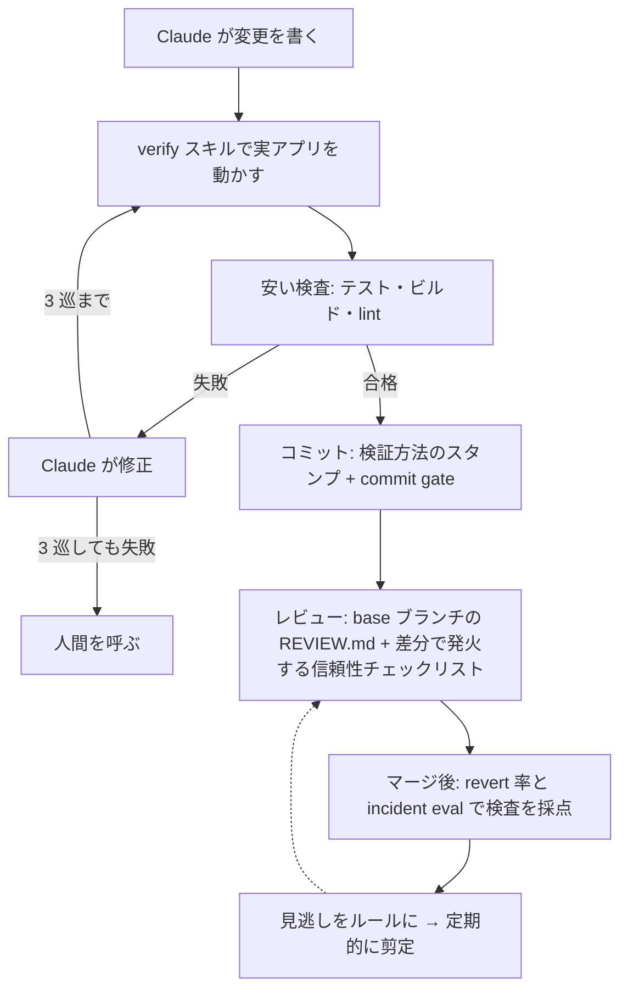

# エージェント時代の検証（Claude Code チームの検証ループ・Addy Osmani）

> **TL;DR**: コードの約 90% を Claude が書く Claude Code チームは、エージェントに自分の仕事を証拠で検証させる「検証ループ」を、委任を増やすための基本部品と位置づける。投資すべきテストは E2E・プロパティ・差分の 3 種で、チームの工程は、verify スキルで実アプリを動かす・3 巡直らなければ人を呼ぶ・検査はコードオーナーが書く・39 項目の信頼性チェックリストを差分で発火させる・レビュアーは 1 体で複数巡・変更が自分を判定する検査に触れられないようにする・新しいゲートは observe モードから・検証器自体を revert 率と評価セットで採点する・見逃しをルールにして定期的に剪定する、で構成されると Addy Osmani（Claude Code チーム）が X 記事で書く。

検証ループが無いと人がすべてを確認するので同時に動かせる Claude は 1〜2 体に留まり、あれば数十〜数百体を並列に走らせられる、と Osmani は書く。根拠として、構造化ファイル生成の社内テストで、別の採点役がルーブリックに照らして Claude の出力を検査すると、標準的なプロンプトのループよりタスク成功率が最大 10 ポイント上がり、最も難しい問題で伸びが最大だったことを挙げる。かつて高価だった検証手段（テスト・ベンチマーク・仕様・実際の端から端までの実行）は今はエージェントに頼めば安く作れ、作られたテストとベンチマークはソフトウェアとして走るので追加トークンをほとんど使わず何度でも回せる。検証の結果はエージェントの改善にも還流でき、ログにユーザーデータが出ていないかの検査にエージェントが繰り返し失敗するなら、hook か CLAUDE.md のより明示的なルールを作る。「これで（ほぼ）再発しなくなる」と Osmani は書く。前作のレビュー記事（[[concepts/agent-era-code-review]]）に対し、本記事は検証の側を深く扱う。

## 投資に値する 3 種のテスト（Osmani の整理）

どのテストでも避けるべき失敗の型が 3 つある、と Osmani は書く。テストが不安定（flaky）だと、エージェントは失敗したコードを直す代わりにテストを再実行することを学ぶ。テストが遅いと、エージェントは 1 回の作業あたりに回すテストを減らし、問題の特定が難しくなる。重いテストはコミットする前の段階に置くのが最適である。

### E2E テスト

1 種類に絞るなら E2E（end-to-end）を選べ、と Osmani は書く。カートに商品を入れ、決済し、確認ページへ進む、といった実際のユーザーの流れを記述する。効果が高い理由は騙しにくいことで、機能全体が動くか動かないかしかなく、完了の基準が確定的で、何が壊れているかを具体的に言える。単体テストは速くて安定だが、通っても機能が壊れていることがありうる。エージェントもテストもタスクの全体を理解していないからである。E2E ではエージェントに実際に動くシステムへの「手と目」を与えるのが効き、CDP（Chrome DevTools Protocol）・シミュレータ・API ハーネスでアプリを起動・操作・検査するスキルを使う。機能マップ（feature map）は、ユーザー視点の機能一覧に経路・キーボードショートカット・セレクタ・期待結果を添えたもので、エージェントの案内と採点基準になる。

### プロパティテスト

多くのテストは「何が壊れそうか」の予想に基づく。プロパティテストは人が見落としがちなエッジケースを見にいき、そこはエージェントがよく失敗する場所でもある。「これは破れないはずだ」という命題を書き、fast-check（JS/TS）・Hypothesis（Python）・proptest（Rust）などのライブラリに数千の入力を生成させて反証を試みる。ほぼすべてのプロジェクトにある性質として Osmani が挙げるのは、往復（X を符号化して復号すると X に戻る。パースと直列化にも使える）・不変条件（残高が負にならない）・冪等性（移行・正規化・再試行を 2 回やっても 1 回と同じ）・等価性（最適化版と素朴で正しい版が同じ結果）の 4 つ。生成されるエッジケースは元のコードを書いたエージェントと同じ偏りを持たないのでエージェントを正直に保てる。仕様が本番の挙動からずれて検証の拠り所にならない書き直しで特に役立つ。

### 差分テスト

機能が変わらないはずの大規模移行に特に効く。旧システムと新システムに同じ入力を与えて結果を比べ、違えばバグか破壊的変更である。鍵はランダム生成の入力か本番トラフィックの標本を使うこと、空白のような無関係な要素を正規化すること、新環境が旧と違ってよい場合のために承認済みの差分リストを持つことである。

## Claude Code チームの検証工程（Osmani の記述）

- **検証とは変更を動かすこと** — アプリを端から端まで動かすことはテストより重要で、iOS の変更をシミュレータで試さずに出荷しないのと同じことが Claude にも当てはまる。Claude は人間や QA エンジニアと同じようにアプリ全体を試せる。Web の変更なら Claude Chrome 拡張、モバイルなら iOS や Android の MCP、デスクトップならコンピュータ操作、バックエンドならサービスをローカルで起動させる。シミュレータの起動やアプリの実行手順は `verify` という名のスキルに書き、リポジトリの `.claude/skills/` に、対象コードに近い場所へ、必要な数だけ置く。Claude はコミット前に verify スキルを使うことを知っている。次にその verify スキルを速く確実にすることに投資し、Claude に反復させストレステストさせる。「スモークテストのハーネスなので、堅牢であってほしい」。端から端まで変更を確かめる手段を渡すと、人間がするように反復して本物の誤りを速く捕まえる。「Anthropic ではほぼすべての変更をこうやって試している」
- **失敗したテストは人の注意を要する** — 誰もすべての変更を読めないので、失敗を「どれに人が要るか」を決める手段の一つにする。Claude が検査を回して失敗を直し、3 巡しても失敗が残れば止まって人を呼ぶ
- **検査はコードオーナーが書く** — コードを所有する人がその検査を書き、オーナーなら指摘することを指摘するまで磨く。検査がレビュアーを呼ぶときは理由を言わせ、差分から推測させない
- **信頼性チェックは差分で発火する** — 39 項目の信頼性チェックリストを持ち、各項目は差分から読み取れるトリガー・検査・背景のインシデントや PR を持つ。例は「`--resume` が古いトランスクリプトを読み込む」で、セッション保存やメッセージ型が変わったら新しいフィールドを安全に読めるかを問う（古いトランスクリプトにはそのフィールドが無い）。Claude は差分を読み、トリガーが一致する項目（通常 3〜10）だけを検査するので、誰も過去の障害を暗記しなくてよい
- **レビュアーは 1 体で複数巡** — レビュアーを積み重ねて改善しようとはしない。主レビュアーの上に 2 体目のより高価なレビュアーを足すのは、主レビュアーを調整するより悪い手になりがちである。代わりに、このコードでレビュアーが注意すべきことを書いた `REVIEW.md` を置く。レビューと検証の巡回は積み上げ式で、毎回ゼロから検査し直すのでなく、前の巡回の文脈と過去の失敗を各パスに向ける。安く、より多く見つかる
- **変更は自分を判定する検査を変えられない** — 変更がそれを判定する検査を変更できるなら、その検査は壊れている。Code Review は `REVIEW.md` を base ブランチか既定ブランチから読み、PR の変更からは決して読まない。変更をゲートするルールは、変更が触れないブランチに置く。レビューはコミット単位に固定し、レビュー中に push されればその結果は使えない（古いコミットでの合格は何も意味しない）。安い検査を先に回す。ローカルで試す前に push すれば、自分で捕まえられたバグに共有のレビューと CI の時間を使ったことになる。チームでは Claude が PR を開く前にテスト・ビルド・リンターを走らせる。終了時にテストを走らせる hook、またはテストスイートが通ることを `/goal` にすることで強制できる
- **新しいゲートは observe モードから** — 各コミットにどう検証したかのスタンプを押す。スタンプには「none」も含め、検証されなかったコミットを後から問い合わせられるようにする。セッションに `/code-review` か `/verify` が無ければコミットをブロックする commit gate を作り、off・observe・enforce の 3 モードを持たせた。observe はブロックされるはずだったものを記録するだけなので、誤検知を点検して誰にも影響が出ないことを確かめられる。enforce はコミットをブロックするが、コミットメッセージに検証しなかった理由を書ける。同じセッションで 2 回ブロックされたら次は通す。「Claude が詰まらないように。Claude Code は完璧ではない」

## 検査そのものを採点する

チームはレビュアーを定期的にレビューする、と Osmani は書く。マージ後に revert された変更の数、マージ前にメンテナが却下した変更の数、そして規模を揃えたクリーンな変更の部分集合を追う。正式な評価として、Code Review チームは過去のインシデントと revert から評価セットを作り、各例についてレビュー時点のリポジトリを再現し、バグが何かの 1 文の答えを用意する。問題のバグを正しく記述した指摘だけが得点し、マージされ安定した変更を対照群にして過剰指摘を防ぐ。調整用セットは固定のテストセットから分けてある。再現率は、生の指摘・検証後・最終レビューで別々に測り、すでに見つけたバグを途中で失っていないかを見る（全部を 1 つの端から端までのスコアにする評価はこの差を捉えない）。もう 1 つの軸は直す重要度で、技術的に正しい指摘の大半は捕まえられても、人が気にするのは must-fix か should-fix か nit かである。Code Review は Important・Nit・Pre-existing のタグを付け、Pre-existing は既にあったバグの責任を著者に負わせないための印である。再現率は、次の改善が本物のバグを捕まえることでなく評価への過適合になる点まで上げる。

## 見逃しをルールにする

Claude Code リポジトリには見逃しをルールに変える方法が 2 つある。1 つ目は人間のレビューコメントと PR の revert からパターンを抽出すること。ルール候補になるには 2 つ以上の PR に現れ、差分から識別できなければならない。3 体のエージェントが反証を試み、人が PR でレビューして承認する。2 つ目は、既知のインシデントに結びつく PR に 3 つのバグ発見器を再実行すること。2 つ以上が見つければ「検出可能なバグ」で、小さな差分で見逃されていればそれは `REVIEW.md` のルールにする価値のある穴である。不安定なテストも同じ扱いで、Claude はスキップ・sleep の追加・通るまでの再試行をしてはならず、根本原因が見つからなければテストを削除して理由を書き残す。ルールにも掃除が要る。テストスイート・検証手順・.md ファイルは放っておけば増えるだけなので、定期的に片づける。

締めくくりで Osmani は、検証層を他のシステムと同じように扱えと書く。判定対象の変更から手の届かない所に置き、自分にとって重要だったバグで採点し、見逃したら教訓を書き残して二度と起こさないようにし、その教訓も剪定して走らせる価値を保つ。そうすれば仕事は「すべての差分を読む」から「完了とは何かを定義し証拠をレビューする」へ移り、それが多数の Claude を同時に走らせることを可能にする。

## 他ページとのつながり（wiki 側の推論）

- [[concepts/agent-era-code-review]] はレビュー工程の全体像（6 層・リスク別承認・収束対策）で、本ページはその 1 層目「PR 前の検証」と「レビュアー自体を良くするループ」を深掘りした続編と読める。前作に無い具体は、39 項目のチェックリスト・3 巡で人を呼ぶ・commit gate の 3 モード・ルール候補を 3 体で反証する手続き・1 体のレビュアーを複数巡させる方針である
- [[concepts/organic-architecture]] で Lauren Tan が検証層に独立の層を与え、トークンの大半を検証に使うと述べたのと、本ページの「検証とは変更を動かすこと」は同じ地点にある。Osmani の「機能マップが案内と採点基準になる」は [[tools/pstack]] の `/create-verification-skill` が生成する「機能マップつきの verify スキル」と同じ語彙で、両チームが同じ形の道具に収束していると考えられる
- [[concepts/coding-agents-as-management]] の実践 1「検証手段を渡し証拠を見せさせる」と、[[concepts/critical-thinking-with-agents]] の「検証の降伏」（緑は 1 つの性質しか伝えない）は、本ページの「単体テストは通っても機能は壊れうる」をそれぞれ管理の側・認知の側から言ったものと読める
- [[concepts/e2e-testing-theory]] で Kuniwak は E2E の実行コストと保守の波及を AI がテストを書いても不変の数理的制約とした。Osmani の「作るのは安くなった・走らせるのに追加トークンはほとんど要らない」はトークン費用の話で、Kuniwak の制約（実行時間・保守量）は別の軸にあり、両立する。E2E を第一に選ぶ Osmani と「主要フローと忠実度に限定」する Kuniwak は、対象の絞り方では一致している
- 「検査そのものを採点する」の設計（インシデントから答え合わせつきの評価セット・対照群・段階別の再現率）は、[[concepts/eval-harness]] が AI アプリの回帰装置として組んだ golden 回答と 3 回実行の分離と同型で、採点対象がボットの回答かレビュアーの指摘かが違う。検証の結果を hook や CLAUDE.md に還流させる話は、[[concepts/claude-code-instruction-methods]] の要請（CLAUDE.md）と要件（hook）の振り分けに乗る

## 観察ログ（未検証）

- 2026-11-17（Osmani）: 構造化ファイル生成の社内テストで、別の採点役がルーブリックで検査すると標準プロンプトのループよりタスク成功率が最大 10 ポイント改善、最難問で伸びが最大。条件の詳細は記事に無い
- 2026-11-17（Osmani）: 信頼性チェックリストは 39 項目、差分ごとに発火するのは通常 3〜10 項目

## 問い

- このリポの CLAUDE.md「完了宣言前の検証」と superpowers の verification-before-completion は散文の要請にあたる。記事の commit gate（セッションに `/code-review` か `/verify` が無ければコミットをブロック・observe モードから）に相当する hook を置くと、誤検知はどれだけ出るか
- `validate_wiki.py` は「変更が自分を判定する検査を変えられない」を満たしていない（同じブランチで検査と対象を一緒に編集できる）。base ブランチから検査を読む運用に、個人リポジトリで意味があるか
- Kuniwak の E2E の数理的制約（実行コスト・保守の波及）は、Osmani の「E2E を 1 つ選べ」とどう両立させるか。エージェントが書くので作成コストは下がるが、実行と保守のコストは残るのではないか
- 「3 巡で人を呼ぶ」の 3 は、同じ Osmani の「2 回修正に失敗したら新セッション」（[[concepts/coding-agents-as-management]]）と数が違う。対象（テスト失敗の修正か、指示のやり直しか）の違いか

## 関連

- [[concepts/agent-era-code-review]] — 同じチームのレビュー記事。本ページはその検証側の続編
- [[concepts/coding-agents-as-management]] — 同じ Osmani の管理論。実践 1「検証手段を渡す」の個人側
- [[concepts/critical-thinking-with-agents]] — 同じ Osmani の「検証の降伏」。緑は 1 つの性質しか伝えない
- [[concepts/organic-architecture]] — Lauren Tan の検証層とトークン配分。機能マップと verify スキルの語彙が共通
- [[tools/pstack]] — `/create-verification-skill` が機能マップつきの verify スキルを生成する
- [[concepts/e2e-testing-theory]] — Kuniwak の E2E の定義と数理的制約。E2E を第一に選ぶ本ページとの両立が問い
- [[concepts/eval-harness]] — golden 回答と 3 回実行で回帰を追う装置。検査を採点する設計と同型
- [[concepts/eval-loop]] — 採点役がルーブリックで出力を止める品質ゲートの一般形
- [[concepts/claude-code-instruction-methods]] — 検証結果を hook（要件）か CLAUDE.md（要請）に還流させる振り分けの公式フレーム
- [[tools/claude-code-goal]] — テストスイートが通ることを `/goal` にする実体
- [[tools/claude-code]] — verify スキル・`/code-review`・hook の置き場となる製品
- [[companies/anthropic]]
