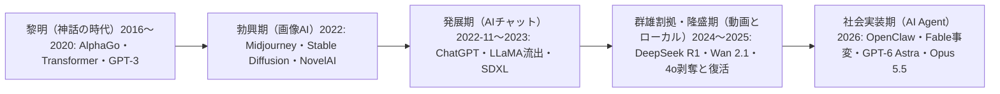

# AI 史の転換点 2016〜2026｜@studio_yebisu の私的年表

> **TL;DR**: 元ゲーム会社ディレクターの @studio_yebisu（StudioYebisu）が、AlphaGo（2016 年 3 月）から DeepSeek-V4.1-Flash（2026 年 10 月）までの AI 史を 5 期・約 30 件の出来事に分け、特に重要な 7 件（AlphaGo・Transformer 論文・ChatGPT・DeepSeek R1・Wan 2.1・Fable 事変・Opus 5.5 系）に✓を付けた私的年表。

性能ベンチマークの更新でなく、「一般の人が AI と会話した日」「重みが手元に落とせるようになった日」「取り上げられたモデルをユーザーが取り返した日」のような受け手側の出来事を転換点に数えているのがこの年表の特徴で、画像生成・ローカル実行・AI コンパニオンの系譜に厚い（wiki 側の読み）。@studio_yebisu は冒頭で「個人の主観」と断り、末尾では「今年に入ってからのスピードえぐい」「Fable が出たぐらいからいろんなプロダクトが作られていると思うので、AI プロダクトの時代がこれから始まるのかなという気がしている。知らんけど」と締めている。本文は冒頭 280 字で途切れていたため、X API で取得した全文を `sources/notes/` にキャッシュした。

## 年表（@studio_yebisu の記述の転記・✓は著者の重要マーク）

### 黎明（神話の時代）

- **AlphaGo vs イ・セドル（2016-03）✓** — 人間の直感の聖域と思われていた分野で AI が人間を凌駕した歴史的事件
- **Attention Is All You Need（2017-06-12）✓** — Transformer の論文で、以後のすべての起点。後に界隈で「聖典」として扱われるように（[[concepts/attention]]）
- **GPT-3（2020-05）** — AI が「文章が書ける」ことが初めて実感された

### 勃興期（画像 AI の時代）

- **LaMDA に意識があると Google の技術者が主張（2022-06）** — 「AI に心はあるか」が初めて大衆の話題に
- **Midjourney のオープン β（2022-07）** — Discord で誰でも絵を出せるように。後に AI Art が賞を取ったことも話題に
- **Stable Diffusion の一般公開（2022-08-22）** — 重みを誰でも手元に落とせるようになり、「ローカル画像生成という宗派」が生まれた。この時代からの猛者は今も元気に活動している、と著者は観測する
- **NovelAI と、そのモデルの流出（2022-10）** — アニメ絵が一気に実用水準になり、日本では「AI 対 絵師」の争いが始まる。著者によればこの争いは今も続くが、最近の「凍結祭り」でやや静かになった

### 発展期（AI チャットの時代）

- **ChatGPT（2022-11-30）✓** — 著者が「AI 史における最大の転換点」と呼ぶ、一般人が AI と「会話」した日。ここから一般認知が圧倒的に広まった
- **Replika 事変（2023-02）** — 性的ロールプレイ禁止により、一時は自殺防止用の窓口が共有されるほどの騒ぎに。著者はこれを「4o パニックの原型」と位置づける
- **LLaMA の重みが 4chan に流出（2023-03）** — ローカル LLM 文化（r/LocalLLaMA）の始祖
- **SDXL 1.0（2023-07-26）** — ローカル画像生成の第二世代。今でも現役

### 群雄割拠・隆盛期（動画とローカルの革命）

- **Sora 発表（2024-02）/ GPT-4o 発表（2024-05）** — 4o は後に大きな騒動を起こし「数多の魑魅魍魎を生み出す」ことになる、と著者は書く
- **FLUX.1（2024-08）/ HunyuanVideo（2024-12）** — より精度の高い画像生成モデルと、本格的な動画生成モデルが公開
- **DeepSeek R1（2025-01）✓** — 重みを MIT ライセンスで公開。Nvidia の時価総額が一時 5,890 億ドル消失。著者の言う「第一次 DeepSeek ショック」
- **Wan 2.1（2025-02-25）✓** — 重みを公開し、2 日後に ComfyUI に入った。著者はここを「ローカル動画の時代の始まり」とする
- **Grok のコンパニオン「Ani」（2025-07）/ Nano Banana（2025-08）/ Sora 2（2025-09）** — 著者はどれも「もう過去の遺産」としつつ、この辺りに魂を囚われた人を何名か確認していると書く
- **4o 剥奪と復活（2025-08-07〜2025-08-10）** — GPT-5 の公開で 4o が選べなくなり（08-07）、Altman が復活を告知（08-10）。ユーザーの反乱で撤回させた事件。4o は非常に人懐っこく肯定的な意見を出すモデルだったため、「GPT-5 が冷たすぎる、私たちの 4o を返せ」という声が爆発した、と著者は説明する

### 社会実装期（AI Agent の時代・2026 年）

- **OpenClaw ブーム（2 月頃）** — 2025 年 11 月に登場した OpenClaw が 2026 年 2 月頃から世界および中国で爆発的なブームとなり、AI Agent という活用方法が大注目される（[[tools/openclaw]]）
- **ChatGPT から 4o が完全終了（2 月 13 日）** — keep4o の署名は約 2.1〜2.2 万筆で、OpenAI は毎日 4o を選んでいたのは約 0.1% と説明した、と著者は書く。それでも 4o を語る人は多く、ローカルで自分だけのコンパニオンを作ろうとする勢力が生まれた。著者はこれを「4o 教徒が生まれた日」と呼ぶ
- **Sora アプリの終了を発表（3 月 24 日）** — 大赤字で公開から半年で終了。同じ月に ChatGPT の成人向けモードも無期限延期に
- **第二次 DeepSeek（4 月〜7 月 31 日）** — DeepSeek V4 pre（4 月）・V4-Flash-0731（7 月 31 日）。著者の記述では 284B の MoE で動くのは 13B、MIT ライセンス。ローカルで動く実用水準のモデルとして話題になり、DGX Spark 民を大量に生み、「AI 主権派」という派閥が誕生した
- **Fable 事変（6 月 9 日〜7 月 1 日）✓** — Claude Fable 5 と Mythos 5 の発表（6 月 9 日・公式の言葉は「これまで一般公開したどのモデルの能力も超える」）→ Fable 5 が全ユーザーで停止（6 月 12〜13 日・米政府の輸出管理の指示によるものと報じられている）→ 規制解除（6 月 30 日）・再開（7 月 1 日）。「世界最強のコーディングモデル」と呼ばれた直後に国家の手で取り上げられた「空白の 18 日間」、と著者は書く（[[models/claude-fable-5]]）
- **GPT-5.6（Sol / Terra / Luna）（6 月 26 日〜）** — まずホワイトハウスが認めた相手だけに提供され、7 月 10 日（日本時間）に一般公開。著者は「リセットおじさん Tibo」が現れ、リセットマーケティングに界隈が一喜一憂するようになったと添える（[[models/gpt-5-6]]）
- **Kimi K3 ショック（7 月 16 日）** — オープンウェイトで一部 Fable に匹敵する性能のモデルが出たこと、中華ラボが米国ラボに次ぐ当時の SOTA 級モデルを出したことで話題に。AI 関連銘柄も一部下落（[[concepts/linear-attention-evolution]]）
- **Claude Opus 5（7 月 24 日）** — Fable 5 に迫る性能を半額で（[[models/claude-opus-5]]）
- **GPT-6 Astra（9 月 3 日）** — 初の GPT-6 で、OpenAI は「世界最高のコンピュータ操作モデル」と呼んでいた、と著者は書く。ComputerUse という概念が一般認知される。GPT-6 Sol / Luna（9 月 22 日）・GPT-6.1 Sol（9 月 29 日・DevDay）が続く（[[models/gpt-6-astra]]・[[models/gpt-6-1-sol]]）
- **Opus 5.5・Sonnet 5.5・Haiku 5.5（9 月 23 日ごろ〜10 月上旬）✓** — Opus 5.5（9 月 23 日ごろ）→ Sonnet 5.5（9 月 29 日ごろ）→ Haiku 5.5（10 月上旬）。「Opus 5.5 は未だ最強の座をほしいままにしている。Astra の天下は Opus 5.5 が出るまでだった」（[[models/claude-opus-5-5]]・[[models/claude-haiku-5-5]]）
- **DeepSeek-V4.1-Flash-1017（10 月 17 日）** — 約 7,630 億パラメータの MoE で重みを MIT ライセンスで公開。Opus 5 にほぼ並び、タスク 1 件あたりの費用は GPT-6.1 Sol の約 3 分の 1、と著者は書く。「めっちゃ良いモデルだが一般認知はそこまで。ローカルの宝物」

著者が「このあと控えている化物」として挙げるのは Qwen4（ローカル主権派がさらに増えるかも）、Astra 6.1 と Bel（「なんか怪しい」）、Fable 5.5（「上場前に出して全モデル破壊しそう」）の 3 つである。

## wiki 既存ページとの照合（wiki 側の整理）

著者の記述のうち、この wiki に既に根拠のあるものと無いものを分けておく。

- **一致するもの**: Fable 5 の停止と復帰は [[models/claude-fable-5]] の観察ログに、ローンチ約 3 日後の米輸出規制ディレクティブによる全世界停止と約 3 週間後の復帰を伝える単一ソース報道として記録されている（Anthropic は過大解釈だと反論したともある）。GPT-5.6 の一般公開 7 月 10 日は [[models/gpt-5-6]]、Opus 5 の「半額」と 7 月 24 日は [[models/claude-opus-5]]、Haiku 5.5 の 10 月上旬は [[models/claude-haiku-5-5]]（10 月 7 日発表）、GPT-6.1 Sol の DevDay 発表は [[models/gpt-6-1-sol]] と一致する
- **wiki に根拠がないもの**: GPT-6 Astra を OpenAI が「世界最高のコンピュータ操作モデル」と呼んだという引用（[[models/gpt-6-astra]] は発表本体を未収集）、GPT-5.6 のホワイトハウス限定の先行提供、Kimi K3 ショックの日付と株価への影響、第二次 DeepSeek と V4.1 の各数値、Wan 2.1 が 2 日で ComfyUI に入ったこと、keep4o の署名数は、いずれも著者の記述だけが根拠である

## 観察ログ（未検証）

- 2026-10-28: 4o 完全終了時の keep4o 署名「約 2.1〜2.2 万筆」と OpenAI の説明「毎日 4o を選んでいたのは約 0.1%」（@studio_yebisu の記述・一次ソース未確認）
- 2026-10-28: DeepSeek-V4.1-Flash-1017 は「約 7,630 億パラメータの MoE・MIT・Opus 5 にほぼ並ぶ・タスク 1 件あたりの費用は GPT-6.1 Sol の約 3 分の 1」（同・未確認）
- 2026-10-28: 著者の予想。Qwen4 でローカル主権派がさらに増える、Fable 5.5 は「上場前に出して全モデル破壊しそう」、Astra 6.1 / Bel は「なんか怪しい」

## 問い

- 自分にとっての転換点はどれか。この wiki は 2026 年のモデルページと Claude Code 周辺が厚く、画像生成・ローカル・コンパニオンの系譜はほぼ無い。著者の✓ 7 件のうち自分の仕事に効いたのはどれか
- 「重みの公開」「ローカルで動く」が繰り返し転換点になっている。自分の運用でローカルモデルを使うかの判断軸（費用・秘匿・速度）は何か
- 「Fable 以降にプロダクトが大量に作られ、AI プロダクトの時代が始まる」という著者の見立ては、半年後に何で確かめられるか（個人開発の公開数・自分が日常で使う AI プロダクトの数）

## 関連

- [[concepts/attention]] — 著者が「以後のすべての起点・界隈の聖典」と呼ぶ Transformer 論文の中核機構
- [[models/claude-fable-5]] — 著者が✓を付けた「Fable 事変」（発表→停止→再開）の当事モデル。観察ログに同じ経緯の報道がある
- [[models/gpt-6-astra]] — 著者が「ComputerUse が一般認知された転換点」とし、Opus 5.5 登場までを「Astra の天下」と評するモデル
- [[models/claude-opus-5-5]] — 著者が「未だ最強の座をほしいままにしている」と書く、2026 年秋の✓付きモデル
- [[models/gpt-5-6]] — 2026 年 7 月 10 日に一般公開された Sol / Terra / Luna 世代
- [[models/claude-opus-5]] — 「Fable 5 に迫る性能を半額で」の 7 月 24 日発表モデル
- [[models/gpt-6-1-sol]] — DevDay（9 月 29 日）で発表された後続モデル
- [[models/claude-haiku-5-5]] — ✓付きの 5.5 系 3 モデルの最後に出た小型モデル（10 月 7 日発表）
- [[tools/openclaw]] — 著者が 2026 年の「AI Agent の時代」の始まりに置くブームの主役
- [[concepts/linear-attention-evolution]] — 著者が「Kimi K3 ショック」と呼ぶモデルの線形アテンション実装を扱う進化史
- [[papers/2023-sharma-sycophancy]] — 著者が 4o の「非常に人懐っこく肯定的」な性格と呼ぶ振る舞いを、人間のフィードバックによる迎合として分析した研究
