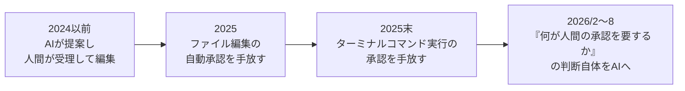

# 人間のAIに対する判断移譲

> **TL;DR**: 西尾泰和が、「最終判断は人間がやる」という主張は解像度が低いと論じ、2024〜2026 年に人間が手放した判断を 3 段階（ファイル編集 → コマンド実行 → 何を人間に承認させるかの判断そのもの）で跡づけたエッセイ。手放す方が便利だったから手放した、というのが本人の見立て。

西尾泰和は、人間と AI の関係の議論で見かける「最終判断は人間がやる」という主張について、数年前なら妥当だったが 2024〜2026 年の変化を踏まえると解像度が低すぎると書く。背景にある問題意識は、AI と人間の速度差が開き、人間の承認待ちがボトルネックになったこと。西尾はこれを、Audrey Tang の「人間が庭で AI が庭師」（人間より AI が千倍・万倍速くなる時代の非対称性）や、岡瑞起の「AI 間のコミュニケーション速度は速くなったが人間は遅いまま」という指摘と重ねる。エージェントが毎回人間を呼ぶと人間の注意がボトルネックになり、めったに呼ばないと人間は探索の行方に関わる機会を失う、という緊張がこのエッセイの主題になっている。

西尾の跡づけでは、2024 年以前は GitHub Copilot のように「AI が提案し、人間が受理すると編集される」構図だった。2024 年にこれが変わる。Devin.ai が計画から実装・テストまで進める「AI ソフトウェアエンジニア」を示し、同時期に Cursor が AI 組み込みエディタとして登場。Devin はサンドボックス（仮想マシン）を用意する方式だったが、多くのエディタ拡張はサンドボックス作成をユーザー側のタスクにしたため、生の環境を触らせるユーザーが多く出た。2024 年末、一部のユーザーが人間の承認なしに実行させ始め、Cursor 0.44 がターミナルコマンドを自動実行する「Yolo Mode」を導入した。西尾は当時「生環境での自動実行は流石にやばい」という肌感だったと振り返る。

2025 年、承認を省く機能が主要ツールに順に入っていく。西尾のまとめでは、Claude Code は 2025/2 に `--dangerously-skip-permissions`（当初はネット接続のない Docker 環境限定）、2025/3 に Shift+Tab でファイル編集の自動承認を切り替える機能を入れ、「どんな編集をするか」を事前レビューする運用から AI に自由に編集させる方向へ移った。Codex CLI は 2025/4 に Suggest／Auto Edit／Full Auto の 3 モードと `--dangerously-auto-approve-everything` を持ち、2025/6 に Rust 版で承認省略とサンドボックス解除を同時に行うフラグが入り、2025/8 にその別名として `--yolo` が付いた。西尾は各段階での自分の肌感（Git 管理下ならロールバックできる、壊れるのが Docker 環境だけなら許容できる、など、許容できる理由を都度見つけていった過程）も書き添えている。

## 2026 年に起きた方針転換と「何を人間が判断すべきか」

2025/10 に Claude Code が選択式の質問専用ツール（のちの AskUserQuestion）を入れ、それまで「承認／拒否」の 2 択だったものが、AI から「どの案がいいか」を問いかけられる形になった。西尾は、2026 年の 2〜8 月に AI が意思決定をする方向へ大きな方針転換が起きた、と区切る。本人が挙げる具体例は次の通り。

- **2026/2** 逆瀬川が「人間に質問する前に読み込ませ、自ら判断・検証させる」スキル設計を公開。「聞くかどうか」の判断を委譲する例として挙げる
- **2026/3** Claude Code の auto mode が Team 向け研究プレビューに。実行前に分類器が危険性を判定し、許可できる操作を自動で通す。承認する役割を AI が担う
- **2026/4** Codex アプリに Automatic approval reviews が登場。サンドボックス境界を越える要求を、作業担当とは別のエージェントが審査する
- **2026/5** Claude Code の Dynamic Workflow（Claude 自身が複数エージェントを動かすスクリプトを作って実行する仕組み。auto mode との併用を公式が推奨）
- **2026/7** auto mode を全ユーザーに一般提供
- **2026/8** Pro・Max・Team で新規セッションの既定を auto mode に変更。AI による承認判断が、選んで有効にする機能から標準設定へ移った

西尾の結論は、「最終判断は人間がやる」が解像度の低い主張に感じるのは「何が人間の判断すべきものか」が明瞭にされていないからだ、というもの。現実には人々は 2025 年に「ファイルを書き換える」判断を、2025 年末に「ターミナルコマンドを実行する」判断を手放し、2026 年 8 月には「何が人間の承認を必要とするか」という判断自体を AI に任せるようになった。手放す方が利便性が高かったから、というのが本人の説明である。このエッセイのきっかけは、西尾自身の X 投稿（「最終意思決定は人間がするべき」が根拠ある主張なのか信仰の表明なのか気になる、バイブコーディングを活用する人々は明らかに毎回自分で判断することを嫌がって手放したがり、最近では「任せていいかどうかの判断」を AI に任せるようになっている、これは観測事実だ、という趣旨）だったと末尾に添えられている。

## 問い

- この 3 段階（ファイル編集 → コマンド実行 → 承認要否の判断）のうち、自分の運用はどこまで手放しているか。このvault の launchd ingest・auto-sync は「承認要否の判断」まで AI に委ねているか、それとも固定ルールか
- 西尾は手放した理由を「便利だったから」と説明するが、[[concepts/loops-and-graphs-approval]] は「取り消し困難なレーンは閾値でなく開かないレーンにせよ」とする。便利さで手放してよい判断と、影響範囲で開けてはいけない判断の線はどこか
- 「最終判断は人間」を信仰でなく根拠ある主張にするには、何が人間の判断すべきものかをどう定義すればよいか

## 関連

- [[concepts/agent-autonomy-levels]] — エージェント自律度の 4 レベル。本ページの「手放し」の歴史は、レベル 1→4 への移行を承認の観点から時系列で跡づけたものと読める
- [[concepts/ai-pre-judgment-automation]] — 「AI に任せるのは判断の手前まで、承認は人間」という入江慎吾の設計。西尾が「解像度が低い」とする立場に近く、どこで線を引くかの具体案として対になる
- [[concepts/loops-and-graphs-approval]] — 人間は取り返しのつかない 1 点だけを承認する設計（@hanakoxbt）。「何を人間が判断すべきか」への設計側からの答え
- [[concepts/small-change-auto-approval]] — 承認を CI チェックで機械化し、該当する小変更を自動承認する Imprint の実装。承認判断そのものの委譲の具体例
- [[concepts/agent-era-code-review]] — Claude Code チームがリスク別に人間承認を 0／1／2 人へ段階化した組織規模の答え
- [[concepts/ai-review-bottleneck]] — 人間の承認・レビューがボトルネックになるという同じ出発点を、個人運用の側から扱うページ
- [[concepts/scheduled-agent-automation]] — 定時起動エージェントの公式参照実装。人間の承認を最小化する運用の 6 ルール
