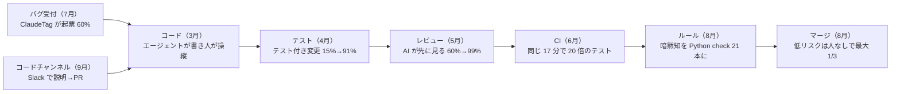

# AI ネイティブなエンジニアリング組織（FurtherAI の 9 か月）

> **TL;DR**: コーディングエージェントを配っただけでは速くならず、出荷工程を 1 段ずつ自動化して 1 人 1 日あたりのマージ数を約 5 倍にした FurtherAI の共同創業者・CTO Sashank Gondala（@sgondala2）が、次のボトルネックは「何を作るか決める工程」に移ったと見て、エンジニアに計画・実行・レビューの所有権を寄せ、マネージャーには製品を自分で触り製品判断を持つことを求める組織論。

発端は Will Larson（Imprint・lethain.com）が X で「リーダーはエンジニアリングマネージャーの AI スキルをどう評価しているか」と問いかけ、Gondala の返信（考えるべき問いのリスト）に多くのブックマークが付いたことである。Gondala はそれを受けて、FurtherAI で 9 か月かけて組織を作ってきた教訓を「出荷の何が変わったか」「チームの何が変わりつつあるか」の 2 部構成の X 記事にまとめた。出発点の観察は、エンジニアにコーディングエージェントを渡しても、1 段を速くするたびに次の段に仕事が積み上がる、というものだった。そこで出荷の全工程を 1 段ずつ見直し、最適化できる所を探した、と Gondala は書く。

## 出荷工程の再構築（Gondala の時系列）

Gondala が挙げる月ごとの変化は次のとおり（記事からの転記。月はすべて 2026 年）。

| 月 | 工程 | 変化 |
|---|---|---|
| 3月 | コード | エージェントが書き、エンジニアが操縦する。初期はツールの痕跡がたまにしか残らず起点の数値は無いが、今はほぼ 100% |
| 4月 | テスト | エージェントがコードと並行してテストを書く。テストを含む変更は 15% → 91% |
| 5月 | レビュー | 人が見る前に AI がレビューする変更は 60% → 99%。人間のレビュアーは判断が要る部分に集中 |
| 6月 | CI | テストを並列化し、変更の影響分だけ走らせる。同じ 17 分で 20 倍のテストが回る |
| 7月 | バグ受付 | ClaudeTag（[[tools/claude-tag]]）で受付を自動化。Slack で誰でも報告でき、重複判定・起票・担当割当まで行う。バグチケットの 60% を起票 |
| 8月 | ルール | バグやレビューコメントで「エンジニアだけが知っていたルール」が露呈するたび、全コミット・全 PR で走る小さな Python チェックにして、ビルドを落とし直し方を出力する。暗黙知をルールに変換し、エージェントはチェックに当たると自分で直して進む。0 → 21 ルール。低リスク変更が人なしでマージできる大きな理由 |
| 8月 | マージ | テスト・自動チェック・AI レビューを通った低リスク変更は人を介さずマージ。最大で変更の 3 分の 1 |
| 9月 | コードチャンネル | 誰でも Slack チャンネルを開き、エージェントに変更を説明して PR を開かせる。数値は未集計だが、複数人が同じエージェントに文脈を足しながら操縦でき協業に効く。Devin（Cognition）のクラウドセッションもチームで多用 |

このほか社内製の Poirot と Sherlock というエージェントが、ログ・メトリクス・トレース・読み取り専用の DB アクセスを持って本番と staging の問題を調査・解決する。Gondala が「いちばん楽しい瞬間」と呼ぶのはエージェント同士の連携で、Claude Tag が依頼をトリアージし、Devin が作業し、Poirot が必要な内部データを引く、という受け渡しが起きるという。副作用として非エンジニアもコードを出すようになり、デザイナーは 8 月以降に約 50 変更（デザインシステムを作った変更を含む）をマージし、デプロイや顧客対応の担当者も Slack から UI の微修正を自分で行っている。

## 何がかかったか

無料ではなかった、と Gondala は書く。夏の間はエンジニアリングの労力の多くがテストとツールに向き、顧客向けの変更数はエンジニア 1 人あたり月 17〜30 件にとどまった。9 月に 45 件へ跳ね、10 月は 48 件のペースだという。

## 新しいボトルネック：何を作るか決める工程

コードを書くのは速くなったが、何を作るかを決めるのは同じ速さでは速くならなかった、と Gondala は述べる。単純化した例として、ある機能に 10 日（計画 3 日・構築 6 日・レビュー 1 日）かかっていたとき、エージェントが構築を 3.5 倍速くしても計画とレビューが同じなら機能全体は 1.75 倍しか速くならず、計画とレビューの占める割合は 40% から 70% に上がる、と計算する。

こうした判断は伝統的にエンジニアリングマネージャー・PM・デザイナーを経由するが、エンジニアが速くなるほどそこが回らなくなる。Gondala の賭けは、管理の層を増やすのでなくエンジニアに所有権を寄せ、計画・実行・レビューの多くをエンジニア自身に扱わせることである。これがエンジニアとマネージャーへの期待を変える。

## エンジニアに求めるもの

Gondala はエンジニアのシニアリティを「どれだけ大きな問題を端から端まで所有できるか」で考え始めたと書き、おおまかに次の 3 段に分ける。

- **ジュニア**: エージェントと一緒に作り、エージェントが間違っていると分かる
- **シニア**: 自分の仕事を自分で計画しレビューする
- **スタッフ**: 曖昧な問題を受け取り、トレードオフを決め、うまくいったかを示す数字を所有する

あわせてエンジニアは顧客に近づく必要があるとし、顧客の問題を理解し、解を出荷し、成功を検証し、本番のリグレッションを所有するまでを端から端まで持たせる、と述べる。

## マネージャーに求めるもの

1. **仕事の中にいる**。何が・なぜ作られ、それが正しい解かをマネージャーが理解している必要がある。Gondala は、コードがレビューされたかを確認するだけでなく、エンドユーザーのように staging で機能を試すことを求める。実際に製品を使うと別の種類の問題が見つかるからである。ただし目的はレビューを増やすことでなく、正しい判断を自分でできるエンジニアを育て、マネージャーは判断が要るものにだけ介入する状態にすることだとする
2. **製品に強くなる**。コードを書くのが安くなると、何を作るかの判断の重みが増す。顧客を理解し、強い製品の意見を持ち、技術判断だけでなく製品判断を下せるマネージャーを求める。エンジニアがその判断力を育てるのも助け、小さな製品判断のたびに PM やデザイナーが要る状態をなくす

Gondala は、今年の大半をエンジニアを速くすることに使い、今は組織全体をその速さで動かす方法を探している、コード・テスト・レビューの自動化より難しい問題になると思う、まだ初期で分かっていないことが多い、と締める（末尾は FurtherAI のエンジニアリングマネージャー／ディレクター募集）。

## 位置づけ（wiki 側の読み）

人間のレビューが新しいボトルネックになる、という Amdahl の法則の構造は [[concepts/recursive-self-improvement]]（Anthropic Institute）や [[concepts/ai-review-bottleneck]]（@smark_x の制約理論）で既に扱われている。Gondala の記事が足すのは二つで、一つはボトルネックが出荷工程の中を月ごとに移っていった記録、もう一つは工程を自動化し切るとボトルネックがエンジニアリングの外へ出て「決めること」になり、ツールでなく組織設計の問題になるという観察だと考えられる。

8 月の「低リスク変更の無人マージ」は、発端の問いの主である Larson が自社 Imprint で組んだ [[concepts/small-change-auto-approval]] や、Claude Code チームのリスク別承認（[[concepts/agent-era-code-review]]）と同じ打ち手である。各社の数値（Imprint は該当約 10%、Anthropic は 6〜9 月にマージ 2 倍超で revert 40% 超減、FurtherAI は最大 3 分の 1）は定義が違うので横並びの比較はできない。暗黙知を Python チェックに変える 8 月の施策は、[[concepts/agent-trust-inverse-pyramid]] の「散文の層から静的解析の層へ努力を移す」をそのまま実行したものと読め、agent-era-code-review の「同じ指摘が繰り返されたら lint という発生源で直す」とも一致する。6 月の CI は、Boardy が待ち時間の側から詰めた [[concepts/agent-era-ci-speedup]] と対になる。FurtherAI は同じ 17 分でテスト量を 20 倍にし、Boardy は 40 分を 2 分にしており、同じ工程で何を目的変数にしたかが違う。

エンジニアを顧客に近づける方向は [[concepts/ai-era-good-engineer]]（LayerX）や [[concepts/forward-deployed-engineer]] と重なり、シニアリティを所有できる問題の大きさで測る見方は [[concepts/product-role-archetypes]]（Boris Cherny）の「職能でなく価値創出の局面で人を見る」に近い。

## 観察ログ（未検証）

- 2026-10-29: 1 人 1 日あたりのマージ数が 1 月から約 5 倍、revert 率は 0.5% 未満のまま（Gondala の自社数値・集計方法は未記載）
- 2026-10-29: 顧客向け変更数が 1 人月 17〜30 件から 9 月 45 件・10 月は 48 件ペースへ（同上）

## 問い

- 「計画とレビューが 70%」の例は構築だけ 3.5 倍という仮定の計算で、FurtherAI 自身は 5 月以降レビューも自動化している。自分の環境で測るなら、工程ごとの実時間をどう取るか
- 「マネージャーは staging で製品を触れ」は、[[concepts/team-leader-transition]] の「プレイヤーの延長でリーダーを定義しない」と緊張しないか。Gondala は目的を「判断できるエンジニアを育てること」に置くが、どこまで自分で触るかの線引きはどこか
- 21 本の Python ルールが何を検査しているかは記事に例が無い。この wiki の validate_wiki.py や LESSONS.md の「指摘が繰り返されたらルールにする」運用と同じ型か、取り直す

## 関連

- [[concepts/ai-review-bottleneck]] — 「読んで直す工程」を制約と見る個人規模の実践。本ページは同じ構造を組織規模で、工程の自動化から組織設計まで追った記録
- [[concepts/recursive-self-improvement]] — 人間レビューが新ボトルネックになる Amdahl 構造を AI 開発全体で論じた Anthropic Institute の論考
- [[concepts/small-change-auto-approval]] — 本記事の発端の問いを投げた Will Larson が自社 Imprint で組んだ低リスク PR の機械承認。FurtherAI の 8 月の無人マージと同じ打ち手
- [[concepts/agent-era-code-review]] — Claude Code チームの多層レビューとリスク別承認。本ページの 5 月（AI が先に見る）と 8 月（低リスクは人なし）に対応
- [[concepts/agent-trust-inverse-pyramid]] — 散文の層から静的解析の層へ努力を移す @poteto の指針。暗黙知を Python チェックにした 8 月の施策はこの実行例
- [[tools/claude-tag]] — 7 月にバグ受付を任せた Slack 常駐の Claude。重複判定・起票・担当割当でチケットの 60% を起票
- [[concepts/agent-era-ci-speedup]] — Boardy の CI 高速化（40 分→2 分）。本ページの 6 月の CI 段階を待ち時間の側から詰めた手順書
- [[concepts/agent-scale-source-control]] — コードを書く速さが律速でなくなると開発基盤が詰まる、という同じ観察を Anthropic がソース管理で報告した事例
- [[concepts/ai-era-good-engineer]] — 「何を作るべきか」を見極める力へ価値が移るという LayerX の像。本ページの「エンジニアを顧客に近づける」と同方向
- [[concepts/forward-deployed-engineer]] — 顧客の問題理解から出荷までを 1 人が持つエンジニア像。Gondala のスタッフ定義と重なる
- [[concepts/product-role-archetypes]] — Boris Cherny の 5 アーキタイプ。職能でなく価値創出の局面で人を見る分類
- [[concepts/team-leader-transition]] — 新任リーダーの評価軸をチームの総量へ移す論。本ページのマネージャー像との緊張は「問い」に記載
- [[companies/proton]] — Proton CTO Bart Butler の社内宣言文。「ボトルネックを消すと次が現れる」「人間レビューの大半は終わる」と本ページと同じ診断を、計測の積み上げでなく宣言・追跡ソフト・再面接で進め、404 Media が「恐怖の文化」と報じた対照例
