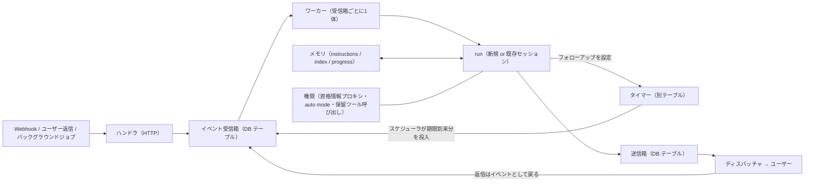

# Always-on エージェントの5つの基本部品（Anthropic 公式ガイド）

> **TL;DR**: 「常時稼働」に見えるエージェントは実際にはほぼ眠っていて、イベントで短く起き、状態を保存してまた眠る。Anthropic の William Hu はその周辺構造を「イベント受信箱・タイマー・メモリ・権限・送信箱」の5部品に分解し、各部品を別々の永続ストア（通常は DB のテーブル）に置けと述べる。

Hu（Anthropic・記事末尾に著者として記名）は、always-on エージェントが動く中核ループは普通のエージェントと同じで、違いは「いつ起きるか・run の間に何を持ち越すか・成果がどう利用者に届くか」を制御する周辺構造にあると書く。ここ数か月で再び注目されている理由として、最新モデルが利用者の意図の理解と「いつ確認を取るべきか」の判断で信頼できるようになったこと、長時間タスクほど知能が安く済むようになったこと（Hu が挙げる例では、ある長期コーディングベンチマークで Opus 5.5 は Opus 5 より解決タスクあたり 78% 安く、通常ワークロードの 40% 減より大きい）の2点を挙げる。顧客から「既存エージェントをもっと能動的にしたい」「ゼロから作りたい」の両方の相談が来ているので部品を公開した、というのが記事の動機である。

@TekonBurns（プロフィールに肩書なし・フロンティアモデルや Claude Code／Codex の動向を追う個人アカウント）はこの記事を5点に要約して投稿し、5,850 件ブックマークされた（2026-11-16 時点）。「最大の誤解は always-on エージェントが 24 時間動いていると思うこと」という投稿の第一文は、記事の「always-on は利用者から見た体験の説明であって実態ではない」という節をそのまま言い換えたものである。本ページは公式記事を正本とし、投稿は入口として扱う。

## run と session のサイクル

記事はエージェントの1回分の仕事を **run** と呼ぶ。イベントを受け取り、タスクを完了し、何が起きたかを保存する、という一続きの作業である。run は **session**（メッセージとツール呼び出しの記録）の中で動き、終わるとエージェントは眠りに戻る。利用者の返信のように前の作業の続きにあたるイベントは既存セッションを再開し、それ以外は新しいセッションを始める。眠っている間はトークンを消費しない、と記事の図は説明する。

## 5つの基本部品

### イベント受信箱（Event inbox）

イベント源（webhook・スケジュール・バックグラウンドジョブ）がエージェントを直接呼ぶと、同時に届いた2つのイベントが競合する run を起こしたり、クラッシュでイベントを失ったりする。記事はその代わりに全イベントを受信箱へ送らせ、ワーカーが拾う形を勧める。最小構成は3つで、イベントの永続リスト（通常は DB テーブル）・それに書き込むハンドラ（通常は HTTP エンドポイント）・それを読むワーカー（通常はバックグラウンドサービス）である。受信箱はイベントごとの状態を追跡し、イベント源の一意 ID で重複排除する。最初は利用者ごとに1受信箱とし、並列度が要るならさらに分割する。

記事が挙げる実装上の指針は4つ。

- **ハンドラは即座に応答する**。webhook 提供者の中には遅い応答を失敗とみなすものがあるため、プロンプトインジェクションの検査のような深い検証は run の中で行う
- **受信箱を唯一の真実とする**。ワーカーは起こされたらまず受信箱から最新イベントを引く。run の途中でワーカーが死んでも、新しいワーカーが同じイベントを拾って再試行できる
- **1つの受信箱に同時に動くワーカーは1体**。run の途中で新しいイベントが来たら、次の run に回す・現在の run に取り込む・中断して再開のいずれかを選ぶ
- **ワーカーは溜まったイベントをまとめる**。利用者が連続で数通送ったら1つの run に併合し、返信は1回で済ませる

### タイマー（Timers）

受信箱と組み合わせて能動性を作るのがタイマーで、記事は **フォローアップ**（エージェントが自分で設定する期限。返信の確認など）と **スケジュール**（既知の周期で繰り返すタスク。日次ニュースレターなど）の2種に分ける。タイマーは受信箱とは別の永続ストア（通常は別テーブル）に置く。受信箱には「今すぐ着手できるイベント」だけを入れるためである。スキーマは共有できるが、スケジュールは繰り返しの情報も持つ。

タイマー自体は run を起こさない。スケジューラ（バックグラウンドサービス）が一定間隔でストアを走査し、期限到来分を処理する。フォローアップは完了にし、スケジュールは次回の期限に更新し、受信箱にイベントを追加してワーカーを起こす。スケジューラは自作でも durable execution エンジンでもよい、と記事は書く。

### メモリ（Memory）

run はばらばらに分かれているので、連続性はメモリが担う。記事は Claude Code の auto memory と Messages API の memory tool がファイルのディレクトリとして実装されていることに触れ、always-on エージェントではそのディレクトリを DB やオブジェクトストアに対応づけてワーカーより長生きさせよ、と述べる。原則は「**別の場所で引き直せないものだけを保存する**」で、issue トラッカーにあるものはポインタだけ保存する。保存する種類は4つ。

| 種類 | 内容 | 読み込み方 |
|---|---|---|
| 利用者の指示 | エージェントの振る舞いについての指示 | 専用ファイルに保存し、毎 run の開始時に読む |
| 利用者についてのメモ | 役割・好み・受けた訂正 | 1ファイルから始め、増えたら小さなファイルに分けて索引だけを開始時に読む |
| 過去のメッセージ | すでに利用者に伝えたこと（繰り返しを防ぐ） | 別ファイルに保存するか、ワーカーが直近数通を読み込む |
| タスクの進捗 | 進行中タスクごとの「済んだこと・残り」 | 索引だけ開始時に読み、必要時に個別ファイルを引く |

記事の例では `instructions.md`・`index.md`・`reported.md` を毎 run 読み、`notes/` と `progress/` は必要なときに読む。run 中に保存するこのメモリに加え、過去セッションを見直してメモリを整える **dreaming** を足せば、古い項目の置き換えや多くの run をまたいで初めて見えるパターンの抽出ができる、と記事は述べ、Anthropic の agent memory の研究記事を参照している。製品側の実装は [[concepts/managed-agents-dreams]] にあたる。

コンテキストウィンドウについては、システムプロンプト・ツール定義・メモリファイルという固定の「オーバーヘッド」が毎 run 載るので、軽く保ちプロンプトキャッシュで費用を下げるよう勧める。新規セッションはこのオーバーヘッドと起動イベントだけで始まり、既存セッションは過去 run のメッセージとツール呼び出しを持ち戻す。長くなりすぎたら古いメッセージを圧縮するか新セッションを始めるが、どちらも詳細を失うので、残すべきものは途中でメモリに書いておく。

### 権限（Permissions）

記事は権限を「always-on エージェントが最も危険を抱える場所」と位置づける。run は利用者のアクセス権を持ったまま、設計上は無人で動くからである。ツール呼び出しごとに、自分で進める・止める・承認を待つのいずれかを決める必要がある。部品は他のエージェントと同じで3つ。

- **資格情報ストア**: 推奨パターンはエージェントの環境の外に置いたプロキシが外向きリクエストに資格情報を付ける形。エージェントは資格情報なしでリクエストを送り、プロキシが本物を注入して転送する。[[concepts/managed-agents-security-principles]] の「資格情報はサンドボックス外のプロキシが付与」と同じ原則である
- **auto mode**: 利用者の入力なしで動けるようにするため、Claude Code の auto mode は分類器で高リスクの操作を審査し、危険と判定したものを止めて Claude に安全な別経路を探させる。最も重要な判断には利用者のレビューが引き続き要る、と記事は書く
- **保留ツール呼び出し（Deferred tool calls）**: Claude Code ではフックがツール呼び出しを保留して利用者の追加入力を待てる。always-on エージェントでも同じ形で、呼び出しが保留されると run は終わりセッションは呼び出しの途中で保存される。依頼は利用者に（例えば MCP Apps で作った対話カードで）示され、答えはイベントとして受信箱に戻り、新しい run が保存済みセッションを再開する。待っている間もワーカーは他のイベントを処理できるので、エージェントは止まらない

### 送信箱（Outbox）

普通のエージェントは応答をストリーミングで見せるが、always-on エージェントは裏で働き、利用者には結果と少しの詳細だけが届く。run の終わり方は3通りで、送信箱にメッセージを送る・何も送らないと決める・保留ツール呼び出しで許可や追加情報を求める、のいずれかである。

多くの場合は利用者へ直接届ける「send」ツールで足り、正式な送信箱が要るのはメッセージの間隔を整えたい、またはエラーから回復させたいときだと記事は書く。送信箱は受信箱と対になる別テーブルで、ワーカーと対になるディスパッチャ（バックグラウンドサービス）が保留中のメッセージを読み、何を届けるか決めて送る。保留ツール呼び出しの依頼は送信箱経由でも自前の画面に直接でもよい。

送る量の調整も重要で、多すぎれば騒がしく、少なすぎれば知るべきことを取りこぼす。記事は eval を組んで釣り合いを探すよう勧め、実務上は「静かに始めて、時間をかけて利用者の注意を勝ち取る」方がよいと述べる。@TekonBurns はこれを「午前3時に利用者へ連投しないための待ち行列」と言い換えている。

## 全体のサイクル

毎 run は受信箱のイベント（利用者のメッセージ・webhook・タイマー）で始まる。ワーカーがイベントを拾って run を起こし、新規または既存のセッションでエージェントを起こす。エージェントはメモリを読んで出発点を得て、権限の範囲で行動し、学んだことでメモリを更新する。run が終わると送信箱に行を積み、ディスパッチャが利用者に届ける。run はタイマーを設定して後で自分を起こせ、利用者がメッセージに返信すればそれが受信箱のイベントになる。各 run は短いがこのサイクルが止まらないことが、利用者に「常時稼働」と感じさせる、というのが記事の締めである。

## 既存ページとの関係（wiki 側の推論）

- [[concepts/scheduled-agent-automation]] の daily-brief 参照実装は、この5部品のうちスケジュール型タイマー・2種のメモリストア（preferences／state）・読み取り専用と予算上限という権限の絞り込み・Slack 1チャンネルという送信先を Managed Agents の機能で具体化したものと読める。受信箱に相当する部品は持たず、起動はスケジュールだけである
- [[concepts/claude-code-loop-types]] の Proactive 類型（イベントまたはスケジュールで起動・人間不在）が、本ページの5部品で組まれる対象にあたる。向こうは Claude Code の機能の合成（`/schedule`・`/goal`・dynamic workflows・auto mode）で、こちらは自前で組むときのデータ構造の話である
- [[tools/hermes-agent-overnight]] の「常時起動の Gateway プロセス＋60秒ティックの cron デーモン」は、受信箱とスケジューラを1つのプロセスに同居させた個人実装と見ることができる

## 問い

- このvault の launchd ジョブ（ingest・auto-sync・weekly）は「タイマー→受信箱→1ワーカー」の形になっているか。同時起動の競合と、失敗したイベントの再試行はどこで担保しているか
- 「引き直せないものだけ保存する」原則で見ると、この wiki の auto memory にはポインタで足りる項目がどれだけ入っているか
- 送信量の eval は何を正解ラベルにするのか。記事は「静かに始めよ」と言うだけで、評価の作り方は書いていない

## 関連

- [[concepts/scheduled-agent-automation]] — Anthropic 公式の daily-brief 参照実装。本ページの部品のうちスケジュール・メモリ分割・権限の絞り込みを Managed Agents で具体化した例
- [[concepts/claude-code-loop-types]] — Claude Code チームのループ4類型。Proactive 類型を自前で組むときの構造が本ページ
- [[concepts/managed-agents-security-principles]] — 資格情報をサンドボックス外のプロキシが付与する原則。本ページの権限部品と同じ設計
- [[concepts/managed-agents-dreams]] — 記事が「dreaming」と呼ぶメモリ整理の製品実装
- [[tools/hermes-agent-overnight]] — 常時起動 Gateway と cron ティックで夜間に自律稼働する個人向け実装
- [[tools/claude-duet]] — Proactive 類型を一般利用者向け製品にした Anthropic のアプリ。朝ブリーフと送信前の確認を持つ
- [[tools/claude-managed-agents]] — 記事が参照する memory tool・セッション・圧縮を提供するプラットフォーム
