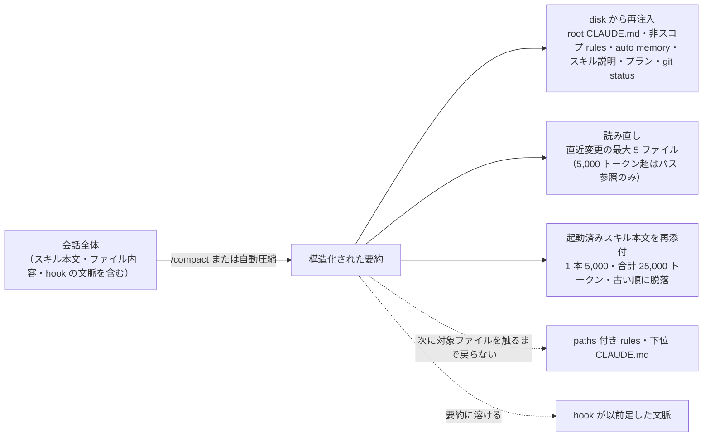

# Claude Code のコンパクションで何が生き残るか（公式の一覧表）

> **TL;DR**: Claude Code の圧縮（compaction）は会話の全部を要約に置き換えるが、直後に CLAUDE.md・auto memory・スキル説明・プランを disk から再注入し、起動済みスキルの本文（1 本 5,000 トークン・合計 25,000 トークン上限）と直近に変更した最大 5 ファイルを読み直す。パス指定の rules と下位 CLAUDE.md、hook が足した文脈は要約に溶ける。

発端は Zhu Liang（@paradite_・16x Prompt と 16x Eval の作者）が各エージェント開発者に投げた質問で、スキル起動の結果（スキル本文）と利用者が指示したファイル読み込みの結果は圧縮を無損失で生き残るか、というもの。Lydia Hallie（X のプロフィールに Claude Code・Anthropic 所属と記載）は 2026-11-02 に、Claude Code では会話中のすべて（スキルとファイル読み込みを含む）が要約されるが、要約の直後に起動済みスキルを再添付し、直近に変更されたファイルを最大 5 つ読み直すと答え、公式ドキュメントの「What survives compaction」節を示した。@studio_yebisu はこの返答を引用し、スキルを作る人は知っておくべきだと勧めている。

## 機構ごとの圧縮後の挙動（公式ドキュメントの表の転記）

Anthropic の Claude Code ドキュメント「context window」ページは、圧縮後の扱いは「その内容がどう読み込まれたか」で決まるとして次の表を示す。

| 機構 | 圧縮後 |
|---|---|
| システムプロンプトと output style | どちらも効き続ける |
| プロジェクト直下の CLAUDE.md と非スコープの rules | disk から再注入 |
| auto memory | disk から再注入 |
| スキルの説明文 | 現在のスキル一覧から再構築して再注入（Claude Code v2.1.304 以降） |
| git status のスナップショット | セッション開始時にあったなら、リポジトリから新しいものを読み直す |
| plan mode で書いたプラン | disk から再注入 |
| `paths:` frontmatter 付きの rules | 対象ファイルを触ったときにオンデマンドで再読込 |
| 下位ディレクトリの CLAUDE.md | 同じくオンデマンドで再読込 |
| Claude が読んだ・編集したファイル | 直近に変更されたものから最大 5 つを読み直す |
| 起動済みスキルの本文 | 再注入。1 スキル 5,000 トークン・合計 25,000 トークンが上限で、古いものから脱落 |
| バックグラウンドのコマンドとサブエージェント | 動き続ける。重複起動しないよう、まだ動いているものを Claude に知らせる |
| hook が以前に足した文脈 | 会話の残りと一緒に要約される |
| `compact` ソースに一致する SessionStart hook | 実行され、その出力が圧縮後の文脈に加わる |

同ページが表の下に添える補足は 3 点。読み直す 5 ファイルのうち 5,000 トークンを超えるものは中身なしのパス参照（`Referenced file`）として戻る。パス指定の rules と下位 CLAUDE.md は対象ファイルを読み書きしたときに message history に入る仕組みなので、圧縮では他と一緒に要約され、圧縮を越えて効かせたい rule は `paths:` を外すかプロジェクト直下の CLAUDE.md に移す。スキル本文の切り詰めはファイルの先頭を残すので、最重要の指示は `SKILL.md` の上部に置く。

要約そのものについては、v2.1.198 以降は要約リクエストがセッションの extended thinking 設定を引き継ぐ（thinking を有効にしたセッションでは thinking 付きで要約し、無効なら無効のまま）とある。

## スキル作者への含意（@studio_yebisu の読みと wiki 側の整理）

@studio_yebisu の「Skill を作る人は知っておいた方がよさそう」を公式表に当てると、効いてくる上限は 2 つあると考えられる。第一に、起動済みスキルは再添付されるが 1 本 5,000 トークンで頭から切られるため、長い SKILL.md は後半の手順が圧縮後に消える。第二に、合計 25,000 トークンの予算を超えると古い起動順から落ちるので、1 セッションで多数のスキルを呼ぶ運用では初期に呼んだスキルが戻らない。[[concepts/skill-building-best-practices]] が説く「小さく保つ・progressive disclosure」は、この圧縮時の切り詰めという別の理由からも裏付けられる。

## 圧縮を待たずに打てる手（公式ページの列挙）

同ページは自動圧縮の前に利用者が取れる手として、`/compact` に焦点の指示を添える（例: `/compact focus on the auth bug fix`）・`/rewind` でメッセージを選んで途中から要約する・`/autocompact` にトークン数を渡して自動圧縮の発火点を早める（例: `/autocompact 500k`）・無関係な作業へ移るときは `/clear`・大きな読み込みはサブエージェントへ委ねる、の 5 つを挙げる。実際に何が載っているかは `/context` で、メモリファイルの編集は `/memory` で確かめる。

## 観察ログ（未検証）

- 2026-11-03: 公式表の「`compact` ソースに一致する SessionStart hook の出力は圧縮後の文脈に加わる」は、[[concepts/claude-code-compact-recovery]] で @u1 が「PostCompact hook は additionalContext を返せない」として 2 段 hook を組んだ前提と関係する。SessionStart（compact）経由なら 1 段で復旧指示を注入できる可能性があるが、wiki 側では未検証

## 問い

- このリポの wiki-ingest スキルの SKILL.md は 5,000 トークンを超えているか。超えているなら圧縮後に Step 4 以降の規則が消えている可能性があり、最重要の規則を先頭に寄せる価値がある
- `compact` ソースの SessionStart hook で復旧指示を注入できるなら、@u1 の marker 経由 2 段 hook は簡略化できるか
- 「直近に変更された 5 ファイル」は編集したファイルが優先されるので、読むだけだった参照資料は圧縮後に手元から消える。長い作業では参照資料のパスを CLAUDE.md かプランに書いておくべきか

## 関連

- [[concepts/claude-code-compact-recovery]] — 圧縮が判断構造を落とす問題への @u1 の退避・復旧設計。本ページはその前提となる「何が公式に戻り、何が戻らないか」の一覧
- [[concepts/claude-code-instruction-methods]] — 7 手段を「ロード時点×圧縮生存×権威」で振り分ける公式フレーム。本ページは圧縮生存の軸だけを機構ごとの表に展開したもの
- [[concepts/skill-building-best-practices]] — スキルを小さく保つ原則。本ページの「1 本 5,000 トークンで頭から切られる」がその圧縮側の根拠
- [[concepts/claude-code-launch-directory]] — 「圧縮後に戻るのは上位の CLAUDE.md だけ」を起動位置の側から述べたページ。本ページの表のうち CLAUDE.md の行にあたる
- [[concepts/claude-code-seo-second-brain]] — 同じ公式仕様（CLAUDE.md は圧縮後に再読込・チャットで打っただけの規則は消える）を SEO 運用の 4 層設計として実装した事例
- [[papers/2026-dairai-top-ai-papers-w35]] — 圧縮の喪失を定量化した研究「What Compaction Destroys」。本ページの表が「戻る」とする機構を使わない指示がどれだけ残るかの測定
- [[models/claude-haiku-5-5]] — `/autocompact 100k` で自動圧縮を早める設定の実例。本ページの「圧縮を待たずに打てる手」の一つ
- [[concepts/prompt-caching]] — アイドル時に自動で圧縮が走る idle compaction。利用者が指示しなくても本ページの表の挙動が起きる経路
- [[tools/claude-code]] — 本ページの機構を持つ製品
