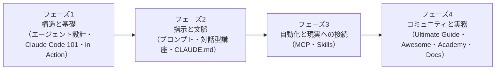

# Claude Code を0から学ぶ無料教材の4フェーズ地図

> **TL;DR**: @soniacuts（SONIA）が「30日で AI の分野に入る」人向けにまとめた、Anthropic 公式の講座・ドキュメントとコミュニティのガイド計12本を「構造と基礎 → 指示と文脈 → 自動化と現実への接続 → コミュニティと実務」の4フェーズに並べた無料教材リスト。全部無料で、1人でチーム分の仕事を同じ品質で終える技能が身につく、と SONIA は述べる。

投稿の冒頭は「Google の元 CEO が、AI によって富を築き自分の事業を持つのがずっと楽になると告白した。条件はこの分野に入りゲームを正しく理解すること」という動画付きの導入で、SONIA はそれに続けて、30日で始めるための「完全な地図と道具」としてリンク集を置く。「保存して毎日戻ってくるデータベース」だと呼びかける構成で、元 CEO の動画の中身は本 vault には収録されていない。引用元の @dravenip は「Anthropic が Claude のプロンプトの仕方を教える 27 分のワークショップを公開した（英語＋スペイン語字幕）。作った人たち自身が教える。無料・登録不要」と書いて動画を添え、さらに @n0tisma のスペイン語 X 記事「CLAUDE CODE de 0 a experto」を引用している（動画本体・記事本文は未収録）。

## 4フェーズ12本（SONIA の分類と一言）

| フェーズ | 教材 | SONIA の一言 | リンク |
|---|---|---|---|
| 1 構造と基礎 | エージェントのアーキテクチャ（LangChain ブログ） | 判断して実行する自立したエージェントの作り方を理解する | https://www.langchain.com/blog?category_equal=%5B%22Agent+Architecture%22%5D |
| 1 | Claude Code 101（Anthropic 公式講座） | ターミナルの中で Anthropic の「恐ろしい（aterradora）」開発ツールを扱う基礎 | https://anthropic.skilljar.com/claude-code-101 |
| 1 | Claude Code in Action（Anthropic 公式講座） | 実プロジェクトを作りながらのライブ実験 | https://anthropic.skilljar.com/claude-code-in-action |
| 2 指示と文脈 | プロンプトエンジニアリング（公式ドキュメント） | モデルから最大の品質を引き出すプロ向けの書き方 | https://platform.claude.com/docs/en/build-with-claude/prompt-engineering/overview |
| 2 | インタラクティブ・プロンプト講座（GitHub・anthropics） | 手を動かすプロンプト訓練 | https://github.com/anthropics/prompt-eng-interactive-tutorial |
| 2 | CLAUDE.md とメモリ（公式ドキュメント） | プロジェクトの文脈とルールを Claude が忘れないための仕組み | https://code.claude.com/docs/en/claude-md |
| 3 自動化と現実への接続 | MCP（公式ドキュメント） | 「本当の革命」。Slack・GitHub・Google など日常の道具とデータベースに Claude をつなぐ | https://code.claude.com/docs/en/mcp |
| 3 | Skills（公式ドキュメント） | 繰り返す手順と独自の機能を教えて再利用させる | https://code.claude.com/docs/en/skills |
| 4 コミュニティと実務 | Claude Code Ultimate Guide（FlorianBruniaux） | 開発者コミュニティのオープンソースの大型ガイド | https://github.com/FlorianBruniaux/claude-code-ultimate-guide |
| 4 | Awesome Claude Code（hesreallyhim） | スクリプト・Skills・拡張のコレクション | https://github.com/hesreallyhim/awesome-claude-code |
| 4 | Anthropic Academy | 公式コース全13本が修了証つきで無料、と SONIA は書く | https://anthropic.skilljar.com |
| 4 | 公式ドキュメント全体 | Claude に関する大小すべての最終的な参照先 | https://code.claude.com/docs/en/overview |

12本のうち9本が Anthropic 公式（skilljar の講座2本と Academy のトップ・platform.claude.com と code.claude.com のドキュメント5本・anthropics の GitHub リポジトリ1本）で、残りは LangChain のブログと GitHub の個人リポジトリ2本。

## 位置づけ（wiki 側の推論）

Anthropic Academy の講座数「13本」と修了証の無料提供は SONIA の記述で、本 vault では公式ページを未確認。Anthropic の公式学習サイトは [[tools/claude-academy]]（academy.claude.com）として既にページがあり、SONIA が貼る anthropic.skilljar.com は同じ講座群を配信する学習管理システム側の URL と考えられる（両ドメインの関係は未確認）。各教材の中身は本 wiki の既存ページが個別に扱っており、公式プロンプトガイドは [[concepts/prompt-engineering]]、CLAUDE.md の設計は [[concepts/claude-md-multilayer-design]]、MCP は [[tools/claude-mcp]]、Skills の作り方は [[concepts/skill-building-best-practices]] にある。このリストの価値は個々の教材でなく「どの順で読むか」にあり、プロンプトと CLAUDE.md（フェーズ2）を MCP・Skills（フェーズ3）の前に置く順序は、[[tools/claude-code-mcp-stack]] で Boris Cherny が「MCP を増やすほど賢くなるわけではない」と注意した点と整合すると考えられる。

## 問い

- @dravenip の言う「27分のワークショップ」は Anthropic 公式のどの動画か。本 vault の Web 検索では長さが一致する公式動画を特定できていない
- Anthropic Academy（skilljar）の講座一覧と修了証の条件を公式ページで確認し、「13本」が現時点でも正しいか見る
- フェーズ1に LangChain の「エージェントのアーキテクチャ」を置くのは、Claude Code を使い始める前に必要な知識か。自分なら Claude Code 101 から入って後回しにするか

## 関連

- [[tools/claude-code]] — このリストの学習対象。Boris Cherny の公式ワークショップの Tips はこちら
- [[tools/claude-academy]] — Anthropic 公式の無料学習サイト（academy.claude.com）。フェーズ1の講座2本とフェーズ4の Academy 全体の提供元で、製品別トラックと AI Fluency の構成はこちら
- [[concepts/prompt-engineering]] — フェーズ2の公式プロンプトガイドの中身
- [[tools/claude-mcp]] — フェーズ3の MCP の中身
- [[concepts/claude-md-multilayer-design]] — フェーズ2の CLAUDE.md を多層で設計する考え方
- [[concepts/skill-building-best-practices]] — フェーズ3の Skills の作り方（Anthropic 社内知見）
- [[tools/claude-code-mcp-stack]] — 公式 MCP サーバー8本の構成論。「増やすほど賢くならない」の注意
- [[companies/anthropic]] — 公式講座・ドキュメントの提供元
