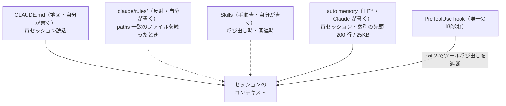

# Claude Code で SEO を回す「第二の脳」（4 層のメモリ配置と自動メモリ索引の切り捨て事故）

> **TL;DR**: Claude Code の 4 つのメモリ層（CLAUDE.md＝地図・`.claude/rules/`＝反射・Skills＝手順書・auto memory＝日記）に、SEO の知識を「必要なときだけ読まれる層」へ振り分けて置く運用。ChatSEO 共同創業者 Nicholas Dulait が自社の 128 行の CLAUDE.md・17 スキル・171 件の auto memory を公開し、索引が 200 行・25KB を超えて 52 行が黙って切られていた事故を報告した。

毎セッションが新しいコンテキストで始まるため、チャットで打っただけの訂正（「ランキングのあるページの URL は変えない」）はセッションが閉じれば消える。Dulait はこれを不具合でなく仕様とみなし、ほとんどの SEO 担当者が毎朝同じインターンに同じ説明をしていながら、Claude が実際に読み込む場所にブリーフを書いていないと述べる。Claude Code には 4 つのメモリ層があるのに大半が 1 層（CLAUDE.md）だけを使って詰め込み、Claude が聞かなくなった時点で「AI は SEO ができない」と結論づける、というのが同氏の見立てで、黄金律は**「それぞれの SEO 知識を、必要なときにだけ読み込まれる層に置く」**。自分の脳は大きく保ち、Claude のコンテキストは小さく保つ。

## 2 つの神話と「絶対」の置き場

Dulait が多くの SEO 設定を壊していると見る前提は 2 つ。第一に「CLAUDE.md はシステムプロンプトだから Claude は従う」。公式ドキュメントは CLAUDE.md の内容がシステムプロンプトの後に**ユーザーメッセージとして**届くと明記しており、Claude は読んで従おうとするが、特に曖昧な規則については厳密な遵守の保証はない。第二に「`robots.txt` に触るなと書けば守られる」。公式ドキュメントはメモリファイルを「文脈であって強制される設定ではない」と位置づけ、Claude の判断に関わらず操作を止めるには PreToolUse hook を使うよう案内する。Dulait の訳は「価格ページを noindex しないという規則が CLAUDE.md にしかないなら、それは防御でなく願望」。

同氏のチームで実際に効いている唯一の「絶対」は PreToolUse hook で、複数の Claude セッションが 1 つの Chrome を共有する環境で、同時に操縦できるのを 1 セッションに限る。これは Claude に行儀を頼むのでなく呼び出しを遮断する。SEO サイトでは同じ型で `robots.txt` を守り、`.claude/hooks/protect.sh` がファイルパスに `robots.txt` を含むとき終了コード 2 を返す。Claude が `robots.txt` を上書きしようとして hook が書き込みを止め、ファイルが無傷だったことをテスト済みだと同氏は書く（`settings.json` の設定本文はキャッシュに未収録）。

## 4 層それぞれの作り方

**第 1 層 CLAUDE.md は 200 行未満の地図。** URL を変えられた経験から規則を 1 つ足し、次はタイトル、次は内部リンクと増えて半年後に 600 行の壁になり、50 行だったころより従われなくなる、と Dulait は典型を描く。公式ドキュメントの目標は 1 ファイル 200 行未満で、長いファイルは「より多くのコンテキストを消費し遵守を下げる」。同氏のものは 128 行で、1 社のコンテンツ・メール・アウトバウンドを動かしている（本文の例はキャッシュに未収録）。同氏が挙げる 3 つの小技は公式ドキュメントでも確認できる。ブロックレベルの HTML コメントはコンテキスト注入前に除去されるので保守メモを無料で残せる（コードブロック内のコメントは残る）。`@path` の import は整理には役立つが import 先も一緒に読まれるためコンテキストは減らない。パスをバッククォートで包むと import されず平文として扱われる。さらに `/init` で下書きを作れること、個人用の `CLAUDE.local.md` と全サイト共通の `~/.claude/CLAUDE.md` があることを添える。

**第 2 層 `.claude/rules/` は自分で読み込まれる規則。** 全規則を CLAUDE.md に置くと、タイポ修正のときにブリーフの規則が、ブログ記事を書くときにランディングページの規則が読み込まれ、毎回その全部を払う。`paths:` フィールド付きの Markdown を置けば、一致するファイルを Claude が読む・編集するときだけ読み込まれる。同氏の例は `pages.md`（価格ページに触れると発火）と `briefs.md`（ブリーフ作成で発火）で、サイトマップの質問ではどちらも読まれない（規則本文はキャッシュに未収録）。`paths:` のない規則は CLAUDE.md と同じく起動時に読まれる。

**第 3 層 Skills は手順書。** CLAUDE.md は事実のため、手続きはスキルに置く。スキルは呼び出したとき、または Claude がプロンプトに関連すると判断したときだけ読まれ、同氏のチームは記事パイプラインからニュースレターまで 17 本を運用する。どのサイトにも要るのは「ページのリフレッシュ」で、既にランクしているページが最も安いクリックを生むからだと述べる。`refresh /pricing` で手順全体が走り、残りの 29 日はその手順がコンテキストを消費しない（SKILL.md 本文はキャッシュに未収録）。多くの人が止まるのは Search Console の手動エクスポートで、同氏は自社の ChatSEO を MCP サーバーで接続し「過去 90 日でクリックを失ったページは」の 1 行に置き換えている（著者は ChatSEO の共同創業者で、この箇所は自社製品の紹介にあたる）。

**第 4 層 auto memory は Claude 自身が書く日記。** 訂正に「わかりました」と返しても、auto memory がなければそれはセッションが閉じるまでしか続かない。auto memory はリポジトリ単位で毎セッション読まれ、読める・直せる・消せる平文 Markdown。「インドは絶対にターゲットにしないと覚えて」と言えば auto memory に、「これを CLAUDE.md に足して」と言えば地図に入り、`/memory` で全ファイルの一覧と切り替えができる。経験則は「地図は自分が書き、日記は Claude が書く」。同氏の日記は 171 ファイルで、うち 63 件が「数字を捏造しない」「全リンクに自社のトラッキングタグ」のような訂正だと書く。

## 索引の切り捨て事故

誰も警告しない部分として Dulait が書くのは、auto memory の索引は先頭 200 行または 25KB のどちらか早い方までしか読まれないという制限で、同氏の索引は 213 行・32.5KB に育ち、**52 行が毎セッション黙って切られていた**。最も古い、出荷済みのプレイブックに関するメモが Claude にとって存在しなくなり、エラーは出ず、唯一の痕跡は読み込まれた索引に付く警告行で、人間は誰も読まない。同氏が引き出した規則は、索引の各項目を 1 行に保ち、詳細はトピックファイルに置き、月に 1 度は索引のサイズを確かめること。

公式ドキュメント（memory ページ）はこの制限を `MEMORY.md` の先頭 200 行または 25KB と明記し、閾値を越えた内容はセッション開始時に読まれないと書く。さらに Claude が `MEMORY.md` に書き込んだ後にファイルを両方の上限と照らし、上限に近ければ短縮を促し、上限を超えていれば書き込みは成功するが索引を書き直すようエラーを返す、とある。Dulait の記述（読み込み時の警告行）と公式の記述（書き込み時のリマインドとエラー）は検知の時点が異なり、どちらも人間の目には届きにくい点は同じと考えられる。この制限は `MEMORY.md` だけに適用され、起動時に読む CLAUDE.md は 4 MiB 以下なら全文が読まれる（4 MiB 超は丸ごと読み飛ばされる）。同じ型の事故は [[concepts/skills-over-memory]] で @mvanhorn が 218 ファイル・46KB の索引で報告しており、独立した 2 件の運用記録が同じ上限に当たっている。

## 読み込み順と健康を保つ 5 コマンド

Dulait が「SEO の脳とガラクタ引き出しを分けるもの」とする読み込み順は次のとおりで、公式ドキュメントの記述とも一致する。起動時に、作業フォルダとその上位すべての CLAUDE.md と CLAUDE.local.md が、上書きでなく連結されて読まれる。同じく起動時に `paths:` のない規則と auto memory の索引。オンデマンドで、下位フォルダの CLAUDE.md とパス指定の規則が、一致するファイルを初めて触ったときに読まれる。`/compact` の後はプロジェクト直下の CLAUDE.md が disk から読み直されるが、チャットで打っただけの規則は消える（圧縮後に何が戻るかの機構別一覧は [[concepts/claude-code-compaction-survival]]）。「ランキングに関わるなら書き留めよ」が同氏の結論。

健康を保つコマンドは 5 つ。`/init`（CLAUDE.md の下書き）・`/memory`（メモリファイルの一覧と auto memory の切り替え）・`/context`（実際に何が読み込まれたかを「Memory files」の下に表示）・`/doctor prompt-audit`（古い指示や矛盾する指示を見つけ、適用を頼むまでファイルを変えない。Claude Code v2.1.283 以降）・「remember …」（auto memory へ直接保存）。設定後は `/context` を一度走らせ、載っていないファイルは Claude には見えていないと確かめる。公式ドキュメントは加えて、200 行超のファイルは起動時と `/status` で警告されること、`/doctor` がディレクトリ構成や依存一覧などコードから導ける内容を削り、落とし穴・理由・既定と異なる規約を残す形で CLAUDE.md の削減を提案することを書いている。

## よくある落とし穴と 60 秒監査

落とし穴 6 つと対策は、巨大な CLAUDE.md→200 行未満で残りは rules と skills・キーワード一覧を `@` で全部 import→`keywords/` に置いて必要な 1 つだけ読ませる・1 ページの目標クエリについて食い違う 2 ファイル→1 ページ 1 ファイル 1 クエリ（公式ドキュメントは食い違いがあると Claude が「どちらかを恣意的に選ぶことがある」と書く）・「X を noindex しない」を CLAUDE.md に書く→PreToolUse hook・チャットでだけ打った規則→CLAUDE.md か rule に書く・200 行超の auto memory 索引→1 項目 1 行。脳は判断を保ち、Search Console がスコアを保つ、とデータの代わりにはならないことも添える。

作る前に答える 5 問は、`/context` に CLAUDE.md が出るか・200 行未満か・auto memory が有効で 200 行未満か・最重要の「絶対」が文章でなく hook か・各マネーページに 1 ファイル 1 目標クエリがあるか。「no」が 3 つ以上なら、持っているのは SEO の脳でなく Claude がちらりと見るメモフォルダだと同氏は言う。

## 過剰になる場面（著者の留保）

Dulait は 1 社のサイト群での設定で標本は 1 つだと断り、共同創業者の Paul が SEO の YouTube チャンネルを運営していて規則が書き下す前から良かったという有利な出発点も明かす。月に 1 度しかサイトに触らないなら 30 行の CLAUDE.md で足り、4 層が報われるのは Claude が毎日サイトに関わる場合。一般化できるのは配置の規則で、一般化できないのは同氏の具体ファイルなので、自分の訂正から自分のファイルを書くよう勧める。記事はワンプロンプトのセットアップ（本文はキャッシュに未収録）と、前作の初期設定記事・続編の自律実行記事への導線、ChatSEO の無料導線で締める。

## 問い

- このリポの auto memory 索引（MEMORY.md）は今何行・何 KB か。200 行・25KB の上限にどれだけ余裕があり、1 行超えの項目はないか
- CLAUDE.md 内の HTML コメントがトークン 0 で残せるなら、保守メモや「この行の由来」を本文からコメントへ移して行数を減らせるか
- このリポの「絶対」（launchd auto-sync の暴走防止など）は文章のままか、PreToolUse hook に置いてあるか。[[concepts/claude-code-instruction-methods]] の問いと同じ宿題が、別のドメイン（SEO）から再提出された形

## 関連

- [[concepts/claude-md-multilayer-design]] — 同じ「CLAUDE.md 単体をやめて層へ分ける」設計を 7 層で示した実装ガイド。本ページは SEO という単一ドメインで 4 層を実運用した記録で、HTML コメント除去と 4 MiB 読み飛ばしは公式 memory ドキュメントで確認できた
- [[concepts/skills-over-memory]] — auto memory の索引が上限超過で黙って切られる同型の事故（@mvanhorn・218 ファイル）と、教訓をメモリでなくスキルへ出荷する規律。本ページの「1 項目 1 行・詳細はトピックファイル」はその運用側
- [[concepts/claude-code-instruction-methods]] — 7 手段を「ロード時点×圧縮生存×権威」で振り分ける公式フレーム。本ページの 4 層＋hook はその SEO 版の適用例
- [[concepts/claude-code-compaction-survival]] — 圧縮後に何が disk から戻り何が消えるかの公式一覧。本ページの「チャットで打った規則は /compact で消える」の機構側
- [[concepts/claude-code-launch-directory]] — `/context` の Memory files で読まれているかを確かめる診断と、上位から連結される読み込み順。本ページの 60 秒監査の第 1 問と同じ手順
- [[concepts/instruction-patch-lifecycle]] — 失敗のたびに足して育てた規則をモデル世代交代時に外す運用論。本ページの `/doctor prompt-audit` はその棚卸しを機械化する公式コマンド
- [[tools/claude-code]] — 本ページの 4 層と hook を持つ製品
