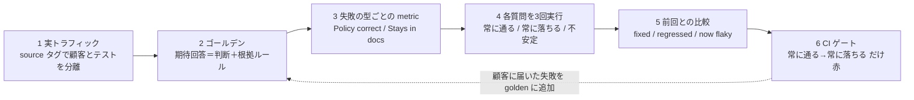

# Eval Harness（変更ごとに全テスト質問を再実行し、何が直り何が壊れたかを質問単位で示す回帰装置）

> **TL;DR**: AI アプリへの変更（モデル・ツール・プロンプト）のたびに固定のテスト質問を本番と同じ API 経由で各3回流し、前回の実行と比べて「直った／壊れた／不安定になった」を質問単位で出し、常に通っていた質問が常に落ちるようになったときだけ CI を赤にする仕組み。Tony（@tonycueva・GitHub の tony-confidentai プロフィールでは Confident AI の Founding GTM Engineer）がシューズ店サポートボットで 33/60→41/60→54/60 の実測つきで6手順に分解した。

最初の eval が動いたあとに来る「第二の壁」を Tony はこう描く。バグを見つけて直し、数問のテストで修正を確かめる。次に誰かが別のバグを直すためにプロンプトを変える。すると、その変更が他に何を壊したか誰も言えない。Tony 自身の前作「Evals and Tracing 101」では5問でシューズ店サポートボットの修正を証明したが、同じボットを本番サーバーに置き、実トラフィックから取った20問を3回ずつ流すと 60 件中 33 件しか通らなかった。5問は既知のバグしか覆っていなかった、というのが本記事の出発点である。

「ハーネス」はモデルの周りのコードを指し、Claude Code や Codex はハーネスである（Agent = Model + Harness）。Tony は OpenAI の研究者 Noam Brown（@polynoamial）の指摘を引き、ポケモンを遊ぶ AI モデルは別々のハーネスで走ったためスコアを比べられなかった、だからモデルのベンチマークはあなたのアプリについてほとんど語らない、と述べる。eval harness は Anthropic のエージェント eval ガイドが「evals をエンドツーエンドで走らせる」と定義する装置で、固定のテスト質問でアプリを動かし各回答を採点するので、利用者が出会うのと同じ形でモデルとハーネスを一緒に測る。Tony はさらに、GitHub Copilot の eval harness が初期の成功の鍵だったという Hamel Husain（@HamelHusain）、ハーネスをオフライン eval と A/B テストで試すという Cursor CEO の Michael Truell（@mntruell）、この仕組みができると進歩が速く来るという Anthropic の Eugene Yan（@eugeneyan）の発言を挙げる。101 で作った metric は採点者で、eval harness はその周りのコード、という位置づけである。

本ページの手順と数値は記事本文からの転記で、コマンド・コード片・compare.py のレポート本文はキャッシュに収録されていない。全コードは GitHub の tony-confidentai/stride-support-bot にある（説明文は「A small AI support bot and its eval harness, from the Evals and Tracing series」）。

## 6手順（Tony の実測つき）

### 1. 実トラフィックから始める

- ボットは小さな FastAPI アプリで POST /chat に答え、毎回のトレースを Confident AI に送る。各トレースに **source タグ**（実利用者は customer、テスト実行は harness）を付け、テストのトラフィックを利用者から分ける
- 前提は Python 3.12・OpenAI キー・無料の Confident AI アカウント。ガイド全体で約30分、3回のハーネス実行で judge 呼び出しが約 $4.20、ボット呼び出しは数セント
- 20問の「実顧客のような質問」を送り、約1分待ってから過去24時間の customer タグ付きトレースを API で引き戻し、質問・回答・検索結果を traces.json に保存する
- 20行を読むと失敗の型が2つ見えた。**日付計算の誤り**（5週間を30日の返品期限と比べて「可」と答える）と**作り話**（ヘルプセンターに無い価格保証・子ども靴・PayPal・破損品に答える。PayPal には「主要なクレジット/デビットカードを受け付ける」と言った）。これが**エラー分析**で、型がテスト対象を決める
- 悪いトレースは LLM スパンの前の検索スパンを見る。5週間の回答はプロンプトのバグに見えたが、検索結果に30日ルールの文書が1つも無いことが最初の原因だった

### 2. トラフィックをゴールデンにする

- 101 では golden は「信頼できる質問」だったが、ハーネスでは各 golden に**期待する回答**を「判断＋その根拠のルール」で書く（例:「No. 5 weeks is 35 days」）。「ボットが正しく答える」では judge が確かめられない
- 失敗した質問だけでなく20問すべてを入れる。良い回答は、ある修正が別のケースを壊したことを知る手段になる
- ハーネスは利用者と同じ HTTP API を harness タグで呼ぶ（target.py）。無料の Render はアイドルで眠るので先に起こし、サーバーエラーは再試行する。最初のベースライン実行でサーバーエラーの質問が「結果なし」になり、比較スクリプトがそれを合格と数えた失敗から再試行を足し、結果が3件未満の質問はエラーとして表示するようにした
- ヘルプセンターが答えを持たない質問（子ども靴）の期待回答は PM が決める。人間の担当者を案内するか、本当の答えを書いた新しい文書を作るか

### 3. 失敗の型ごとに metric を書く

- 101 の answer relevancy と faithfulness は5週間のバグを見逃した。最初の全実行で faithfulness は60件すべて合格、5週間の質問も両方 1.00。回答は話題に沿い、ボットが見た3文書とも一致していたが、それでも間違っていた
- そこで失敗の型ごとに G-Eval metric を1つ置く。**Policy correct** は CONTEXT（本物のポリシー＝ヘルプセンター全文）を受け取り、検索がルールを取り逃しても判断を検査する。**Stays in docs** は RETRIEVAL_CONTEXT（ボットが実際に見た検索結果とツール出力）を受け取り、作り話を検査する。2つの metric に違う証拠を渡すのがこの手順の主旨
- 最初の実行で Policy correct は5週間の質問に 0.12 を付け、理由に「5週間は35日、期限は30日」と書いた
- Stays in docs の初版は CONTEXT を使っていて、注文状況の質問2つ（注文 4821・9999）を落とした。回答は正しかったが、注文状況はツールから来るので judge の持つヘルプセンターには無い事実に見えた。RETRIEVAL_CONTEXT に替えて両方合格。**失敗の一部はアプリのバグ、一部はハーネスのバグ**で、信じる前に読む

### 4. 各質問を3回走らせる

- ハーネス本体は pytest ファイル1つ（test_harness.py）。goldens.json を読み、各 golden にヘルプセンター全文を文脈として渡し、アプリを起こし、本番 API を呼んで4つの metric を検査する
- `-id` で実行に名前を付け（比較で使う）、`-r 3` で各ケースを3回繰り返す。ボットは毎回違う答えを返しうるし、judge も違う点を付けうるから
- judge は DeepEval 4.3.1 の既定で gpt-5.4。別モデルも指定できるが、judge はコストと点を変えるので比べる実行では揃える
- 結果は20問×3回＝60件中33件合格。使える数字は質問単位で、**常に合格**7問、**常に不合格**5問（5週間・価格保証・別カードへの返金・子ども靴・破損靴）、**不安定**8問
- 「注文 4821 が届かない」は3回とも同じ正しい回答で、judge が 不合格・不合格・合格 を付けた。ボットは変わらず judge が揺れた。QA は不安定な質問の3トレースを並べ、回答が違えばボットのバグ、同じなら judge の問題として metric を直す側へ回す
- 1回実行は約3分の1のコストで作業中の目安に使い、2つの版を比べるときは3回使う。1回あたり約 $1.40 の judge 呼び出し

### 5. 出荷前に実行を比べる

- 合格率は「どれだけ動いたか」、比較は「何が動いたか」を示す。compare.py が2つの実行を Confident AI から ID で取り、各質問に状態を付け、変わったものを列挙する
- 1つ目の変更はプロンプト v3（文書からだけ答える・文書に答えが無ければ人間の担当者を案内する・1週間を7日と数える）。60件中41件合格、7問が直り、価格保証・子ども靴・PayPal は「わからない」＋人間の案内になり、退行は0。しかし5週間の質問は3回とも不合格のまま
- レポートは下から読む。「Still failing」が仕事の一覧、「Now flaky」が読む一覧、合格率は最後。ギフトカード現金化の質問は3回とも正しく「No」と答えたのに answer relevancy が丁寧な結び文のせいで 0.67 を付けた。これは judge のノイズ
- プロンプトが週を日に数えると言っているのになぜ落ちたか。検索が30日ルールを返していなかった。顧客は「send them back」と書き、キーワード検索は「Returns are accepted within 30 days of delivery」と1語も共有しない。**プロンプトでは検索のバグは直せない**
- 2つ目の変更は埋め込みによる意味検索。60件中54件合格、退行0。5週間の質問は3回とも合格し回答が30日の期限を名指しする。「別のカードに返金できるか」も同じ検索バグだったので合格した
- Confident AI の regression ページは3件を退行と示したが、その1つ「速達の料金」は v3 でも 合格・不合格・合格 と揺れていた。1回の不合格は退行ではない。だからスクリプトは各質問を3回で比べる
- 「靴が破損して届いた」は毎回不合格のまま。ヘルプセンターに文書が無く、プロンプトでも検索でも直せない。直し方は新しい文書で、それはサポートチームの判断。golden はハーネスに残し、文書が公開されれば次の実行で常に不合格の一覧から外れる
- **1実行につき変更は1つ**。プロンプトと検索を同時に変えていたら、5週間の修正が検索から来たとわからなかった

### 6. 変更ごとに走らせる

- GitHub Actions のワークフロー（.github/workflows/evals.yml）が、ボットか goldens に触れる PR ごとに PR 版のボットを CI 内で起動し、ハーネスを3回走らせ、main のベースライン（harness/baseline.json・3回実行の結果）と比べる。main が良くなったら main の実行を保存してベースラインを差し替える
- ゲートは3回作り直した。(1) **失敗が1件でもあれば赤**: main でも落ちる golden があるので最初の PR から赤。常に赤のチェックは無視される。(2) **1回実行で退行があれば赤**: 「箱を捨てた」で赤になったが回答は正しく、丁寧な結び文で relevancy 0.67。1回実行が judge のノイズを誤報にした。(3) **3回で「常に合格→常に不合格」になった golden だけ赤**。不安定なケースは人が読む一覧に出し、マージは止めない
- 新しい検索の PR ではチェックは緑。直り4・退行0・新たに不安定1・破損靴は不合格のまま。退行があればスクリプトが終了コード1を返しチェックが赤になる
- 3回実行1回あたり約 $1.40、CI の全チェックは8分
- ハーネスは作った週に CI へ入れる。誰かが思い出して回すハーネスは回されなくなる。頻繁に赤いゲートはチームに無視を教える。QA は本当の失敗が顧客に届くたびに golden を足す。PM は最初の赤の前にリリース規則（チェックが緑で、常に不合格の各質問に担当がいる、など）を決め、リリースチェックリストに入れる

## 役割別の仕事（Tony の整理）

| 役割 | ハーネスは何か | 担当 |
|---|---|---|
| エンジニア | プロンプトとモデルのテストスイート | 利用者と同じ API を呼ぶ（デプロイと認証も試される）・URL とトークンは環境変数・1実行1変更・修正が効かないときはプロンプトを変える前にトレースを開く・作った週に CI へ・明確な退行だけ止めるゲートから |
| QA | AI の回帰スイート。eval のうち現在の仕事に最も近い部分 | 実トラフィックからテストケースを選ぶ・失敗の型に短い名前と件数を付ける・不安定なケースを「ボットが揺れた／judge が揺れた」に仕分ける・新しい metric は良悪をラベル済みの少数ケースで先に試す・顧客に届いた失敗ごとに golden を足しベースラインを更新する |
| PM | 「良い回答」の考えを、リリース間で比べられる合格率に変える | 各ケースの期待回答を書く（5週間前の購入は35日で期限30日なので明確な No）・作り話を事業コストで順位付け（PayPal の誤答は売上を失い、価格保証の作り話は守るべき約束を作る）・文書に無い質問の答えを決める・metric を顧客への約束の名で呼ぶ（Policy correct／Stays in docs）・リリース規則を先に書く |

## 実測値（Tony のシューズ店ボット・単一環境）

| 実行 | 変更 | 合格 / 60 | 備考 |
|---|---|---|---|
| ベースライン | 修正前のボット | 33 | 常に合格7・常に不合格5・不安定8 |
| プロンプト v3 | 文書からだけ答える・人間を案内・週は7日 | 41 | 直り7・退行0・5週間は不合格のまま |
| 意味検索 | キーワード検索を埋め込みに | 54 | 退行0・破損靴のみ常に不合格 |

3回実行1回あたり約 $1.40 の judge 呼び出し、3回分で約 $4.20、CI のチェックは8分。judge は gpt-5.4（DeepEval 4.3.1 既定）で、Tony は judge を替えると点もコストも変わると注記する。

## 位置づけ（wiki 側の推論）

- [[concepts/eval-loop]] が挙げる3つの実行ポイント（出荷前の回帰テスト・実行時のガードレール・本番の継続監視）のうち、最初の「出荷前」をゲートの設計（何を赤にするか・不安定をどう扱うか）まで含めて実装した例と読める。eval-loop は閾値（0.7）でスコアを切るが、本ページは質問単位の「常に合格→常に不合格」で切り、スコアは judge ノイズの検出に使う
- [[tools/claude-api-build-eval-hillclimb]] の hillclimb と同じ「1変更ずつ」だが、過剰適合を防ぐ手段が異なる。hillclimb は train/test の分割で隠した側の伸びを見る。本ページは同じ質問を3回流してボットの揺れと judge の揺れを分け、退行の誤報を防ぐ
- 「顧客に届いた失敗を golden に足す」は、[[concepts/agent-era-code-review]] でインシデントごとに eval を増やすのと同じ戻り道。「今回の出力でなく失敗の型を直す」という [[concepts/harness-seven-jobs]] の原則を、失敗の型→metric という対応で具体化していると考えられる

## 観察ログ（未検証）

- 2026-10-29: 33/60→41/60→54/60、3回実行あたり約 $1.40、CI 8分は Tony の単一環境・単一ボットの実測で、記事自身が「あなたの数字は少し違いうる」と断る。別の judge・別のアプリで同じ比率になるかは追跡

## 問い

- この wiki の ingest 品質に「同じ入力を3回流してボットの揺れと judge の揺れを分ける」は適用できるか。ingest は1回しか走らないので、同一ソースを3回取り込んで差分を見る実験に意味があるか
- 「常に合格→常に不合格だけ赤」は不安定なケースを人に回す。不安定が増えたとき誰が読み切るか。eval-loop の閾値方式が失う情報（質問単位の退行）と、本方式が失う情報（スコア分布）のどちらが自分の用途で重いか
- 前作「Evals and Tracing 101」（5問の eval・answer relevancy と faithfulness・polite refusal metric）は wiki 未収集

## 関連

- [[concepts/eval-loop]] — 生成→採点→閾値未満を止める品質ゲートの一般論。本ページはその「出荷前の回帰テスト」をゲート設計と実測つきで実装した例
- [[concepts/harness-engineering]] — Agent = Model + Harness の全体論。本ページはモデルとハーネスを一緒に測る eval 側の装置
- [[tools/claude-api-build-eval-hillclimb]] — 試験づくりと1変更ずつの改善を Claude Code のコマンドにしたもの。過剰適合対策が train/test 分割か3回実行かで異なる
- [[concepts/agent-era-code-review]] — Claude Code チームのレビュー再設計。インシデントごとに eval を増やす戻り道が本ページの「顧客に届いた失敗を golden に」と同形
- [[concepts/harness-seven-jobs]] — 「今回の出力でなく失敗の型を直す」原則。本ページは失敗の型ごとに metric を置く形でそれを実装
- [[concepts/ai-engineer-interview-questions]] — 「変更で何が壊れていないと言えるか」を採用面接の問いにした版。本ページはその答えになる装置
