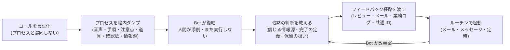

# 「何でも自動化する」考え方：ゴールとプロセスを分け、暗黙の判断を教え、フィードバックを Bot 自身に取らせる（Lauren・Grok Bot チーム）

> **TL;DR**: Grok Bot チームの Lauren（@poteto）が X 記事「Automate Anything with Grok Bot」で示した自動化の作法。自動化は「ゴール＋プロセス＋機械」であり、業務の末端（フォームを埋める・メールを送る）でなく事業上のゴールを先に言語化して Bot に渡す。プロセスは音声で脳内ダンプして Bot に復唱させ、自分が無意識にやっている判断（どの情報源を信じるか・何をもって完了か）を実例で教え、顧客レビューや業務ログを Bot 自身に読ませて改善案を出させ、最後にルーチンで起動条件を決めて人間がボトルネックでなくなる、という順序。

> 📌 X bookmark: 14,006（2026-11-19 時点）

Lauren が記事を書いた動機は、Grok Bot を十分に使えていない人が多いのは製品の問題でなく「自動化の仕方を知ること自体が難しい技能だから」という見立てにある。自動化は毎日やっている人でも正しくやるのは難しいとしつつ、その中身は誰でも学べる考え方だと述べる。アップルパイを焼く（材料を買い・組み・焼き・冷ます）、タイヤを替える（ジャッキで上げ・道具を探し・付け替える）のように、ゴールと、そこへ至る手順のプロセスがあり、自動化はそこに機械（パン屋の焼成機、あるいはコード）を足したものにすぎない、というのが Lauren の整理である。Grok Bot が変えたのは、1〜2 年前まで機械を組むかコードを書ける人に限られていたこの最後の段を、平易な英語で説明すれば Bot がコードを書き、自分の計算機を持ってマウスを動かし、アプリを入れ、ブラウザを使い、会議に参加してメモを取るところまで引き受ける点だと Lauren は説明する。「技術者でないなら、いったん疑いを保留してほしい。Bot はあなたがコンピュータでできることなら本当に何でもできる」という製品チーム側の主張で、できないことや失敗の形は記事に書かれていない。

同じ著者の [[concepts/grok-bot-team-guide]] が「Bot をどう作りどう管理するか」の 7 項目であるのに対し、本記事は「自分の仕事をどう分解して Bot に渡すか」の側で、7 項目のうち音声ダンプと復唱（7 項目目）と dr eggbot（1 項目目）がここで具体化される。

## ゴールから始める（プロセスと混同しない）

Lauren がよく見る間違いは、プロセスをゴールと取り違えることだという。仕事には既に手順が決まっていることが多いが、ゴールはフォームを埋めることでもメールを送ることでもなく、それらは手順の一歩にすぎない。考えるべきは「このプロセスは何のためにあり、事業のどこに位置するか」で、売上を増やす側（販売の処理・新機能の構築）か、費用を減らす側（適量の在庫発注）かを問い、分からなければ上司や同僚、あるいは Bot 自身に聞けばよいと述べる。

ゴールから始める理由として Lauren は、人間と Bot の両方を最終結果に向けることと、Bot がプロセス自体をより効率的にする道を見つけうることを挙げる。プロセスは目的のための手段なので固執しないほうがよい、という立場である。最初に渡す文面は次の形で、記事は Bot の仮名を Potato にしている。

> Hi Potato, this is the goal I want you to be responsible for: <goal>. Pick out a name and picture for yourself based on it.

記事が挙げる最初のゴールの例は 7 つ。車・家・子どもの学費に向けて貯金する、小規模事業の新規予約を取る、顧客体験を良くして良いレビューをもらう、従業員を雇う、製品のフィードバックを集めて改善する、週次会議のスライドを用意する、製品の新機能を作る。ゴールの書き方が分からなければ、「ゴールを任せたいがうまく書けない。満足する形になるまで質問して私にインタビューして」と Bot に頼めばよいとする。

## プロセスは脳内ダンプして復唱させる

ゴールを渡したら、自分ならどうやるかを考え、Bot にどこを効率化できるか見させる。自分のプロセスを厳密に守らせたいなら、そう言ってもよい。Lauren が勧める渡し方は Grok Bot の音声入力で、整理せず意識の流れのまましばらく話すこと。話す中身は、ふだんの手順、注意して見ている点、使うアプリと道具、仕事が正しく終わったことをどう確かめるか、必要な情報をどこから得るか（メール・Slack/Teams・チケット・アプリやサイト）、結果のフィードバックをどこで受けるか（顧客のレビュー・同僚）の 6 点である。文面は次の通り。

> Potato, this is how I usually do this goal myself: <process>
>
> I want you to think about how you can take this over completely from me. Before you begin, restate what you think my goal and process is in simple English so I can give you feedback and confirm it. I don't want you to start executing on this yet, let's focus on getting the process planned first.

一度で合わせようとせず、Bot の復唱を読んで情報を足して直し、数回で納得できる形にしてから「進めて、必要なアプリと道具に接続して」と言う。余裕があれば「私の元のゴールに照らしてこのプロセスを見直し、もっと良い・効率的なやり方があれば教えて」とも頼める。復唱させる 1 文は同じ著者の [[concepts/goal-restatement-prompt]] と同じ型で、ここでは「ゴールとプロセスの両方」を「平易な英語で」「まだ実行せずに」言い直させる形に広がっている。

## 自分がどう考えているかを教える（暗黙の判断）

プロセスを説明するときに忘れがちなのは、自分が考えずにやっていることの多さだと Lauren は書く。顧客の予約を取る仕事なら、どのサービスに時間がかかるか、誰がどの仕事をできるか、予約の間にいつ余白を取るかを本人は分かっているが、Bot にはその文脈が要る。自分がその仕事をするとき何に注意を払い、何があれば違うやり方をするかを考えて渡す。

情報の出どころと、仕事が終わったことの確かめ方も伝える。記事の例では、メールと予約システムで予約時刻が食い違ったらどちらを信じるか。予約はメールを送っただけでは終わっておらず、予約が正しく保存され、顧客に確認が届いて完了になる。詳細を待っている状態なら、Bot にそれを追跡させて、あとで再開するときに誤って予約を二重に作らないようにする。

すべての状況を先回りして説明する必要はなく、実例を数件、特に何かがうまくいかなかった例や普段と違う対応をした例を渡し、Bot にどう扱うか答えさせてフィードバックを返す。何を説明し忘れているかを Bot に見つけさせる文面も示されている。

> Potato, help me figure out what I haven't told you about this process yet. Ask me questions about how I make decisions, where I get my information, how I check the work, and when you should ask me for help. Ask one question at a time, then walk me through a few examples so I can give you feedback before we automate this.

「一つずつ質問して」の形は [[tools/grill-me]] の実装前インタビューと同じ向きで、自分でも書いていなかった前提を掘り出す点は [[concepts/finding-unknowns]] の Unknown Knowns にあたる。

## Bot 自身に改善させる（フィードバック経路とデータ）

Bot が仕事を回し始めたら、改善のためのフィードバックを渡すことが重要で、いちばん良いのは Bot 自身がフィードバックを取りに行けるようアプリと道具を渡すことだと Lauren は書く。考え方は「自分がその仕事をしていて自分を改善したいなら何をするか」。予約を管理する Bot なら、メール・SNS・Google や Yelp のレビューを見張らせ、顧客の不満を拾って改善案を自ら提案させる。Yelp に「長く待たされた」とあれば、Bot がその顧客のその日の記録を引いて何が起きたかを見られる。

ここから Lauren は「事業がコンピュータ化されているほど Bot と自動化には良い」と続ける。データの有無が改善案の質を決めるからで、しかも Grok Bot はそのデータを取る道具を自分で作れる。自動車整備の例では、来店時刻・担当者と話せた時刻・鍵を預かった時刻・作業の開始と終了を記録するアプリを Bot に作らせれば、待ち時間を割り出して原因を診断できる。複数のアプリにまたがるデータを突き合わせるには ID が要るとも述べ、顧客 ID・メールアドレス・注文番号・部品番号・バーコード・従業員 ID のように、ツール間で一意で一貫した識別子を持つことが Bot に全体像を掴ませる鍵だとする。

## ルーチンで「いつ動くか」を決める

最後に、Bot がいつ働くかを決める。メールが届いたとき、誰かがメッセージを送ったとき、あるいは定期的に。Grok Bot ではこれをルーチンで設定する。ルーチンが無ければ Bot は頼まれたときしか働かず、始めたばかりならそれでよいが、自分がボトルネックでなくなるには自動で動く形にする必要がある。トリガーはメールや Slack/Teams のメッセージであることが多く、週 1 回や 1 日おきのような定期実行の場合もあり、どちらも Bot に設定を頼めばやってくれる、と Lauren は書く。3 つの動詞の整理 [[concepts/goal-loop-routine]] でいう「自分がいない間に走る routine」を、非エンジニア向けに「いつ動くかを決める」の一言で説明した形である。

## Dr Eggbot

記事の締めで Lauren は「自分が仕事の自動化について知っていることをすべて Dr Eggbot に教えた」と書き、自動化を進めたいならこの Bot を入れて手伝わせるよう勧める。Dr Eggbot は Bot を設計する Bot で、質の高い Bot を作ってくれると説明される。同じ Bot は [[concepts/grok-bot-team-guide]] の 1 項目目と [[tools/grok-bot-essential-bots]] の 1 位に dr eggbot として載っている。

## 位置づけ（wiki 側の読み）

- **ゴールとプロセスの取り違え**は、[[business/goal-kpi-management-layer]] で @yoshio_nocode が「広告を出す ≠ 顧客が増える」「タスク完了と事業の前進は別」と書いた区別と同じで、Lauren はそれを個人や小規模事業が Bot を設定する入口で言っている。「元のゴールに照らしてプロセスを見直させる」は、[[concepts/instruction-means-review]] が常設ルールにした「目的に照らして手段を再検討させる」を自動化の計画段階で 1 回行うものと読める。ゴールの一段上を問う向きは [[concepts/ai-ambition-four-types]] にもある
- **完了の定義**（予約が保存され確認が届くまで）と**保留の追跡**（二重予約を避ける）は、コーディングでいう受け入れ基準と引き継ぎを業務に置き換えたもので、[[concepts/grok-bot-one-person-harness]] が Operator に渡す受け入れ基準・引き継ぎと役割が対応する
- **Bot にデータを取る道具を作らせる**は、[[tools/grok-bot]] で @lingxi が「クラウドエージェントに完全なフィードバックループを渡す」と書いたことの業務版で、検証対象がコードの動作でなく顧客の待ち時間になっている。共通 ID で複数ツールのデータを結ぶ助言は、[[concepts/palantir-ontology]] が企業規模で行う「対象に同一性を与えて世界モデルを写し取る」ことの最小形と考えられる
- **承認の線**について記事は、「いつ私に助けを求めるべきか」を Bot に質問させる形で Bot 側に委ねている。顧客への確認送信のような外部送信の手前で人間が止める固定の線は書かれておらず、[[concepts/ai-pre-judgment-automation]] の「検知→調査→提案→人間確認→実行」や [[concepts/ai-dedicated-smartphone]] の「送っていいが無ければ送信が動かない」とは対照になる。同じ Grok Bot の利用者構成では [[concepts/grok-bot-one-person-harness]] が Ask first の承認境界を明示している
- **誰に向けた記事か**。@lingxi の運用記（[[tools/grok-bot]]）がエンジニアの開発管理、[[concepts/grok-bot-team-guide]] が Bot の作法であるのに対し、本記事の例は予約・採用・レビュー・在庫で、非エンジニアの小規模事業者を読者に置いている。製品チームが「自動化の考え方」そのものを教材にしている点は、[[concepts/claude-code-task-delegation]] の「毎回うまく指示する」から「指示なしでも結果が出る環境を設計する」への転換を、製品側から促す動きと読める

## 問い

- ゴールを「売上を増やす／費用を減らす」まで遡らせたとき、Bot が自分でプロセスを変えてよい範囲と、変える前に人に聞く範囲の線をどこに引くか。記事はその線を Bot への質問で決めさせており、外部送信前の固定の承認線は置いていない
- この vault の launchd ingest を「ゴール＋プロセス」で書き直すと、ゴールは何か（wiki ページが増えることか、問いに答えられることか）。取り込み手順というプロセスをゴールと混同していないか
- 「共通 ID で複数ツールのデータを突き合わせる」を個人規模でやるなら何が ID になるか（メールアドレス・tweet_id・ファイルパス）。この vault では sources のファイルパスがそれにあたるか

## 関連

- [[tools/grok-bot]] — 基盤製品。@lingxi の開発チーム運用記に対し、本ページは製品チームの Lauren が非エンジニア向けに書いた自動化の考え方
- [[concepts/grok-bot-team-guide]] — 同著者の Bot 設計 7 項目。本ページはその前段にあたる「仕事の分解の仕方」で、音声ダンプと復唱・dr eggbot が重なる
- [[concepts/goal-restatement-prompt]] — 同著者の 1 文。本ページでは「ゴールとプロセスを平易な英語で言い直し、まだ実行しないで」の形に広がる
- [[tools/grok-bot-essential-bots]] — kaito 選の 10 体。1 位の dr eggbot に Lauren は自動化の知見を教えたと書く
- [[concepts/goal-loop-routine]] — goal / loop / routine の 3 動詞。本ページのルーチンは「自分がいない間に走る」側
- [[concepts/scheduled-agent-automation]] — 定時起動エージェントの Anthropic 公式設計ルール。本ページのルーチンを Claude Managed Agents で組むときの参照実装
- [[business/goal-kpi-management-layer]] — 「タスク完了と事業の前進は別」を事業管理の層で書いた @yoshio_nocode の構想。本ページの「プロセスをゴールと混同しない」と同じ区別
- [[concepts/finding-unknowns]] — 実装前に unknowns を洗う技法群。「何を説明し忘れているか聞かせる」は Unknown Knowns の掘り出し
- [[tools/grill-me]] — AI に一問ずつ質問させる実装前インタビュー。本ページの「一つずつ質問して」と同じ向き
- [[concepts/instruction-means-review]] — 目的に照らして手段を再検討させる常設ルール。本ページの「元のゴールに照らしてプロセスを見直させる」の常設版
- [[concepts/ai-ambition-four-types]] — ゴールの先のゴールを問う Altitude の型。本ページの「売上か費用か」まで遡る問い方と同じ向き
- [[concepts/grok-bot-one-person-harness]] — 一人会社向けの Operator 1 体の 7 手順。受け入れ基準・引き継ぎ・Ask first の承認境界を明示する点で本ページの補完
- [[concepts/ai-pre-judgment-automation]] — 外部送信の手前に人間確認を固定する運用。本ページが Bot に委ねる承認線の対照
- [[concepts/ai-dedicated-smartphone]] — 「送っていい」が無ければ送信が動かない LINE 運用。同じく承認線を固定する側の実例
- [[concepts/claude-code-task-delegation]] — 「毎回うまく指示する」から環境設計への転換。本ページは製品チームがその転換を教材にしたもの
- [[tools/pstack]] — 同著者の Cursor スキル群。復唱の `/in-your-own-words` を含む
