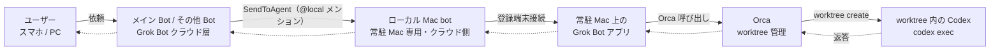

# Grok Bot から常駐 Mac の Orca と Codex を呼ぶ自動ルーティング（@kzkhykw の個人構成）

> **TL;DR**: Notion の AI/FDE kazuki hayakawa（@kzkhykw）が、Grok Bot に「ローカル Mac 専用の Bot」を 1 体置き、メイン Bot が @ メンションで仕事を渡すと、自宅の常駐 MacBook 上の Grok Bot アプリが Orca で git worktree を切って Codex を実行し、結果を逆向きに返す構成。コーディング・画像生成・長めのループ・Codex のトークン余りをローカルへ振る条件にし、タスクに応じて自動で振り分ける。

Grok Bot の各 Bot はクラウド上の計算機で動き、手元のマシンは「別物」で、Bot がそこへ触れるのはデスクトップアプリ経由のローカル実行だけ、と Cursor が公開する Grok Bot のドキュメントは説明する。@kzkhykw の構成は、そのローカル実行の入口を「ローカル Mac bot」1 体に集約し、メイン Bot や用途別の Bot はそこへ依頼を投げるだけにする（入口を 1 体にまとめる意図は図から読んだ wiki 側の解釈で、著者本人の説明は「ローカル MacBook 呼び出す専用のボットを作って、タスクに応じて自動ルーティング」の 1 文）。[[concepts/grok-bot-ai-team-workspace]] で炎鎮が自宅の Windows PC を主作業場にし 1 回ごとに承認して Claude Code や Codex を直接動かしていたのに対し、こちらは Mac 側に worktree 管理ツールの Orca を挟み、依頼ごとに隔離した作業ディレクトリで Codex を走らせる。著者は X のプロフィールで Notion の AI/[[concepts/forward-deployed-engineer|FDE]]、PMDAO の founder、Salesforce で AI プロダクト担当だったと記す。元ポストは 2026-10-31 の 2 文と構成図 1 枚で、呼び出し方・Orca を選んだ理由・差し替え可能な範囲は著者が翌日以降にスレッドへ足した返信と引用ポストにある（いずれも sources/notes/ に転記）。

## 構成図の転記

図の見出しは「Grok Bot → 常駐Mac の Grok Bot アプリ → Orca / Codex」、副題は「クラウドの専用エージェントから、登録端末のアプリを通じて実行」。実線が依頼、破線が返答で、返答は依頼と逆順に同じ経路を戻る。

| 層 | 構成要素 | 図の注記 | 次へ渡す矢印 |
|---|---|---|---|
| ユーザー | スマホ / PC | — | 依頼 → メイン Bot／その他 Bot |
| Grok Bot（クラウド / エージェント層） | メイン Bot | — | SendToAgent → ローカル Mac bot |
| 同上 | その他 Bot | カメラ自作・日報など | SendToAgent → ローカル Mac bot |
| 同上 | ローカル Mac bot | 常駐 Mac 専用エージェント・クラウド側 | 登録端末接続 → 常駐 Mac の Grok Bot アプリ |
| 常駐 Mac（登録済みの物理マシン） | Grok Bot | 常駐 Mac 上のアプリ | Orca 呼び出し → Orca |
| 同上 | Orca | worktree 管理 | worktree create → worktree |
| 同上 | Codex | worktree 内で codex exec | 返答 → Orca へ戻る |

## ルーティングの条件と呼び出し方（著者の説明）

ローカルの MacBook へ振るのは、著者の本文によれば**コーディング・画像生成・長めのループ・Codex のトークン余り**の 4 条件で、タスクに応じて自動で振り分ける。判定をメイン Bot の指示文に書いているのかスキルやルーチンなのかは、ポストにもスレッドにも記載がない。

実際に使うときはメイン Bot から「@ local」で呼び出している、と著者は引用ポストで補足する。Bot 名は「Local Mac Handler」で、メンションしやすいように英語表記の名前がよいと勧める。添付の画面写真では、Grok Bot の Mac アプリの入力欄に「このタスクQAループ回して @local mac」と打ちかけた状態で、候補に「Local Mac Handler Bot」が 1 件出ている。同じ Bot 一覧には「Podcast Helper」が見え、他の Bot 名はぼかされている。

スレッドで著者が答えた範囲は次のとおり。

- **自宅 Mac は登録端末としてつないでいるだけ**で、SSH 経由の VPS 操作はまだ試していない（@ks458008 への返信）
- **設定でつまずく**のは分かる、最初は自分もそこで止まった（@sorekaiya への返信）。何の設定かは書かれていない
- **Orca は読んでいるだけなので Claude Code でもできる**（@kiuri_cucumber への返信）。Codex でなく Claude Code でもよく、ローカル LLM も使えるので Qwen もたまに触らせている、登場頻度は高くない、と自己返信でも述べる
- **iPhone からは直接 Orca のモバイルアプリで行ける**（@misaki_hennyu への返信）
- @0xKyosuke の「スクショや録画を戻すループ」の提案には「寄せてみます」と答えており、構成に取り込む予定と読める

## Orca を選んだ理由と Orca の概要

「Herdr でもいいでしょ勢がいます」と前置きしたうえで、著者は Orca の GUI が好きなこと、Orca のモバイルアプリが使いやすく、何かあったときに常駐 Mac へモバイルからでも触れることを理由に挙げる（「アイコン可愛いし」とも）。[[tools/herdr]] は複数マシン上のエージェントを 1 つの操作卓に束ねるツールで、スマホからの操作は Tailscale と Termius を組み合わせる運用が wiki に記録されている。著者の選択基準は機能差でなく GUI とモバイル経路の使い勝手にある。

Orca は公式サイト onorca.dev が「Claude Code・Codex・その他のコーディングエージェントを並列に、それぞれ自分の worktree で走らせる。ターミナル・差分・ブラウザ・CLI を 1 つのアプリに」と説明するデスクトップアプリで、「無料でオープンソース」と記す。GitHub の stablyai/orca は MIT ライセンス、README は macOS・Windows・Linux 対応と、iOS App Store と Android APK で配るモバイルコンパニオン（エージェントの完了通知を受け取り、外出先から追加指示を送る）を掲げる。対応エージェントの一覧には Claude Code・Codex・Grok・Gemini・Cursor・OpenCode・Qwen Code などが並び、「使っているサブスクリプションをそのまま持ち込む」方式をとる。GitHub のリポジトリ説明は「Grok Bot や Claude Code などエージェントの艦隊と働く場所」と Grok Bot を名指ししている。著者の「Orca は読んでいるだけ」という返信は、Grok Bot アプリが Orca に worktree の作成と Codex の実行を頼み、エージェントの種類は Orca 側の設定で差し替えられる、という意味に読める（wiki 側の解釈）。

## Grok Bot 公式ドキュメントとの対応

図のラベルは著者の用語で、公式の機能名と一対一ではない。Cursor が公開する Grok Bot のドキュメント（work と security のページ）から対応しそうな記述を引くと次のようになる。

| 図のラベル | 公式ドキュメントの記述 |
|---|---|
| メイン Bot → SendToAgent → ローカル Mac bot | 「Hand work between Bots」: Bot は別の Bot へ非同期メッセージを送れ、受け手は起きて処理し後で返信できる。ハンドオフは会話に表示される。会話では `@` で Bot・グループ・ルーチン・アプリをメンションできる |
| 登録端末接続・常駐 Mac 上のアプリ | 「Your local computer is separate」「Local execution」: クラウド計算機と手元のマシンは別物で、Bot はデスクトップアプリを通じて自分のマシンでコマンド実行・ファイル読み取り・クラウド計算機との間のファイル移動ができる |
| ローカル実行の承認 | 既定はコマンドごとの承認で、承認カードに実行するコマンドがそのまま出る。設定は Settings > Computer > Your computer の「Execution on this computer」で **Ask every time / Always allow / Never allow** から選ぶ。公式は「Bot がローカルのファイルを扱う特定の理由がない限り Never allow を勧める」と書く |
| ホスティング | Grok Bot は Cursor がホストするクラウド計算機でのみ動き、オンプレミスや自前イメージは未対応。1 アカウントの全 Bot は 1 台のクラウド計算機を共有する |

著者の構成で「自動ルーティング」と承認がどう両立しているか、つまり Always allow にしているのか毎回承認しているのかは、ソースに記載がない。

## 位置づけ（wiki 側の推論）

- **入口を 1 体に寄せる効果は権限でなく文脈にあると考えられる**。公式のローカル実行ポリシーは Bot 単位でなく利用者のデスクトップ設定なので、Bot を分けても権限の境界は増えない。専用 Bot を置く価値は、Orca の呼び方・worktree の作法・結果の戻し方といった常駐 Mac 向けの手順と記憶を 1 体に持たせ、他の Bot は「@local に投げる」だけで済む点にあると読める
- **Orca を挟む理由は並列と隔離にあると考えられる**。著者が挙げる「長めのループ」や複数 Bot からの同時依頼を 1 台の Mac で受けるとき、依頼ごとに worktree を切れば同じリポジトリ上で作業が衝突しない。これは Orca 公式サイトが掲げる主機能そのもので、[[concepts/grok-bot-ai-team-workspace]] の炎鎮の構成が自宅 PC 上の Claude Code や Codex を直接動かすのと比べた差分になる
- **[[tools/grok-bot]] の @lingxi が Mac mini を Cursor Cloud の private worker にする案**は、実行基盤を Cursor のクラウドエージェントに置いたまま自宅機を貸し出す向きで、こちらは Grok Bot のローカル実行で自宅機の Orca と Codex を直接呼ぶ。Codex の契約枠（「トークン余り」）を使い切る動機は、[[tools/herdr]] で @Voxyz_ai がクォータの消費に合わせてモデルの役割を変える運用と同じ出発点にある
- **スマホからの経路が 2 本ある**。スマホ → Grok Bot のメイン Bot → ローカル Mac bot → 常駐 Mac という Bot 経由の経路と、iPhone → Orca モバイル → 常駐 Mac という直結の経路で、後者は [[tools/claude-code-remote-control]] が公式に提供する「スマホから自分の PC のエージェントを動かす」と同じ目的を Orca で組んだものにあたる

## 問い

- 「Codex のトークン余り」をどう検知してルーティングに使っているか。Orca のモバイルアプリは使用量の確認を掲げるが、Bot 側の判定に何を渡しているかはソースに無い。[[tools/codexbar]] のような残量の可視化を Bot に読ませているのか、本人に聞ける機会があれば確かめる
- 公式の既定（コマンドごとの承認・推奨は Never allow）に対し、著者は Always allow にしているのか。自宅機を触らせる承認粒度は炎鎮の「1 回ごとに承認」と対照になるので、両者の運用を比べる材料として追う
- 自分の環境（Mac と Claude Code 中心）で同じ形を組むなら、Orca を挟まず Claude Code を直接呼ぶ案と比べて worktree 分離がどこで効くか。並列依頼が実際に発生するかで答えが変わる

## 関連

- [[tools/grok-bot]] — 基盤製品。@lingxi は Cursor のクラウドエージェント（private worker の Mac mini を含む）を実行基盤にするが、本ページは Grok Bot のローカル実行で自宅 Mac の Orca と Codex を直接呼ぶ
- [[concepts/grok-bot-ai-team-workspace]] — 炎鎮の自宅 Windows PC 主体の構成。遠隔コマンドは 1 回ごとに承認し Claude Code や Codex を直接動かす。本ページは Mac 側に Orca を挟み worktree 単位で Codex を走らせ、入口をローカル専用 Bot 1 体に寄せる
- [[tools/herdr]] — 著者が「Herdr でもいい」と並べた代替。複数マシンのエージェントを人間の操作卓に束ねる方向で、著者は GUI とモバイルアプリの使いやすさで Orca を選んだ
- [[tools/openai-codex]] — 常駐 Mac 側の実行役（codex exec）。著者は Claude Code やローカル LLM（Qwen）にも差し替え可能と述べる
- [[tools/claude-code-remote-control]] — スマホから自分の PC のエージェントを動かす公式経路。本ページはスマホ → クラウドの Bot → 登録端末、または iPhone → Orca モバイルの 2 経路で同じ目的を組む
- [[concepts/private-agent-board]] — 同じく Grok Bot を自前の仕組みにつなぐ個人構成。あちらは複数社の常駐エージェント間の伝言、こちらは 1 社の Bot から自宅の計算資源への橋渡し
- [[concepts/grok-bot-opus-5-5-harness]] — Grok Bot を「ハーネスが製品で脳は交換可能」と読む @0xMorlex の整理。本ページの著者が Codex を Claude Code やローカル LLM に差し替えられると述べるのは、常駐 Mac 側でも同じ分離が成り立つ例
