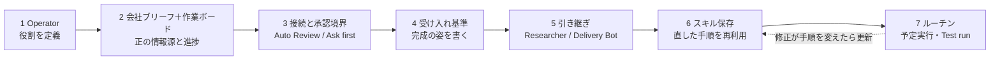

# Grok Bot で組む一人会社のハーネス（Operator・会社ブリーフ・承認境界・ルーチン）

> **TL;DR**: 一人会社の経営者が納品・営業・意思決定で手を離せない間も仕事が進むよう、Grok Bot に「Operator」1体を置き、会社ブリーフと作業ボードを正の情報源として渡し、承認境界・受け入れ基準・引き継ぎ・スキル・ルーチンの7手順で囲む設定手順（@beamnxw の X 記事「Grok Bot Engineering: Set Up a Harness for Your One-Person Company」）。

@beamnxw は、一人会社に要るのは「オーナーが忙しい間も仕事を前に進める方法」であり、Grok Bot には繰り返しの準備作業と実行作業を任せられると述べる。ここでの「ハーネス」は、各タスクに**担当（owner）・現在の文脈・レビューできる結果・明確な承認境界**の4つを与える枠組みを指す。記事はデジタル製品かサービスを売る一人事業を例にし、読者に自分の提供物へ置き換えるよう促す。各手順には docs.x.ai の公式ドキュメント（get-started・bots・computer-and-apps・approvals-security-and-privacy・chat-and-collaboration・skills-routines-and-automations・settings-and-notifications）が添えられている。

本ページの手順は記事本文からの転記で、「Operator の説明文に貼る」「会社ブリーフにコピーする」など7か所の貼り付け用テンプレート本文はソースのキャッシュに収録されていない（元記事 x.com/i/article/2107133050547007488 で読める）。

## 7手順（@beamnxw）

### 1. 役割を定めた Operator を作る

- 公式ダウンロードページからインストールし、アカウントとプランの要件を確認してサインインする
- New → Create new Bot で Bot を作り、名前を Operator にして Edit Profile を開く
- **説明文（description）には常設ルール、個別メッセージには今の割り当て**を書く
- 最初の仕事はリサーチ・下書きの準備・作業ボードの更新。タスクごとに具体的な成果を指定する

### 2. 会社に正の情報源を与える

- 既存のノートやドキュメントに短い**会社ブリーフ**を作り、Bot に添付するかアクセスできるリンクを渡す
- 不明な項目は unknown と書き、タスクを止めている不足情報を Bot に指摘させる
- 承認済みの実例を加える。クリエイターなら公開記事と採用された編集、サービス業なら実際の納品例と合意済みの作業範囲
- **作業ボード**のステータス案は ready / working / blocked / awaiting approval / complete
- ブリーフは安定した事業の文脈、ボードは現在の進捗に使い分ける。変わる事実には出典と更新日をつける
- Grok Bot は好みと作業文脈を保持するが、影響の大きい判断では現在のソースを開き直させる

### 3. 最初のワークフローの周りだけ接続する

- ローンチ準備なら、提供物のドキュメント・承認済み実例・公開リサーチ源から始める
- Bot がそのサービスに保存する必要があるときだけ、ノート/ドキュメントのプラグインを Marketplace から追加する
- 認証が要るサイトは Agent Computer を開いて人が操作を引き取り、ログインして Bot に返す
- アカウント上の全 Bot はクラウドの計算機を共有し、ファイルとブラウザセッションも共有されうる。新しい役割を足すときは接続済みアカウントを見直す
- Settings → General → Auto-review を開き、Auto Review を有効にしたうえで、会社ブリーフに列挙した外部アクションへ **Ask first** ルールを足す。ルールが重なるときは Ask first が優先。サービスへのアクセス範囲も合わせて絞る。Auto Review はモデルがアクションを評価する
- ローカル計算機での実行はタスクの必要に応じて設定する。クラウド文書を使うワークフローはクラウドアクセスから始められる

### 4. タスクごとに受け入れ基準を置く

- タスクには「完成した仕事がどう見えるか」を書く
- 小さな製品ローンチの例: 提供物・価格・条件がソース文書と一致している／各事実に裏付けがある／文章が承認済み実例に従っている／最終文書が会話からアクセスできる／ボードに次に自分が決めることが示されている
- これは編集系の例で、クライアント納品なら合意した範囲と必要ファイル、経費の準備なら元の領収書と記録に合う合計のように、実際の業務に合わせる

### 5. 引き継ぎに仕事を載せる

- まず Operator がタスク全体を持つ。分ける価値のある繰り返し作業が出たら専門 Bot を足す。Researcher が証拠収集、Delivery Bot が顧客向け成果物の準備を持ち、Operator はボードとレビューキューを維持する
- Grok Bot はグループ会話と Bot 間の引き継ぎに対応する。複数の Bot が1つの成果を共有するときはグループを使い、次の手順を担当する Bot をメンションする
- **1ステージ1オーナー**。受け取る Bot には、続ける前に保存済みの作業を点検させる
- この構造は中断にも効く。次のターンが「何が済んだか・どの成果があるか・何が残っているか」を確認できる。不確かな外部アクションは、再試行の前に宛先と行動記録を確認する

### 6. レビューした手順を保存する

- 小さな本物のタスクを回し、出力を修正してから Bot の会話でスキルとして保存する
- **スキルは再利用可能な方法、ルーチンは所有 Bot のための予定実行**。保存したスキルはコンポーザーのスラッシュメニューから呼ぶ
- 予定化する前に別の入力で試し、ソースの欠落や不完全なブリーフをどう扱うか確かめる

### 7. 判断を助ける仕事を予定実行にする

- Settings → General → Bot でタイムゾーンを設定し、繰り返し実行を始めるときは Usage & Billing を確認する
- Operator の会話でルーチンを依頼し、表示される予定・ソース文書・所有 Bot・期待出力を確認する。Test run は接続したツールを通じて本物の仕事をする
- 後で承認済みのワークフロー（リサーチ準備・週次の納品パック・渡した記録からの経費サマリー）を予定化する。各ルーチンを観測できる結果に結び、ソースや手順が変わったら実行履歴を見直す
- 成果物を受け入れたら最終版を保存し、ボードを更新し、再利用したい修正を記録する。修正が手順を変えるならスキルを更新する

## 位置づけ（wiki 側の推論）

- 同著者の [[concepts/claude-code-long-task-harness]] は Claude Code の設定ファイルを7層に重ねてコーディングの長いタスクを完走させる手順で、本ページは同じ「ハーネス」の語を一人会社の業務に当てたもの。両方に共通するのは、成果物の受け入れ基準を先に書く・進捗を外部（progress.md／作業ボード）に残す・直した結果を再利用できる場所（スキル）へ戻すの3点と考えられる。
- 「ブリーフは安定した文脈、ボードは現在の進捗」という分離と「会社ブリーフに列挙した外部アクションは Ask first」という承認境界は、[[concepts/harness-seven-jobs]] が挙げる記憶の外部化・権限はモデルの外に対応すると考えられる。
- Grok Bot の個人構成では [[concepts/grok-bot-ai-team-workspace]]（担当別7体）や [[tools/grok-bot-essential-bots]]（10体）のように複数 Bot から入る例が先に wiki に入っているが、本記事は Operator 1体から始め、繰り返し作業が見えてから Researcher・Delivery Bot を分ける順序を取る。

## 問い

- 自分の一人会社相当（この wiki の運用）で、Operator に最初に渡す「繰り返しの準備作業」は何か。ソース収集・下読み・ボード更新のどれが受け入れ基準を書きやすいか
- Auto Review はモデルが判定するので、Ask first の列挙から漏れた外部アクションは通りうる。会社ブリーフの外部アクション一覧をどう網羅し、漏れをどう検出するか
- 貼り付け用テンプレート7本は未収録。元記事から取り直して、常設ルールの長さや受け入れ基準の書式を確認する価値があるか

## 関連

- [[tools/grok-bot]] — 基盤製品。@lingxi のエンジニアリング運用記に対し、本ページは一人会社の業務運用の設定手順
- [[concepts/grok-bot-ai-team-workspace]] — 炎鎮の担当別7体構成。本ページは1体の Operator から始め、必要になってから分ける対照
- [[concepts/claude-code-long-task-harness]] — 同著者が Claude Code のコーディングに対して書いた7層ハーネス。受け入れ基準・外部の進捗記録・スキルへの書き戻しが共通
- [[tools/grok-bot-essential-bots]] — kaito 選の Bot 10体。Commitments（タスク追跡）や Engineering Lead は本ページの Operator・作業ボードに近い役割
- [[concepts/harness-seven-jobs]] — 本番ハーネスの7つの仕事。ブリーフ/ボードの分離と Ask first の承認境界が記憶の外部化・モデル外の権限に対応
- [[business/hensu-kyokushouka]] — 一人ビジネスをマネジメント不要に設計する論。本ページはその実行側に常駐エージェントを置く手順
