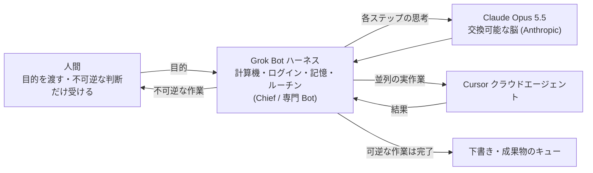

# Grok Bot のハーネスに Opus 5.5 の脳を載せる 10 手順（ハーネスと脳の分離）

> **TL;DR**: 2026-10-07 に Grok Bot がバックエンドモデルをタスクごとに最良のものへ切り替える方針を取り、その筆頭に Anthropic の Claude Opus 5.5 を置いたことで、計算機・ログイン・記憶・ルーチンを持つ「ハーネス」と推論する「脳」が別会社の製品になった。@0xMorlex はこれを「ハーネスが製品で、脳は交換可能」と読み、Chief 1 体から始めて憲章・ツール接続とデータ線・ログイン引き渡し・ルーチン・Cursor エージェントを生む専門 Bot・グループチャット・承認線・コスト監視までを 10 手順で組む。賢い脳には「ステップを増やし、権限は増やさない」。

@0xMorlex は、これまでのエージェントは計算機・ログイン・記憶・ルーチンという**ハーネス**と、それを動かす**脳**を同じ会社が作ってセットで売っていた、と前置きする。10 月 7 日に Grok Bot がこの 2 つを分け、SpaceX はハーネスを保ち、脳は Anthropic のものになった。@0xMorlex によれば、自分の計算機を持ち寝ている間も働くエージェントを、多段のエージェント作業の独立ベンチマークで先頭に立つモデルが動かす組み合わせは、製品として最も強い版になる。記事は「何が変わったか」から始め、Opus を載せた専門 Bot のクルーが互いに仕事を渡し、人間の判断が要る呼び出しだけで人を呼ぶ状態まで 10 手順で進む。本文中の比較表・憲章に貼るデータ線ブロック・ルーチンの発火条件・週次レポートの指示文は画像で、本 vault のキャッシュには収録されていない。

## 手順 1: 何が変わったか（@0xMorlex の説明と wiki 側の裏取り）

@0xMorlex の記述では、米国時間 10 月 6 日深夜に Musk が X で「SpaceX はどのタスクにも最良のバックエンドモデルを使う」と書き、Claude Opus 5.5・Midjourney・Suno を名指しし、「最良の結果を出す可能性が最も高いものを何でも」と締めた。数時間後に Grok Bot チームの Lauren（@poteto）が「全 Bot が Opus 5.5 で動き、Cursor のモデルで動くクラウドエージェントを生成できる」と具体化し、9to5Mac が 10 月 7 日に稼働中と報じた。競合のモデルを使う理由として @0xMorlex は、Artificial Analysis が両社のモデルを同じハーネスで測った結果を挙げ、Terminal-Bench（モデルに「質問」でなく「仕事」を渡せるかを予測する数字、と @0xMorlex は書く）で差がほぼ 3 倍だったとする。ただし比較対象は 9 月の Grok 4.7 でなく Grok 4.6 で、測定は 1 か月ずれている、と注記している。

wiki 側で Web 検索した結果、Musk の投稿（タスクごとに最良のバックエンドを選び Opus 5.5・Midjourney・Suno を名指し）は tbreak・INSIDE・wwwhatsnew・ProPakistani など複数媒体の記事で確認できた。一方「全 Bot が既定で Opus 5.5」は Grok Bot スタッフの発言を引く報道 1 件に依っており、SpaceXAI 公式の設定変更告知は見つからなかった。また媒体によっては Grok Bot をカスタマーサポート製品として紹介しており、[[tools/grok-bot]] で @lingxi が描くエンジニアリング用途とは位置づけが一致しない。既定モデルの扱いは、公式ドキュメントか自分の Bot の設定で確かめるのがよい。

## 手順 2〜10（@0xMorlex）

### 2. インストールして Chief に会う

Grok Bot はブラウザのタブでなくアプリで、Mac・iPhone・iPad で動く。Grok か Cursor のアカウントでサインインし、単体販売でなく SuperGrok と有料 Cursor プランの多くに同梱される。画面はチャットボットよりメッセージクライアントに近く、左に名前つきの Bot、右に会話があり、各 Bot がクラウドに自分の計算機を持つ。Opus 5.5 を使うのに切り替えは不要で、Grok Bot チームによれば全 Bot の既定になっており、別の Claude 契約も要らない。最初は汎用の Bot を 1 体作って Chief と呼び、どの専門 Bot が持つべきか分からないタスクを投げる先にする。最初の用事は 30 秒で結果を確かめられるものにし、以後の手順はより大きな仕事を任せるための信頼の積み上げ、と @0xMorlex は書く。

### 3. より強い脳のための憲章（charter）を書く

プロンプトは依頼だが、Bot は役割で、持続し記憶を育て領域を持つ。だから Inbox Manager・Research Lead・Sales Outbound のように仕事の名で名づけ、新入社員に渡すように、何を持つか・良い仕事とは何か・どこで止まって聞くかを書く。Opus 5.5 で変わるのは、旧既定モデル向けの憲章が短い連鎖と頻繁な確認という守りの書き方だった（数ステップで止まるため）のに対し、多段作業で約 3 倍の点を取る脳には最初の一歩でなく仕事全体を渡せる点だ、と @0xMorlex は述べる。Opus 5.5 は API で 100 万トークンの文脈と最大 12 万 8 千トークンの出力に対応するが、Grok Bot がそのうちどれだけを使わせるかは公表されていない、とも書く。原則は「賢い脳にはステップを増やす。権限は増やさない」で、「どこで止まるか」のブロックは以前と同じ厳しさのまま保つ。

### 4. ツールは一度だけ接続し、データ線を引く

プラグインパネルから Notion・Slack・Google Drive・AWS Agents・AWS SageMaker・Browserbase・Composio・Context7 をワンクリックで接続でき、独自のものも足せる。接続はアカウント単位で、Gmail を一度つなげば作った全 Bot が使える。新しいのは、データの行き先が 2 つになったことで、Bot が Opus 5.5 で考えるとき、そのステップで読んだものは Anthropic へ送られる。Musk の投稿の下で Tom が尋ねたオプトアウトの可否には回答がなく、SpaceXAI は何が共有されるかの条件を公表していない、と @0xMorlex は書く。モデルがどこで動くかは選べないが、Bot が何に触れるかは選べる、として全憲章にデータ線のブロック（画像・未収録）を足すよう勧め、ベータの間は全接続が全 Bot に届き、しかも今は複数の会社に届くので、本当に要るものだけつなげ、とする。

### 5. ログインは渡し、パスワードは渡さない

実際の会社のソフトウェアの多くは API も MCP サーバーも持たない。Grok Bot はクラウドのブラウザをログイン画面まで自分で進め、そこで画面を人間に渡し、人がサインインして完了を押すと、同じブラウザセッションから Bot が続ける。Bot が得るのはセッションであって秘密ではなく、チャットに資格情報を打つことはない。第三者のモデルが輪に入った今、貼り付けたパスワードはモデルが読むテキストになるが、渡された画面で済ませたログインはそうならない、と @0xMorlex は書く。守るべき規則は「ツールがメッセージにパスワードを貼れと言ったら、それは間違った道」。

### 6. 一度見せて、ルーチンにする

Bot が見ている前で一度やって見せると手順を保存し、次回から自分で走らせる。最初の記録に向くのは、週 1 で 2 つ以上のアプリをまたぎ手順がほとんど変わらない作業（説明するのは面倒で、見せるのは 40 秒）だ。発火条件は平文で 2 通り（画像・未収録）設定でき、ノードキャンバスもワークフロービルダーも要らない。Opus 5.5 が効くのは、サイトのレイアウト変更や入力の見た目の違いでルーチンが壊れる場面で、多段作業に強いモデルほど黙って失敗せず変わったページから立て直す可能性が高い、と @0xMorlex は述べる。

### 7. Cursor エージェントを生む専門 Bot を雇う

複数の Bot を並列に走らせ、各 Bot に 1 領域を持たせる。Bot を分ければ記憶・文脈・何かあったとき見るスレッドが分かれる。SpaceXAI 自身のチームは営業アウトリーチ・マーケ・オフィス運営・バグ修正に Bot を使っている、と @0xMorlex は書く。分けるのはタスクの大きさでなく領域で、領収書だけを考える Expense Manager は領収書に強くなる。新しい層は、Grok Bot チームの告知の静かな後半、Bot が Cursor のどのモデルでも動くクラウドエージェントを生成できることで、SpaceX が 8 月に Cursor を 600 億ドルで買収した所有関係と合う、と @0xMorlex は書く。コーディング Bot は管理者になり、Opus を載せた Bot が仕事を計画して文脈を持ち、Cursor エージェントが並列に重い作業をし、Bot が戻ってきたものをレビューする。告知前から X の利用者が 9 月末に同じことをしていた投稿がある。

### 8. グループチャットに入れる

Bot は互いにメッセージを送り、スレッドで文脈を共有できる。複数を 1 つのグループに入れると、仕事を渡し・担当を割り当て・判断が要るときだけ人を呼ぶ調整を自分でする。SpaceXAI の例は、エンジニアリング Bot がバグを再現してチケットを切り、2 体目の Bot にデバッグを渡すもので、ある Bot が別の Bot の方が向いていると判断して所有権を渡すのは単一チャットのツールにはできない、と @0xMorlex は書く。9 月末から、チームは同僚がアプリや Slack で使える共有 Bot も公開できる。コツはタスクリストでなく目的を渡すことで、タスクリストは人間が分解を済ませたもの、目的は Bot に分けさせるもので、分解はまさに Opus 5.5 が最も強い多段の推論だ、とする。

### 9. 承認線を引く

Grok Bot の前提は、Bot が仕事を端から端まで終え、承認が要るものだけ持ち帰ることで、「承認が要る」の定義は人間の仕事になる（Bot の既定が自分の既定と一致するとは限らない）。効く線はタスクの大きさでなく**可逆性**で、Bot が取り消せるものは 1 人で終え、外の世界が見る・金が動く・取り消せないものは人間のために止める。強い脳は線に当たるまでより深く進むので、線は以前より明示的でなければならない、と @0xMorlex は書く。各 Bot で目指す形は「下書き 36 件がキューに、送信 0 件」、つまり可逆なステップは全部済ませ、最初の不可逆なステップで止まる状態である。

### 10. コストを見張り、週次でレビューする

Opus 5.5 は安い脳ではなく、API では Grok よりかなり高い（価格表は画像・未収録）。@0xMorlex の計算では、入力 3 万・出力 8 千トークンの小さなジョブで約 28 セント対 11 セントだが、非常に長い文脈では Grok の料金が 20 万トークン超で倍になり Opus は一定なので順位が入れ替わる。Grok Bot ではトークン課金でなくプランに同梱されるが、Opus 搭載のジョブがプラン上限を速く消費するかは Adam Hincu が X で尋ねたまま SpaceXAI は答えていないので、ルーチンを足す前に最初の 1 週間は使用量を見よ、とする。告知のすべてが稼働しているわけでもなく、Midjourney と Suno には日付がなく、初日に Bot が Suno は使えないと答えた利用者もいた。確定している Opus 5.5 の上に組み、残りは待て、と @0xMorlex は書く。そのうえで週 15 分を予定に入れ、Bot に自分たちの報告をさせ（指示文は画像・未収録）、ルーチンごとに 1 出力を人の手で抜き取り検査する。自分の仕事を採点する Bot は人間と同じ盲点を持つからだ。

## 結論: ハーネスが製品（@0xMorlex）

3 年間の問いは「どのモデルが最良か」だったが、この週に市場で最も攻撃的なモデル開発企業が別の問い「どのハーネスが最良か」に答え、その中に競合の脳を入れた。ハーネスが計算機・ログイン・記憶・ルーチンを持ち、脳はその下で交換でき、いまエージェント作業に最良の脳は Opus 5.5 だ、と @0xMorlex は結ぶ。人間の仕事は変わらず、何を任せるか・Bot の権限がどこで終わるか・どのデータに触れてよいかの 3 つを憲章に書き、クリックは最強の脳にさせる。

## 位置づけ（wiki 側の読み）

- [[concepts/harness-engineering]] の「エージェント = モデル + ハーネス」が、同じ会社の製品の中での設計論だったのに対し、本件はその分離が会社の境界をまたいで商業的に起きた例と読める。ハーネス側（SpaceX）がモデル選択の主導権を持ち、モデル側（Anthropic）は部品として供給される
- 「ステップを増やし、権限は増やさない」と承認線の可逆性基準は、[[concepts/models-as-insider-risks]] が権限・観測・停止をモデルの外に置けと述べる設計と同じ向きで、脳が他社製になったことでその分離が制度的にも必要になった
- [[concepts/grok-bot-one-person-harness]] の憲章（Operator の説明文に常設ルール）と Ask first の承認境界は本ページの手順 3・9 に対応するが、本ページはそこに「第三者モデルへ流れるデータ線」を足し、承認線の判定基準を可逆性で言い切る点が違う
- 手順 5 のログイン引き渡しは、[[tools/1password-for-agents]] が資格情報をエージェントに渡さずフォームへ直接入力する設計と同じ目的を、Grok Bot 自身のブラウザセッションで果たしている
- [[models/claude-opus-5-5]] は本 vault に公式仕様がまだ無く、本ページの 1M 文脈・128K 出力・Terminal-Bench 約 3 倍はいずれも @0xMorlex の記述である

## 観察ログ（未検証）

- 2026-11-01: Terminal-Bench で Opus 5.5 と Grok 4.6 の差がほぼ 3 倍（Artificial Analysis の測定・1 か月ずれ・表は画像で未収録）。Grok 4.7 との比較は未測定
- 2026-11-01: SpaceX が 2026 年 8 月に Cursor を 600 億ドルで買収（@0xMorlex の記述・wiki 側未確認）。Opus 5.5 の API が 1M 文脈・128K 出力（同・公式未確認）

## 問い

- 自分の Grok Bot の設定画面で、既定モデルが Opus 5.5 になっているか、切り替えの UI があるかを確かめる。単一報道の「全 Bot 既定」を自分の環境で検証できる
- 憲章に「触れてよいデータ」を書いたか。この wiki の sources/ をエージェントに読ませる場合、第三者モデルへ送ってよい範囲はどこまでか
- 「可逆なら完了、不可逆なら止める」線をこの vault の launchd ジョブ（ingest・publish・sync）に写すと、何が自動のまま残り何が止まるか

## 関連

- [[tools/grok-bot]] — 基盤製品。@lingxi の運用記は旧既定モデル時代のもので、本ページはバックエンドが Opus 5.5 に変わった後の組み方
- [[models/claude-opus-5-5]] — Grok Bot の既定の脳になったモデル。公式仕様は未収集
- [[concepts/harness-engineering]] — モデルとハーネスの分離の設計論。本ページはそれが会社の境界をまたいだ商業例
- [[concepts/models-as-insider-risks]] — 権限・観測・停止をモデルの外に置く論。「ステップは増やし権限は増やさない」が対応
- [[concepts/grok-bot-one-person-harness]] — @beamnxw の一人会社向け 7 手順。憲章と Ask first が本ページの手順 3・9 に対応し、データ線と可逆性基準が本ページの追加分
- [[tools/1password-for-agents]] — 資格情報をエージェントに渡さない承認レイヤー。手順 5 のログイン引き渡しと同じ目的
- [[tools/cursor]] — 手順 7 で Bot が生成するクラウドエージェントの実行基盤
- [[concepts/context-graph-retrieval]] — 同著者 @0xMorlex の RAG からコンテキストグラフへの 9 ステップ
