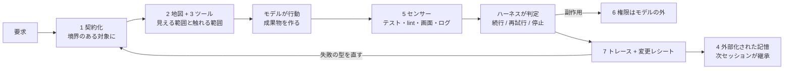

# 本番ハーネスの7つの仕事（Harness Engineering）

> **TL;DR**: エージェントが壊れ続けるときプロンプトの形容詞をいじるのをやめ、モデルの周囲のシステム（ハーネス）を点検せよ。@0xwhrrari は本番ハーネスの仕事を契約化・地図・ツール・外部化された記憶・センサー・モデル外の権限・トレースの7つに分け、重要なルールは「指示」と「機械的検査」の二重で書けと述べる。

失敗するエージェントに対して多くの人はプロンプトを変え、次にモデルを変え、次にコンテキストウィンドウを広げるが、それでも決定を忘れ・間違ったツールを使い・検証を飛ばし・同じループに嵌まる、と@0xwhrrariは述べる。問題は知能ではなく周囲の環境であり、その環境がハーネスで、それを設計するのが harness engineering だという定義から記事は始まる。@0xwhrrari が引く根拠は2つで、Dario Amodei（Anthropic CEO）が Claude Code の成立を説明する中で「もちろんインターフェースが要る、使うにはハーネスが要る」と述べたこと、OpenAI が Codex でエージェントファーストのコードベースを作った記事「Harness engineering: leveraging Codex in an agent-first world」で、初期の進みが遅かった原因を「環境が十分に規定されていなかった（The environment was underspecified）」と書き、対応として「もっと頑張れ」と言うのでなく欠けている能力を特定して読める形・強制できる形にしたこと。

同じモデルでも、チャット欄に置けば質問に答え、リポジトリ・ターミナル・テスト・ブラウザ・プロジェクトメモリ・隔離 worktree・レビューループの中に置けばソフトウェアを出荷する。重みは変わらずハーネスが変わった、というのが中心命題。ハーネスはモデルが何を見られるか・何に触れるか・セッション間で何が生き残るか・何が証拠と見なされるか・いつ止まるべきかを決める。プロンプトエンジニアリングが指示を改善するのに対し、ハーネスエンジニアリングは指示が実行される条件を改善する。理論的な全体論は [[concepts/harness-engineering]]、構築手順は [[concepts/harness-engineering-roadmap]] にあり、本ページは「本番ハーネスが担う仕事の一覧」という運用側の分解にあたる。

## 7つの仕事

@0xwhrrari が挙げる本番ハーネスの仕事（各項の詳細リストは画像のためキャッシュ未収録）。

1. **要求を契約に変える**。行動の前に要求を境界のある対象へ変換する。契約はタスクが静かに再定義されるのを防ぐ。これがないとエージェントは別の仕事を完了して成功を宣言できる
2. **エージェントに地図を渡す**。プロジェクト知識は要るが、すべての文書を毎回コンテキストに入れるのではない。どこを見るかを教える小さなルートガイドを置き、詳細知識はそれが統制するコード・ツール・ワークフローの近くに置いて必要なときだけ読ませる。地図はコンテキストを温存し、巨大なマニュアルはそれを食い潰す
3. **正しい環境の中で正しいツールを公開する**。ツールアクセスはボタンの一覧ではなくモデルと現実世界の間のインターフェースで、各ツールに明確な目的・予測可能な出力・明示的な失敗状態・権限境界が要る。良いツールはモデルが悪く推論する前に曖昧さを減らし、悪いツールは何が起きたかをモデルに推測させる
4. **記憶を耐久する状態へ外部化する**。会話はシステム・オブ・レコードではない。決定・成果物・失敗・未解決リスクをコンテキストウィンドウの外に保存し、次のセッションは会話の劣化した語り直しではなく仕事の状態を継承する。これがコンテキストリセット・クラッシュ・引き継ぎを生き延びる方法
5. **自律性より先にセンサーを足す**。観測できないものは修正できない。テスト・linter・スクリーンショット・ログ・メトリクス・スキーマ検証器が曖昧な品質を証拠に変える。モデルが成果物を作り、環境が成果物についての証拠を出し、ハーネスがその証拠で続行できるかを判定する
6. **権限をモデルの外で強制する**。モデルは行動を推奨してよいが、認可するのはハーネス。高価・不可逆・他人に触れる行動ほどこの分離が効く。計画を考え・リスクを承認し・副作用を実行する3つを同じ確率的システムにやらせない
7. **トレースを記録し局所的に復旧する**。すべての走行が読める痕跡を残す。トレースがなければ失敗は謎のままで、あれば次のハーネス改善への入力になる

## 指示をインフラにする

多くのチームは重要なルールを散文で持ち、エージェントはそれを読み、やがて1つを無視する。@0xwhrrari が勧めるのは重要なルールを二重に符号化すること。1回目はエージェントが理解できる指針として、2回目はエージェントが迂回できない機械的検査として。指針は理由を説明し、検査は境界を強制する。これにより過去の失敗が恒久的なシステム改善に変わり、次のエージェントは事故を覚えている必要がなく、ハーネスが代わりに覚えている。Claude Code では「毎回 X したら Y」「絶対 X するな」を指示でなく hook と permissions に置くという公式フレーム（[[concepts/claude-code-instruction-methods]]）と、精神論を検査可能な契約へ書き換える7層設計（[[concepts/claude-md-multilayer-design]]）が、この二重化の実装にあたると考えられる。

## ループはハーネスのもの

長時間の仕事には反復が要るが「動くまで繰り返す」は制御系ではない。有用なループは証拠・上限つきの再試行・予算・エスカレーション経路を持つ。モデルは局所的なギャップをどう修復するかを決め、ハーネスはもう一度試してよいかを決める、という役割分担を@0xwhrrariは置く。Anthropic の長時間エージェントの研究「Harness design for long-running application development」も同じ結論に達し、構造化された成果物がセッション間の連続性を保ち、独立した評価者が作り手に具体的なフィードバックを返して自己承認を防ぐとし、「可能な限り単純な解を見つけ、必要なときだけ複雑さを増やせ」と書いている、と@0xwhrrariは引用する。

## 失敗はシステムを更新するべき

多くの人は今回の出力を修復する。ハーネスエンジニアは失敗の型（class of failure）を修復する。即時のパッチは1回の走行を直し、ハーネスの変更はその後のすべての走行を改善する。これが複利の優位であり、良いハーネスはエージェントのミスをインフラへ変換する、と@0xwhrrariは述べる。

## 脳・手・履歴を分ける

信頼できるエージェントは、推論するモデル（脳）・ツールと実行環境（手）・状態とトレース（履歴）の3つが分かれていると考えやすい。サンドボックスが死んでも履歴は残り、モデルが変わってもツールとポリシーは検査可能なままで、タスクを再開するときは新しいセッションが成果物とトレースから状態を再構成できる。@0xwhrrari は Anthropic の Managed Agents がセッション・ハーネス・サンドボックスでこの分離を明示していると述べたうえで、重要なのはベンダーでなくアーキテクチャであり、推論エンジンがファイルシステム・権限システム・記憶 DB・監査ログを兼ねてはならないと論じる。権限と観測をモデルの外に置くべきだという同型の主張は [[concepts/models-as-insider-risks]] が統制の側から述べている。

## すべての走行に変更レシートを

エージェントが終わったとき最終出力だけを残さず、出力がどう作られたかを説明する小さなレシートを残す。これでモデル更新を比較でき、退行の原因を特定でき、監査が可能になり、最終回答が壊れたプロセスを隠すのを防ぐ。[[concepts/claude-code-long-task-harness]] が「証拠を返すレビュアー」と progress.md で実装している発想と重なる。

## ループを閉じる最小のハーネスから始める

ハーネスエンジニアリングは最初のタスクの前にプラットフォームを建てることではない。観測・検証・復旧ができる最小のシステムから始め、タスクが複雑さに値するときだけ上げる。短い低リスクのタスクはプロンプト1つとレビュー1回で足り、ファイルを編集しネットワークに触れ PR を開く6時間のコーディング走行には本物のハーネスが要る。ハーネスはそれが制御する失敗面より小さくあるべきだ、と@0xwhrrariは述べる。記事末尾のチェックリストは画像のため未収録だが、@0xwhrrari は「いくつかが No なら、より強いモデルはシステムを信頼できるものにせず、失敗を高価にするだけだ」と結ぶ。

## 3段階の転換

プロンプトエンジニアリングはモデルに何をすべきか告げ、コンテキストエンジニアリングはモデルが何を見るかを決め、ハーネスエンジニアリングはモデルが行動する世界を建てる。モデルは来月変わるかもしれないが、ツール・テスト・状態・ポリシー・トレースは改善を続けられる。だから耐久する優位はプロンプトの外、モデル周囲のシステムへ移っており、最良の作り手は「どのモデルが最も賢いか」だけでなく「どの環境がその知能を信頼できるものにするか」を問う、というのが@0xwhrrariの結論。

## 問い

- このvaultの wiki-ingest を7つの仕事で採点すると、契約化（/tmp/ingest_result.json のスキーマ）・地図（CLAUDE.md の役割ルーター）・センサー（validate_wiki.py）はあるが、「変更レシート」と「失敗の型を直す」経路（LESSONS.md）は機械的検査として強制されていない。どれを hook に昇格させるか
- 「重要なルールは指針と機械的検査の二重で書く」を適用すると、CLAUDE.md の文のうち hook に置き換え可能なものはどれか。[[concepts/instruction-patch-lifecycle]] の Ablation と逆向きの棚卸しになる
- 「ハーネスは制御する失敗面より小さくあるべき」を定量化できるか。ハーネスのトークン消費と、それが防いだ失敗のコストを比較する指標は何か

## 関連

- [[concepts/harness-engineering]] — Agent = Model + Harness の理論的全体論（5アーティファクト・3陣営・5原則・Build to Delete）。本ページは本番ハーネスの「仕事」を7つに分けた運用側の分解
- [[concepts/harness-engineering-roadmap]] — @0xCodez による14ステップの構築手順。本ページの7つの仕事を積む順序の参考
- [[concepts/graph-reliability-design]] — 同じ@0xwhrrariが複数ノードのグラフへ持ち上げた議論。耐久する状態・ノード単位の失敗方針・「分類器は確率的、許可されたルートは決定論的」は本ページの仕事4・7・6のグラフ版
- [[concepts/claude-code-instruction-methods]] — 指示と機械的強制（hook/permissions）の振り分け公式フレーム
- [[concepts/claude-md-multilayer-design]] — 精神論を検査可能な契約へ書き換える7層設計
- [[concepts/claude-code-long-task-harness]] — 証拠を返すレビュアーと progress.md による変更レシートの実装例
- [[concepts/models-as-insider-risks]] — 権限・観測・停止をモデルの外に置く統制側の論
- [[concepts/12-factor-agents]] — 実行状態の統合・起動/一時停止/再開（Factor 5・6）。仕事4の「記憶の外部化」の原型
