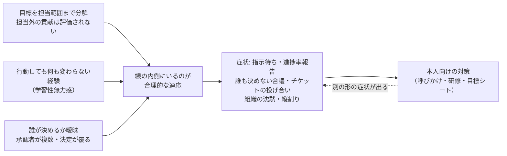

# 「自分の仕事はここまで」は原因ではなく症状（吉羽龍太郎）

> **TL;DR**: メンバーが担当範囲に線を引いて越えないのは本人の主体性の欠如ではなく、目標設定と評価制度・学習性無力感・意思決定者の曖昧さという構造への正しい適応であり、呼びかけや研修でなく構造の側（決める人を1人にする・提案に結果を返す・担当外の貢献を見える場に出す）を変えよ、と吉羽龍太郎（株式会社アトラクタ Founder 兼 CTO・アジャイルコーチ）が講演資料の公開記事で述べる。

吉羽は 2026-10-22 に顧客の社内イベントで「『自分の仕事はここまで』はどこから来るのか」と題して講演し、その資料を自身のブログで公開した（スライド本体は本 wiki では未収集で、本ページはブログ本文の要約部分にもとづく）。「担当外のことには手を出さない」「チケットに書いてあるとおりにやりました」「言われていないので」という声はどの組織でも聞かれ、決まって「主体性がない」「当事者意識が足りない」と本人の問題として片づけられる、と吉羽は書く。対策も「越境しよう」という呼びかけや研修、目標管理シートへの「主体性」の記入と、本人に向けたものばかりになる。吉羽の診断は「呼びかけで変わるくらいなら、とっくに変わっている」というもので、他人の行動の原因を状況より性格や意欲に求めすぎる傾向を、社会心理学の「根本的な帰属の誤り」として名指しする。行動は人と環境の両方で決まる（レヴィンの式）という前提に立ち、線を引いている人はその環境に正しく適応しているだけだ、とする。

## 自律は放任ではない

アジャイルソフトウェア開発宣言の背後にある原則もスクラムガイドも、自分の仕事に線を引かない自律的なチームを前提にしている、と吉羽は述べる。ここで言う自律は、目指す方向や守るべき制約を共有したうえで、その枠の中で自分たちで判断して行動することで、枠がわからないと人は安全な範囲にこもりやすくなる。吉羽は人が線の内側にこもらないための条件を5つ挙げる。目的が見えている、決めてよい範囲がはっきりしている、必要な情報が届く、自分の行動が結果を変えると感じられる、越境して失敗しても責められない、の5つで、どれか一つでも欠けると人は線の内側にこもる、という。

## 線の内側にこもると何が起きるか

症状として吉羽が列挙するのは、指示待ち、進捗率での報告、誰も決めない合議制、チケットの投げ合い、組織の沈黙、そして縦割りがそのままシステムの形になること（コンウェイの法則）である。「指示待ちをやめよう」とルールを作っても別の形の症状が出るだけで、原因のほうを見るべきだ、と吉羽は書く。

## 線を引かせている3つの要因

吉羽は構造側の要因を3つに整理する。

- **目標設定と評価制度**: 目標を担当範囲まで分解すると、目標に書いていないことはする理由がなくなる。担当外の貢献は評価されにくく、全体がうまくいかなかったときは責められる。この条件なら線の内側にいるのが合理的な選択になる、と吉羽は書く。
- **学習性無力感**: 吉羽は「2016年の見直し」に触れ、学習しているのは「無力さ」ではなく「自分の行動で状況をコントロールできる」ということのほうだとわかった、と書く。だから「主体的になれ」と言うより、自分の行動で何かが変わった経験を作る。ブログに出典名はなく、この見直しは Maier と Seligman が学習性無力感の提唱から50年を機に発表した再検討論文を指すと考えられる（wiki 側の推測）。
- **意思決定者の曖昧さ**: 誰が決めるのかわからないと、意見を出すことが「他人の領分を侵す」行為になる。承認者が複数いると責任が薄まり（責任の拡散）、決定が後から覆されると決めることそのものに意味を感じなくなる。

## 影響力を実感できる関わり方

自分の意見や行動が結果に影響しないと感じると関心を持ち続けるのは難しいので、関心を求める前に影響力を実感できるようにする、と吉羽は書く。採用されなくてもよいので、検討されて採否の理由が返ってくることが大切だとする。具体策として吉羽は DACI（Driver・Approver・Contributor・Informed の4役割で意思決定の責任を分ける枠組み）を挙げ、決める人（Approver）を1人に決め、意見を出す人（Contributor）を明確にすれば、意見を出すのは越境ではなく役割になる、と述べる。DACI の詳細は吉羽自身が翻訳した書籍『Aligned ―プロダクト開発におけるステークホルダーとの関係性の築き方』を参照するよう案内している。

## 線は引いてはいけないのか

引いてよい、と吉羽は答える。チームの認知負荷には限界があるので境界は必要で（『チームトポロジー』を引く）、問題は境界があることではなく、またぎ方が決まっていないことだとする。線を引くだけで「内と外」が生まれるので、線をまたいで共有する上位の目標をセットで持ち、プロダクトゴールがこの上位目標になる。吉羽の原則は「線を引くのは説明責任と権限まで。関心まで線を引かない」である。

## 明日から試すこと（吉羽の列挙の転記）

メンバーとして:

- 自分のチームのゴールを1文で説明できるか確かめる
- 自分の仕事に関わるステークホルダーを3人書き出す
- 他チームのスプリントレビューに1回出てみる
- 担当外で気になったことを1つ口に出す
- 小さく越境して、結果が返ってきた経験を記録しておく

リーダー・マネージャーとして:

- 越境して失敗した人を責めない。悪い知らせを持ってきた人に感謝する
- 提案には必ず結果を返す。通らなかったなら理由も返す
- 決める人を明確にし、承認者は1人にする
- 個人の目標とチームの成果をつなげ、担当外の貢献を見える場に出す
- チームに任せる範囲を言語化する

## 位置づけ（wiki 側の読み）

[[concepts/team-leader-transition]] で @KensukeTaki が新任リーダーに「目的を語る」「委譲する」「心理的安全性を行動規範に落とす」と説くのは、本ページのリーダー側の処方（任せる範囲の言語化・越境の失敗を責めない・提案に結果を返す）と同じ向きで、吉羽はそれをメンバー側の症状から逆算して構造の名前（評価制度・無力感・決定者の曖昧さ）を付けたものと読める。[[concepts/mendokusasa-barrier]] の @Books_Apps は動かない本人の内側（面倒くさい）に理由を置いて仕組みで着手させるが、吉羽は観察者が本人の内側に理由を置くこと自体を帰属の誤りと呼び、環境の側に置く。説明の置き場が対照をなす。[[business/org-design-intelligence]] の DRI（特定の問題を一定期間所有する直接責任者）は、吉羽の「承認者は1人にする」を組織設計の側から実装したものと考えられる。

## 問い

- 自分のチームで「決める人」が1人に決まっている決定と、承認者が複数いる決定を書き出すと、線の内側にこもる症状はどちらに集中しているか
- 吉羽の5条件（目的・決めてよい範囲・情報・影響の実感・失敗が責められない）は、AI エージェントに任せる範囲を決めるときの条件としても読めるか
- 講演スライド本体と、学習性無力感の「2016年の見直し」の出典を確認する

## 関連

- [[concepts/team-leader-transition]] — 新任リーダーの転換論（@KensukeTaki）。本ページのリーダー側の処方と同じ向きで、吉羽はメンバー側の症状から構造を逆算する
- [[concepts/mendokusasa-barrier]] — 人が動かない本音を「面倒くさい」に置く @Books_Apps の行動論。本人の内側に理由を置く側と、環境に置く本ページとの対照
- [[business/org-design-intelligence]] — Sequoia と Block の組織設計。DRI（直接責任者）は「承認者は1人にする」の組織設計側の実装と読める
