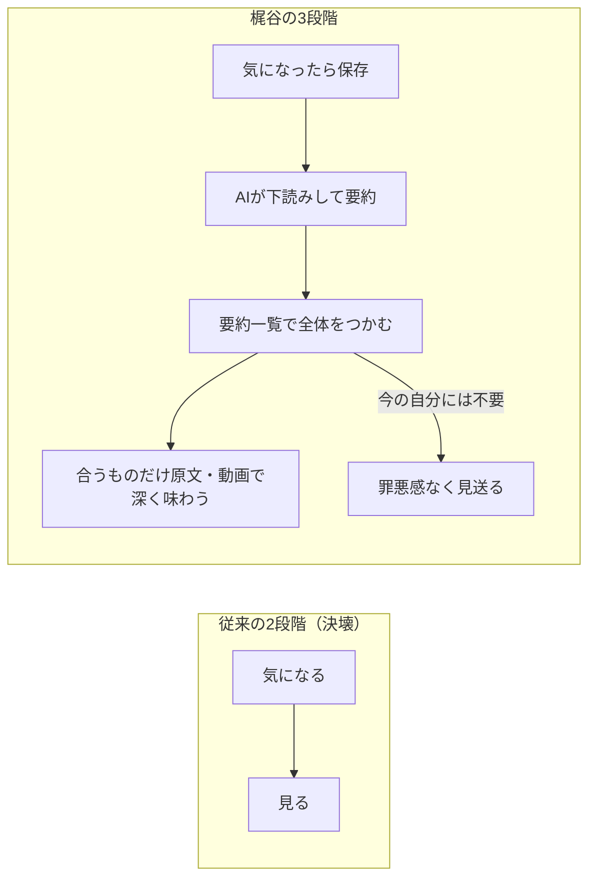

# 情報圧死：AI 下読み要約で「読まないもの」を安心して決めるインプット術

> **TL;DR**: AI でコンテンツの供給は限界費用ゼロで無限に増える一方、受け手の時間と注意は有限のまま。この非対称が「追えていない」焦燥を生む状態を梶谷健人は「情報圧死」と呼び、処方箋として「気になる→見る」の 2 段階を「保存→AI 下読み→要約一覧で選び、合うものだけ深く読む」の 3 段階へ組み替え、要約を「読まないための道具」でなく「深く読むものを選ぶための道具」として使えと説く。

梶谷健人（[[business/ai-agent-era-strategy]] の著者で、記事末尾で紹介する AI インプットサービス SuperFlow の作り手）は、息苦しさから X のアプリを消しては仕事で入れ直す反復を続けた当事者として、この記事を書いている。梶谷によれば、人を苦しめているのは情報の多さそれ自体でなく、「社会の急速な変化に自分は付いていけていないのではないか」「すべきインプットを十分にできていないのではないか」という焦燥感・無力感・自己嫌悪であり、この現代特有の病理を「情報圧死」と名づける。記事は、なぜ今それが起きているのか（供給側の構造変化）、誰がどう苦しんでいるのか（調査データ）、どう生き延びるか（AI を使った 3 段階インプット）の順で論じる。

## 情報は増えたのでなく、増え方が変わった

「情報が多すぎる」という嘆き自体は古く、梶谷は古代ローマのセネカの「本が多すぎることは気を散らす」や、活版印刷普及期の 1545 年に書誌学者コンラート・ゲスナーが「有害な本の氾濫」に頭を抱えたことを挙げる。今回が過去のどの時代とも決定的に違う点は一つだけで、**情報を作る側の「人間の手」という物理的制約が消滅した**ことだ、と梶谷は述べる。

根拠として梶谷が引くのは Graphite 社が 2025 年に出した分析で、インターネット上で新規公開された英語記事のうち AI 生成の割合は約 52% と過半数を超えたという推計である（梶谷が公開グラフから読み取った値）。ChatGPT 登場前の 2022 年時点では 5% 程度だったものが 2024 年 11 月の段階で人間の書く記事数を上回ったとし、AI 判定ツールによる推計値ではあるが 2 年あまりでネット空間の主客が逆転した、と梶谷はまとめる。

一方で受け手の 1 日は 24 時間のままで、注意力の上限も上がらない。**コンテンツ生産の限界費用が 0 に近づき供給は無限に増える一方、個人の時間と注意は有限のまま。この非対称性が情報圧死の根本原因だ**、というのが梶谷の中心主張である。

## 押し潰すのは量でなく「追えていない」という感覚

梶谷は国内外の調査を 3 つ並べる。数値はいずれも梶谷の記事に示されたものである。

- NTT ドコモ モバイル社会研究所の 2026 年 2 月の調査では「今の社会は情報が多すぎる」と感じる人が 83.1% で、弊害として「疲れやストレスを感じる」「判断に迷う」と答えた人がそれぞれ約 7 割（対象は 15〜79 歳の男女 7,359 人）。
- 同研究所の 2025 年 2 月の調査では、SNS による情報疲労を感じる人が全年代で半数超（対象は 15〜59 歳の SNS 利用者 4,031 人）。
- オックスフォード大学ロイター研究所の Digital News Report 2026 では、「意識的にニュースを避ける」人の割合が世界で 2017 年の 29% から 2026 年の 42% へ増加。ところが日本は 12% で、調査対象国の中で最低水準。

梶谷はこの最後の対比から、日本人は情報過多の中でもニュースを避けず、避けずに追おうとして疲れている、という構図を読み取る。なぜ日本人が「避ける」を選ばないかについては、調べた限り明確に答える調査やデータは見つからなかったと梶谷は断り、生真面目さやメディア環境を可能性として挙げるに留める。そのうえで、**日本では自分が追う情報の総量を自分で決めていないことによる精神的疲労が他国より顕著**とは言えそうだ、と梶谷は述べる。他人が付けた「必見」「絶対に目を通しておくべき」というラベルで、自分で決めたわけでもない TODO が毎日何十個も積み上がる、というのがその日常風景である。

## 「気になったら見る」が成立しなくなった

従来のインプットは「1. 気になる → 2. 見る」の 2 段階で回っていた。1 日に出会う「気になる情報」が処理可能な範囲に収まっていた時代は、その都度見れば済んだからだ。いまはタイムラインを少し眺めるだけで「気になる」情報が大量に流れてくる一方、じっくり見る時間は増えておらず、AI で仕事量が増えた結果インプット時間はむしろ短くなっている人も多い。2 段階のシステムが物理的な許容量を超えて決壊している、と梶谷は診断する。

## 処方箋：圧が AI によるものなら、受ける側も AI を使う

梶谷の結論は「生身で機械の生産能力に対抗しようとするから圧死する」であり、インプットのプロセスを次の 3 段階に組み替える。

1. 気になったら、まず保存する
2. AI に下読みをさせて要約を作る
3. 要約を一覧して全体をつかみ、本当に自分に合うものだけを原文や動画で深く味わう

この考え方は新しくない、と梶谷自身が言う。フランシス・ベーコンは 1625 年の随筆「学問について」で「ある本は味見するだけでよく、ある本は飲み込むだけでよく、ごく一部の本だけを噛み砕いて消化すべきである」と書き、続けて「ある本は代わりの者に読ませ、要約を作らせてもよい」と述べている（原題 Of Studies。梶谷はプロジェクト・グーテンベルクの原文へリンクしている）。ただしベーコンは「代理人に任せてよいのは重要でない本に限る」と但し書きを添えており、裏返せば重要な本は自分で噛み砕けということだ、と梶谷は強調する。

ここから梶谷の主張の核心が出る。**要約は「読まないための道具」ではなく「深く読むものを選ぶための道具」**であり、AI 要約だけを眺めて分かった気になり表面を撫でるだけなら薄っぺらい雑学収集にすぎない。要約という見取り図が手元にあるからこそ「読まない」という決断が怖くなくなり、見なかったものへの後ろめたさが消え、本当に大切な情報に有限の時間と注意を注げる。**減らすべきなのはインプットの総量ではなく、見送った情報に対する不安のほうだ**、と梶谷は書く。

梶谷自身の実践では、気になった記事や動画を専用ツールに放り込むと裏で AI が下読みして要約を作り、その一覧で全体像をつかんだうえで「今の自分の課題に深く関わる」「時間を取ってでも自分の頭で噛み砕く価値がある」と確信できたものだけ腰を据えて読む。内容を見たうえで見送っているので罪悪感が残らず、逆に関心に合うと分かっているものには安心して時間を使えるようになった、と梶谷は述べる。

## SuperFlow

梶谷が「自分自身が生き延びるために作った」と述べるのが SuperFlow で、コンセプトは「情報の氾濫に溺れないための、インプットサービス」。気になった記事や動画を保存した瞬間に AI による下読みの要約が届き、全体をつかんでから本当に気になる情報だけを自分の意志で選んで深く読む、という上記 3 段階をそのまま製品にしたものである（公式サイトは super-flow.ai。記事のリンクカードの紹介文では要約に図や注釈が付くとある）。梶谷は「情報圧死の時代に必要なのは、もっと速く読む力ではなく、読まないものを安心して決める力だ」と結ぶ。

## 他ページとのつながり

「作る側の上限は AI で外れたが受け手の上限は変わらない」という構図は、深津貴之が [[concepts/development-as-agriculture]] で述べた「生成は課金で増やせるが確認速度は増やせない」パラドックスや、@smark_x が [[concepts/ai-review-bottleneck]] で制約理論から導いた「AI 協働の速さは人間の読んで直す工程で決まる」と同じ非対称を、仕事の成果物でなく日々の情報摂取に当てはめたものと考えられる。@smark_x の処方がボトルネックへ流す量と質を絞ることだったのと同様に、梶谷の 3 段階も「要約一覧」という手前の工程で原文へ流す量を絞る設計になっている（推論）。

同じ情報過多を扱う Dan Koe の [[concepts/creativity-recovery-protocol]] が「入力を遮断して処理時間を取り戻す」方向なのに対し、梶谷は入力を減らさず「見送る不安」を減らす方向を取る点が対照的である。また「必見」ラベルで積み上がる終わらない TODO が心をすり減らすという梶谷の描写は、[[concepts/zeigarnik-fatigue-loop]] で @tsumugi_utatabi が述べた「小さな未完了が注意を奪い続ける」疲労ループそのもので、要約を見て「読まない」と決めることは、同ページの言う「完了」でなく「決着」に相当すると考えられる（推論）。

## 観察ログ（未検証）

- 2026-10-23: 新規公開英語記事の AI 生成比率「約 52%」は、梶谷が Graphite 社の公開グラフから読み取った値。Graphite の原典で数値と判定手法を確認する
- 2026-10-23: 日本の「ニュースを避ける」人の割合 12%（世界 42%）は Digital News Report 2026 からの引用。原典の日本ページで設問文と対象国数を確認する

## 問い

- この wiki のパイプライン（保存→ingest 要約→weekly）は梶谷の 3 段階そのものだが、要約が「深く読むものを選ぶ道具」として機能しているか。要約を読んで終わりになり、原文に戻った件数がどれだけあるかを数える
- 梶谷の処方は「読まない決断を安心して下す」ことに重心がある。[[concepts/llm-wiki]] 型の運用で保存→要約の先に「見送る」を明示的に記録する工程を置くと、取り込んだ後に何も決めない状態は変わるか
- 日本のニュース回避率の低さを梶谷は「追う総量を自分で決めていない」と読んだが、別の説明（ニュースへの信頼度・メディア接触習慣）で同じ数字が説明できないか原典で確かめる

## 関連

- [[concepts/creativity-recovery-protocol]] — 情報過多を「心を狭める要因」の 1 つとして同じ問題を扱う Dan Koe の実践論。処方が「入力遮断」である点で本ページの「AI 下読みで選ぶ」と対になる
- [[concepts/ai-review-bottleneck]] — AI の生成速度と人間の読む速度の非対称を制約理論で論じ、ボトルネックへ流す量と質を絞る @smark_x の 5 策。本ページの 3 段階は同じ発想の情報摂取版
- [[concepts/zeigarnik-fatigue-loop]] — 「必見」で積み上がる未完了が注意を奪い心をすり減らす構造の説明と、「完了」でなく「決着」で抜ける考え方。要約を見て「読まない」と決めることがこの決着にあたる
- [[business/ai-agent-era-strategy]] — 同著者・梶谷健人の企業戦略論。本ページは同じ著者が個人のインプットを扱った記事
