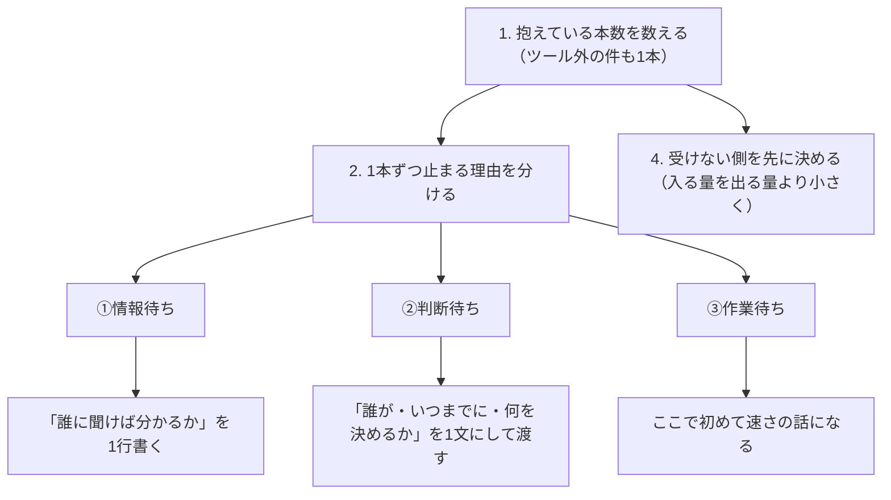

# 仕事が終わらないのは速さでなく「同時に持っている本数」｜リトルの法則で見る仕掛かり

> **TL;DR**: 1本を片づける速さを上げても仕事は終わらず、終わるのは同時に抱える本数が減ったとき。リトルの法則（並んでいる数が半分なら待ち時間も半分）を自分の案件に当てはめ、本数を数え、止まる理由を情報待ち・判断待ち・作業待ちに分け、「受けない側」を先に決める、と @smark_x が主張する。

ジェフ・ベゾスの「チームはピザ2枚で足りる人数に収める」という原則に対し、AI の時代には2枚でも多すぎる、12人→6〜7人→エージェントと組むなら1人、という人数論の投稿を X で見かけた、と @smark_x は書き出す。そのうえで、人数を減らしても終わらない仕事があると指摘し、論点を「人数」から「同時に持っているテーマの数」へ移す。

## 行列の式は自分の案件にも当てはまる

@smark_x によれば、60年以上前にジョン・リトルが「行列」について1つの式を証明した。レジに並んでいる人数が半分になれば待ち時間も半分になる、という当たり前に聞こえる関係が、業種にも人数にも片づける順番にも左右されずに成り立つことを示した式である。並んでいるのが他人ではなく自分が抱えている案件だというだけで、仕事も同じ行列だと @smark_x は言う。たとえば10本を同時に持っている人が3本に絞ると、手の速さを変えていなくても1本が片づくまでの日数は3分の1近くまで縮む、というのが著者の挙げる例である。

一般にこの式はリトルの法則と呼ばれ、系内の仕掛かり数 = 到着率 × 滞在時間（L = λW）と書かれる。処理能力が同じなら1本あたりの滞在時間は仕掛かり数に比例する、というのが上の例の根拠になる（wiki 側の補足）。

## 人数を絞る会社が減らしているのは「テーマの数」

人数を絞ってきた会社は、同じことを別の場所でもやっていると @smark_x は見る。

- **Amazon** —— 長いあいだ「シングル・スレッド・オーナー」という役割でスケールしてきた、と元副社長が書いていたと @smark_x は紹介する（副社長の名前は記事に未記載）。1人がエンジニアリングもプロダクトもデザインもその事業の損益もまとめて持ち、名前のとおり1人が同時に走らせる役割である
- **OpenAI** —— 創業者のサム・アルトマンが「計画の80%を捨てて、1つのことを大規模にやる」と言い、有望な20の方向を4つの優先事項に絞ったそうだ、と @smark_x は伝聞として書く

つまり減らしているのは人数ではなく「同時に持っているテーマの数」だ、というのが著者の読みである。@smark_x は自分が長いあいだ逆をやっていたとも書く。終わらないのは自分が遅いからだと思い1本あたりを速く片づけようとしたが、速さを上げても本数は減らない。速くなったぶん、また新たな業務を受けてしまうからである。

## 数え方と動かし方（4手順）

@smark_x が本数を減らすために提示する手順は次の4つである。

1. **抱えている本数を「数字」で出す** —— 着手したのに終わっていないものを全部書き出す。返していないメール、確認待ち、口頭で頼まれた件、頭の中にあるだけの件も1本として数える。タスク管理ツールに入っているものだけを数えると、たいてい実数の半分以下だと著者は言う
2. **1本ずつ「止まる理由」を3つに分ける** —— ①情報待ち（必要な事実がまだ揃っていない）、②判断待ち（事実は揃っているが誰も決めていない）、③作業待ち（決まっているが手が空いていない）。分けてみると③がいちばん少なく、忙しいと感じているときの本数はほとんど①と②で埋まっている、というのが著者の観察である
3. **分類ごとに「動かし方」を変える** —— 情報待ちは「誰に聞けば分かるか」を1行書く。書けないならそれは情報待ちではなく、聞く相手を決めていない判断待ちである。判断待ちは「誰が・いつまでに・何を決めるか」を1文にして相手に渡す。決めてもらうのを待つのではなく、決める形のほうを渡す。著者の例文は「A案でよければ明日15時までにご返信ください。ご返信がなければA案で進めます」まで書いて出す、というもの。作業待ちだけが本当に時間の問題で、ここに来てはじめて「速さの話」になる
4. **「受けない側」を先に決める** —— 入る量が出る量を上回っていれば本数は必ず増える。数式のとおりである。だから「週の前半は新しく受けない」のように、受けないほうを先に決めておく

## 自分が待たせている本数のほうが効く

やってみて効いたのは、自分が待っている本数よりも「自分が誰かを待たせている本数」だった、と @smark_x は強調する。返していない1通はこちらでは「あとで返す」だが、相手の側ではもう1本の仕掛かりとして立っている。つまり同じ1本が2人ぶんの本数に乗っている。

その例として著者は、NVIDIA のジェンスン・ファンについて、1on1 をやらない、ステータス報告も受け取らない、直属の部下は60人ほど、代わりに毎朝社員から届く100通ほどのメールをそのまま読む、という X 投稿が流れていたと紹介する。@smark_x はこれを、人を減らさなくても間に判断待ちの行列を作らなければ止まらない設計だと読み、逆に言えば階層をひとつ挟むたびに誰かの本数が1本増えている、とまとめる。記事の結びは「速く働くほうが目立つけど、終わるのは本数が減ったとき」である。

## 他ページとのつながり

同じ @smark_x の [[concepts/ai-review-bottleneck]] は『ザ・ゴール』の制約理論で「どの工程がボトルネックか」を見て、そこへ流れ込む量と質を絞る話だった。本ページはリトルの法則で「系の中に何本あるか」を見る。どちらも「1つの工程を速くしても全体は終わらない」という同じ結論に至るが、制約理論は絞る場所を、リトルの法則は本数と滞在時間の比例関係を与える、という役割の違いがあると考えられる。

[[concepts/zeigarnik-fatigue-loop]] が描く「未完了が注意を奪い続ける」疲労は、本ページの数え方で言えば頭の中にあるだけの件も1本として立っている状態にあたる。同ページが脱出口とする「完了でなく決着」は、本ページの手順3で判断待ちを「誰が・いつまでに・何を決めるか」の1文にして渡す動きと同じ方向だと考えられる。また [[concepts/ai-secretary-gateway]] で @dansyu_callenge が AI 窓口に担わせる「返事待ち・判断待ちに分ける」仕事は、手順2の分類を AI に機械化した形と読める。ただし同ページの区分は自分が待つ側だけを扱い、本ページが最も効いたとする「自分が待たせている本数」は含まれていない。

[[concepts/slack-time-at-work]] の稼働率80%設計と、手順4の「受けない側を先に決める」は、どちらも出る量に対して入る量を抑える打ち手である。[[concepts/ai-native-engineering-org]] で Sashank Gondala が「出荷工程を自動化し切るとボトルネックは何を作るか決める工程へ移る」と報告した現象は、本ページの判断待ちが組織規模で現れた形と考えられる。

## 観察ログ（未検証）

- 2026-11-07: ジェンスン・ファンの「1on1 なし・ステータス報告なし・直属約60人・毎朝約100通のメールを読む」は @smark_x が X 投稿の伝聞として紹介した数字。原投稿と一次発言は未確認
- 2026-11-07: 「タスク管理ツール内の件数は実数の半分以下」は @smark_x の経験則。自分の棚卸しで本数を比べて確かめる

## 問い

- 自分の仕掛かりを全部数え、情報待ち・判断待ち・作業待ちに分ける。未 ingest のソース、読み返していない weekly、返していない連絡はどこに入るか
- AI エージェントに出した指示で返答を読んでいないものは、エージェント側の行列にも立っている。[[concepts/ai-review-bottleneck]] の「セッションを増やすと順番待ちが伸びる」は「同じ1本が2人ぶんに乗る」の AI 版か
- リトルの法則は到着と処理が釣り合った定常状態の式で、手順4が言う「入る量が出る量を上回る」状態では本数が増え続ける。「受けない期間」の長さをどう決めれば定常に戻るか

## 関連

- [[concepts/ai-review-bottleneck]] — 同著者の制約理論。ボトルネック工程への流入を絞る側の答えで、本ページは工程でなく仕掛かり本数の側から同じ「速くしても終わらない」を扱う
- [[concepts/zeigarnik-fatigue-loop]] — 未完了が注意を奪い続ける疲労ループ。脱出は完了でなく決着で、本ページの「判断待ちを決める形にして渡す」が決着の具体形
- [[concepts/ai-secretary-gateway]] — 依頼を予定・返事待ち・判断待ちに分ける AI 窓口（@dansyu_callenge）。手順2の分類を AI に機械化した例
- [[concepts/slack-time-at-work]] — 稼働率を80%に抑える設計（Sean Goedecke）。手順4の「受けない側を先に決める」と同じく入る量を制御する
- [[concepts/ai-native-engineering-org]] — 出荷工程を自動化し切った後のボトルネックは「何を作るか決める工程」（Sashank Gondala）。本ページの判断待ちが組織規模で現れた形
