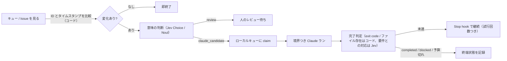

# ループの決定コスト（Loop Engineering + Jev Engineering）

> **TL;DR**: Claude の自動化ループは、空のキューを確かめる・変わっていない Issue を読み直す・もう一度試すか決める、といった「判断」にトークンを払い続ける。@beamnxw はこの判断を本体のループから切り出し、厳密な比較と計数はコード、意味を読む判断は TypeSafe AI の判断モデル [[models/jev]]、実装だけを Claude、という順の別経路に載せて、何がランを始め何がランを続けさせるかをアプリ側で制御する手順を示す。

@beamnxw が解こうとしている問題は、Claude のループが「生産的な行動の間にある問い」に払うトークンである。直近の自動実行を 1 本取り、生産的な行動と行動の間でどんな問いが立っていたかを見る。キュー監視なら「この新しいレポートは調査に足る情報を持っているか」を何度も問っている。@beamnxw が候補に挙げる判断は、受信した Issue の分類、固定リストからのハンドラ選択、出力が書かれた要件を満たしているかの確認、新しい証拠が別のエージェント実行に値するかの判定の 4 つで、問いごとに頻度と「何の情報があれば答えられるか」を書き出した一覧が出発点になる。@beamnxw は、Anthropic が適した処理を hook に移し冗長な操作をメイン会話の外に置くよう勧めていること、コンテキストの増大がセッション全体で処理されるトークンを増やすと公式のコスト解説が説明していることを、この切り出しの根拠として引く。

## 順序: コードで変化を見てから意味を読む

Issue 監視なら、まず識別子とタイムスタンプで何かが変わったかをコードで確かめ、変わっていなければそこで終える。新しい Issue だけが意味のフィルタに届き、受理された課題だけが関連レポートと「求める結果」を添えてコーディングエージェントに渡る。@beamnxw は、分類器もリソースを消費するのでこの順序が重要だと書く。意味を読む必要がある判断にだけ分類器を使い、厳密な比較とカウンタはコードに残す。

## Jev が返すもの

Jev は TypeSafe AI の判断モデルで、Issue レポートのような state と、回答形式を定義した質問を送る。@beamnxw が公式の質問プリミティブとして挙げる 3 型は、Choice（選ばれた選択肢と確率分布）、Noul（yes の確率）、Score（自分で定義した順序つきレベルの値）である。@beamnxw が公式ドキュメントから引く数値は、現行の文書化モデル `jev-1.13.0`、入力 100 万トークンあたり 0.042 ドルで出力トークンは無料、リクエストは文字列または構造化テキストを受け付け、上限はリクエスト全体で 64,000 トークン、state と最長の質問の合計で 32,000 トークンである（モデル側の仕様と公式が認める苦手の全体像は [[models/jev]] にある）。

質問の書き方について @beamnxw は 3 点を挙げる。各カテゴリに「何がここに属するか」を伝える説明をつける。想定外の素材のために明示的な経路として `other` の選択肢を作る。質問キーは応答の識別子にすぎず、Jev は instructions と criteria を質問の意味として受け取るので、`safe` のようなキーには評価する条件の実際の説明が要る。最初の実験には結果が目に見えるルーティング判断を選ぶべきで、Issue 分類はレポートを読んで提案された経路が妥当か自分で判断できるので検査しやすい、と @beamnxw は書く。

## 検査できるフィルタから始める

@beamnxw の手順は、Python 3 のローカル作業フォルダに公式パッケージを入れ、TypeSafe コンソールで作った API キーを環境変数 `TYPESAFE_API_KEY` に置く（Issue ファイルとソース管理には入れない。公式クライアントはこの環境変数を自動で読む）。架空のレポートを `issue.json`、分類スクリプトを `triage.py` として保存し実行する（記事のコードブロックはキャッシュに残っておらず、本文は未収録）。クライアントは明示的なタイムアウトと再試行ポリシーを持ち、最初の実験では再試行を無効にして 1 回だけ試みる。出力は route・モデルバージョン・確率・入力トークン数を含む JSON で、モデルは `claude_candidate` か `review` を選ぶ。`claude_candidate` はフィルタが「調査対象として適格」と見たことを意味するだけで、バグ自体の再現はまだ必要だと @beamnxw は注意する。レポートを使い方の質問や不完全な苦情に差し替えて、どちらも `review` に留まるかを確かめ、意外な結果は評価ケースとして残す。この段階では Issue の自動編集・エージェント起動・リポジトリ変更を一切入れずに判断だけを検査できる。

## 確信度を使えるものにする

例の `0.9` という閾値は初期設定で、本番の閾値は自分のワークロードのラベル付き例と、ルーティングを誤ったときの影響から選ぶ。TypeSafe の `confidence` は確率分布の要約で、@beamnxw が公式の定義から引く対応では、Choice で選択肢が 4 つのとき confidence 0.9 は選ばれた選択肢の確率 0.925 に当たる。Noul は yes の確率をそのまま出す。両方の値をログに残し、閾値が実際に何を通したかを後から見られるようにし、Issue のカテゴリと証拠要件は別々の条件にする。

最初の評価には、自分でラベルをつけた過去のレポート 30〜50 件を使い、通常のバグ・使い方の質問・機能要望・不完全または混合のレポートを含める。記録するのは 4 つ、自分なら選ぶ経路、Jev が提案した経路、提案された自動アクションが適切だったか、不一致を生んだ証拠は何か、である。見逃した適格なバグも誤った受理も数える。@beamnxw は「ほとんど全部を review に送るフィルタは、自動のミスが少なくても有用な仕事をほとんどしていない」と書く。まずシャドーモードで走らせ、既存のワークフローが実際の判断を続ける横で提案経路だけを記録し、不一致を見て、修正した基準を別のレポート集合で試す。質問を調整し終えたらモデルバージョンを固定し、評価済みの設定を保持し、カテゴリ・指示・モデルを変えるたびに評価を繰り返す。

## 受理したレポートを境界つき Claude ランへつなぐ

TypeSafe は「分類がハンドラを選ぶ」intent routing をパターンとして文書化しており、返ったカテゴリから次のアクションへの対応はアプリ側が所有する。Issue フィルタでは受理候補をローカルキューに入れ、Issue の識別子・現在の内容のハッシュ・分類レコードを持たせる。Claude を起動する前にその項目がまだ最新で、他のワーカーが claim していないことを確かめ、起動前に claim して、結果のセッションまたはジョブ識別子を記録する。変わっていない Issue はポーリング周期をまたいで安定した identity を持つべきで、そうでなければ毎回のポーリングが 1 件のレポートを別のコーディングランに変えてしまう、と @beamnxw は書く。受理したレポートを Claude に渡すタスクブリーフ（本文は未収録）では、レポートに調査の証拠を供給させ、権限・リポジトリの境界・許される成果物は自分のタスク設定に置く。ランが失敗したら失敗を保存し、再試行が新しい証拠を持っているかを判断する。再試行回数と支出上限はプロセスを起動するワーカー側に置く。

## コマンド分類を追加のチェックにする

Claude Code の `PreToolUse` hook は提案されたツール呼び出しを実行前に受け取り、ハンドラは構造化された許可判断を返せる。Jev の分類器でコマンドをレビュー対象として旗を立てたりアクションの種類を識別したりし、その結果を明示的な許可ルールと実行環境の制限と一緒に使う。短いコマンドがネットワーク要求・ファイル変更・資格情報の読み取りを行うスクリプトを呼べるし、テストランナーもプロジェクトのコードを実行して成果物を書く。ゲートのカテゴリには具体的な効果を書く、と @beamnxw は言い、次の 5 つを挙げる（転記）。

- 既知のローカル情報を読む
- 許可されたプロジェクトファイルを変更する
- データを削除する、またはリポジトリ履歴を変更する
- 外部の宛先と通信する
- 効果が不明または混合

効果が不明なら review の経路に留める。外部アクションの承認は分類器の推定から分離する。確認を求めるハンドラが返す JSON の形（記事では例示されているがキャッシュに未収録）は hook 結果を出すコードに置く。`allow` を返すと許可プロンプトを飛ばせるので、その分岐は重い選択になる。資格情報へのアクセスと破壊的な境界は強制可能なルールに残す。@beamnxw は、ファイル権限ルールのツールカバレッジは特定されているが任意の Python や Node のサブプロセスは間接的にファイルにアクセスできる、より広い境界は OS の分離が扱う、という Anthropic の文書を根拠に挙げる。

## 完了判定に証拠を与える

完了の判断には書かれた要件と観測可能な出力が要る。エージェントを始める前に小さな受け入れ記録を用意し、タスク固有の版を `GOAL.md` として保存する（テンプレート本文は未収録）。exit code や必須ファイルの存在のような厳密な条件はコードで検査し、意味の質問は集めた証拠が書かれた要件に対応しているかを評価する。Jev には受け入れ基準・関連する結果・未解決項目を送り、検査が失敗していればその失敗と影響する要件を渡す。Claude Code の Stop hook は理由つきで継続を要求でき `stop_hook_active` も受け取るので、この信号と明示的な試行カウンタを使って未解決の条件で継続を繰り返さないようにする。カウンタはセッションとタスクに閉じる。終端状態は completed・blocked・budget exhausted を別々に記録する、それぞれ次のアクションが違うからだ、と @beamnxw は書く。最初のセットアップでは組み込みの `/goal` コマンドで完了条件を表現でき、その評価器は会話の証拠を見るので、検証結果と出力パスをトランスクリプトに含める（[[tools/claude-code-goal]]）。

## 決定予算を計算する

@beamnxw の例示計算では、一晩 600 リクエスト、各 4,000 入力トークンの課金で、月あたり約 3.02 ドルになる（計算式の本体はキャッシュに未収録。公表単価 0.042 ドル/100 万トークンで 30 晩分とすると 72M トークンで約 3.02 ドルになり、wiki 側の検算では整合する）。ワークフロー全体の予算には Claude の実装作業・再試行・インフラ・レビュー時間も入る。自分の実行を測るときは質問も含めた報告済みの入力トークンを使う。小さな Issue 本文にも大きなカテゴリ説明がつく。同じ state に関する独立した質問が複数あるときは一緒に送る。Jev は共有 state に対してそれらを評価し、答えの結合はコードが後で行う（トリアージ例はカテゴリと再現証拠の 2 問でこれをしている）。追加の質問は実際のルーティング条件に仕えるものだけにし、指示文も入力トークンを占めることを忘れない。追跡する指標は受理され完了したタスクあたりのコストで（式はキャッシュに未収録）、分子には不良ルーティングが引き起こした修正を含める。レビュー時間は分で別に記録しても運用評価に含める。サブスクリプション利用者はプランの使用量と完了した作業を見る。Anthropic は Claude Code のセッションのドル表示は API トークンコストの推定値で、Pro と Max は使用量がサブスクリプションに含まれると説明している、と @beamnxw は引く。

## state を絞り、結果を復元できるようにする

Jev は送られた情報を state として評価するので、Issue・関連する環境の事実・その質問に必要な証拠を渡す。TypeSafe は数値精度・日付比較・間接参照・無関係な詳細の多い大きな state を弱点として文書化しており、厳密な値はコードで計算し、意味の判断に要るときは結果の事実を供給する。判断ごとに 1 件の簡潔なレコード（項目の identity・モデルバージョン・質問バージョン・返り値・選ばれた経路・最終結果）を保存すれば、不要な Claude ランを、それを受理したルールまで遡れる。分類器のエラーでは項目をレビュー可能なまま残し処理状態を保存する。ワーカーのエラーではセッション記録を保存し、明示的な再試行判断を要求する。@beamnxw の進め方は、ローカルフィルタから始めて不一致にラベルをつけ、評価済みの 1 経路を境界つきワーカーに接続し、ログが繰り返し出てくる判断を示したらコマンド分類や完了分類を足し、通常の負荷で 1 週間回したあとに受理タスク・見逃し・再試行・実使用量を点検して次に改善する判断を選ぶ、というものである。サンプルが小さいうちは例を集め続ける。

## 位置づけ（wiki 側の読み）

[[concepts/loop-engineering]] が計測すべき指標とした cost per accepted change を、本記事は「ループの中のどの判断にいくら払っているか」という単位まで分解して下げる手順と読める。[[concepts/decision-layer-model]] の「LLM が作り、Jev が決め、コードが実行する」を、ループの起動・継続・停止という 3 つの分岐に当てた形でもある。[[concepts/jev-claude-code-integration]] で limpet や jev-belay が担う Stop フックの位置を、ここでは自前の試行カウンタと Jev の完了判定で組んでいる。同じ著者の [[concepts/claude-code-long-task-harness]] が 7 層のうち「権限とフック」と `/goal` に割り当てた役割を Jev で埋める続編と考えられる。入江慎吾の [[concepts/ai-pre-judgment-automation]]（検知は通常プログラム、必要なときだけモデル、軽量から強いモデルへ段階的に）は、Jev を使わずに同じ順序を組んだ実践として対になる。

## 観察ログ（未検証）

- 2026-10-08: 「600 リクエスト/夜 × 4,000 入力トークンで月約 3.02 ドル」は @beamnxw の例示計算。自分の ingest ループで 1 判断あたりの入力トークン（カテゴリ説明を含む）を実測して照らす

## 問い

- この wiki の ingest ループで「払い続けている判断」は何か。未処理ファイルの検知はスクリプトが担っているが、カテゴリ判定と Tier 判定は毎回 LLM が読んでいる。カテゴリ判定を Jev の Choice に置き換えた場合の一致率を、LESSONS.md の判定事例をラベルにしてシャドーモードで測れるか
- [[models/jev]] の公式が認める苦手「state に埋め込まれた指示で答えが動く」は、外部から来る Issue レポートをそのまま state にするトリアージでどう効くか。不明なら review という既定だけで足りるか
- 「ほとんど全部を review に送るフィルタは仕事をしていない」を数で言うには何を測るか。[[concepts/jev-codex-integration]] が言う自動処理率と正解率をセットで測る設計と、ここの 4 項目の記録は同じ表に収まるか

## 関連

- [[models/jev]] — 判断モデル本体の仕様・価格・公式が認める苦手・評価値の読み方
- [[concepts/loop-engineering]] — ループ設計の全体論と cost per accepted change。本ページはその指標を判断単位で下げる手順
- [[concepts/decision-layer-model]] — 「LLM が作り、Jev が決め、コードが実行する」設計パターンと 30 事例。本ページはそれをループの起動・継続・停止に当てた形
- [[concepts/jev-claude-code-integration]] — Jev を Claude Code につなぐ 3 ルートと Stop フック系ツール（limpet・jev-belay）。本ページは同じ位置を自前で組む
- [[concepts/claude-code-long-task-harness]] — 同じ著者 @beamnxw の 7 層セットアップ。「権限とフック」と `/goal` の層を Jev で埋める続編と読める
- [[concepts/ai-pre-judgment-automation]] — 入江慎吾の「検知は通常プログラム・必要時だけモデル・軽量→強モデル」運用。Jev なしで同じ順序を組んだ対の実践
- [[tools/claude-code-goal]] — 完了条件を表現する組み込みコマンド。評価器が会話の証拠を見るため検証結果をトランスクリプトに残す
