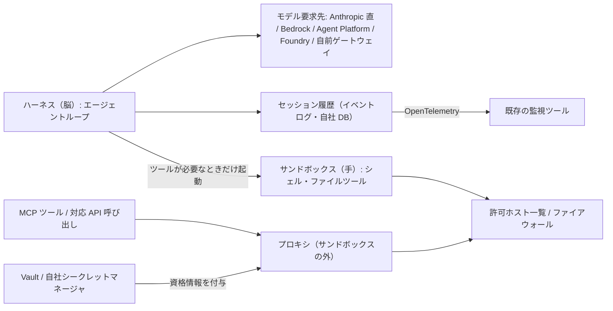

# Managed Agents のエージェントセキュリティ4原則（脳と手の分離・資格情報の外置き・許可ホスト・全記録）

> **TL;DR**: 無人で社内コードと社内システムに触るエージェントは人が各ステップを見張れないので制限を仕組みに組み込む必要がある、として Anthropic が [[tools/claude-managed-agents]] の設計原則4つ（ハーネスとサンドボックスの分離・資格情報をサンドボックスの外で付与・環境ごとの許可ホスト一覧・全ステップを OpenTelemetry で記録）を公式記事で示し、同じ記事で全部品を自社環境で動かす Self-hosted Managed Agents を private beta として発表した（2026-11-14）。

Anthropic が原則を記事の中心に据えた背景は、Managed Agents の提供形態が3段階に広がったことにある。最初は Anthropic がインフラを運用する hosted サービスとして Claude Platform 上で提供し、コードを自社環境に留めたいチーム向けに self-hosted sandboxes を足した。その後エージェントは壊れたビルドの修復・リリースのテスト・アラートのトリアージ・バグ backlog の消化のような重要な仕事を無人で担うようになり、社内システムへのアクセスが要る。そのレベルの権限を持つエージェントについては、サンドボックスだけでなくサービス全体を自社環境に置きたいチームがあり、これまではプラットフォームを自作するしかなかった、と Anthropic は記事で述べる。4原則は Anthropic が全部をホストする場合・サンドボックスだけ自社でホストする場合・サービス全体を自社でホストする場合のどれにも共通して適用される、というのが記事の位置づけである。

## 3つの提供形態

| 形態 | 自社環境で動く部分 | 記事での位置づけ |
|---|---|---|
| hosted（Claude Platform） | なし（Anthropic がインフラを運用） | 最初に提供した形態 |
| self-hosted sandboxes | サンドボックスのみ | コードを自社環境に留めたいチーム向けに追加 |
| self-hosted Managed Agents | ハーネス・サンドボックス・資格情報・セッション履歴の全部（自社クラウドまたはオンプレ） | private beta（2026-11-14 時点・Anthropic のアカウントチームへ申請） |

self-hosted Managed Agents では、Managed Agents サーバ・そのデータベース・エージェントがシェルとファイルツールを動かすワーカーを自社で運用する。モデルへの要求先は Anthropic 直接・クラウド事業者（Amazon Bedrock・Google の Agent Platform・Microsoft Foundry）・自前のゲートウェイから選べる。開発者が使うコア API は hosted 版と同じだ、と Anthropic は書く。セッション履歴は自社のデータベースに保存され、ゼロデータリテンション（ZDR、Anthropic 側にデータを残さない契約）を結んでいる組織では Claude へ送る要求に他の Messages API 呼び出しと同じようにそれが適用される。運用対象と ZDR の扱いの詳細は製品ページ [[tools/claude-managed-agents]] の節に置く。

## 4原則（Anthropic の記述）

### 1. 脳と手を分ける

ハーネス（脳）が Claude を呼び、サンドボックス（手）でエージェントのコードが動く。両者は設計上分離されていて、エージェントのコードはサンドボックス内で、エージェントループ・セッション履歴・Vault の秘密はその外に置かれる。Anthropic は分離の副次効果も3つ挙げる。エージェントが1つのサンドボックスの生存にその実行全体を依存しない。サンドボックスはツールが必要になったときだけ起動する。セッション履歴はサンドボックスの外にイベントログとして置かれる。

### 2. 資格情報をサンドボックスに入れない

Vault（Managed Agents の資格情報保管庫）は資格情報をサンドボックスの外に保つように設計されている。MCP ツールと対応する API 呼び出しについては、サンドボックスの外にあるプロキシが要求に資格情報を付与する。self-hosted では自社のシークレットマネージャに資格情報を置くこともできる。

### 3. ネットワークアクセスを制限できる

環境ごとに許可ホストの一覧を設定でき、それ以外のホストへの要求は遮断される。壊れたビルドを直すエージェントなら、一覧は git ホストとパッケージレジストリだけでよい、と Anthropic は例を挙げる。サンドボックスを自社でホストする場合は、同じ制限を自社のファイアウォールで設定する。

### 4. 全セッションが完全な記録を残す

Managed Agents はエージェントが取った全ステップを、ツール呼び出しとその結果も含めて記録する。記録は OpenTelemetry（監視データの標準規格）で出力されるので、既存の監視ツールに送り、他のシステムと並べてエージェントの活動を確認できる。

## Lesse の4問題領域との対応（wiki 側の推論）

Anthropic の head of platform である Katelyn Lesse は、多エージェントシステムの未解決領域を基盤・身元と権限・隔離・監視と停止の4つに整理した（[[concepts/multiagent-engineering-problems]]）。本記事の4原則は、それに対する同じ会社の製品側の答えと読める。以下の対応は wiki 側の推論で、記事自体は Lesse の記事に触れていない。

| Lesse の問題領域 | 本記事の原則 | 対応の読み |
|---|---|---|
| 基盤（エージェントは有状態で長く遊休する） | 脳と手を分ける | サンドボックスをツールが要るときだけ起動し、状態（履歴）をイベントログとして外に出す構造は、遊休中にサンドボックスを持ち続けない形になる |
| 身元と権限 | 資格情報をサンドボックスに入れない | エージェントのコードが資格情報そのものを見ないので、侵害されたコードから秘密が漏れにくい。Lesse が未解決とする「人の代理の同意」には記事は触れていない |
| 隔離（被害範囲） | 許可ホスト一覧と脳と手の分離 | 1体が侵害されても到達できる先が許可ホストに限られ、ループと履歴はサンドボックスの外にある |
| 監視と停止 | 全セッションの記録を OpenTelemetry で出す | 横断トレースの要件に対応する。Lesse が求めた「エージェントが自分のトレースを書き換えられない」「資格情報ごと止めるキルスイッチ」は本記事に明示の記述がない |

エージェントループ・履歴・秘密をサンドボックスの外に置く部品配置は、Microsoft CEO の Satya Nadella が [[concepts/models-as-insider-risks]] で求めた「権限・観測・停止をモデルの外に置く」を製品構造として実装した形にも見える。脳と手という比喩は [[concepts/ai-agent-building-blocks]] の5ブロック（脳/手/記憶/ループ/検証）と同じ語で、Anthropic も分離の説明に使っている。

## 問い

- 自分の launchd 夜間 ingest（claude -p）に「許可ホスト一覧」と「全ステップの OpenTelemetry 記録」に相当する最小構成を置けるか。Claude Code の permissions と hook で代替できる範囲はどこまでか
- self-hosted で履歴が自社 DB に移ると、Dreaming（[[concepts/managed-agents-dreams]]）のようにセッション横断でメモリを再構成する機能はどこで動くのか。公式ドキュメント（platform.claude.com/docs/en/managed-agents/self-hosted）で確認する
- 「エージェントが自分のトレースを改ざんできない」保証は self-hosted では誰が担うのか。自社運用の DB に書く以上、改ざん防止は運用側の責任になると考えられる

## 関連

- [[tools/claude-managed-agents]] — 製品ページ。self-hosted の運用対象・モデル要求先・ZDR の扱いの差分はそちらの節に置く
- [[concepts/multiagent-engineering-problems]] — Lesse の4問題領域。本ページはその製品側の答え
- [[concepts/models-as-insider-risks]] — 権限・観測・停止をモデルの外に置く Nadella の設計論。本ページの脳と手の分離・記録の外置きはその部品配置
- [[concepts/ai-agent-building-blocks]] — 脳/手/記憶/ループ/検証の5ブロック。Anthropic も脳と手の比喩で分離を説明する
- [[concepts/workload-identity-federation]] — 静的 API キーを使わない Anthropic への認証。資格情報を外に置く原則と同じ方向
- [[concepts/claude-code-security]] — Claude Code 側のセキュリティ設定。組織展開では両方を組み合わせる
- [[concepts/ai-agent-governance]] — 外部ポリシーでエージェントの実行を縛る設計。許可ホスト一覧はネットワーク層での同種の制御
