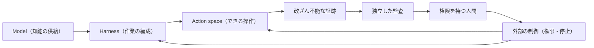

# モデルを内部脅威として扱う（Models as Insider Risks）

> **TL;DR**: 挙動を内部から説明できないフロンティアモデルを「悪意はなくても誤りや乗っ取りがありうる社内の強い権限者」とみなし、権限・観測・停止の制御をモデルの外側に置いて封じ込めるべきだ、という Microsoft CEO Satya Nadella の設計論。

> 📌 X bookmark: 18,000（2026-10-11 時点）

従来のソフトウェアは振る舞いを特定のコードパスまで遡れたが、いまのモデルは出力を学習データや重みの構成に帰属できない、と Nadella は出発点を置く。それでも機密データへのアクセスと重要な操作の権限をエージェントに渡している以上、信頼の設計を組み直す必要があり、責任はモデル提供者の保証では免除されないと述べる。Nadella はこれを「**知能の供給（supply of intelligence）と、それに対する権限（authority）を分離する**」と言い表す。アラインメントという難問はいったん脇に置き、非決定的なモデルを決定論的なシステム設計・人間による統制・運用手順で囲む工学的アプローチから始めるべきだ、というのが主張の骨格になる。

「内部脅威（insider risk）」の比喩について、Nadella は「モデルが悪意を持つからではなく、重要なシステムに触れる十分に有能な主体は誰でも誤り得るし侵害され得るから」と説明する。企業は強い権限を持つ人間に対して、ID の確立・最小権限・活動ログ・封じ込め境界といった実践を数十年かけて磨いてきたので、それをモデルにも当てはめればよい、という立場である。

## CoT 透明性とその限界

Nadella は思考過程（CoT）の透明性を「譲れない条件」とし、「Neuralese（人間に読めない内部表現）」を推論が不透明であることの言い訳にしてはならないと述べる。ただし CoT の透明性だけでは十分でも信頼できるものでもない。モデルの出力を一貫して忠実（faithful）にする方法がまだ分かっていないからだ、と同じ記事で限界も認めている。

モデル同士で敵対的にテスト・検証させることは「やるべき」としつつ、それだけでは「不透明なオーケストレーション層の中の不透明なモデルを、別の不透明なモデルが見張る」入れ子のブラックボックスになると Nadella は指摘する。

## 制御をモデルの外に置く

だからモデルのアクセス範囲と実行できる操作を統制する仕組みはモデルの外側に置く必要がある、と Nadella は結論づける。根拠として挙げるのは「プログラムは自分の権限を強制する機構を迂回・改ざんできてはならない」という1970年代からの情報セキュリティの原則である。現在の文脈では、モデルを作業を編成するハーネス（harness）から分離し、さらに「何ができるか」を定める操作空間（action space）からも分離し、制御と安全装置を外部化することを指す、と Nadella は書く。

## 観測可能性の7原則

Nadella が「観測可能性（observability）の原則」として挙げる7項目（原文の要旨）：

| 原則 | 内容 |
|---|---|
| Model diversity | 重要な成果を1つのモデルだけに依存させず、モデルに自分の仕事を検証させない |
| Observe everything | 意味のあるモデルの行動はすべて、改ざん不能で人間が読める証跡を残す。結果に至る過程をモデルの自己申告に頼らず再現できるようにする |
| Verifiability | 成功タスクだけでなく、失敗・攻撃・エッジケース・システム変更を含めてシステム全体を継続的にテストする |
| Independent controls | モデルが何にアクセスでき何を実行できるかを、組織が独立して決められる |
| Independent auditability | 検証は検証対象の知能から独立させる。システムの振る舞いと、その振る舞いが意図どおりかを判断する証拠の両方を、単一のモデルに握らせない |
| Containment | 最初から侵害されている前提で封じ込める。権限を持つ人がタスク途中でも停止・遮断できる「非常ブレーキ」を持つ。高度なモデルほど高度な封じ込め技術が要り、標準化が必要 |
| Incident disclosure | 失敗・侵害時は影響を受けた相手へ速やかに開示し、何がなぜ失敗したか・どの制御が効かなかったかを業界で共有する。実行時にエージェントの挙動を変える実装詳細も含める |

記事は「最も信頼できるシステムは、最も信頼できるモデルを持つシステムではなく、モデルを最も信頼しなくて済むシステムになる」という一文で締めくくられている。

## wiki 内の他の議論との関係（推論）

- 「制御をモデルの外に置く」は、[[concepts/ai-agent-governance]] が AWS Rex の例で示す「実行内容の生成と許可ポリシーを同じ場所に置かない」設計と同じ方向を向いていると考えられる。Nadella の記事はそれを企業 CEO の立場から業界標準の要求にまで広げている。
- モデル・ハーネス・操作空間の三分離は、[[concepts/harness-engineering]] の「エージェント = モデル + ハーネス」をさらに一段割った見方とも読める。ハーネス論が性能のための分離を語るのに対し、こちらは統制のための分離を語っている点が違う。
- 「モデルに自分の仕事を検証させない」「独立した監査」は、[[concepts/claude-md-multilayer-design]] の Writer/Reviewer 分離や、[[concepts/ai-engineer-interview-questions]] が問う暴走停止・責任分離を、組織ガバナンスの水準で言い直したものと考えられる。
- 同じ Nadella の [[business/frontier-ecosystem]] は「最良のモデルを選ぶこと」に優位を置かない論で、本記事の Model diversity（単一モデル依存を避ける）とは戦略面とガバナンス面から同じ結論に向かっているように見える。

## 問い

- 「モデルに検証させるが、検証の独立性は別系統で担保する」を、個人規模のエージェント運用（夜間の自動処理など）でどこまで実装できるか。改ざん不能な証跡と非常ブレーキの最小構成は何か。
- 別モデルによる検証は誤検知が多いと実運用で撤去されることもある。Model diversity と運用コストの釣り合いをどう取るか。
- Incident disclosure の業界標準は、誰（ベンダー・利用企業・規制当局）が主導して形になるか。

## 関連

- [[concepts/ai-agent-governance]] — 外部ポリシー（Cedar/Rex）で実行を縛る設計。「制御をモデルの外に置く」の具体実装例
- [[concepts/harness-engineering]] — モデルとハーネスを分ける全体論。本ページは統制の観点からの三分離
- [[concepts/claude-md-multilayer-design]] — 独立 Reviewer と Permission・Hooks の強制境界
- [[concepts/ai-engineer-interview-questions]] — 責任分離・暴走停止を面接で問う運用ガバナンス
- [[business/frontier-ecosystem]] — 同じ Nadella によるモデル非依存の戦略論
