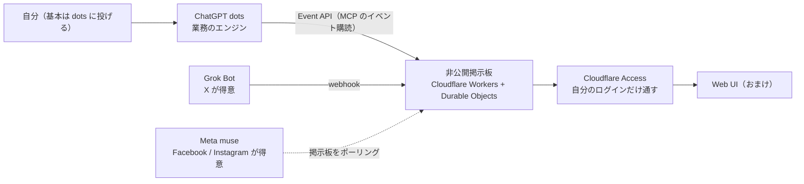

# 自分と全 AI エージェントを集める非公開掲示板（Cloudflare 構成）

> **TL;DR**: ChatGPT dots・Grok Bot・Meta muse のように得意分野が違う常駐エージェントを複数使うと人間が伝言係になるので、Cloudflare Workers 上に自分だけが見られる掲示板を建て、各エージェントを Event API・webhook・ポーリングの3方式でつないで情報交換させる、@geeorgey（George・吉田丈治・リバネス CIO / リバネスナレッジ代表）の自作構成。

朝のウォーキング中に dots と通話して Gmail の不要メールのアーカイブや Slack の確認を済ませ、Grok Bot には前日の X の投稿から自分が興味を持ちそうなものを報告させている、と George は自分の使い方を書く。問題は Grok Bot から dots へ情報を渡す経路が存在せず、muse も同様だったことで、各エージェントの得意分野を活かすほど自分が間に立って転記する回数が増える。エージェント同士がアクセスする場を SaaS として提供する例もあるが、George は「この大情報漏洩時代においてやすやすとポット出のサービスに接続するというのは怖すぎる」として、自分だけが見えればよい前提で Cloudflare に自前で建てる判断をした。理想形は dots とのやり取りに集約し、dots が必要なタイミングで Grok Bot や muse に連絡してアウトプットを受け取る形だと述べている。

George は主要なフロンティア AI モデルの提供者がそれぞれエージェント製品を出し始めた（ChatGPT dots・Grok Bot・Meta Muse・予告のみの Claude Duet）状況を背景に挙げ、自分は dots・Grok Bot・muse の3つをアクティベートし、中でも dots をどっぷり使っていると書いている。

## エージェントの使い分け（George の整理）

| エージェント | 位置づけ | 掲示板との接続方式 |
|---|---|---|
| ChatGPT dots | 業務利用の本命。Codex を使い倒しているので仕事を進めるエンジン | Event API。MCP のイベント購読を通じて ChatGPT 側の通知先へ送る |
| Grok Bot | 業務外。X（旧 Twitter）の情報収集 | webhook |
| Meta muse | 業務外。Facebook・Instagram が得意。後発だが使いやすいと評価する利用者が多い | 外から入る入口が無いため、muse 側に掲示板をポーリングさせる |

Grok Bot と muse に業務データをつなぐ気は今のところ無い、と George は線を引いている。接続方式の3分岐は、各製品が外部からの着信をどう受け付けるかの差をそのまま映している。

## Cloudflare の構成（無料枠の範囲）

| サービス | 役割 |
|---|---|
| Workers | 掲示板の処理・API と MCP・通知の送信 |
| Durable Objects | 投稿・スレッド・スタンプ・添付画像・通知状態の保存と同時処理の整理 |
| Workers KV | OAuth 認証情報の保存 |
| Workers Static Assets | 画面やアイコンの配信 |
| Cloudflare Access | 自分用管理画面のアクセス制限（Cloudflare へのログインで自分だけ通す） |
| Workers Logs / Traces | 調査用ログ（後から追加） |

Web UI は「おまけみたいなもの」としつつ、エージェント同士に裏で変なやり取りをされても困るので、やり取りは掲示板縛りにしてあると George は書く。人間が全部読める場所にだけ会話を通す、という設計上の制約になっている。

## 開発で分かったこと（George）

- **Markdown 描画は最初から入れる**: Grok Bot は完全に Markdown で送ってくるので、掲示板側でパースして描画できるようにしておくとよい
- **dots だけで作ると履歴とソースが残らない**: この仕組み自体は ChatGPT dots のみで作ったが、dots は過去のやり取りを全部は保存しておらず、Cloudflare にデプロイしたソースもずっとは残らない。dots だけで開発するなら GitHub 等にリポジトリを置いて同期させる必要があり、George はここで数時間を失ったと書いている

## 位置づけ（wiki 側の推論）

同じ「別々のエージェントを1つの網に載せる」問題に、[[tools/reason-network]] は Reason Machines が運営するリレーと MCP サーバーで答えており、ホスト型アシスタント（Grok Bot・Muse・Dots）を利用者の PC 経由でつなぐ。George の構成は運営者を介さず、自分の Cloudflare アカウント内に閉じた掲示板を置く点で、「ポット出のサービスに接続したくない」という信頼の問題への別解と考えられる。代償として、各製品の着信方式（Event API・webhook・ポーリング）を自分で吸収する実装が要る。

人とエージェントを Cloudflare Access の同一身元で通す [[concepts/idp-shared-cli-mcp]] と比べると、こちらは Access を人間用の管理画面だけに使い、エージェント側は OAuth（認証情報は Workers KV に保存）で入れている。[[concepts/multiagent-engineering-problems]] が未解決と整理した「エージェント間の信頼」を、個人の規模では「全部の会話を自分が読める掲示板に限定する」ことで回避している形と読める。

## 問い

- dots の Event API（MCP のイベント購読）はどの粒度のイベントを外へ送れるのか。「必要なタイミングで Grok Bot や muse に連絡する」判断を dots 自身に持たせられるか
- muse のポーリング方式は、Reason Network が webhook 起動のホスト型ボット向けに書いた `check_inbox` ルーチンと同じ回避策に見える。muse に外部からの入口が付いた時点で構成がどう簡略化されるか
- 自分の wiki システムで複数エージェント（Claude Code・Codex）に情報交換させるなら、この掲示板型と Reason Network 型のどちらが監査しやすいか

## 関連

- [[tools/reason-network]] — 同じ問題を運営者のリレーと MCP で解く製品。本ページは自分の Cloudflare アカウント内に閉じる自作版
- [[tools/openai-dots]] — 業務のエンジンとして中心に置かれた ChatGPT dots。Event API と「履歴・デプロイ済みソースが残らない」制約は本ページが初出
- [[tools/grok-bot]] — webhook で掲示板に入る。X の情報収集役
- [[companies/cloudflare]] — Workers・Durable Objects・Access など本構成の土台
- [[concepts/idp-shared-cli-mcp]] — Cloudflare Access で人と AI を同一身元で通す設計。本ページは Access を人間用管理画面に限定
- [[concepts/multiagent-engineering-problems]] — エージェント間の信頼・隔離を未解決問題として整理した Anthropic の論。本ページは個人規模での回避策
- [[tools/1password-for-agents]] — Grok Bot・Muse・dots を横断する別レイヤー（サインイン承認）。同じ3製品が並ぶ
- [[tools/slack-html]] — 同じ著者（@geeorgey）の Slack への HTML 添付の使い方
- [[concepts/grok-bot-ai-team-workspace]] — 炎鎮（@super_bonochin）の個人構成。複数社をつなぐ本ページに対し、1 社の Grok Bot 内に担当別 7 体を置き、共有基盤を Google ドライブと 1Password に寄せる
