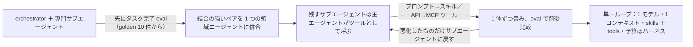

# サブエージェントを主ループに畳む（Anthropic Applied AI の単一エージェントループ）

> **TL;DR**: Anthropic の Applied AI チームは、企業向けエージェントではルーター・プランナー・領域別サブエージェントを主エージェントのループに畳んだ方が品質・コスト・遅延で勝つ場面が多いと報告し、スキルとツール検索の段階的開示で仕事を 1 つのコンテキストに集め、タスク完了 eval で 1 体ずつ畳んで悪化したものだけ残す移行手順を示した（著者 Diane Sarkis・2026-10-22 公開）。

企業が複数の製品と機能を 1 つの顧客窓口に束ねようとすると、機能ごとにチームが分かれているので、まず各チームが自分のエージェントを作り、その上に中央のプラットフォームチームがオーケストレーターを載せる形になりやすい。記事はこれを「エージェント構成が組織図の写しになる Conway の法則」と呼ぶ。Applied AI チームが複数の企業導入を比べたところ、スキルを持つ単一エージェントが「1 本のプロンプトで全部」と「サブエージェント設計」の両方に品質で勝ち、タスクあたりのコストと遅延も低いことが多かった。ある企業では顧客向けエージェントの中の十数個の専門サブエージェントが、ブランドとして一貫した体験を保ちにくくし、遅延も増やしていた。記事がよく見ると書く提案設計（意図分類器→固定の多段推論→利用者セグメント→推薦の分岐→その上の orchestrator）への典型的なフィードバックは、「この構造の大半はモデルがもう自分でできる仕事を代わりにやっていて、明確なシステムプロンプト 1 本・薄いデータツール 4〜5 本・固い出力ガードレールで用途の大半は足りる」というものだった。

紹介者の Matt Stockton（@mstockton・企業の AI/ML 導入を支援する立場と自己紹介）は「もうサブエージェントは要らない、たいていのワークフローは 1 体でよい。Bitter lesson に近い」と要約し、投稿は 2,537 件ブックマークされた（2026-11-17 時点）。ただし記事自身は「サブエージェントには研究の最前線を含めて居場所がある」と明記し、残す条件を 3 つ挙げている。「要らない」は紹介者の圧縮で、本ページは記事を正本とし投稿は入口として扱う。

## サブエージェントを残す 3 条件

記事はサブエージェント（独自のコンテキストウィンドウ・ツール・指示を持ち、コーディネーターに編成されるエージェント）を検証・並列作業・権限の分割に有効だとし、Anthropic 自身も multi-agent research system などで使っていると書く。残すべきなのは次のいずれかに当たるときである。

- 単一ループがコンテキストの肥大で**計測可能な**性能劣化を起こしている
- 複数のタスクを、終わったら捨てられる新しいコンテキストで並列に処理する必要がある
- 単一エージェントが適切なツールを選べない、またはシステムプロンプトの指示が衝突している

この 3 条件に当たらないのに、チームや問題種別ごとにサブエージェントを与えるのが記事の言う失敗である。

## 大きな組織で起きる 5 つの失敗

orchestrator-subagent でも「特定のエージェントを MCP ツールとして公開した単一エージェント」でも、各チームが自分のエージェントを持つ構成は次の複雑さを持ち込む、と記事は列挙する。

| 失敗 | 記事の説明 |
|---|---|
| コンテキスト管理 | エージェント間で何を受け渡すか決める必要があり、往復のたびに詳細が落ちる |
| サブエージェントの乱立 | 全チームが自分のサブエージェントを出荷し、基準も責任者もない重複した数百体になる |
| Frankenprompt | 全チームがシステムプロンプトに 1 文ずつ足し、矛盾した規則と一貫しない声になる |
| 検証されない局所的な eval | 各自が自分のサブタスクに最適化した eval を足し、全体を持つ人がいないまま経営が薄まったスコアで判断する |
| 遅延 | 多段構成そのものが遅延を足す。ある顧客は単一ループと比べて約 2 倍の実行時間差を見た |

## 段階的開示つきの単一ループが効く 3 つの理由

orchestrator-subagent はチーム横断の専門家を束ねる妥当な方法だが、より効くことが多いのは**スキルによるコンテキストの段階的開示**と**ツール検索によるツールの段階的開示**だと記事は書く。エージェントはスキルとツールの短い説明だけを見て、必要なときに全文を読み込む。理由は 3 つ。

- **共有コンテキストの方が良い答えを出す**。長く走るエージェントでは複数タスクの文脈を主コンテキストに同居させたい。前のステップの結果を見たエージェントはそれらをつなげられ、サブエージェントが返す要約の束より豊かな出力になる。コンテキストウィンドウの数が減り、損失のある受け渡しも減る
- **段階的開示がコンテキストの肥大を防ぐ**。全部を 1 本の長いシステムプロンプトに載せずに多様なタスクをこなせるので、仕事をサブエージェントに分けていた主因が消える。Anthropic は上位モデル向けに Claude Code のシステムプロンプトを 80% 以上削り、その中にはスキルとツールの段階的開示に関する削減が含まれる（[[concepts/context-engineering]]）
- **モデルが有能になった**。Opus 4.5 以降、1 つのループで扱える量は多くのチームの想定を超えた。Opus 5.5 と Fable 5.1 では thinking を切れず、最近のモデルは進捗を語り自分の仕事を確かめながら進むので、ハーネスの一部が冗長になる。新しいモデルが出るたびに判断をハーネスからモデルへ移せる。単純なループは次のモデルへの移行も楽で、記事が手伝った移行では硬直したマルチエージェント構造こそが新モデルの働きを止めていた

単一ループには規律が要る。管理されたシステムプロンプト、適切な時に発火するスキルとツールの説明、コンテキストウィンドウ・メモリ・メモ取りの意図した扱いである。小さな中央チーム 1 つが end-to-end の品質とシステムプロンプトを持ち、新しいツールと eval を出荷前に検査する。マルチエージェントにするなら、機能しうる最も単純なパターン（generator-verifier・orchestrator-subagent など）から始め、**文脈で分ける**。各サブエージェントに他からほとんど何も要らない仕事を渡し、小さな結果を返させる（独立した調査経路・きれいなインターフェースを持つ別コンポーネント・ブラックボックス検証）。問題種別で分けると「伝言ゲーム」になり、受け渡しのたびに精度が落ちる。

## 目標とする単一ループの形

記事が勧める到達点は次のとおり。

- 1 つのモデルと 1 つのコンテキストウィンドウが開放型のツールループを回し、制限（ターンとコストの予算・書き込みゲート）はハーネスが持つ
- 毎ターン、モデルがツール呼び出しの束を出し、ハーネスが並列に実行して生の結果を同じモデルに返す。次の一手（次の束・利用者への質問・回答）はモデルが決める
- モデルが答えるか予算に達したらループは止まる。回答後に goal や verifier の検査を任意で走らせる
- **モデルが初回ターンに計画をコンテキスト内に書き、結果が届くたびに改訂する**。orchestrator と専門エージェントの構成からの最大の変更点で、計画を書くモデルと実行するモデルが同じになるので、ターンの途中で計画を変えられる
- コンテキストの読み込みはエージェント自身が管理する。規則のカタログから計画を書き直すコードのステップは不要になり、順序と領域の手順は**スキル**へ、ハード制限（検証・承認ゲート）と会話の途中で生じるもの（メモリ参照など）は**ツール**へ移る。安くほぼ常に必要なもの（エンティティ解決など）の読み込みと機械的な部分（ペイロード構築・ストリーム解析・確認の再開）は、ループが呼ぶツールの中でコードが担ってよい

この形は「利用者の高次の目標を理解して代理で動くエージェント」という多くのチームの到達目標にも合う。学んだことが全部 1 つのコンテキストに残るからである。

## 移行の手順

### タスク完了 eval を先に作る

最初の一歩は、サブエージェントを畳むべきかを判断できる eval セットである。効いた構造は、中央チームが持つ end-to-end のセット 1 つと、各スキルに添えてそのチームが出荷する小さなセット。golden 例は 10 件からで十分だと記事は書く。最終メッセージをルーブリックで採点するのが出発点で、orchestrator が残る間はルーティング精度（正しいサブエージェントを選んだか）も追い、畳んだ後は正しいスキルを読み正しいツールを呼んだかに置き換える。内部システムの再生や利用者の反応の模擬が難しい環境では、重要なイベントにタイムスタンプを記録して後から的を絞った eval として再生する方法が Anthropic 内部で効いた。

### 領域エージェントの併合

最初の併合の前に小さな end-to-end eval を作り、**使われている順に、共有コンテキストで畳む**。互いの出力に連鎖する・同じデータを触る・一緒に呼ばれることが多い専門家は併合候補で、本番トラフィックのかなりの割合が「専門家 A の次に B」なら密結合のペアとして 1 つの領域エージェントにする。

### サブエージェントをツールとして呼ぶ

3 条件のどれかに当たって残すサブエージェントは、主エージェントが**ツールとして呼ぶ**と、主エージェントが利用者との会話を持ち続けられる。サブエージェントが会話を乗っ取る完全なハンドオフは、利用者と直接話す必要があるときだけに限る。サブエージェント共通の応答スキーマを定義し、結論を主エージェントが実データで検証し、最終合成への入力を削れる。サブエージェントを書き直さずに済み、畳む前のタスク完了 eval のベースラインも取れる。ただし専門家ごとのプロンプト・コンテキスト・責任チーム・eval は残り、呼び出しごとに損失のある要約が返り、入れ子のモデルループが遅延を足す。

### スキルとツールで 1 体ずつ畳む

各サブエージェントのプロンプトをスキルに、API 呼び出しを MCP ツールに変えて 1 体ずつ畳み、サブエージェントあり／なしで eval を比べて残すものを決める。比べるときは最終スコアだけでなく**どのタスクが反転したか**を見る。記事のサポートエージェントの試行では、あるサブエージェントを別のものに畳むと遅延は下がったが、通っていた工程が壊れた。主エージェントが注文照会ツールを持ったまま自分で答え、配送の専門担当に配送日を聞かなくなったからである。この破壊は 2 回のうち 1 回しか出なかったので、変更の前に本番で一緒に走る全ての連鎖と破ってはならない全ての規則に eval のタスクを用意し、各タスクを 2 回以上走らせよと記事は書く。

## 複数のチームが 1 体に貢献する方法

領域の推論は知識ベース・スキル・MCP ツールから引ける。各チームは所有をエージェントからスキルとツールに移し、小さな中央チームがシステムプロンプトと end-to-end の品質を持って、新しいスキル・ツール・eval を出荷前に検査する。

- **MCP ツール**: エージェントが行動する・システムの生データを読む・固定の形で結果を返すときに合う。移行中はサブエージェントを呼び続ける手段にもなる。ツールは API ごとに 1 つでなく**利用者の意図でまとめる**。システムプロンプトのツール定義が 30〜50 を超えるとツール選択が劣化しやすい。ツール検索の遅延読み込みを使い、ハードな前提条件は減らして必要なものはツールの中へ移す（Y が X の出力を要るなら Y のツールがそれを確かめ、モデルが従える指示を返す）。利用者ごとの権限も同じで、各ツールが呼び出し元の利用者に許される範囲を確かめて平文の拒否を返せば、権限レベルごとに別エージェントを持たずに 1 つのループで異なる利用者に応えられる
- **スキル**: チームの仕事のやり方（専門サブエージェントのプロンプトが持っていた手順・規則・判断）をエージェントが知る必要があるときに合う。スキル群の保守は書く人に返し、Claude がスキルを作り・試し・刈り込むスキルで重い部分を担う。乱立を防ぐにはチームごとの DRI がスキルを持ち、よく作られ・重複せず・eval 付きで出荷する。`/skill-creator` は新規作成と既存の監査（削減・重複排除・再構成）、`/skill-doctor` は各スキルのコストと実際の使用頻度を見せて死荷重を消す
- **知識ベース**: 時々しか要らない参照資料（ポリシー・指標の定義・製品仕様）に合う。検索や参照ツールの裏に置くか、スキル内の参照ファイルとして出荷する。コードが取り出してプロンプトに貼り付ける形は避ける

## 移行キットと claude-api スキル

記事は Claude API スキル群と、それらを 1 本の誘導付きワークフローにつないだ移行キット（GitHub の anthropics/single-agent-loop-kit）を挙げる。キットにはモックシステムで試せるデモが付く。

| スキル | 記事の説明 |
|---|---|
| `/claude-api build-eval` | 中央チームが持つ最初の end-to-end セット、または各チームがスキルに添える小さな eval を作る |
| `/claude-api prompt-audit` | プロンプト・スキル・ツール説明の中の旧モデル向けの指示を見つけ、修正を diff で提案する。以前のモデルのために足された規則が今はエージェントを遅く硬くしている箇所を探す |
| `/claude-api hillclimb` | 既存の eval に対してアプリを反復改善する。「畳んだ版 vs 残した版」の比較で、スキルとツール説明を反復させて畳んだ版がサブエージェントに並ぶか超えるかを見る |
| `/claude-api cost-optimize` | 呼び出しの行き先をプロファイルし、プロンプトキャッシュ・不要トークンの削減・effort・モデル選択の節約を 1 変更ずつ提案する |

記事の結びは、どの構成も原則より重要ではないというものである。計測し、1 度に 1 つ変え、持ちこたえたものを残す。モデルが有能になりエージェントが長く走るほど、サブエージェントの多くはスキルとツールになる。小さな end-to-end eval を作り、1 体畳み、畳んだ版のスコアが悪いときだけサブエージェントとして残す、を繰り返す。

## Matt Stockton の読み

Stockton が挙げた 5 点は、記事のどこに対応するかを添えると次のようになる。

- 「組織図に合わせてエージェントを作るな」は記事の Conway の法則の指摘そのもの
- 「Plan mode は死んだ。計画は主エージェントのコンテキストにある方がよい」は、記事の「モデルが初回ターンに計画を書き改訂する」を指す。記事は別立てのプランナー（サブエージェントやコードのステップ）を畳む話をしており、Claude Code の plan mode には触れていない。「死んだ」は Stockton の言い方である
- 「MCP ツール設計が決定的。API をそのまま写さず jobs to be done で」は、記事の「利用者の意図でまとめ、30〜50 定義で選択が劣化する」に対応する
- 「eval はタスク完了・最終出力で（必要ならスキル／ツール呼び出しで）。整合して矛盾がないように」は記事のタスク完了 eval と「局所 eval の乱立」の失敗に対応する
- 「サブエージェントを残すならツールとして呼び、主エージェントがコンテキストを握る」は記事の「サブエージェントをツールとして呼ぶ」の節

Stockton はさらに、記事を貫く主題として「AI 導入の多くは既存の構成（技術と組織の両方）の上に AI を重ねるが、本来は構成そのものを考え直すべきで、最も難しいのは人の側（組織設計・どのチームが何をするか・どのチームが存在すべきか）」と書く。記事が明示的に主張するのは「チームの所有をエージェントからスキルとツールへ移す」までで、組織の再設計はそこから Stockton が引き出した読みと位置づけられる。

## 既存ページとの関係（wiki 側の推論）

- [[concepts/multi-agent-patterns]] が整理する Anthropic 公式の設計パターンに対し、本記事は同じ会社が「企業導入では畳んだ方がよいことが多い」と逆方向から書いたもの。向こうの「コンテキスト中心分解」の観察と、本記事の「文脈で分け、問題種別で分けない」は同じ判断基準を指している
- [[concepts/cost-effective-harness]] の Lance Martin による委譲の損益分岐（境界の重複・fan-out の重複）は、本記事の「損失のある受け渡し・入れ子ループの遅延」を個人規模で計測した側と読める
- [[tools/claude-code-subagents]] と [[concepts/claude-code-orchestration]] が扱う Claude Code のサブエージェントは、使い捨てコンテキストでの並列と探索に使う限り残す 3 条件に当たる。[[concepts/x-ops-subagent-company]] の「統括 1 体＋8 チーム」は役割で分けた構成で、本記事の基準では併合候補が多いはずだが、向こうは個人の X 運用で企業規模の失敗（乱立・Frankenprompt）は起きにくい
- [[concepts/coding-agents-as-management]] の orchestration tax（追加 1 体ごとの注意コスト）は、本記事の遅延と文脈の損失を人間の監督側から見た言い方にあたる
- [[concepts/multiagent-engineering-problems]] は数千体が持続的に働く規模の工学問題で、本記事の「十数体の専門家を 1 体に畳む」とは対象の規模が違う。畳めるのは 1 つの顧客窓口の中の話である
- [[concepts/eval-harness]] の質問単位の回帰検出は、本記事の「最終スコアでなく反転したタスクを見る・各タスクを複数回走らせる」と同じ運用

## 観察ログ（未検証）

- 2026-11-18: 単一ループが multi-agent harness より約 2 倍速かったのは記事中の顧客 1 社の計測で、条件は書かれていない
- 2026-11-18: サポートエージェントの試行で、畳んだ後の破壊は 2 回中 1 回しか出なかった。再現率の低い破壊を何回の実行で拾えるかは記事に目安がない

## 問い

- この vault の wiki-ingest・auto-triage・weekly は Claude Code のスキルで、既に「スキル＋ツールを 1 体が読む」形に近い。残っているサブエージェント相当（Explore・fork）は 3 条件のどれで正当化されるか
- 「30〜50 のツール定義で選択が劣化」はツール検索の遅延読み込みで解けるというのが記事の主張だが、ツール検索に載せる説明文の書き方は何が決めるのか
- 移行キット single-agent-loop-kit のデモは、この wiki の headless パイプラインのような非対話システムにも当てられるか

## 関連

- [[concepts/multi-agent-patterns]] — Anthropic 公式の設計パターン集。本ページはその「畳む側」
- [[concepts/cost-effective-harness]] — 委譲の損益分岐の実測。同じコスト構造の個人規模の観察
- [[tools/claude-code-subagents]] — Claude Code のサブエージェント。残す 3 条件に当たる使い方の代表
- [[concepts/claude-code-orchestration]] — subagent／agent teams／worktree の使い分け
- [[concepts/x-ops-subagent-company]] — 役割（組織図）で分けた 9 体構成の実例。本記事の基準で見直す対象
- [[concepts/context-engineering]] — 記事が引く Claude Code システムプロンプト 80% 削減の公式解説
- [[concepts/skill-building-best-practices]] — スキルの段階的開示（progressive disclosure）の作法
- [[concepts/coding-agents-as-management]] — orchestration tax を監督側から述べた Addy Osmani の記事
- [[concepts/multiagent-engineering-problems]] — 数千体規模の未解決問題。規模の違う隣接論
- [[concepts/eval-harness]] — 質問単位で反転を見る回帰 eval の実装例
- [[concepts/claude-code-parallel-oversight]] — `/skill-doctor` でコンテキストを食うスキルを見つける運用の紹介
- [[tools/claude-managed-agents]] — 記事が前提にする Claude Platform
- [[models/claude-opus-5-5]] — 記事が「thinking を切れない」と述べるモデル
