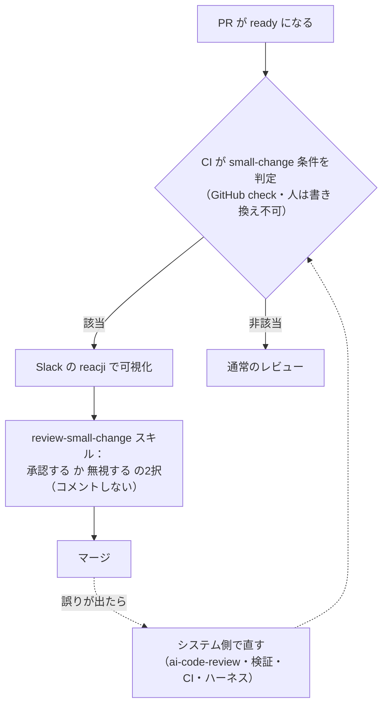

# small-change：条件を満たす小さな PR を機械が承認する（Imprint）

> **TL;DR**: AI でマージされる PR が増えてレビュー待ちが伸びた Imprint が、「1,000行未満・AIレビューbotの重大指摘なし・作者がそのサービスに10本以上マージ済み・影響サービス数が上限未満・共有ライブラリ不可」を人が書き換えられない CI の check で判定し、該当 PR だけをコメント無しで承認するスキルに任せる運用。該当は約10%で、起きた誤りは人でなくシステムの失敗として直す。

Imprint のエンジニア1人あたりのマージ PR 数は2年前の平均4倍になり、2チームは10倍、1人は2年前の平均エンジニアの週あたり25倍に達したと、Imprint の Will Larson（lethain.com）が書く。同じ期間にインシデントは半期比で42%減、重大インシデントは78%減で、品質と速度のトレードオフという構図はもともと有用でなかったが今は否定しようがない、と Larson は述べる。一方で PR レビューの中央値は2年前の約33分から約77分へ伸び、その傾きはマージ数と強く相関していたため、Larson はレビュー時間の削減をその週の優先事項に据えた。「解決した！冗談だ、全く解決していない」と前置きしつつ、現在の手法として `small-change` を紹介する。日本語では @iwashi86 が「AIでPRが増えすぎたレビュー負荷を、条件を満たす小さな変更の自動承認で減らす試み」として上の数値とともに紹介している。

## なぜ PR をレビューするのか（Larson の4理由）

Larson はレビューの目的を4つに分け、それぞれに現代の開発様式ではより良い解き方があるとしつつ、変更は慎重に進めると書く。

1. **作者とレビュアーの知識共有** —— ソフトウェア工学は徒弟制で学ばれ、レビューは経験者が良いソフトウェアの姿を教える主要な機構。今の量では、個々の PR でなく PR のクラスタ単位で行うことになる
2. **誤りの防止** —— レビューは昔から誤りを捕まえるには高価な工程で、効果的な CI/CD と、@poteto の pstack のようなハーネス側の検証手法の方が効く（[[tools/pstack]]）
3. **悪意ある振る舞いの防止** —— 注意深いレビューでも有能な悪意は見逃す（幸い多くの悪意は無能だという）。固定ルール（特定のオブジェクト・クラス・ファイルの変更はレビュー必須）、LLM ベースの会員サポートで磨いた不正対策、監査、監査ログの検査を組み合わせる方がよい
4. **文書化された統制上のコンプライアンス義務** —— 変えられるが、今日の時点では一部リポジトリで独立した人間のレビューを要する

## small-change の仕組み（記事からの転記）

1. PR が ready になると CI/CD が small-change に該当するかを判定し、結果を GitHub の check（合格/不合格）として表す。可視化のためのラベルもあるが、該当を決めるのはビルドが管理し人が書き換えられない check の方である（ラベルは一次フィルタに使い、check を別途検証する）
2. 次の条件を**すべて**満たすものが small-change

   | 条件 | 内容 |
   | --- | --- |
   | 規模 | 1,000行未満 |
   | AI レビュー | 自動レビュー bot `ai-code-review` の p1・p2 の指摘が無い |
   | 作者の経験 | そのサービス／アプリのディレクトリに10本以上のマージ済み PR がある。複数サービスにまたがる変更では全部で経験が要る |
   | 影響範囲 | 影響するサービス／アプリが N 未満。フロントエンドのモノレポは N=1、gRPC サービスと共通 HTTP ゲートウェイを同時に触るのが典型のバックエンドのモノレポは N=3 |
   | 除外 | 共有ライブラリ・ユーティリティのファイルは対象外 |
   | パス別調整 | 各リポジトリの `.small_change` ファイルでパスごとに挙動を調整できる（例: 資金移動を扱うサービスを除外） |

3. Slack の自動化が PR への言及すべてに状態（テスト失敗・承認済みだがテスト実行中・マージ可能など）の reacji を付けており、そこに small-change の reacji を足した
4. 社内スキルリポジトリに2つのスキルを作り、各ハーネスへ配布した
   - `review-small-change` —— リポジトリの一覧を受け取り、open かつ draft でない small-change をすべてレビューし、条件（small-change の check を含む全 check が合格・決済やセキュリティなど敏感な話題に触れない）を満たせば承認する。**選択肢は「承認」か「無視」の2つだけで、PR にコメントは決して書かない**。「meat proxy（肉の代理）レビュー」の増殖を避けるためで、これはいくつかのチームで「解決策のふりをしたボトルネック」になっている
   - `review-pr-cluster` —— PR をまとめてレビューして共通テーマを見つけ、議論の機会と検証の追加を提案する
5. small-change が起こした誤りはシステムの失敗であり、`ai-code-review`・検証機構・CI/CD・ハーネスの改善というシステムの水準で解く、という社会的な期待を置いた

実装と展開には断続的な注意で2日ほどかかり、つまみの調整は長く、たぶん永遠に続くと Larson は書く。

## meat proxy レビュー

Larson が small-change のコメント禁止の理由に挙げるのが、Simon Willison の記事に由来する meat proxy レビューである。パターンは次の4段で進む。①チームがレビューに溺れる。②手元のハーネスで PR をレビューし始める。③PR に大量のコメントが付き、筋の通ったものと通らないものが混ざる。調べなければ区別できず、どれがレビュアー自身の見解かも分からないので、レビュアーが同意すらしていないコメントを反証する大仕事になる。④そのコメントへの返答にもハーネスを使い、レビュー全体が学びを生まない幻になる。しかも他のメンバーの関与なしでもできてしまう。Larson は、meat proxy レビューをしているすべてのケースで、中央のレビュー機構・その指摘に対処するハーネスのループ・単に承認を押すこと、に投資した方が良い結果になると述べる。

## fleet：中央で統制するハーネス

もう一つのレビュー量削減策として Larson は中央で統制するハーネス `fleet` を挙げる。Stripe の Minions（[[tools/stripe-minions]]）に似るが、one-shot の方式は取らない。クラウド上の強く統制されたハーネスで実装と検証を行い、独立した評価機構が変更ごとに必要な独立レビュアーの数を決める。安全と評価された変更ではその数は1（fleet が書き、人が1人レビュー）まで下がる。

## 結果と見通し

有用な結果を出すには早すぎると断ったうえで、初期の結果では約10%の変更が small-change に該当し、セキュリティや金銭に近い話題に触れてフラグが立たない限りごく速く承認されていると Larson は書く。10%は小さいが中核の考えは機能しており、成否は今後数か月で検証機構を包括的にしながらこの割合を広げられるかにかかる。検証の改善は、Larson が Imprint の領域に当てはめる「規模の複雑さが低く領域の複雑さが高い」ソフトウェアでは、利用者ごとに設定と振る舞いが違うぶん段階的ロールアウトのような手法のカバー範囲が小さくなり、難しいとも述べる。社内の受け止めは一様に前向きではなく、良いエンジニアとして学んできたやり方からの大きな変更だという。長年の best practice が単なる教義になっていないかを毎週再評価できるのが現在のサイクルの最も活力のある部分であり、再評価を止めれば遅れを取るのが最も痛い部分だ、と Larson は結ぶ。

## 他ページとのつながり（wiki 側の推論）

- Anthropic の [[concepts/agent-era-code-review]] は人間承認をリスク別に0・1・2人へ分け、Low は自動レビューとセキュリティチェックが緑なら不要とした。Imprint の small-change は、その「0人」の段を独立した check と承認専用スキルで実装した一例と読める。差分は、承認する主体が CI でなくハーネス上のスキルであること、作者の経験（10本以上）を条件に含めること、コメントを禁じていることで、Larson は記事中で Anthropic の記事を「同じ道を進む皆」として参照している
- [[concepts/agent-trust-inverse-pyramid]]（@poteto）の「人間レビューは最もスケールしないので、エージェントが既定で正しいことをする環境の設計に労力を使う」を、Larson は「誤りの防止は CI/CD とハーネス検証の方が効く」「small-change の誤りはシステムの失敗」という形で組織の運用に置いている。記事が pstack を名指ししている点で、両者は同じ系譜にある
- 承認か無視かの2択でコメントを禁じる設計は、[[concepts/ai-review-bottleneck]]（@smark_x）が言う「読んで直す工程」へ流入する量を、コメントという形で増やさないための制約と考えられる
- [[tools/grok-bot]]（SpaceXAI）の「高確信・低影響は自動マージ」と比べると、small-change は確信度でなく変更の属性（行数・指摘・経験・影響範囲）で線を引いており、判定を LLM の確信度に頼らない点が異なる

## 観察ログ（未検証）

- 2026-10-19: 平均4倍・2チーム10倍・1人25倍のマージ数、インシデント42%減・重大78%減（半期比）、レビュー中央値33分→77分、small-change 該当約10%は、いずれも Larson の自己申告の単一ソース。品質の改善を small-change の効果と読まないこと（記事は効果を測れる段階でないと明言し、small-change は品質改善の後に始めた施策）

## 問い

- このリポの PR 運用に small-change の条件を移すとしたら、「作者の経験10本以上」は一人運用では意味を持たない。代わりに何を条件にするか（触るパスの `.small_change` 相当だけで足りるか）
- 「承認か無視か、コメントしない」を Codex クロスレビューに適用すると、指摘が出ない代わりに何が失われるか。review-pr-cluster のようにまとめて後から見る仕組みで補えるか
- 検証の網羅性が上がらなければ該当率10%は広がらない。Imprint が「検証を広げる」と言うとき、具体的にどの種類の検証を足すのか（続報を追う）

## 関連

- [[concepts/ai-judgment-delegation]] — 「何を人間が承認すべきか」の判断自体を AI に委ねる流れ（西尾泰和）。承認を機械チェックへ移す本ページはその具体例
- [[concepts/agent-era-code-review]] — 同じ問題への Anthropic の答え。リスク別の人間承認（0・1・2人）と往復上限。Larson が記事中で参照
- [[concepts/agent-trust-inverse-pyramid]] — 人間レビューを最小にし決定論的な層へ努力を移す @poteto の指針。記事が pstack を検証手法として名指し
- [[tools/stripe-minions]] — Larson が fleet の類例に挙げる Stripe のマシン生成 PR パイプライン（one-shot 方式の違いあり）
- [[tools/pstack]] — 記事が「レビューより効く誤り防止」の例に挙げるハーネス検証スキル群
- [[concepts/ai-review-bottleneck]] — 人間の「読んで直す工程」を制約と見る個人規模の実践。コメント禁止の設計と対応
- [[tools/grok-bot]] — 高確信・低影響の PR を自動マージする別事例
