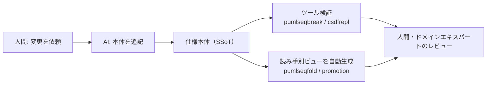

# 仕様を SSoT とビューに分けて管理する（Kuniwak）

> **TL;DR**: 仕様の本体（シーケンス図・状態遷移図）は厳密で巨大なまま1か所（SSoT: Single Source of Truth、信頼できる唯一の情報源）に保ち、読み手ごとの図はツールで自動生成し、本体の記述は AI に任せ、人間レビューの前に静的解析と仕様アニメーションで機械検証する、というコインチェック Kuniwak の仕様記述技法。

要求をシーケンス図で、トップレベルの仕様を1つの状態遷移図で書く流儀（Kuniwak の『要求定義・仕様記述・設計・検証のガイドライン』、Speaker Deck）を前提にすると、記述が進むほど図は長大になり、多くの人にとって「理解を拒否せざるをえない異物」になる、とコインチェック株式会社の Kuniwak は書く。対策として読み手ごとの局所的な図を手作業で描くと、本体の仕様変更に追従できずに腐り、「この資料は古いから参考にしないほうがいいよ」と口伝される暗黙知頼みの開発体験が生まれる。Kuniwak が問題の中心に置くのは図の大きさそのものでなく、手作業のビューが本体と不整合を起こすことである。

## なぜ状態遷移図は潰れるのか（ping-pong の例）

Kuniwak の例は、画面の「ping」ボタンを押すと「pong」に変わり、もう一度押すと「ping」に戻る Web サービスである。1人のユーザーに注目すれば ping 状態と pong 状態を往復するだけの明快な図になる。ところが複数ユーザーが使うシステム全体を素朴に1つの図にしようとすると、「ユーザー A は ping、ユーザー B は pong」という対応表を内部で管理する**たった1つの状態**に集約され、誰かがボタンを押すたびに自分自身へ戻る自己遷移を繰り返す図になってしまう。全ユーザーの状態の組み合わせを直積で表す方法もあるが、ユーザー数が増えれば状態数が爆発するので、いずれにせよ人間には読めない、と Kuniwak は脚注で添える。

## 解決策1: SSoT から用途別のビューを自動生成する

原則は「仕様本体（SSoT）を厳密に保ちつつ、人間が読むためのビューは自動生成する」。本体が更新されればビューも再生成されるので、ドキュメントが腐る心配がない、と Kuniwak は述べる。

### シーケンス図: ライフラインの除去と折りたたみ

読み手となる関係者ごとにフィルタリングしたビューを作る。具体的には、読み手のライフライン（参加者）と直接やりとりしない内部的なライフラインを丸ごと除去し、「ツール1」「ツール2」「ツール3」のように細かく分かれたものは「ツール」という1つのライフラインに折りたたむ。読み手のライフラインの数だけビューを生成する。ツールは pumlseqfold（Kuniwak/puml-tools のコマンドの1つ）。

### 状態遷移図: promotion（昇格）で局所化する

形式手法の Z 言語における promotion の考え方を応用する。1人のユーザーに注目した局所の状態遷移図を、全ユーザーを考慮した大局の状態遷移図へ埋め込む。局所の振る舞いが正しければ大局も正しいと結論づけられる場合があり、そのとき人間は読みやすい局所の図を確認するだけで済む。ping-pong は局所の独立性が高い **free promotion** の例で、局所を読むだけで大局も正しいと結論できる。ユーザー間で状態の制約が絡む **constrained promotion** では局所だけでは不十分だが、多くの場面で図の大幅な簡略化に役立つ、と Kuniwak は書く。

## 解決策2: AI が本体を書き、ツールがレビュー前に検証する

ビューを用意できても、源泉となる SSoT 自体は巨大で緻密な記述が要る。Kuniwak は、巨大なシーケンス図や状態遷移図の生成・追記は AI（コーディングエージェント）が得意とする領域で、全体の一貫性を保ちながら局所的な変更を依頼できるとし、次のプロンプト例を挙げる。

- 「イベント A が発生する直前に、画面 X の表示と権限チェックのシーケンスを追加して」
- 「ユーザーの状態遷移に、一時停止状態とその復帰遷移を追加して」

ただし AI に描かせた図は必ず人間がレビューする。そしてそのレビューの前に、専用ツールで機械的に検証しておく。初歩的な不整合が残っているとレビューの時間を浪費するからだ、と Kuniwak は理由を置く。

| 対象 | 頻発する問題 | 検証手段（Kuniwak の指定） |
|---|---|---|
| シーケンス図 | 因果の断絶（メッセージの矢印が途中で途切れる）。AI に「矢印が途切れていないか確認して」と指示しても見落とし（偽陰性）が多い | 静的解析ツール pumlseqbreak（Kuniwak/puml-tools） |
| 状態遷移図 | 静止した図を眺めるだけでは遷移の誤りが分からない | 仕様アニメーション。AI に自動検証させるなら csdfrepld か csdfreplcmd（Kuniwak/puml-parallel）に「/goal 0-switch カバレッジを取るまで仕様アニメーションして」、人間が対話的に確かめるなら csdfrepl |

仕様アニメーションとは、実際にイベントを発生させて状態が正しく遷移するかを動的に検証することである。0-switch カバレッジは状態遷移テストの網羅基準で、すべての遷移を少なくとも1回ずつ通すことを指す（この一文は wiki 側の補足）。プロンプト中の /goal は Claude Code の [[tools/claude-code-goal]] と考えられるが、記事はツール名を明記していない。

事前に形式的な誤りを排除しておくと、ドメインエキスパートや関係者とのレビューでは「この業務の流れで使い勝手（使用性）に問題はないか」という本質的な議論に集中できる、と Kuniwak はまとめる。

## 他ページとのつながり（wiki 側の推論）

- [[concepts/behavioral-specification]] は同著者の前段で、「何を仕様として書くか」（変換システムとリアクティブシステムの2分類・内部イベント τ）を扱う。本ページは、そうして書いた仕様が巨大化した後に「どう読ませ、どう検証するか」を扱う
- [[concepts/agent-trust-inverse-pyramid]]（@poteto）の「散文の指示より静的解析に努力を置く」と同じ配分である。「矢印が途切れていないか確認して」というプロンプト（散文の層）は偽陰性が多く、pumlseqbreak（静的解析の層）に置き換えたら見落としがなくなった、という Kuniwak の観測は、検証を散文層から静的解析層へ移した具体例と読める
- [[concepts/ai-coding-loop-formal]]（mizchi）は TLA+・Alloy などを「仕様が合っているか」の検査に使う。Kuniwak は Z 言語の promotion を検証でなく**図を読みやすく構造化する側**に借りており、形式手法の概念の使い方が異なる
- [[concepts/dsl-as-harness]] の「検証器が無料のフィードバックループになる」を PlantUML に当てはめると、pumlseqbreak と csdfrepl がその検証器にあたる
- 同著者の [[business/ai-lifeplan-simulation]] も「人間が依頼・AI が生成・ツールが機械的に処理・人間が判断」という同じ役割分担で組まれている

## 観察ログ（未検証）

- 2026-10-20: Kuniwak の観測範囲では、pumlseqbreak を導入したことで因果断絶の見落としがなくなった（単一著者の観測・件数は非公開）

## 問い

- この vault の仕様文書（docs/superpowers/specs）にも SSoT とビューの分離は要るか。読み手が自分と AI だけなら、ビューより先に検証器を置くべきではないか
- constrained promotion（ユーザー間で状態が絡む仕様）が本質の領域、たとえば決済や在庫では、局所図だけで済まない部分がどのくらい残るか
- csdfrepl の無い図ツール（Mermaid の stateDiagram など）でも、0-switch カバレッジまでの仕様アニメーションに相当する検証ができるか

## 関連

- [[concepts/behavioral-specification]] — 同著者の前段。変換/リアクティブの2分類・状態遷移図・τ。本ページは巨大化した後の読ませ方と検証
- [[concepts/agent-trust-inverse-pyramid]] — 散文より静的解析へ努力を置く逆ピラミッド。pumlseqbreak への置き換えがその具体例
- [[concepts/ai-coding-loop-formal]] — 形式手法を仕様の検査に使う mizchi の棚卸し。本ページは promotion を記述の構造化に使う
- [[concepts/dsl-as-harness]] — 検証器付き DSL の設計論。PlantUML＋pumlseqbreak はその一例と読める
- [[tools/claude-code-goal]] — 「/goal 0-switch カバレッジを取るまで」で使われていると考えられる自律ループ
- [[business/ai-lifeplan-simulation]] — 同著者の家計シミュレーション手法。役割分担が同じ形
