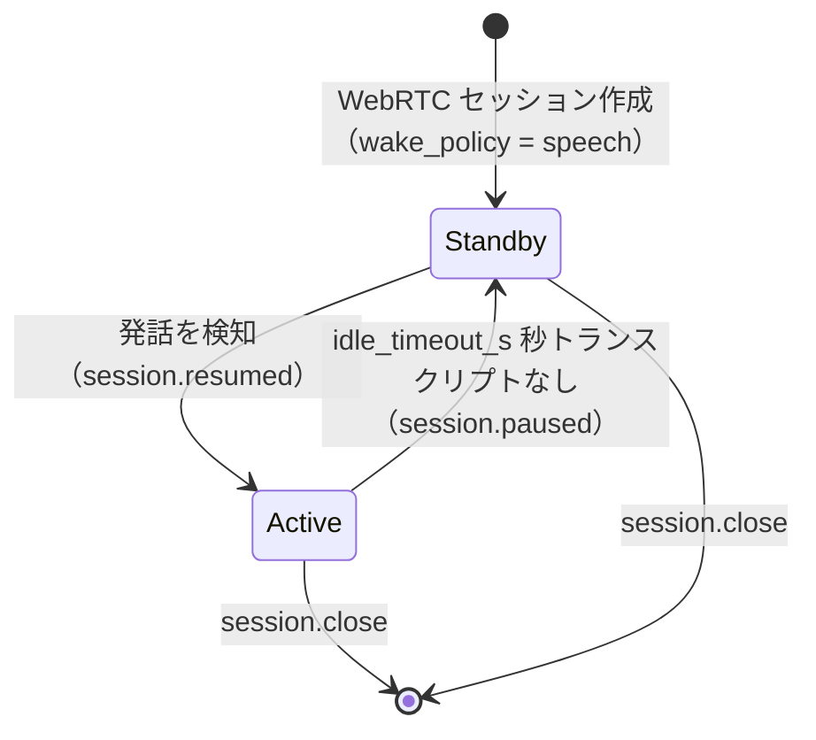

# GPT-Live-1.1

> **TL;DR**: OpenAI のフルデュプレックス音声モデル GPT-Live の改訂版。言語をまたいでも訛りと声が揺れにくくなり、文字起こし精度が上がり、WebRTC セッションの待機（standby）が稼働時 $0.05/分 の半額以下の $0.02/分 で課金される（2026-11-19 API 提供開始）。

GPT-Live は「聞きながら話す」1 つのモデルで音声層を担い、深い推論やツール呼び出しはバックエンドのテキストモデルへ委任する構成をとる。OpenAI は GPT-Live-1 の API 版発表で、音声認識→推論モデル→音声合成を連結する従来構成は受け渡しごとに遅延が増え、割り込み・間・話題転換の扱いを開発者が調停する羽目になると述べ、単一モデルで聞く・話すを扱えば割り込みにその場で反応しつつ裏で作業を続けられると説明した。委任先は GPT-6 Astra のような自社モデルでも第三者モデルでもよく、発表記事は Codex SDK に会話文脈を渡して回答を音声へ返す例を載せている。GPT-Live-1.1 はこの構成を変えずに音声層の品質と待機時の費用を改めたリリースで、@OpenAIDevs は「言語をまたいで自然で一貫した訛り」「新しい standby オプションによる待機コストの低減」「タスク完了の信頼性向上」の 3 点を挙げる。

## 1.1 での変更点（OpenAI の記述）

- **訛りと声の一貫性**: モデルページは GPT-Live-1 と比べ、発話の文字起こしがより正確になり、言語をまたいでも訛りと声がより一貫すると書く
- **委任の指示は自然言語で**: 推論やツール使用をバックエンドへ渡す条件を、プロンプトに平文で書く（委任ガイドが正本）
- **standby**: WebRTC セッションで推論を止めている間は待機料金が適用される（仕組みは後述）
- **レート制限は別枠**: GPT-Live-1.1 と GPT-Live-1 は同時セッション数の上限が別で、各モデルの上限は推論リージョンをまたいで適用される

## 仕様（モデルページの転記）

| 項目 | 値 |
|---|---|
| スナップショット名 | `gpt-live-1.1` |
| 入力 / 出力 | 音声・テキスト（画像・動画は非対応） |
| 利用する API | Live セッション（`v1/live/sessions`）。既存の Live セッション設定のモデル名を差し替えて使う |
| ストリーミング / 関数呼び出し | 対応 |
| 構造化出力 / ファインチューニング / 予測出力 | 非対応 |
| 料金（セッション時間課金） | 稼働 $0.05/分・待機 $0.02/分。バックエンドモデルとツールの利用は別課金 |

## standby の仕組み（Live ガイドの記述）

- WebRTC セッション作成時に `session.wake_policy.type` を `speech` にすると、発話を待ってから推論を始める。`session.idle_timeout_s` を 5〜60 の整数で設定すると、その秒数だけ入出力のトランスクリプトが途切れたときに待機へ戻る。省略すると最初の起床後はセッション終了まで稼働し続ける
- `session.wake_policy.vad_threshold`（0〜1・既定 0.5）は、サーバー側の音声区間検出が推論を始めるのに要する発話の確からしさ。初回の起床と各停止後の再開に効く
- 待機中もマイクのトラックは流し続ける。接続とセッション ID は変わらず、ユーザーが話し始めると会話履歴を復元して再開する。待機直後の短い発話への最初の応答は遅れることがある
- サイドバンドかデータチャネルで `session.resumed`（推論準備完了）と `session.paused`（アイドルタイムアウトで待機入り）を受け取る
- 会話の間隔が長いアプリでは、待機でなくセッションを閉じて再開時に新しいセッションを作る。保存済みセッションのフォークか、テキスト履歴の投入で文脈を戻す。ガイドは、待機で浮く音声時間とセッション再作成の費用・音声が使えるようになるまでの遅延を比べてアイドルタイムアウトを選べと書く

## 位置づけ（wiki 側の読み）

- [[models/dessa]] も同じフルデュプレックス音声モデルだが、Block は人間の会話音声だけでゼロから訓練しローカルで動かす方向をとる。GPT-Live は音声層を薄く保ち推論をバックエンドのテキストモデルへ委任する構成で、「どこで考えるか」の設計が対照的だと考えられる
- [[concepts/feynman-technique-ai-era]] の iwashi は、消費者向けの GPT-Live を学習内容の説明相手に使う。本ページは同じ名前を持つ API 側のモデルで、開発者が自分のアプリに同種の対話を組み込む入口にあたる

## 観察ログ（未検証）

- 2026-11-20: OpenAI 自己申告（GPT-Live-1 発表時）: Full Duplex Bench で GPT-Realtime-2.1 比 +30 ポイント、GPT-6 Astra（medium）と組んで Tau3 で 1 位、Speak の早期評価で割り込み約 80% 減。1.1 の定量値は未公表

## 問い

- 自分の用途（学習の説明相手・作業中の音声操作）で `idle_timeout_s` をいくつにすると、待機料金とセッション再作成の手間の釣り合いがとれるか
- 日本語での訛り・声の一貫性は実際に改善したか。公式の主張は多言語一般にとどまる

## 関連

- [[companies/openai]] — 開発元
- [[models/dessa]] — Block のフルデュプレックス音声モデル。音声だけで訓練しローカルで動く対照
- [[concepts/feynman-technique-ai-era]] — iwashi が GPT-Live を説明相手に使う学習法（消費者向け側の実践）
- [[business/chatgpt-plan-api-credits]] — ChatGPT Pro / Business の月次 API クレジットの対象に GPT-Live・Realtime API が含まれる
- [[tools/openai-codex]] — GPT-Live-1 発表で OpenAI が示した委任先の例（Codex SDK に会話文脈を渡し、回答を音声へ返す）
