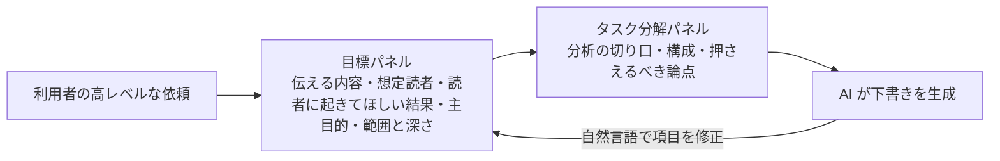

# メタ認知的足場は AI 支援の知識労働に「生産的な摩擦」を生む（Kewenig ら, arXiv 2610.30945）

> **TL;DR**: AI が下書きを書く前に「目標の明確化」と「タスク分解」を促す動的な足場（scaffold）を挟むと、文章の質が上がり、足場を外した次のタスクでも優位が残り、3 日後の内容想起も改善した。一方で利用者は足場つきの AI を「役に立たない・負荷が高い」と評価した。主観的な楽さは支援の価値を過小に見積もる、と著者らは述べる。297 人・594 本の文章によるランダム化比較実験。Viktor Kewenig・Lev Tankelevitch・Sean Rintel・Advait Sarkar・Abigail Sellen が 2026 年 10 月に arXiv へ投稿したプレプリント。

生成 AI は知識労働の中身を「作ること」から「計画・評価・指揮」へ移し、働き手に新しいメタ認知の負荷をかける、というのが著者らの出発点である。目標を述べさせたりタスクを分解させたりするインターフェースは既にあるが、これまでは使いやすさやモデルをどれだけ制御できるかで評価されてきて、人が作る成果物の質では評価されてこなかった、と著者らは先行研究を位置づける。本研究はその足場が成果物そのものを改善するか、足場を外した後も効果が残るか、作業内容をよく覚えているかを、大規模な被験者間比較で測った。

**動的な足場**とは何か。著者らが作ったのは、AI チャットパネルと編集可能なドキュメントキャンバスを持つブラウザ上の執筆ツールで、GPT-5.3 に接続している。足場あり版では、利用者が高レベルな依頼を打つと、まず編集可能な欄を持つ目標パネルが生成される。欄は、伝えたいメッセージ・想定読者・読者に起きてほしい結果・主な執筆目的・範囲と深さの 5 つ。それを埋めると、タスク固有の操作を持つタスク分解パネルが生成される。操作は、分析の切り口・構成・押さえるべき論点。選択内容が AI の下書きを形づくり、操作は自然言語で修正できる。著者らが強調するのは、これが固定のテンプレートでなく、利用者自身の依頼・それまでの選択・作業段階から生成・更新される点である。対照群は同じチャットとキャンバスを、2 つのパネルなしで使った。

## 実験の設計

ランダム化した被験者間実験で、各参加者は AI 支援で専門的なブリーフを 2 本、順序を釣り合わせて書いた。題材は市職員向けの週 4 日勤務の提案書と、ハイブリッド勤務導入のコンサルティングブリーフ。処置群はタスク 1 だけ足場を使い、タスク 2 は両群とも足場なしで書いた。参加者は英語を母語とする米国在住の Prolific 登録者 297 人で、足場群 153 人・対照群 144 人。594 本の文章が集まり、3 日後の想起調査には 159 人が戻った。1 セッションは最長 80 分の自己ペースで、上位 5 人にボーナスを出した。事前登録はしていない。

文章の質は 7 項目のルーブリックで LLM 判定者が書式を落としたテキストを採点し、人間の評価者 2 人による採点と照合した。判定者は GPT-5.4。ベースライン共変量を入れた混合効果モデルで分析し、タスク 2 のプロンプトは条件を伏せて目標の明確さとタスク分解の 2 次元で符号化した。内容想起はロジスティック混合モデルで、脱落は多重代入で扱った。作業負荷は NASA-TLX で測った。

## 主な結果（著者らの記述）

- **足場を使っている間も、外した後も文章の質が高い。** 足場で書いた群はタスク 1 で対照群より質の高いブリーフを書き、足場なしのタスク 2 でも優位を保った。足場群は時間を長く使ったが、時間では差を説明できなかったと著者らは述べる。経過時間の対数を入れても両方の対比は変わらず、処置を条件づけると作業時間は質と独立に関連しなかった。
- **より意図的なプロンプトが持ち越された。** 誰も足場を持たないタスク 2 で、足場を経験した群は目標をより明確に述べ、作業をより頻繁に手順へ分けたプロンプトを書いた。符号化は条件を伏せて行った。ただし両群とも多くの人がタスクの文言をそのままプロンプトに貼った（足場経験者 153 人中 56 人＝36.6%・対照群 144 人中 63 人＝43.8%）。
- **作業内容をよく覚えていた。** 3 日後、足場を使った群は各ブリーフが何についてのものだったかを想起できた割合が高かった。両群とも AI を使っており、戻ってきた参加者は約半数なので推定は不正確だと著者らは断る。「比較は AI 支援の 2 条件間であり、AI が無支援の作業より記憶を損なうという証拠と矛盾するものではない」と著者らは書く。
- **成果は良いのに体験は悪かった。** 足場を使っている間、参加者は AI を役に立たないと評価し、制御感が下がり、特にプロンプト作成と考えの追跡で作業負荷が上がった。足場のない次のタスクでは負荷の差は小さく、統計的に信頼できなかった。追加の負担は足場つきのやり取りを調整・管理することに集中していた、と著者らは述べる。
- **人は計画したことには気づくが、目標が明確になったことには気づかない。** 自分の作業過程について尋ねると、足場を使った人は「作業を小さな手順に分けた」と答えたが、「目標をより明確にした」とは答えなかった。実際のプロンプトは両方で改善していた。分解は部品の一覧のような点検できる痕跡を残すが、明確な目標は単に「何が欲しいかわかっている」と感じられるだけだ、というのが著者らの説明である。
- **多くが仕事を丸ごと AI に渡した。** 最良のブリーフへのボーナスがあっても、全参加者の 40% がタスク 2 でタスク説明文をそのままプロンプトに貼り、作業の生産だけでなく仕様の決定まで委ねた。著者らはこれを「コホートの性質を一部反映しているかもしれないが、最も完全な形での AI への過度な依存でもある」と述べる。

## 数値（ソースの表の転記）

| 指標 | 結果 | 出典箇所 |
|---|---|---|
| 文章の質（1〜4 ルーブリック合成）、タスク 1 足場 vs 対照 | b = 0.089、95% CI [0.023, 0.155]、P = .008 | §4.1.1, p. 13 |
| 文章の質、タスク 2（両群とも足場なし） | b = 0.070、95% CI [0.004, 0.136]、P = .037 | §4.1.1, p. 13 |
| 標準化効果量、タスク 1 とタスク 2 | Hedges' g = 0.29 と g = 0.21 | §4.1.1, p. 13 |
| タスク 1 の所要時間、足場 vs 対照（分） | 27.84 対 16.35 | §4.1.1, p. 14 |
| 人間の評価者による 107 本ベンチマークでの合成スコア差、タスク 1 | 0.440 [0.157, 0.724]、P = .002 | Table 2, p. 15 |
| LLM 判定者と人間の評価者の一致 | ICC(A,1) = 0.456、Pearson r = 0.662 | §4.1.1, p. 14 |
| タスク 2 のプロンプト得点（目標の明確さ＋タスク分解、39 点満点）、足場経験 vs 対照 | 14.43 対 11.07 | §4.2, p. 16 |
| 足場経験後にプロンプト合成得点が高くなるオッズ | OR = 1.779 [1.173, 2.698]、P = .0067 | Table 3, p. 16 |
| タスク 2 のプロンプトがタスク文の貼り付けだった参加者 | 297 人中 119 人（40%） | §5.3, p. 21 |
| 3 日後の内容想起、タスク 1、足場 vs 対照（完全ケース） | 64.6% 対 45.6%、OR = 5.07、95% CI [1.21, 21.25]、P = .026 | §4.3.1, p. 17 |
| 内容想起、タスク 2、足場経験 vs 対照（完全ケース） | 54.4% 対 38.0%、OR = 4.24、95% CI [1.02, 17.57]、P = .046 | §4.3.1, p. 17 |
| 多重代入後の内容想起、タスク 1 とタスク 2 | OR = 3.24、P = .032；OR = 3.06、P = .042 | §4.3.2, p. 17 |
| AI の有用性の知覚（1〜5）、足場 vs 対照 | b = -0.342、95% CI [-0.510, -0.174]、P < .001 | §4.4.2, p. 18 |
| 制御感の知覚（1〜5）、足場 vs 対照 | b = -0.251、95% CI [-0.486, -0.017]、P = .036 | §4.4.2, p. 18 |
| NASA-TLX 作業負荷（1〜10）、タスク 1、足場 vs 対照 | M = 4.71 対 3.96；b = 0.745、P < .001 | §4.4.3, p. 18 |
| NASA-TLX 作業負荷、タスク 2（足場なし）、信頼できず | M = 4.08 対 3.93；P = .429 | §4.4.3, p. 18 |

ソースの表では人間の評価者との照合を「107 本のベンチマーク」、方法の節では「117 本」と書いており、どちらが正しいかはブリーフからは判別できない。

## 著者らが挙げる含意

- 摩擦を設計材料として扱い、ただし生産的になるよう設計する。目標設定を冒頭に集中させず下書きの各段階に分散し、ツールが求める選択の理由を説明し、計画支援と推敲支援を対にする。
- 追加の努力の価値を、その瞬間・作業が段階を移るとき・成果物において見えるようにする。感じとして役に立たないツールは、任意なら使われなくなる。その便益は作業が終わってから初めて届くからだ、と著者らは書く。
- 短い足場は「AI を指揮する技能」を安価に育てる手段になりうる。この技能は人によって偏りがあり、あるツールから別のツールへ持ち運べる。
- AI が思考に与える影響の研究は、ツールがどれだけ役に立った・大変だったと人が言うかに頼らず、成果と過程を客観的に測るべきだ。

## 限界（著者らの記述）

- 文章の質は LLM 判定者が採点し、人間の評価者との一致は中程度だった。共通サブセットでは人間の評価者のほうが大きな足場の優位を見出し、判定者は人間の得点幅を圧縮していた（較正の傾き 0.375）。プロンプトと想起の結果は判定者に依存しない。
- 想起の結果は参加者の約半数に基づき、甘い採点規則を使い、信頼区間が広い。内容想起は関与の狭い指標である。追跡調査の脱落は大きく、想起コホートの 50.6% に採点済みの想起結果がなかった。
- 検証したのは同一セッション内の短期転移で、週・月単位の持続ではない。単発のオンライン課題で、実際の職場ではなく米国の Prolific 登録者が対象。
- 静的な足場の条件がなく、目標支援とタスク分解支援を分けずに一緒に検証した。

## 用語（著者らの定義）

- **動的メタ認知的足場**: 利用者自身の依頼から AI が生成するインターフェース操作で、下書きの前に目標の明確化、次いでタスク分解を促す。固定のプロンプトテンプレートとは異なり、表示される選択肢は参加者の現在の依頼・それまでの選択・作業段階から生成・更新される。
- **生産的な摩擦（productive friction）**: 感じる努力を増やし有用性の知覚を下げながら、成果を改善する支援。著者らが見つけたトレードオフにつけた名前。
- **短期転移（short-lag transfer）**: 支援を取り除いた同一セッション内の後続タスクに便益が残るかどうか。
- **目標の明確さとタスク分解**: 参加者のプロンプトを条件を伏せて符号化した 2 次元。目標の明確さは意図する結果・読者・制約・成功基準をどれだけ明示したかで 7 指標、タスク分解は作業を具体的な手順や部品に分けたかで 6 指標。
- **認知的オフロード（cognitive offloading）**: 標準的な定義では、タスクの認知的要求を減らすために外部資源を動員すること。生産を AI に委ねることはこれを伴いうる。

## 出典について

本ページの元は、共著者の Sean Rintel が自身のサイトで公開したリサーチブリーフである。ブリーフは AI の支援で作成され「著者らの公刊テキストではない」と明記されており、節・ページ番号は arXiv の PDF（2610.30945v1）を指す。本ページは論文 PDF 本体には当たっていない。

## wiki 側の読み

以下は wiki 側の推論である。

- 足場が促しているのは AI の計画ではなく**人間の**計画である。[[concepts/goal-restatement-prompt]] は AI に目標を復唱させて人間が添削する向き、本研究の目標パネルは AI が欄を用意して人間が埋める向きで、どちらも「目標を言語化する工程」を下書きの前に置く点で同じ場所に効く。
- 「主観的な楽さが支援の価値を過小評価する」という知見は、[[concepts/cognitive-debt]] の「説明できないものは出さない」基準が運用上つらく感じられても続ける根拠になる。想起の改善は、理解を手放さない運用の効果を測る指標の候補と読める。
- 40% がタスク文を貼り付けたという観察は、[[concepts/ai-judgment-delegation]] が跡づけた「手放す方が便利だから手放す」が、実行の承認だけでなく仕様の決定にも及んでいることの実測と読める。
- 摩擦が任意だと使われない、という著者らの指摘は、個人の harness で「実装前に前提を明示する」類の工程を任意のスキルにするか常設のルールにするかの判断材料になる。

## 観察ログ（未検証）

- 2026-10-31: 3 日後の内容想起 OR = 5.07（95% CI 1.21〜21.25・回答者は約半数）。追試や多重代入後の値（OR = 3.24）まで縮むかを追う。

## 問い

- この vault の運用で、人間側の目標明確化とタスク分解を促す足場はどこにあるか。CLAUDE.md の「隠れた前提・トレードオフを明示」や [[concepts/goal-restatement-prompt]] は AI に言語化させる向きが中心で、人間自身が目標を書く工程は薄くないか
- 著者らの「感じとして役に立たない支援は任意なら使われない」を踏まえ、自分の harness で摩擦を既定にするか任意にするか。既定にした場合、その価値を見えるようにする手段は何か
- 検証は同一セッション内の短期転移のみ。週〜月で持続するか、静的テンプレートで同じ効果が出るか（著者らは未検証と明記）

## 関連

- [[concepts/cognitive-debt]] — AI の生成速度に人間の理解が追いつかない負債。本研究は足場で理解（想起）を保つ側を実測し、楽さと成果が逆向きになることを示した
- [[concepts/goal-restatement-prompt]] — 作業前に目標を AI に復唱させる 1 文プロンプト。本研究の目標パネルは人間に目標を書かせる向きの対
- [[concepts/ai-judgment-delegation]] — 人間が承認を手放した 3 段階。本研究の「40% がタスク文を貼った」は仕様の決定まで手放す段階の実測
- [[concepts/feynman-technique-ai-era]] — 「わかった気」を説明して確かめる勉強法。主観的な理解感と客観的な成果のずれという同じ問題
- [[tools/claude-academy]] — AI Fluency の 4D（Delegation/Description/Discernment/Diligence）。本研究が「持ち運べる技能」と呼ぶ AI を指揮する力の教材側
- [[concepts/agent-reflection-layer]] — エージェント側にメタ認知を実装する設計。本研究は人間側のメタ認知を足場で支える側
