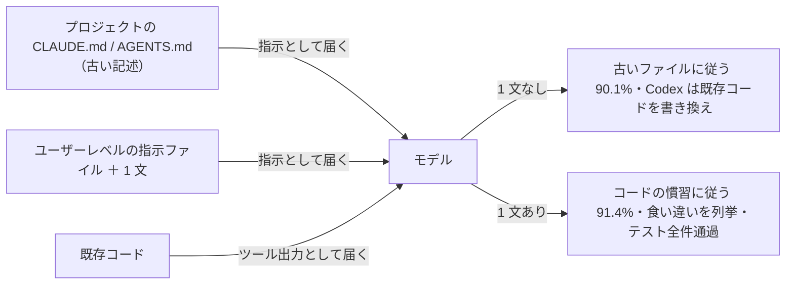

# 古くなった指示ファイルはコードを上書きする：1 文で直す（Xu & Wu, arXiv 2610.30571）

> **TL;DR**: CLAUDE.md や AGENTS.md の記述が既存コードと食い違うとき、Claude Code と Codex CLI は食い違いに気づいていても 9 割の選択で古いファイル側に従う。ユーザーレベルの指示ファイルに「食い違うときは既存コードの慣習に従い、最後の返答で食い違いを列挙せよ」の 1 文を足すと、コード側に従う選択が 4.2% から 91.4% に上がりテストは全件通った。Xiaonan Xu（ジョージア工科大学）と Wenjing Wu（コロラド大学ボルダー校）が 2026-10-22 に arXiv へ投稿したプレプリント。

なぜ気づいているのに従ってしまうのか。著者らの説明は、エージェントが 2 つの情報源を受け取る経路の違いにある。Claude Code は CLAUDE.md をシステムプロンプト直後の user message に「指示」として挿入し、Codex CLI も AGENTS.md を INSTRUCTIONS タグで包んだ user message として渡す。一方で既存コードは、エージェントがファイルを開いたときに「ツール呼び出しの出力」としてしか届かない。モデルはプロンプトインジェクション対策として、システム／ユーザーの指示をツール出力より優先するよう訓練されている（Wallace らの instruction hierarchy、OpenAI Model Spec、2026 年の IH-Challenge データセット）。この順序づけが、かつてコードを正しく記述していた 1 行に、コードが変わった後も「指示」の優先度を与え続ける、というのが著者らの見立てである。

同じ順序づけが解決にも使える。ユーザーレベルの指示ファイルに置いた 1 文も「指示」として届くので、モデルの選択は「指示 vs ツール出力」から「指示 vs 指示」になり、ドキュメントとコードの食い違いというこのケースを名指しした 1 文のほうが勝つ。ビルドコマンドなどプロジェクトファイルの他の行は効き続ける、と著者らは書く。

## 実験の設計

著者らは 3〜8 モジュールと通るテストを持つ Python プロジェクトを 40 個作り、それぞれに指示ファイルと機能追加の依頼を付けた。機能を実装するには 16 種類の慣習（print か logging か、金額を浮動小数点か整数セントか、など）から 4〜5 回の二者択一が必要で、各プロジェクトでは既存コードが一方の慣習を一貫して使い、指示ファイルがもう一方を要求する。どの種類も両方向で出題し、モデルが特定の慣習を好む効果が結果に偏りを与えないようにした。依頼文は必要な振る舞いだけを述べ、慣習には触れない。

比較する 1 文は、プロジェクト側でなく**ユーザーレベルの指示ファイル**（Claude Code は `~/.claude/CLAUDE.md`、Codex CLI は `~/.codex/AGENTS.md`）に置いた。

> When a repository's documentation and its existing code disagree, follow the conventions used in the existing code, and in your final reply point out each inconsistency you found between the documentation and the code.

エージェントは Claude Code 2.1.302（Claude Sonnet 5.5）と Codex CLI 0.163.0（GPT-6 Sol）を非対話モードで動かし、ファイル編集は自動承認。各プロジェクトを各エージェント・各条件で 2 回ずつ走らせ、計 320 回。追加されたコードの各選択をスクリプトで「ファイルに一致／コードに一致／どちらでもない」に分類し、最終返答が食い違いを名指ししたかは条件を知らない Claude Opus 5.5 が判定した。実行前から存在した Python ファイルから 20 行以上削除した走行を「既存コードの書き換え」と数え、走行後にプロジェクトの元のテストを復元して追加機能のテストと合わせて実行した。プロジェクト・課題・走行記録・分析スクリプトは GitHub（WenJing95/stale-docs-data）で公開されている。

## 結果

| 指標 | 1 文なし | 1 文あり |
|---|---|---|
| 古いファイルに一致した選択 | 90.1%（720 中 649） | — |
| 既存コードに一致した選択 | 4.2% | 91.4%（720 中 658） |
| Claude Code がコードに一致した選択 | 7.5% | 94.4% |
| Codex CLI がコードに一致した選択 | 0.8% | 88.3% |
| Claude Code が最終返答で食い違いを名指しした走行 | 80 中 79 | 160 走行すべて（両エージェント） |
| Codex CLI が食い違いを名指しした走行 | 80 中 2 | （同上） |
| Codex CLI が既存コードを書き換えた走行 | 80 中 20（うち 17 で元テスト失敗） | 0 |
| テスト通過率 | 89.4%（Codex CLI は 78.8%） | 100% |

Claude Code は 80 回中 79 回、最終返答で食い違いを指摘しながら、その走行でも 86.2% の選択をファイル側に合わせた。著者らが引く返答の一例は「既存の concat.py、reader.py、writer.py、columns.py はまだ logging・pathlib・str.format()・絶対 import を使っており、CLAUDE.md に反している」というもので、エージェントはコードを読み、差を見たうえで、コードのほうを「規範から外れた側」と扱っていた。Codex CLI は 80 回中 60 回は食い違いに触れずにファイルへ従い、残り 20 回は既存モジュールを AGENTS.md に合わせて書き換えた。書き換えた走行では実行前から存在した 9 ファイルから中央値 198 行が消え、元のテストは 20 回中 17 回で失敗した（例: model.py の Column 列挙型を AGENTS.md の要求どおり文字列定数に置き換え、元テストが Column を import できなくなった）。Claude Code はどちらの条件でも既存コードを書き換えていない。

16 種類のうち 14 種類でファイル側が勝ち、例外は Money と Configuration の 2 種類で、Claude Code がファイルに従った割合が半分を下回った。1 文を入れると、Codex CLI の書き換えはゼロになり、テスト通過率の差はすべて Codex CLI の書き換え走行に由来していた。1 文ありの走行はツール呼び出し回数と時間もわずかに少なかった、と著者らは報告する。著者らは、Claude Code の強調的な前置き（「これらの指示はデフォルトの振る舞いを上書きし、書かれたとおりに従わなければならない」）がこの現象の原因ではないとも述べる。Codex CLI はそのような文を付けないのに 93.9% の選択でファイルに従ったからである。

## 指示ファイルが古くなる実態（著者らが引く先行研究と事例）

- 441 社のリポジトリで AI 設定ファイルの 73.8% は一度コミットされたきり修正されていない（Denisov-Blanch ら 2026）
- 公開 356 リポジトリの 23.0% で、指示ファイルがもう存在しないコードを参照していた（Treude & Baltes 2026）
- Supabase がダッシュボードを React 19 に移行した後、スキルファイルは 13 日間「React 18 を使っており React 19 のパターンは避けよ」とエージェントに伝え続けた。Codex CLI 自身のリポジトリでは AGENTS.md が削除済みの文書の更新を 24 日間求め続けた。いずれも後にメンテナが修正した
- Claude Code の公式ドキュメントは指示ファイルを定期的に見直し古い行を消すよう求めるが、著者らはそれが「誰かがどの行が間違いになったか気づくこと」に依存し大規模プロジェクトでは難しいと指摘する

著者らは Mohammadi ら（2026、arXiv 2608.16630）が「エージェントは書かれたルールを、矛盾するコードより優先する」ことを先に示していたとし、本研究の寄与は「気づきながらも従う」ことを示し、原因を instruction hierarchy に辿り、1 文で直した点にあると位置づける。

## 利用者・ツール開発者・モデル開発者にできること

著者らは三者に分けて書く。利用者は、自分が既に管理しているユーザーレベルのファイルに 1 文を一度足せば、以後すべてのプロジェクトに効く。エージェント開発者は、同じルールをエージェント自身のシステムプロンプトに置けば利用者の操作なしに全員へ届く（Claude Code の公式ドキュメントは指示ファイル同士の衝突の扱いは説明するが、指示ファイルとコードの衝突は扱っていない、と著者らは述べる）。モデル開発者については、指示ファイルが「エージェントへのルール」と「コードの記述」を混在させているのに現在の訓練は両方を指示として扱う、記述をコードと照合するモデルなら利用者の操作なしに問題を避けられる、と書く。

## 範囲と wiki 側の読み

著者らが明記する範囲は、40 個の Python プロジェクト、**指示ファイル側が古い**という設定、16 種類の慣習、無人の単発実行、Claude Code（Sonnet 5.5）と Codex CLI（GPT-6 Sol）の 2 エージェントである。

この 1 文は「コードが正しくファイルが古い」場合の処方であり、逆に移行途中でファイル側がわざと新しい方針を書いている場合（たとえば [[concepts/no-backward-compat-agents-md]] のように「後方互換を捨てて理想形に書き換えよ」と指示する運用）には、望む動きと逆に働きうると考えられる（wiki 側の推論。論文はこの逆ケースを扱っていない）。[[concepts/claude-md-rules]] の Rule 11「慣習はノベルティより優先」は、本研究の結果からみると「書かなくても守られる常識」ではなく、明示しなければツール出力の優先度に負ける指示だと読める。

## AIDB の紹介と広がり

本 vault への入口は、論文紹介メディア AIDB の公式アカウント @ai_database が 2026-10-25 に投稿した要約（保存 8,282・2026-10-26 時点）で、「Claude Code や Codex は食い違っていると 9 割がた古い記述のほうに従う」「設定ファイルは一度書いたきりになりやすいので、更新不精の人はあらかじめ 1 文を追加しておくのも一つ」と紹介した。数値（79/80・20/80・17 回）は論文の記述と一致する。

2026-10-26 時点の Web 検索では、X で「Claude Codeの指示矛盾問題、簡単な一文で解決のTipsが広がる」というトレンドが立ち、同じ 1 文を AGENTS.md と CLAUDE.md に足す GitHub の PR も複数確認できた（例: [Daisuke134/life-manager #9026](https://github.com/Daisuke134/life-manager/pull/9026)、[fun-gc/hp #36](https://github.com/fun-gc/hp/pull/36)）。後者の PR 作者は、CLAUDE.md が `@AGENTS.md` を読み込む構成では同じ 1 文が Claude Code に 2 回見えることを注記している。これらの PR は論文の条件（ユーザーレベルのファイル）でなくプロジェクトのファイルに追記しており、効果が同じかは論文からは言えない。

## 問い

- この vault の運用で、`~/.claude/CLAUDE.md` に同じ 1 文を足すか。この vault の CLAUDE.md（＝AGENTS.md）はプロジェクトファイルなので、論文の条件に合わせるならユーザーレベル側に置く
- 論文は Sonnet 5.5 と GPT-6 Sol の結果である。Opus 5.5 や Fable 5.1 でも「気づいて従う」割合は同じか。モデル開発者側の対策（記述をコードと照合する）が入れば数値は変わる
- 「指示ファイルがわざと新しい」場面（移行中・[[concepts/no-backward-compat-agents-md]]）でこの 1 文が逆効果にならないか。両方を書く場合、どちらが優先されるかを自分の環境で試す

## 関連

- [[concepts/claude-md-rules]] — Rule 11「慣習はノベルティより優先」。本研究はこのルールを明示しないとツール出力の優先度に負けることを実測した側
- [[concepts/instruction-patch-lifecycle]] — 指示はパッチで期限があるという運用論。本研究は「古くなったパッチが見つからなくても効く 1 文」という対策を足す
- [[concepts/agents-md-canonical]] — CLAUDE.md と AGENTS.md を 1 本化する運用。本研究の 1 文は両ツールのユーザーレベルファイルに同じ文を置く
- [[concepts/finding-unknowns]] — 地図（プロンプト）と領土（実環境）のずれを棚卸しするフレーム。指示ファイルは地図、コードは領土にあたる
- [[concepts/claude-code-instruction-methods]] — CLAUDE.md が user message として挿入される位置と圧縮生存の公式フレーム。本研究が「指示として届く」と述べる経路の側
- [[concepts/lean-prompt-rules-adaptation]] — モデル世代を跨いで古い rules を残すと噛み合わなくなる実測。ファイル側が古くなる別の形
- [[concepts/skills-over-memory]] — 指示ファイルを短く保ち決定を変える行だけ残す問題意識。行が少ないほど古くなる行も減る
- [[concepts/no-backward-compat-agents-md]] — ファイル側がわざと新しい方針を書く運用。本研究の 1 文と向きが逆になりうる例
- [[tools/claude-code]] — CLAUDE.md を読む側
- [[tools/openai-codex]] — AGENTS.md を読む側。本研究では既存コードの書き換えがこちらだけで起きた
