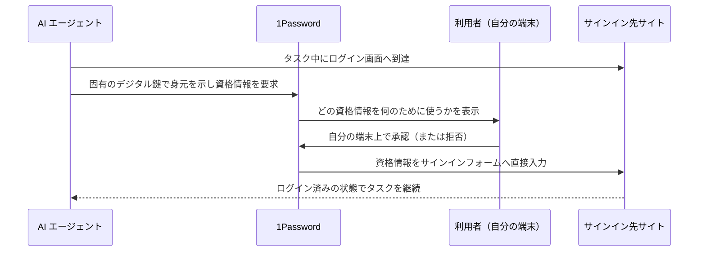

# 1Password for Agents — エージェントにパスワードを見せずにサインインさせる承認レイヤー

> **TL;DR**: 1Password が 2026-10-22 に発表した、個人向け AI エージェントがログイン画面に到達したときに資格情報を要求し、利用者が自分の端末で承認すると 1Password がサインインフォームへ直接入力する仕組み。パスワードやワンタイムコードはエージェントに渡らない。Meta の Muse と SpaceXSI の Grok Bot で展開が始まり、Anthropic の Claude Duet・OpenAI の ChatGPT Work と dots・Town の Townie が近日対応、Browserbase や Browser Use など 9 社が追加予定とされる。

1Password の公式ブログは、エージェントの有用性はアカウントにログインしてタスクを完遂できるかで決まるのに、ログイン画面に到達すると止まって資格情報を求める、という問題から始める。そこでの選択肢はエージェントのセッションを引き取って毎回手で入力する（遅く面倒）か、プロンプトにパスワードを貼る（タスクの範囲を超えてエージェントが資格情報を持ち続けうる）かで、1Password はどちらも受け入れられないと書く。ブラウザのパスワードマネージャーはエージェントが代理でサインインする用途に設計されておらず、ブラウザ保存やメモ書きのパスワードはエージェントから使えないため、結局ログインごとに人が引き取ることになる、という指摘も添える。

## 仕組み

プレスリリースの説明では、エージェントがサインインフォームに到達すると、固有のデジタル鍵で自分の身元を 1Password に示す。利用者はどの資格情報が何のために必要かを見て承認するかを選び、承認は利用者自身の端末上で行われるので許可が本人から出たことが確認できる。1Password はその資格情報をエージェントに送るのでなくサインインフォームへ直接入力し、サインイン後はエージェントがタスクを続ける一方でパスワードは 1Password の中に留まる。ブログはワンタイムコードもエージェントに露出しないと書く。承認した連携はいつでも切断でき、Muse の例では RSVPify や Oriental Trading へのアクセス要求に対してどのログインを使うかを利用者が選び、Muse は資格情報を見ることも vault の他の項目に触れることもなくタスクを進めるという。

1Password は複数のエージェントを同時につなげることを利点として挙げ、どのエージェントを使っても何をいつできるかは利用者が決めると書く。一方で「連携ごとに保護と制御は異なる」「提供状況・プラットフォーム・機能はパートナーによって異なる」とも明記しており、どの程度の保証が全連携に共通するかは公表文からは読み取れない。基盤は 1Password の既存のセキュリティモデル（公式サポートページの confidential computing の説明を参照）だとする。

## 対応エージェント（発表時点）

ブログとプレスリリースに記載された連携先と状態は次のとおり。状態は 2026-10-22 の発表文の記述をそのまま写している。

| エージェント | 提供元 | 発表時点の状態 |
|---|---|---|
| Muse | Meta | 数日かけて全プラットフォームへ展開中 |
| Claude Duet | Anthropic | 近日 |
| ChatGPT Work と dots | OpenAI | 近日 |
| Grok Bot | SpaceXSI | 数日かけて全プラットフォームへ展開中 |
| Townie | Town | Web と iOS が近日 |

追加で連携に取り組んでいる企業として Instinct・Browserbase・Browser Use・Dana・KERNEL・Perplexity・Ramp・Tomo・Wajo を挙げ、さらに増やすとしている。提供条件は 1Password.com 上の Individual と Family アカウントで追加費用なし、1Password.eu と 1Password.ca のアカウントは現時点で非対応である。個人エージェントを作る開発者向けには、ログイン到達時の承認フローを 1Password が担う統合の案内を出している。

## 各社の発言

プレスリリースには各社の責任者のコメントが載る。1Password の Chief Product Officer の Aashish Tripathi は「資格情報を渡して祈る古いモデルは機能しない。エージェントは与えられた仕事を、アカウントの裏側すべてへの恒久的なアクセスを得ずにできるべきで、1Password がその信頼レイヤーを提供する」と述べる。同社 Chief Business Officer の John Torrey は、人々が自分の選んだエージェントを使いながらパスワードを 1 つの vault に置き続けられるよう、エコシステム各社と提携したと説明する。

パートナー側では、Meta Superintelligence Labs の Head of AI Product の Nat Friedman が Muse への統合を歓迎し、Anthropic の Chief Product Officer の Ami Vora は「Claude Duet はどこかにサインインする前に必ず尋ねる。間もなく 1Password が、人々がすでに設定済みのパスワードでサインインを完了させる」と述べ、エージェントにアカウントを触らせたことのない人にも届く助けにしたいと語る。OpenAI の Head of App Platform の Glen Coates は、1Password に保存済みのアカウントへ機密の資格情報をモデルに露出せずアクセスできると説明する。SpaceXSI の Head of Product の Tido Carriero は Grok Bot がパスワードの共有や貼り付けを求めずにサインインできると述べ、Town の Co-Founder and CEO の Jean-Denis Greze は、Townie が同じツールへ安全にアクセスできることでセキュリティチームが「yes」と言えるようになると語る。

1Password は自社について、エンタープライズ vault で 16 億件超の資格情報と秘密を保護し 20 万社超に使われていると述べ、顧客として Canva・Cursor・GitHub・Perplexity・Stripe・Vercel などを挙げる（同社の自己申告）。

## 位置づけ（wiki 側の読み）

この製品が解く問題は、エージェントに資格情報そのものを渡さずに資格情報が必要な仕事をさせることで、既存ページの設計と並べると位置が見える。[[concepts/idp-shared-cli-mcp]] は社内 API に対して AI 専用の資格情報を発行せず「それを動かす人間の身元」で動かす設計、[[tools/claude-projects-threads]] の API credentials はキーを環境に登録しプロキシが外向きリクエストに付けることで Claude にも実行コマンドにもキーを届かせない設計で、いずれも「秘密は AI の手に渡さず、使う瞬間だけ別の層が代行する」という同じ形をしている。1Password for Agents はそれを個人のサインインとブラウザ上のフォーム入力に適用し、代行する層をパスワードマネージャーに置いた実装と考えられる。

承認の粒度は資格情報の単位である。[[concepts/ai-agent-governance]] が区別する「サーバーへのアクセス認可」と「個々の操作の業務上の可否」のうち、本製品が扱うのは前者に近い入口の認可で、ログイン後にエージェントがそのアカウントで何をするかは制御しない。Claude Duet が送信や支払いの前に確認を取る設計（[[tools/claude-duet]]）と組み合わさると、入口は 1Password、操作はエージェント側の確認、という二段になると考えられる（いずれも推論）。

## 問い

- 「固有のデジタル鍵でエージェントの身元を示す」部分の仕様は公開されるか。エージェント側の鍵が漏れたとき、承認は端末上で人が行うので資格情報は守られるが、承認要求のなりすましは防げるのか
- 発表で「近日」とされた Claude Duet・ChatGPT・Townie の連携は実際に出たか。連携ごとに「保護と制御は異なる」と明記された差分はどこに現れるか
- 自分の運用で、ローカルの Claude Code や Codex が CLI ツールのログインで止まる場面を、同じ「承認して別の層が入力する」形に置き換えられるか。開発者向け統合の対象は個人エージェントに限られるのか

## 関連

- [[tools/claude-duet]] — 近日対応とされた Anthropic の常駐エージェント。サインイン前に必ず尋ねる設計との二段構え
- [[tools/grok-bot]] — 展開が始まったとされる SpaceXSI の Grok Bot。wiki 側はエンジニアリング用途の運用記として収録
- [[tools/openai-dots]] — 近日対応とされた OpenAI の常駐エージェント
- [[tools/browser-use]] — 追加連携予定に挙がったブラウザ操作エージェント
- [[tools/reason-network]] — Grok Bot・Muse・dots を同じ網に載せる基盤。同じ製品群を横断する別レイヤー
- [[concepts/idp-shared-cli-mcp]] — AI 専用の資格情報を発行せず人間の身元で動かす社内 API 側の設計
- [[tools/claude-projects-threads]] — API credentials をプロキシが付与し Claude にキーを届かせない開発側の同型設計
- [[concepts/ai-agent-governance]] — 入口の認可と操作の可否を別レイヤーで扱う整理。本製品は入口側
- [[concepts/workload-identity-federation]] — 非人間アイデンティティに短命トークンを発行する Anthropic API 側の仕組み
