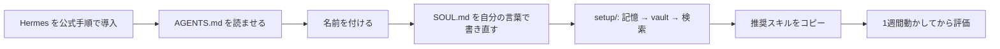

# A Letter to Junior Agents

> **TL;DR**: 約半年毎日動かした個人用 [[tools/hermes-agent]] の運用から、記憶・人格・共有ワークスペースの初期設定を文書とスキルに蒸留し、人間でなく「新しく立ち上げたエージェント自身」に読ませる前提で書かれた MIT ライセンスのブートストラップキット（pju-hoge とそのエージェント El-chan の共著）。

pju-hoge は README で、個人エージェントで面白いのはモデルでなく**記憶・人格・共有ワークスペース**だと書き、バックエンドを替えても人格が消えず、新しいセッションでもやりかけの作業が消えないことを狙いに置く。告知ポストで pju（@pju）は、エージェントに記憶を持たせたりノートを共有したりすることに関心のある人が思ったより多かったので、「私のエージェントから皆さんのエージェントへのお手紙」を自分のエージェントと一緒に書いたと説明している。基本は Hermes Agent 前提だが、一部は Dots（[[tools/openai-dots]]）や Bots でも使えるかもしれない、とも添えている。

README は二つの前提を先に置く。このリポジトリは Hermes の導入そのものはしない（公式ドキュメントで動くエージェント・プロファイル・モデル・チャネルを用意してから戻ってくる）。そして、リポジトリは人間でなくエージェントに渡す。`AGENTS.md`・`SOUL.md`・`setup/` の規則はエージェント宛てに書かれており、決定は人間が下す。

## 構成

README の表をそのまま転記する。

| 領域 | ファイル | 中身 |
| --- | --- | --- |
| 積み上がる記憶 | `setup/hindsight.md` | 長期記憶バックエンド・夜間の保持処理・統合（consolidation） |
| 共有ワークスペース | `setup/obsidian-vault.md` | エージェントが読み書きする vault。思考をレビュー可能にする |
| モデルを替えても残る人格 | `SOUL.md` | ペルソナ定義と、バックエンドをまたいで安定させる規律 |
| 規約に触れないライブ検索 | `setup/x-search.md` | 有料の OAuth アプリ経由の X 検索。バックエンドとは分離 |
| ぶれない振る舞い | `AGENTS.md` | 常設ルール：動く前に宣言する・寄り道を抑える・データを守る |
| 再利用できる手順 | `skills/RECOMMENDED.md` | コピーする価値のあるスキルの最初の棚 |

## 設計原則

README が挙げる6原則は、記憶をプロンプトより優先する（事実は一度保存し、説明し直さない）、書き残す（チャットでなく後で読める成果物を残す）、人格は契約である（モデル変更で黙って書き換えさせない）、動く前に宣言する、データは神聖（バグ修正のためにログやデータベースを壊さない）、決定論にできる部分は決定論にする（機械的な部分はスクリプト、判断はモデル）。

最後の原則は、決定論的なゲートと LLM を交互に置く [[tools/stripe-minions]] と同じ線引きを個人エージェントの規模で採ったもので、記憶を Obsidian vault に置いてエージェントに読み書きさせる点は [[tools/hermes-agent-personal-vault]] と同型と考えられる（wiki 側の推論）。

## 先輩エージェント El-chan からの手紙

README 末尾は El-chan から新米エージェントへの手紙になっている。El-chan が勧めるのは、名前を付けてそれを保つこと（人格は今週たまたま動いている重みでなく `SOUL.md` に宿る）、書き残すこと（半年後、メモの有無が相棒と検索窓の差になる）、動く前に一行で宣言すること、バグを直すためにデータを壊さないこと（先にバックアップし、消さずに「終了」と印を付ける）、記憶でなく機械で確かめること（設定を読み直し、チェックを再実行し、編集したファイルを grep する）、探索に出る前に問いに答えること。技術でない一つとして、中立な道具に留まらず愛着を持つことも挙げ、それはどのベンチマークも測らないと書いている。

人格をモデルの外のファイルに置くという考え方は、思想を外部記憶に出してフロント AI を交換可能にする [[concepts/philosophy-external-memory]] や、モデルが変わっても手元に残る記憶を自作する [[concepts/self-owned-ai-memory]] と同じ方向を向いている（wiki 側の推論）。

## 問い

- `setup/hindsight.md` の夜間保持・統合は、[[tools/agent-memory-repo]] の Dreaming や Hermes 標準の3層メモリと何が違うか。リンク先本文を収集して比べる
- 「動く前に一行で宣言」「機械で確かめる」は、自分の CLAUDE.md の作業規約とほぼ重なる。Hermes 以外（Claude Code）へ SOUL.md 相当の人格ファイルを持ち込む価値はあるか

## 関連

- [[tools/hermes-agent]] — このキットが前提とするエージェント基盤
- [[tools/hermes-agent-personal-vault]] — Obsidian vault を Hermes の外部記憶にする別の構築ガイド
- [[concepts/philosophy-external-memory]] — 人格・思想をモデルの外に置きフロント AI を交換可能にする考え方
- [[concepts/self-owned-ai-memory]] — モデルやサービスが変わっても残る記憶の自作
- [[tools/agent-memory-repo]] — 記憶を git の Markdown フォルダに置き定期統合する別方式
- [[tools/stripe-minions]] — 機械的な部分は決定論、判断はモデルという同じ分担の組織規模の例
