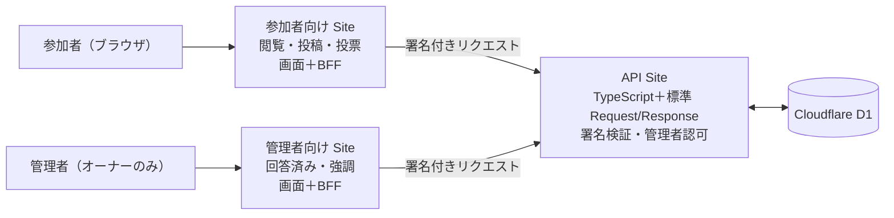

# ChatGPT Sites（ChatGPT／Codex に説明するだけで Web サイト・アプリを作って公開する OpenAI のホスティング機能）

> **TL;DR**: ChatGPT か Codex に「こういうサイトを」と説明すると Codex が作ってそのまま公開 URL を出す OpenAI のホスティング機能。Plus・Pro・Business・Enterprise で使え、HTTP/HTTPS/WebSocket と D1 データベース（10 GB）・R2 ファイル保存を持ち、2026 年末までホスティング無料。WEB エンジニアのスナガクは、画面だけでなく JSON API サーバーとしても公開できることを実測し、参加者・管理者・API の 3 Sites 構成でイベント用の質問・投票ボードを組んだ。

OpenAI の開発者ドキュメントは Sites を「ChatGPT か Codex で説明することでサイトを作り、ホストし、共有する」機能と定義し、コードを書かずに始められること、既に作った Web アプリやゲームを別のデプロイ設定なしでホストできることを挙げる。ヘルプセンターによれば、プロンプトに「website」と書くか `@Sites` を付けて頼み、プライベートなプレビューを直してからデプロイすると URL が発行され、新規 Site は既定で非公開になる。接続済みアプリ（connected apps）を使う Site も作れ、訪問者はそれぞれ自分の接続アカウントと権限で使う。Enterprise ワークスペースでは公開が既定でオフで、管理者が有効化する。

このvaultでは、2026-06-02 の Codex Sites 発表（Business／Enterprise 先行）を [[tools/openai-codex]] が、2026-09-30 の「Sites が plugin extensions 付き MCP サーバーをホストできる」告知を [[tools/openai-mcp-extensions]] が記録している。2026-11-01 時点のヘルプセンターは Plus と Pro の個人アカウントでも使えると書いており、提供範囲が個人プランまで広がっている。

## 仕様と料金（公式ドキュメント・2026-11-01 時点）

- ランタイムは HTTP・HTTPS・WebSocket に対応し、生の TCP 接続（受信・送信とも）は非対応。一部のフレームワーク・プライベートネットワーク・データベース・バックグラウンドサービスは非対応
- ストレージは Site ごとに D1 データベース 10 GB、R2 オブジェクトストレージは固定上限なし
- Site の作成・編集は Codex の利用枠を消費し、ホスティング（トラフィック・保存）の利用枠は別建て
- ホスティングは 2026-12-31 まで無料。2027-01-01 から計測が始まり、プランに含まれる月間枠を超えた分だけ課金。2026-12-01 から Site ごとのトラフィックと保存量を見られるようになる。Enterprise の運用課金は現在免除
- 第三者の決済事業者を通した物品・サービスの販売は可能だが、カード情報は決済事業者だけが扱う。保護対象医療情報の処理、13 歳未満向け、マルウェア配布などは禁止

| 利用するもの | 課金単位 | 概算クレジット |
|---|---|---|
| ストレージなしの Site | 1 Site・月 | 0 |
| ストレージありの Site（空のデータベースを含む） | 1 Site・月 | 25 |
| トラフィック | 10 万リクエスト | 16 |
| データベース保存 | 1 GiB・月 | 150 |
| ファイル保存 | 1 GiB・月 | 3.75 |
| カスタムドメイン（登録費は別） | 1 ドメイン・月 | 25 |
| プライベート接続（Enterprise のみ） | 1 トンネル・月 | 125 |

（2027-01-01 発効予定として公式ドキュメントが示す提案レートを転記。クレジット額は概算と明記されている）

ドキュメントは 1 ページの訪問が「典型的には 30〜50 リクエスト」を生むと書く。空のデータベースを持つ Site はトラフィック抜きで月約 25 クレジットになる。

## スナガクの「API サーバーとしても使える」実測（2026-10-31）

スナガク（@suna_gaku。WEB エンジニアで著書『Codexではじめるエージェンティックコーディング』、#AIMIXMeetup 主催）は、アプリのバックエンドの API サーバーとして Sites を公開でき、「とりあえず試したい」段階で API 部分をすぐ作れるのが利点だと投稿した。誰でも叩けるので認証の設定は必要で、管理者用と一般ユーザー用でアプリを分け、全員に公開するかログインした自分だけにするかを決めれば他人からは見えなくできる、BFF 構成で安全にデータを扱うこともできる、と続け、「来週火曜のイベント（2026-11-03）までにもう少し遊ぶ」と結んでいる。添付 4 枚の内容は次のとおり。

**最小 API の構成**。ブラウザや HTTP クライアントが `GET /api/hello` を送ると、private Site（owner-only）の Site 単位の認証を経て JSON API が `200 OK`・`Content-Type: application/json`・`{"message":"Hello World"}` を返す。状態表は「実装・配信: 完了」「認証付き HTTP 実測: 完了」「本人による使い勝手確認: 記録上は進行中」「CORS: 未検証」で、脚注に「匿名プローブは 403。通常のサインイン動作や匿名利用可否は未確定」とある。

**イベント質問・投票ボードの現在の構成**。参加者向け Site（閲覧・投稿・投票。画面＋BFF。投稿・投票には ChatGPT でのログインが必要）と管理者向け Site（回答済み・強調。オーナーのみ）が、それぞれ署名付きリクエストで API Site（TypeScript＋標準 Request／Response。リクエストの署名を検証し、管理者操作はオーナーのみ許可）を呼び、API Site が Cloudflare D1 を読み書きする。1 つのモノレポに participant／admin／api と共通 packages を置き、Web フレームワークは使わず、Hono は移行案として未使用。

**メリットと考慮点**。役割を分離（参加者・管理者・API を別々に運用）、管理操作を守る（署名検証と API 側の認可、鍵を分離）、共通コード（1 つのモノレポで画面・契約・処理を共有）、環境を切り替え（Sites は D1、自己ホストは OIDC＋SQLite）。考慮点は「3 サービスの設定・配信・鍵の管理が必要」「Site 間通信と認証の検証が必要」。

**デメリット・注意点**。運用が複雑（3 サービスの設定・配信・バージョン管理）、鍵の管理（参加者用と Admin 用の署名鍵を安全に更新・保管）、認可の維持（API 追加時も管理者チェックが必要）、障害の切り分け（画面→BFF→API→DB のどこかを調べる）、データ保護（D1 のバックアップと復元訓練が必要）、参加者への負担（投稿・投票に ChatGPT ログインが必要。質問は公開）。「Hono への移行はコード整理に役立つが、これらの運用課題は残る」とまとめている。

スナガク自身が「誰がオーバーエンジニアリングや…（？）」と書くとおり、イベント 1 回の投票ボードに 3 Sites＋署名検証を敷くのは試作としては重い。ただ、自己ホスト側を OIDC＋SQLite に差し替えられる構成にしてある点は、Sites を「とりあえず置く場所」から本番の自前ホスティングへ移すときの出口を先に作る設計と読める（推論）。

## 他ページとの位置づけ（wiki 側の推論）

公式ドキュメントが上限表に書く「D1 データベース」「R2 オブジェクトストレージ」は [[companies/cloudflare]] の製品名で、スナガクの構成図も Cloudflare D1 を直接名指ししている。Sites のランタイムが Cloudflare の基盤上にあることを示唆するが、OpenAI 側が基盤を明記した記述は今回のソースには無い。[[tools/google-ai-studio]] の無料アプリ構築・無料デプロイと同じ「作ったものをそのまま公開する場所」の競争で、Sites は ChatGPT のログインを認証基盤として持ち込める点が違う。[[tools/openai-mcp-extensions]] の MCP サーバーホスティングと今回の JSON API 公開は、どちらも「Sites は画面だけでなくバックエンドを置く場所でもある」という同じ事実の別の切り口と考えられる。

## 観察ログ（未検証）

- 2026-11-02: スナガクの投稿は 105 ブックマーク（2026-11-01 時点）。CORS と匿名利用可否は本人も未検証と明記
- 2026-11-02: Web 検索で見つかった第三者記事は「2026-09-11 に OpenAI が 3 か月で 500 万 Sites と公表」と書くが、OpenAI 一次ソースは未確認

## 問い

- Sites の API を ChatGPT の外（自分のアプリや Claude のクライアント）から認証付きで叩けるか。スナガクの「匿名プローブは 403」は Site 単位の認証が ChatGPT セッションに縛られることを意味するのか
- 2027-01-01 以降の課金で、スナガクの 3 Sites 構成はデータベース付き Site が 1 つなので月約 25 クレジット＋トラフィックになる。個人のイベント用途で「無料で置いておける場所」であり続けるか
- [[concepts/ai-chat-deeplink]] の `?prompt=` 導線と組み合わせ、Sites でホストした画面から ChatGPT へ戻す動線は作れるか

## 関連

- [[tools/openai-codex]] — 2026-06-02 の Codex Sites 発表の記録。Sites を作る側のエージェント
- [[tools/openai-mcp-extensions]] — Sites が MCP サーバーをホストできるようになった 2026-09-30 の告知
- [[companies/openai]] — 提供元
- [[companies/cloudflare]] — 上限表と構成図に出る D1・R2 の提供元
- [[tools/google-ai-studio]] — 競合する無料アプリ構築・デプロイ基盤
- [[design/claude-premium-website-build]] — スナガクが frontend-design スキルの更新を紹介した記録がある制作ワークフローのページ
