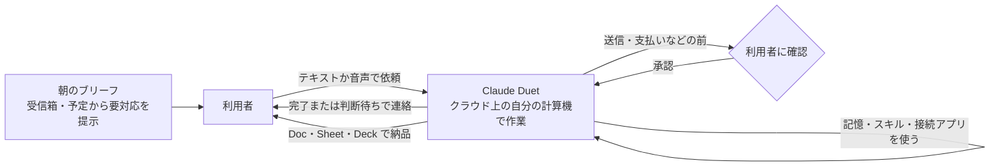

# Claude Duet — 向こうから声をかけてくるプロアクティブな Claude の単独アプリ

> **TL;DR**: Anthropic が 2026-10-21 にリサーチプレビューとして公開した、Claude が能動的なエージェントとして働く新アプリ。朝のブリーフで要対応事項を知らせ、メッセージで渡した仕事をクラウド上の専用計算機で進め、利用者が席を離れても動き続け、送信や支払いなど本人に代わって行う操作の前には確認を取る。

> 📌 X bookmark: 15,081（2026-10-22 時点）

従来の Claude アプリは利用者がチャットを開くのを待ち、開いたあとは隣で一緒に作業する道具だった。Anthropic は製品ページでこれと対比して「Claude Duet は向こうから来る」と書き、毎朝注意が要るものを伝え、メッセージで渡された仕事を引き受け、終わったときや承認が要るときに連絡してくる、と説明している。公式アカウント @claudeai の告知は、注意が要るものを持ってくる・頼んだ仕事を完了する・席を離れても働き続ける・本人に代わって動く前に確認する、の4点でこのアプリを要約した。利用者側の操作は、信頼する同僚にメッセージを送るのと同じで、プロンプトも設定も要らず、テキストでも音声でもよく、履歴は1本のスレッドに残る。

## 何をするか（Anthropic の説明）

製品ページで Anthropic が挙げる動きは3層に分けて読める。まず毎朝のブリーフで、受信箱と予定の中から本人の対応が要るものを示し、返信の下書きを承認用に用意する。次にメッセージで渡された仕事を、接続したアプリを使ってクラウド上の自分の計算機で進める。会議の設定やダッシュボードの構築を頼めば、終わったときに共有してくる。最後に、事業運営の作業として、未払いの請求書を見つけて催促の下書きを作る、給与計算を確認用に準備する、契約書を送付できる状態に整える、ブリーフ・デッキ・ダッシュボードをまとめる、といった例を挙げている。仕上がった成果物は Doc・Sheet・Deck のような形で利用者のレビューに戻ってくる。

Claude Duet は利用者の Claude アカウントをそのまま使い、記憶・スキル・コネクタが最初のメッセージから効く。製品ページの見出しは 6,000 を超えるコネクタとプラグインに対応するとうたう。常時動いているが、連絡するかどうかの判断は「何が待てるかを知っている」と Anthropic は表現し、何も要らなければ静かにしているとしている。

## 安全設計（Anthropic の説明）

Anthropic は、メッセージの送信や支払いのような機微な操作の前に利用者へ確認を取ると明記している。承認・ログイン・安全性チェックは利用者専用のクラウド計算機の中で実行され、機微な情報はそこから出ない、という説明である。利用者は Duet が何をしたか・いま何をしているかを見て、進め方を変えられる。

リサーチプレビューとしての限界も Anthropic 自身が書いている。スレッドを読み違える、緊急度の見積もりを外す、確認と確認の間に届いたものを取り落とす、の3つである。

## 提供範囲と利用枠（Anthropic の説明）

- 米国の Claude Pro・Max 加入者向けの待機リスト制。Team・Enterprise プランはまだ対象外
- iOS・Android の単独アプリ。PC では claude.ai 上のウェブで開く
- リサーチプレビュー期間中はプランの利用枠を Claude 本体と共有し、通常の会話とは違う使い方で消費する。バックグラウンドの確認も枠に数えられ、財務モデルやデッキの構築のような大きな仕事はモデルのターン数とバックグラウンド作業が増える

## 位置づけ（wiki 側の推論）

Claude Code チームが [[concepts/claude-code-loop-types]] で整理した4類型のうち、イベントやスケジュールで起動し利用者が止めるまで続く Proactive 類型を、開発者向けの部品でなく一般利用者向けの製品にしたものと考えられる。入江慎吾の [[concepts/ai-pre-judgment-automation]] は Slack・Gmail・カレンダーなど仕事の入口を監視して提案し、人間が承認してから実行する運用を個人で組んだ実践記で、Duet はその形をベンダーが製品化したものに見える。ただし承認を求める線の引き方が違い、入江の運用は実行のすべてに人間の確認を置くのに対し、Duet は「送信・支払いなど本人に代わる操作の前」に置く。@dansyu_callenge が [[concepts/ai-secretary-gateway]] で「今日の秘書ブリーフ」として自作していた朝の窓口は、Duet の朝ブリーフに相当し、コピペ秘書から常駐秘書へ段を上げる作業をベンダー製品で飛ばす選択肢が出たと読める。

競合として並ぶのは、OpenAI が ChatGPT 内の常時稼働エージェントとして出した [[tools/openai-dots]] と、自分の計算機を持つエンジニアボット [[tools/grok-bot]] である。クラウド上に自分の計算機を持ち利用者が離れていても動く、という形は3者で共通する。@umiyuki_ai の要約では Dots はボットを複数作れるのに対し、Duet の製品ページは履歴を1本のスレッドに置くと書いており、仕事の分け方の思想が違うと考えられる。Anthropic 自身の先行製品では、[[tools/claude-google-workspace]] が編集を反映前に1件ずつ承認させる設計を取っていた。Duet はそれより粗い粒度で、外に影響が出る操作だけを止める。公式の参照実装 [[concepts/scheduled-agent-automation]] の daily-brief は、開発者が Managed Agents で組む朝ブリーフで、Duet は同じ体験を組まずに受け取る側の製品と考えられる。Duet の実装基盤が何かは製品ページに書かれておらず、未確認である。

## 問い

- 自分の運用のうち「入口の監視→提案」の部分を Duet に寄せられるか。日本からは待機リストの対象外なので、まず提供地域の拡大時期と Team プラン対応を追う
- 「送信・支払いの前に確認」の線引きで、カレンダー招待の作成やファイル共有はどちら側に置かれるか。実物で1回試す
- 複数の仕事を並行させるとき、Dots の複数ボットと Duet の1スレッドのどちらが扱いやすいか。[[concepts/overnight-delegation-prompt]] の就寝前委任を Duet に移すと何が変わるか

## 関連

- [[concepts/claude-code-loop-types]] — Claude Code チームによるループ4類型。Duet は Proactive 類型の一般利用者向け製品と考えられる
- [[concepts/ai-pre-judgment-automation]] — 入口の監視→提案→承認→実行を個人で組んだ運用（入江慎吾）。Duet はその製品版で、承認の線を外部操作の手前に置く
- [[concepts/ai-secretary-gateway]] — 「今日の秘書ブリーフ」を自作する窓口設計。Duet の朝ブリーフに相当
- [[tools/openai-dots]] — OpenAI の常時稼働エージェント。複数ボットか1スレッドかで形が違う
- [[tools/grok-bot]] — 自分の計算機を持つエンジニアボット。クラウドの専用計算機という共通点
- [[concepts/scheduled-agent-automation]] — Anthropic 公式の daily-brief 参照実装。開発者が組む側の朝ブリーフ
- [[tools/claude-google-workspace]] — 編集を1件ずつ承認させる Anthropic の先行製品。承認粒度の比較対象
- [[concepts/overnight-delegation-prompt]] — 常駐ボットに夜通し作業させる委任プロンプト
- [[companies/anthropic]] — 開発元
- [[tools/1password-for-agents]] — 1Password が 2026-10-22 に発表したサインイン承認レイヤー。Claude Duet は「近日対応」とされ、Anthropic CPO の Ami Vora は Duet がサインイン前に必ず尋ねる設計に 1Password が入力を完了させる形になると述べる
