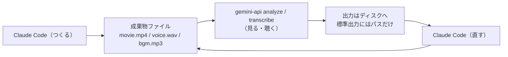

# Gemini API CLI（gemini-api）

> **TL;DR**: Google の `gemini-api` は、コーディングエージェントがシェルから Gemini を呼ぶための、状態を持たない依存ゼロの CLI。画像・音声・音楽・動画の生成（image／tts／music／video）、ファイルや公開 YouTube の分析（analyze）、話者ラベルつき文字起こし（transcribe）、Deep Research などのマネージドエージェントへの委任（agent run）を 1 コマンドずつ提供し、生成物はディスクに書いてパスだけを標準出力に返す。個人ゲーム開発者ギガビット（@gigabit_million）が Claude Fable に作らせた 67 秒の動画は、これを「文字の世界に住む Claude Code に目と耳を足し、つくって・見て・直すを 1 人で回せるようにする道具」として描く。



公式ドキュメント（Google AI Studio の docs）によれば、生の REST 呼び出しや対話型 CLI はコーディングエージェントにとって問題を起こす。base64 のメディアがコンテキストウィンドウを埋め、対話プロンプトがサブプロセスを止め、古い学習データが存在しないフラグを幻覚させるからだ。`gemini-api` はこれを、オフラインのスキーマ参照・ディスク出力・ドライラン・無状態という 4 つの設計で避け、Antigravity・Claude Code・Cursor のどのエージェントのサブプロセスからでも、ターミナルや CI からでも同じコマンドで動くと説明する。すべての機能は Interactions API の上で動く。公式は `gemini-api` を「対話型コーディングエージェント `@google/gemini-cli`（Gemini CLI）ではなく、状態を持たない API クライアントで、どのコーディングエージェントの中でも実行できる」と区別し、オープンソースのベータ版でマイナーバージョン間に破壊的変更がありうるため、自動化環境や CI ではリリース版を固定するよう求めている。

## 位置づけ（公式の使い分け表を転記）

| 道具 | 何をするか | いつ使うか |
|---|---|---|
| **Gemini API CLI**（`gemini-api`） | どのシェルからでも Gemini のモデルとマネージドエージェントを呼ぶ | コーディングエージェント・シェルスクリプト・CI ジョブが、プロジェクトに依存を足さずにメディア生成・ファイル分析・バックグラウンドのリサーチエージェント実行をしたいとき |
| **Google GenAI SDK** | Python・TypeScript・JavaScript・Go・Java・C# のコードに Gemini クライアントライブラリを取り込む | アプリケーション・バックエンド・Live API セッションに Gemini を組み込むとき |
| **Gemini Docs MCP とスキル** | コーディングエージェントに最新ドキュメントの検索と SDK の規則を渡す | エージェントが GenAI SDK を import するアプリコードを書くとき |

公式の整理では、エージェントやスクリプトが Gemini を**呼ぶ**なら CLI、アプリに Gemini を**組み込む**なら SDK とコーディングエージェント設定、という線引きになる。

## 4 つの設計（公式の説明を転記）

1. **オフラインのスキーマ参照**: `--usage` でコマンドツリーを KDL 形式で、`--schema` で `--body` 用の JSON Schema を出力する
2. **ファイルはディスクへ、標準出力にはパスだけ**: メディア生成と文字起こしのコマンドはファイルを書き出し、出力パスだけを印字する。バイナリをコンテキストに入れない
3. **ドライランと構造化出力**: `--dry-run` は入力を検証し資格情報を伏せて HTTP リクエストをオフラインで表示する。`-o json`・`-o toon`・`--jq` で機械可読に、`--agent-mode` で構造化した JSON エラーを標準エラーに返す。コマンドは `--interactive` を付けない限り対話プロンプトを出さない
4. **既定で無状態**: 隠れたローカル状態を持たない。複数ステップは `--previous-interaction-id`、アップロード済みの `files/<id>` URI、バックグラウンドのインタラクション ID で明示的につなぐ

`-o json` を付けたメディアコマンドは、ファイルをディスクに書いたうえで `kind`・`mime_type`・`path`・`response_id`・`size_bytes`・`status` のメタデータを標準出力に返す。

## 導入と認証（公式の手順を転記）

```bash
# 1. インストール（macOS / Linux）。GEMINI_VERSION=<release-tag> でリリースを固定できる
curl -fsSL https://raw.githubusercontent.com/google-gemini/gemini-api-cli/main/scripts/install.sh | bash

# 2. API キー（Google AI Studio で発行）
export GEMINI_API_KEY="YOUR_API_KEY"

# 3. 動作確認
gemini-api whoami
gemini-api generate "Confirm CLI setup in one sentence." --dry-run
```

Windows は PowerShell のスクリプト、Go 環境は `go install github.com/google-gemini/gemini-api-cli/cmd/gemini-api@latest`、固定版は GitHub Releases のビルド済みバイナリでも入る。ローカルでは `gemini-api configure --api-key` で OS のキーチェーン（macOS Keychain・Linux Secret Service・Windows Credential Manager）に保存でき、`--no-keyring` なら `~/.config/gemini-api/config.yaml` に置く。公式は CI では鍵をシークレットストアから注入しリポジトリに書かないよう警告する。

公式は、プロジェクトの `AGENTS.md`・`CLAUDE.md`・`.cursorrules`・システムプロンプトに貼る指示文も用意している。要旨は 4 点で、コマンド選びは `--help` か `--usage`、`--body` を組む前に `<command> --schema`、不慣れな呼び出しは `--dry-run -o json` で確認、`generate` と `agent run` で単一の JSON が要るときは `--stream=false -o json`、複数ステップはメディアコマンドが印字するパスと `generate`／`agent run` が返す `id` でつなぐ、というもの。その上で「ランディングページを作り、Gemini でヒーロー画像と 15 秒のナレーションを生成し、バックグラウンドで Deep Research に競合の CLI オンボーディングを比較させ、成果物をページに組み込め」のような普段どおりのプロンプトを渡す例を示している。

## コマンド（公式の一覧を転記）

| 群 | コマンド | 働き |
|---|---|---|
| 生成 | `image` | 画像の生成・編集（`-i` で入力画像）。JPEG を書き出しパスを印字 |
| 生成 | `tts` | 24 kHz モノラル WAV の音声合成（1 人または 2 人の話者） |
| 生成 | `music` | 楽曲・ループの生成 |
| 生成 | `video` | MP4 の生成・編集。完了まで待つ（`--async` で ID を即時返却） |
| 生成 | `generate` | テキスト生成を標準出力にストリーム（`--stream=false` で一括） |
| 理解 | `analyze` | PDF・画像・音声・動画・CSV・テキスト・公開 YouTube URL への質問応答 |
| 理解 | `transcribe` | 話者ラベルとタイムスタンプつきの文字起こし（`md`・`text`・`json`・`srt`） |
| エージェント | `agent` | マネージドエージェントの実行（`run`・`status`・`cancel`・`delete-interaction`）とカスタムエージェント定義の管理（`create`・`list`・`get`・`delete`） |
| エージェント | `environments`・`credentials`・`webhooks`・`triggers` | サンドボックス環境・保存資格情報・Webhook 配送・定期実行の設定 |
| 設定とファイル | `configure`・`auth`・`whoami` | 資格情報と既定値の設定、認証状態の表示 |
| 設定とファイル | `files` | Files API へのアップロード・一覧・確認・削除 |
| 設定とファイル | `models` | 利用可能なモデルの一覧 |

## ワークフローの要点（公式の説明を転記）

- **画像**: Nano Banana で生成し、`--aspect-ratio 16:9`・`--image-size`（512・1K・2K・4K）を指定できる。生成したパスを `-i` で渡せば編集になり、`-i` を複数回渡すと参照画像（キャラクターとスタイルガイドなど）を組み合わせられる
- **音声合成**: 既定の声は `Kore`、`--voice` で変更。2 人の対話は本文に「Alice: …」「Bob: …」と書き `--multi-speaker "Alice=Kore,Bob=Puck"` で声を割り当てる
- **音楽と動画**: 音楽は Lyria、動画は Gemini Omni で生成し、`--resolution 1080p` を指定できる。`video` は既定で完了まで待ち、`--async` なら ID を返して後から `--resume <id> --out <path>` で受け取る。`-i` に画像を渡すとその画像を動かす
- **テキスト**: `generate` は `--stdin` でパイプ入力、`--previous-interaction-id` で前の対話を継続
- **分析と文字起こし**: `analyze` に `-i` を複数渡すと前後のスクリーンショット比較などができる。ローカルファイルは 14 MB（base64 後 20 MB）までインライン送信し、それ以上は `files upload --wait` で一度アップロードして `files/<id>` URI を使い回す。Files API のファイルは 48 時間後に削除される
- **エージェント**: `agent run "…" --agent deep-research-preview-04-2026 --background --stream=false --jq '.id'` で Deep Research をバックグラウンド起動して ID を取り、`agent status <id> -o json` で確認、`agent cancel <id>` で停止する。Antigravity エージェントをリモートサンドボックスで起動することや、カスタムエージェントの管理もできる
- **生のリクエスト本文**: 専用フラグのない項目（`response_format` のスキーマ・関数呼び出しツール・`generation_config`・`"store": false`）は `--body` に Interactions API の JSON を渡す。フラグと `--body` が同じキーを設定すると終了コード 2 で失敗する
- **終了コード**: 0 成功・1 実行時または API エラー（ネットワーク・レート制限・バックグラウンドジョブ失敗）・2 用法または検証エラー・3 認証エラー
- **制限**: `generate` と `agent run` を `-o json` や `--jq` と組むには `--stream=false` が要る。双方向 WebSocket は非対応で、リアルタイム音声・映像は Live API と SDK を使う

## ギガビットの動画「Claude Code に目と耳」（動画の転記から）

ギガビットは X のプロフィールで、Unity のスマホゲーム 12 本と無料ブラウザゲーム 145 本を公開する個人開発者で、ゲーム開発への AI 活用歴 4 年と名乗る。投稿文は「Fable による『Claude Code が Gemini API CLI を使うとどれだけパワーアップするかわかる動画』」の 1 文で、動画を作った主体を Claude Fable としているが、Claude Code からどの手段で映像化したかは投稿に書かれていない。動画の筋は次のとおり。

1. Claude Code に「demo.mp4 を見て感想を教えて」と頼むと 16 進のバイト列しか見えず、「Claude Code は、文字の世界に住んでいる」「動画は見えない。音は聞こえない」と置く
2. 「そこへ、コマンドをひとつ」で `gemini-api` が入り、キャラクターに目と耳が付く
3. `gemini-api analyze -i movie.mp4 "何が映ってる？"` に Gemini が「暗闇の中に浮かぶ砂時計の中で、光り輝く砂が神秘的に流れ落ちていく様子を描いた映像です」と答える。`analyze -i https://youtu.be/…` で YouTube 最初の動画「Me at the zoo」も読む
4. `gemini-api transcribe -i voice.wav --format srt` で「こんにちは、クロード。」「私の声、聞こえますか？」のタイムコードつき字幕を得る。`analyze -i bgm.mp3 "テンポと雰囲気は？"` に「約 120 BPM」と答える
5. 「つくる力も、借りられる」として image・tts・music・video の 4 コマンドを示し、「絵・声・BGM は、このムービーで実際に使ったもの」と動画自身の素材が `gemini-api` 製だと明かす
6. 「いちばん大きな変化」は「つくって、見て、直す。自分の作品を、自分で確かめられる」で、つくる＝Claude Code・見る聴く＝gemini-api・直す＝Claude Code の円環図を出す。末尾には「このムービーを見た Gemini の指摘」として「[00:33] 背後のビートと声がぶつかって聞き取りづらさを感じさせます。声が鳴る瞬間は BGM をしっかり絞るべきです」が出る

ナレーションや BGM の音声は転記していない。

## 他ページとのつながり（wiki 側の推論）

- [[concepts/gemini-rewrite-stop-hook]]（@yugen_matuni）は「内容は Fable／Astra・日本語は Gemini」という分業を Codex の Stop Hook で自動化した例で、本ページの「つくる＝Claude Code・見る＝gemini-api」も同型の分業である。向こうは言語の自然さで、こちらは映像・音声というモダリティで分けている
- [[concepts/opus-motion-design-studio]]（@0xMovez）の「自己フレーム批評ループ」は、レンダリングした静止画を Claude 自身が見て直す方式だった。`gemini-api analyze` は動画と音声をファイルのまま別モデルに見せる方式で、BGM と声の衝突のような音の評価まで届く点が違う
- [[tools/claude-code-mcp-stack]] の Boris Cherny の原則「検証手段を渡す」「外部ツールを作業面へ」を、MCP サーバーでなくシェルコマンドで満たす道具と読める。公式が CLAUDE.md に貼る指示文を配っているのは、[[concepts/claude-code-instruction-methods]] でいう散文層に外部ツールの使い方を載せる手順にあたる
- [[tools/claude-code]] 側から見ると、Claude Code 自身の WebFetch や画像読み取りが扱えない動画・音声・音楽を、ディスク経由で別モデルに委ねる拡張になる

## 観察ログ（未検証）

- 2026-11-16（ギガビットの動画）: Gemini が動画自身の 00:33 の BGM と声の衝突を指摘し、その下に「声のあいだ、BGM を -18〜-20 dB に下げた」と読める 1 行がある（小さな文字で一部不確か）。音声に対する指摘の精度は、この 1 例しか手元にない

## 問い

- この vault の ingest で動画・音声ソース（X の動画・YouTube）を読むのに `gemini-api analyze`／`transcribe` を使えるか。今回の取り込みでは一時環境の ffmpeg でフレームを切り出し、音声は未収録だった。`GEMINI_API_KEY` の置き場と、出力を sources/notes/ にどう残すかが決めどころになる
- 「見る」を別モデルに委ねる構成は、評価者と生成者を分ける。Gemini の指摘を自動ゲートにするか、人間が読む指摘に留めるかで、[[concepts/eval-loop]] の閾値設計が変わる
- Files API の 48 時間削除と 14 MB のインライン上限で、長時間の講演動画はどう扱うか。`files upload` の URI をセッションをまたいで使い回せるのは 2 日までになる

## 関連

- [[tools/claude-code]] — 動画の主役。文字の世界にいる Claude Code に、動画・音声・音楽の入出力を足す
- [[companies/google]] — 提供元。Gemini のモデル群（Nano Banana・Lyria・Gemini Omni）を 1 つの CLI から呼ぶ
- [[concepts/gemini-rewrite-stop-hook]] — Claude と Gemini の分業を Hook で自動化した先行例。本ページはモダリティで分ける側
- [[concepts/opus-motion-design-studio]] — コードから動画を作り自己批評で直す講座。本ページの「見る」を別モデルに外出しした構成と対になる
- [[tools/claude-code-mcp-stack]] — 「検証手段を渡す」「外部ツールを作業面へ」の原則。本ページはそれをシェルコマンドで満たす例
- [[concepts/claude-code-instruction-methods]] — 公式が配る CLAUDE.md 向け指示文が載る散文層の位置づけ
- [[concepts/eval-loop]] — 別モデルの指摘をゲートにするかどうかの判断枠
- [[tools/hyperframes]] — HeyGen 製の動画フレームワーク。その `/media-use` スキルがサインイン 1 つで音楽カタログ・素材検索・TTS をエージェントに渡す。本ページが Gemini のモデル群で満たす「耳と素材を足す」役割を HeyGen 側で担う対応物
