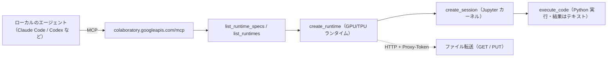

# Google Colab（API と MCP エンドポイント）

> **TL;DR**: Google Colab がランタイムの作成・コード実行・削除を REST API と Google ホストの MCP エンドポイント（`colaboratory.googleapis.com/mcp`）として公開し、ブラウザでノートブックを開かずにローカルのエージェントが Colab の GPU／TPU を使えるようになった（2026-11-17 発表・全ユーザーに提供）。

Colab の計算資源はこれまでブラウザのノートブック UI を通して使うものだった。@umiyuki_ai はこの発表を「今まではサイトに行ってノートブックを開いてワチャワチャするしかなかったが、ローカルからコードで API を呼んで GPU インスタンスを立ち上げ、GPU 処理を実行できる」と紹介し、Codex に Colab の GPU を使わせて動画を量産させる使い方を例に挙げる（例に出る「H3」が何を指すかはポスト内で説明されていない）。Google Colab チーム（Jack Yang・Kevin Eger）は発表記事で、API と MCP エンドポイントを「Colab の計算基盤への標準化されたヘッドレスなインターフェース」と位置づけ、ローカル開発環境の拡張・ML ワークフローの自動化・AI エージェントへの加速計算の付与という 3 つの用途を挙げる。

## 何が公開されたか（Google Colab チームの発表）

**REST API（v1beta）**

- **ランタイム管理**: ランタイム割り当ての作成・取得・一覧・削除（CreateRuntime / GetRuntime / ListRuntimes / DeleteRuntime）
- **ハードウェアと契約の発見**: CPU・GPU・TPU の利用可能なマシンタイプを一覧する ListRuntimeSpecs と、契約ティアを返す GetSubscription。Web UI と同じ契約特典を引き継ぎ、Pro / Pro+ はティアに応じて H100 GPU や TPU v6e のランタイムを使える
- **Jupyter サーバーへの直接接続**: ランタイムが認証済みの接続情報（ConnectionInfo）を返すので、Jupyter サーバーに接続できる任意のツールを Colab で裏打ちできる。公式の **VS Code 向け Colab 拡張**はこの API の上に作られている
- **標準準拠**: Google API（AIP）標準と OAuth 2.0 認証。Google REST と OpenAPI 3.0 の両方のディスカバリスキーマを提供する

**ホスト型 MCP エンドポイント**

- REST API の全エンドポイントをツールとして公開し、一部はエージェント向けに簡略化
- 任意の Python を実行する `execute_code` と、状態管理を助けるセッション系ツール（`create_session` など）

**始め方**（発表記事の手順）: Google Cloud Console のプロジェクトで Colab API を有効化 → OAuth 2.0 クライアントを作成 → ディスカバリスキーマからクライアントを生成するか、AI ハーネス側に MCP エンドポイントを設定する。

## MCP ツール一覧（API リファレンスの転記）

| ツール | 役割 |
|---|---|
| `list_runtime_specs` | ランタイムのスペック（variant・アクセラレータ・shape）と、ユーザーが各スペックを使えるかを一覧する。`create_runtime` の前に呼ぶ |
| `list_runtimes` | ユーザーのランタイムをスペックと接続情報つきで一覧する。作成前に再利用できるものを探す |
| `create_runtime` | ランタイムを作成し、準備完了まで待つ |
| `get_runtime` | ランタイムのスペックと `connectionInfo` を取得する。ファイル転送の入口 |
| `delete_runtime` | ランタイムとその上のファイル・セッション・状態をすべて削除する。取り消し不可 |
| `get_subscription` | ユーザーの契約ティア（free / Pro / Pro+）を返す |
| `create_session` | ランタイム上に Jupyter カーネルのセッションを開く |
| `list_sessions` | ランタイム上の開いているセッションを一覧する（ユーザーのノートブックが開いたものも含む） |
| `delete_session` | セッションを閉じてカーネル状態を捨てる。ファイルはランタイムに残る |
| `execute_code` | ランタイムの Jupyter カーネルで Python を実行し、stdout・stderr・最終式の値・例外を返す |

## エージェント向けの運用ルール（リファレンスが明記）

リファレンスのツール説明は、エージェントが読む前提で運用上の注意を長く書いている。

- **ランタイムは再利用し、状態の分離はセッションで行う**: ランタイム作成は遅くクォータ制限があるため、`list_runtimes` で既存を探し、状態を分けたいときは新しいランタイムでなく新しいセッションを開く。`create_runtime` には毎回新しい UUID を `requestId` として渡し、DEADLINE_EXCEEDED で失敗しても同一呼び出しを繰り返せば作成中のものを待つ
- **実行結果はテキストだけ**: `execute_code` は画像やプロットを返さず、サイズ超過は `outputTruncated` で切り詰める。1 セッションの呼び出しは直列で、並列にしたいときはタスクごとにセッションを分ける
- **長時間実行は再接続で拾う**: 呼び出しは 600 秒で DEADLINE_EXCEEDED になるがコードは走り続ける。`session` ターゲットと UUID の `executionId` を付けておけば、同一呼び出しの再送で実行中の処理に再接続して結果を受け取れる。リファレンスはバックグラウンド実行してポーリングするより、この方式を優先せよと書く
- **ファイルは HTTP で運ぶ**: バイト列を base64 でツール呼び出しに載せるとコンテキストを埋めるため、`connectionInfo.url` に `X-Colab-Runtime-Proxy-Token` ヘッダを付けて HTTP で転送する。ダウンロードは `GET {url}/files/{path}`、アップロードは `PUT {url}/api/contents/{path}` の JSON で、1 リクエスト 50 MB 未満、大きいものは `chunk` 番号で分割する。トークンは発行から約 1 時間で失効する
- **削除は保守的に**: `delete_runtime` はユーザーが求めたとき、またはランタイム数超過で `create_runtime` が失敗したときに自分が作ったものを空けるときだけ。状態のリセットには `delete_session` を使う。`list_sessions` にはユーザー自身のノートブックのセッションも並ぶので、閉じるのは自分が開いたものに限る
- **エラーの意味**: FAILED_PRECONDITION はアクセラレータの空きなし・クォータ切れ・ランタイム数超過、RESOURCE_EXHAUSTED はレート制限（何も作られていないので指数バックオフで再試行）、NOT_FOUND はランタイムが存在しないか停止済み

## 2026-03 のローカル MCP サーバーとの違い

Google for Developers（@googledevs）は 2026-03-17 に、オープンソースの Colab MCP Server を「エージェントが Colab ノートブックの中でネイティブにコードを書いて実行できる」ものとして紹介していた（ポスト本文のみ確認・記事本体は未キャッシュ）。今回の発表は Google がホストするエンドポイントとランタイム管理の REST API で、発表記事はこれを「ヘッドレス」と呼ぶ。ノートブックの画面を介さずにランタイムそのものを割り当てて実行できる点が差分だと考えられる。

## 観察ログ（未検証）

- 2026-11-20: 第三者の検証リポジトリ（GitHub xbill9/colab・Web 検索で把握、未キャッシュ）は `execute_code` 1 回の上限を 300 秒、ランタイムは削除するまで compute unit を消費し続けると報告。公式リファレンスの 600 秒との差の理由は未確認

## 問い

- 自分の重い処理（動画生成・小型モデルのファインチューニング）を Claude Code や Codex から Colab へ投げる運用が実際に回るか。Cloud Console プロジェクトと OAuth クライアントの準備、無料枠のクォータがどこで引っかかるか
- [[concepts/small-llm-fine-tuning]] の「切断に備えて 50 ステップごとに Drive へチェックポイント」は、ヘッドレスのランタイムでも必要か（ランタイムの寿命と切断条件は未確認）

## 関連

- [[companies/google]] — 提供元。Colab の契約ティア（Pro / Pro+）が API 経由のアクセラレータ選択にそのまま効く
- [[tools/claude-mcp]] — MCP 仕様の受け皿。本ページは Google がホストするリモート MCP サーバーの一例
- [[concepts/small-llm-fine-tuning]] — Colab を最初の実験場にする助言（@sairahul1）。本ページの API で、ノートブック UI を介さず同じ実験をエージェントから回せる
- [[tools/openai-codex]] — @umiyuki_ai の例で Colab の GPU を使わせる側のエージェント
- [[tools/gemini-api-cli]] — Google がエージェントに渡すもう一つの入口（シェルから Gemini を呼ぶ CLI）。本ページはモデルでなく計算資源を渡す側
