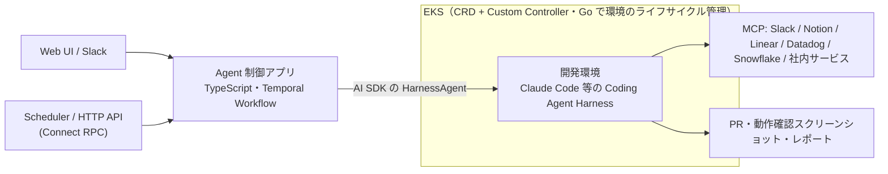

# haro — LayerX バクラクが内製したクラウド型 Background Agent

> **TL;DR**: LayerX バクラク事業部が内製した、Web UI・Slack・Scheduler・API から呼び出すとバクラク開発に必要な環境がクラウド上に立ち上がり、その中で Claude Code などの Coding Agent が動く基盤。Staff Software Engineer の izumin5210 は、巨大 monorepo でのローカル開発のメモリ限界と、自社の内製ツール群を既製品がまかなえないことを内製の理由とし、2026 年 10 月時点で 1 日の PR の 55〜60% が haro 経由だと公表している。

izumin5210（LayerX バクラク事業部 Platform Engineering 部 Staff Software Engineer）は、haro を Ramp 社の Inspect と同じ系統のクラウド型 Coding Agent と位置づける。内製の動機は 2 つあるという。第一に「ローカル開発の限界」で、バクラクシリーズのほとんどが 1 つの monorepo で開発されコードベースが伸び続ける中、Language Server を起動するエディタや Coding Agent のプラグインがメモリを大量に消費し、git worktree での並列開発では人間の認知より先にメモリが限界を迎える。ローカル用プロセスマネージャーの内製や高速な gopls の自作で工夫してきたが、ローカル資源に上限がある以上は限界があると書く。第二に「自社コードベースを動かすには既製品では足りない」ことで、この規模の monorepo をリモートで快適に動かし、内製ツールや環境をローカルと同じようにリモートで使おうとすると既製品では足りず、足りても開発者体験として最適かは別だという。自前で作れば自社のプロダクトラインナップ・コードベース・開発文化にフィットさせられ、しかも Coding Agent のおかげでそれを作る負担は劇的に小さくなっている、というのが izumin5210 の判断である。

## 構成

Agent を制御するアプリケーションは TypeScript で実装され、Temporal Workflow から AI SDK の HarnessAgent 経由で、クラウド上の環境内にある Coding Agent Harness（Claude Code 等）を操作する。環境は EKS 上で動作し、Custom Resource Definition（CRD）と Custom Controller でライフサイクルを管理する。izumin5210 の整理では、Agent Loop を TypeScript（Temporal Workflow）、環境を Go（Kubernetes）がそれぞれ管理する分担になる。

haro 上の Agent には Slack・Notion・Linear・Datadog・Snowflake など社内で使う各種サービスの MCP（Model Context Protocol）が接続されており、利用者は鍵管理や接続先管理をせずに、普段の自分のアカウントでこれらの情報を Coding Agent から安全に使える。この「鍵を配らず、人間の身元でエージェントに社内文脈を渡す」構成は [[concepts/idp-shared-cli-mcp]] と同じ方向と考えられる（wiki 側の推論）。内製の社内サービスの MCP もつながっており、例として「Coding Agent がアップロードした HTML アーティファクトを表示し任意箇所にコメントできる」社内プロダクトを挙げる。複雑な設計タスクの結果を図解豊富な HTML に起こし、そこへのコメントをさらに AI に読ませて設計ループを回すという使い方である。Service Console という内製の Internal Developer Platform の MCP もつながり、開発・運用の自動化にも使えるという。

## 利用状況（LayerX の公表値）

haro の開発チームは最初の KPI として「リポジトリ全体の PR のうち haro 経由で作られたもの」の数を普及率の間接指標として追っている。izumin5210 が記事で公表した数値は次のとおりで、いずれも 2026 年 10 月時点の自社計測である。

| 指標 | 公表値 |
|---|---|
| 現行バージョンの開発開始 | 2026 年 7 月半ば |
| 1 日の PR のうち haro 上で作成された割合 | 55〜60% 程度（数にして 200 件弱） |
| 利用者数 | 58 名（バクラク事業部エンジニアの半数超） |
| 最も活用が激しいチームの PR 比率 | 87% |
| モバイルアプリチームの PR 比率 | 75% ほど |

モバイルチームが早期に使い始めた理由として、実機やエミュレーターの数が開発並列数のボトルネックになるところ、haro 環境では Android エミュレーターが動くためボトルネックでなくなることを挙げる。ちょっとした UI 変更なら haro に投げれば、実装から AI の動作確認・スクリーンショット撮影・PR 作成まで一気通貫で進み、マージ直前まで手放しで走るという。クラウド型で環境構築が不要になったことで、デザイナー自身によるモバイル UI の実装修正や、QA エンジニアによる PR 差分からの観点出しと自動動作確認にも使われ、「コードを読み書きでき動作確認も可能な環境」をカジュアルに払い出せることがプロダクト開発フローの各所に変化を起こしていると izumin5210 は書く。

## Coding だけではない Background Agent

izumin5210 は、エンジニアの仕事はコーディングだけでなくレビュー・バグ修正・アラート対応・リファクタなどに広がり、プロダクトを届ける仕事はデザイナー・PdM・サポート・営業との連携を要すると述べ、haro をコーディング以外の業務も扱えるよう設計したという。例として、コードベースを見ながらのタスク管理システムの状態更新、Slack の議論で出た仕様や実装の不明点をそのまま haro に聞いてコードや Notion の仕様から実挙動を答えさせる使い方、Slack のバグ・インシデント報告から haro を起動しコード・ログ・DWH を見て原因調査する使い方を挙げる。

多様なユースケースに対応するため、haro には利用者が独自の「Agent」を定義できる仕組みがある。ここでの Agent は「system prompt」「利用する MCP tools」「起動する環境」などのパラメータの集まりで、タスクをうまく遂行するための専用パラメータを事前に定義し、様々な経路から呼び出せる。起動経路は Web や Slack のチャットに加えて Scheduler と HTTP（Connect RPC）の API に対応し、定期のバグスキャン・セキュリティスキャン、daily や weekly で指標を集計して所感とともに Slack に投稿する運用、flaky test 収集ダッシュボードのボタンから API 経由で flaky 修正セッションを起動する運用が動いている。haro 自体の開発・運用も haro を使っており、デプロイ直後のログの異常検知、問題発生時の原因調査から修正、日々の要望の収集・集約を自動化して少人数で開発・運用しているという。

izumin5210 は haro の特性を「カスタム Agent」「Slack・Scheduler・API など多様な起動経路」「MCP による様々なリソースアクセス」「クラウド上で動く（ラップトップの状態に左右されない）」の 4 つにまとめ、単なるコードを書く Agent にとどまらずプロダクト開発に関わる多様なタスクの自動化基盤になりつつあると述べる。

## ループを勝手に閉じる基盤になる（はず）

haro 上のセッションは原則公開で、他の社員からもやり取りが見える（顧客データや機密に触れるセッションは権限に応じて閲覧制限）。これにより「うまい人」のセッションを参考にでき、カスタム Agent や Scheduler の設定も原則公開なので隣のチームの良い使い方を取り入れやすい、と izumin5210 は書く。さらに開発上の試行錯誤がデータとして残るため、そのログを分析して prompt や skill にフィードバックできれば「haro を使っているだけで勝手に生産性が上がる」世界になるはずだとし、開発以外でも AI が日々処理するセッションを定期的に振り返ってフィードバックすれば精度やトークン効率の改善ループが勝手に回る、と見立てる。LayerX のイベント Bet AI Day 2026 での CTO 松本の資料を引き、Outer Loop と Harness Optimization Loop が勝手に閉じていく世界を目指すと述べる。

## Software Factory のその先

izumin5210 は、世の中で議論される Software Factory を「AI Agent による計画・実装・検証・リリースと、そこで得た学びによる継続的な改善をつなぐ仕組み」と要約したうえで、仕組みが整っても何を流すべきかは自動的に決まらないと指摘する。自明な issue やアラート、作るものが明確な仕様なら Factory 的に処理するのが効率的だが、バクラクのように顧客の課題に深く入って解き方から考えるプロダクト開発では「仕様を決める」ところが不確実で、何度もそこへ戻るループになることが多いという。「速く作る」だけでなく「価値を速く作る」ことが求められ、これはおそらく世界の誰もまだ答えを持っていない領域だと書く。haro は「ソフトウェア開発」だけでなく「プロダクト開発」や事業全体を加速させる AI Agent 時代の開発基盤を目指すとして記事は採用案内で終わる。

全社規模のコスト最適化として Software Factory を扱う Uber の [[concepts/software-factory-cost-equation]] に対し、本記事は Factory に何を流すかという上流の不確実性を論点にしており、両者は同じ語を別の層で使っていると考えられる（wiki 側の推論）。

## 観察ログ（未検証）

- 2026-10-23: izumin5210 の見立て「セッションログを prompt や skill にフィードバックすれば、haro を使っているだけで勝手に生産性が上がる世界になるはず」。記事時点では構想で、実装や効果の報告はない。続報で追う

## 問い

- 「鍵管理なしで普段の自分のアカウントの MCP が使える」仕組みは、[[concepts/idp-shared-cli-mcp]] のような IdP 認証の共有か、[[tools/claude-projects-threads]] のようなプロキシ注入か。記事には実装が書かれていない
- PR 比率 55〜60% という普及指標は、[[concepts/agent-era-code-review]] のようなレビュー側の再設計を伴っているか。haro 経由 PR のレビュー負荷はどう処理されているか
- 自分の環境で「Coding 以外の業務」を Background Agent に流すなら、最初に定義するカスタム Agent（system prompt・MCP・環境）は何か

## 関連

- [[tools/claude-projects-threads]] — Anthropic 版のクラウドセッション基盤。fresh clone・API credentials のプロキシ注入・コーディネーターがスレッドに分割する構成
- [[tools/grok-bot]] — SpaceXAI が社内で使うエージェント管理ボット。クラウドエージェントを起動・監視し PR まで運ぶ別実装
- [[concepts/idp-shared-cli-mcp]] — 鍵を配らず人間の身元で AI に社内文脈を渡す設計。haro の MCP 接続と同じ方向
- [[concepts/software-factory-cost-equation]] — Software Factory をコスト方程式として扱う Uber の全社実例。本ページは「何を流すか」の側
- [[concepts/github-runner-agent-factory]] — 個人規模の 24/365 ソフトウェア工場。情報を GitHub に集約する構成
- [[concepts/ai-era-good-engineer]] — 同じ LayerX の「AI 時代のよいエンジニア像」。haro が自動化する範囲の外側に残る仕事の定義
- [[concepts/token-management]] — 同じ LayerX 発の、トークン消費を経営イシューとして扱う考え方
- [[concepts/loop-engineering]] — 人間がループの外に出る設計論。haro が目指す Outer Loop の閉じ方の一般論
