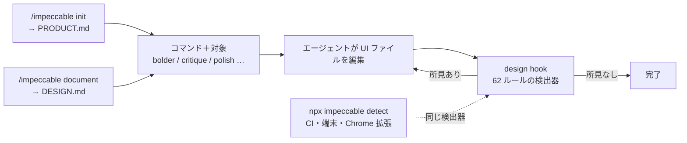

# Impeccable（コーディングエージェントのデザイン語彙：操作・レビュー・スロップ検出）

> **TL;DR**: Paul Bakaus が公開した Apache 2.0 のエージェント用スキル集。「もっと目立たせて」の代わりに `bolder`・`polish` など 24 の動詞を対象と組にして指示し、`critique`／`audit` で採点し、LLM を使わない 62 本の決定論ルールが AI スロップ（Inter・紫から青のグラデーション・カードの入れ子）を出荷前に拾う。編集のたびに走る design hook が主戦場で、Claude Code・Cursor・Codex CLI など README が列挙する 19 ツールに対応する。

解こうとしている問題は、指示なしでページを頼むとモデルやプロジェクトを問わず同じ見た目が返ってくることである。README は Inter フォント一択、紫から青へのグラデーション、カードの中のカード、色付き背景の上の灰色文字、見出しの上に置かれる角丸のアイコンタイルを「何度でも出てくる」兆候として挙げる。Bakaus の処方は三つに分かれる。言葉（「make it pop」では推測になるので、`/impeccable bolder the pricing cards` のように一手ごとのプレイブックを一つの対象に向ける）、レビュアー（`critique` がユーザビリティヒューリスティクスで採点して直す順を決め、`audit` がアクセシビリティ・性能・テーマ・レスポンシブを P0 から P3 で並べる）、スロップ検出器（LLM も API キーも使わない 62 本の決定論ルール）である。README には同一モデル（Fable 5.1）・同一ブリーフ（リグリア海岸の 14 室のゲストハウス）での比較画像があり、Impeccable なしだとクリーム地に細いセリフとピル型ボタンの「無難な既定」、ありだと夜の邸宅を海から見た一枚の写真を軸に組んだページになると説明している。Bakaus は「既に存在するインターフェースに最も強い」と述べ、新規ページの生成はより難しいモードとして別ドキュメントに分けている。

## 仕組み: 文脈ファイルとコマンド＋対象

`/impeccable init` をプロジェクトごとに一度走らせると、コードを読み、推測できないことだけ（誰のための製品か・何をする必要があるか・制約）を尋ねて `PRODUCT.md` を書く。以後のすべてのコマンドがこれを読む。`/impeccable document` は既存の視覚体系を `DESIGN.md` に書き出し、変更がブランドから外れないようにする。コマンドは「動詞＋対象」で呼ぶ（`/impeccable critique the onboarding flow`・`/impeccable quieter the landing page`・`/impeccable harden checkout`）。README は「狭い対象ほど良い結果になる。一つのセクションを近くで見る方がページ全体を一瞥するより勝る」と述べる。よく使うコマンドは `/impeccable pin audit` で `/audit` という独立のショートカットにできる。Codex ではスラッシュコマンドの代わりに `$impeccable` を使う。

## 24 コマンド

| 群 | コマンド |
|---|---|
| Steer（操作） | `bolder` 無難なデザインを増幅 · `quieter` うるさいものを抑える · `distill` 不要なものを除く · `colorize` 灰色の画面に色を入れる · `typeset` フォント・階層・サイズ · `layout` 余白とリズム · `animate` 遷移と操作フィードバック · `delight` 個性 · `overdrive` シェーダー・バネ物理・スクロール連動 |
| Review（レビュー） | `critique` 採点つき UX レビュー · `audit` 技術品質レポート |
| Finish（仕上げ） | `polish` 出荷前の最終パス · `harden` エラー・i18n・はみ出し・端ケース · `clarify` 不明瞭な文言の書き直し · `adapt` 画面サイズと端末 · `optimize` 読み込みと描画性能 · `onboard` 初回フローと空状態 |
| Iterate live（ブラウザで反復） | `live` ブラウザで要素を選び変種を巡る · `generate` 名指しした要素の変種を手動選択なしで生成 |
| Plan and set up（計画と準備） | `shape` コードの前に UX を計画 · `init` `PRODUCT.md` を書く · `document` `DESIGN.md` を書く · `extract` 繰り返すパターンをデザインシステムへ |

24 番目の `craft` は、ただの構築依頼の非推奨エイリアスである（README の表から転記）。

## 検出器の三つの実行経路

- **エージェント内（design hook）**: エージェントが編集した UI ファイルを毎回走査し、エージェントが「完了」と言う前に所見を返す。README は「ほとんどのスロップはここで捕まる。hook がないと、誰かが思い出したときにしか検出器は走らない」と書き、インストーラが hook を提案したら「yes と言え」と勧める。対応は Claude Code・Cursor・Codex・GitHub Copilot・Grok Build・Hermes Agent。
- **CI と端末**: `npx impeccable detect src/` でディレクトリ、`npx impeccable detect https://example.com` で描画済みページ（手元の Chrome か Edge を使う）、`--json` で機械可読、`--github` で GitHub Actions の注釈、`--list-rules` で全ルールの id と説明。JSX・TSX などソースファイルにはパターン規則だけが当たり、低コントラストや小さすぎる文字のように描画が要る規則は URL 走査で動くので、開発サーバーにも向けよと README は書く。終了コードは `2` が所見あり、`1` が走査不能。ブランドフォントを全面で許すには `npx impeccable ignores add-value overused-font Inter --reason "Brand font"`、1 ファイルだけ規則を切るには `<!-- impeccable-disable overused-font: exported brand doc -->` のコメントを置く。
- **ブラウザ**: Chrome 拡張が同じ所見を任意のライブページに重ねて表示する（自分のページでも他人のページでも）。

## Live mode と安全上の注意

`/impeccable live` は起動中の開発サーバーをオーバーレイ付きで開き、要素を選んで方向を指定すると変種をその場で差し替え、受け入れたものをソースに書き戻す。Vite・Next・SvelteKit・Astro・Nuxt・素の HTML で動く。README は注意を三つ明記している。ローカルのチェックアウトだけを編集し、デプロイ済みサイトに注入したり本番の CSP を緩めたりしないこと。文言編集の適用は `package.json` の任意スクリプト `impeccable:manual-edit-validate` をユーザー権限で走らせるので、知らないリポジトリでは先に確認すること。そして Apply は、直近 1 分以内にポーリングしているチャットエージェントがなければ PATH の `codex` CLI（無ければ `claude`）を承認・権限確認・サンドボックスをすべて切って起動し、環境変数を継承する。これを避けるには live mode を起動する環境で `IMPECCABLE_LIVE_COPY_AGENT=chat`（チャットセッションに留める）か `off`（Apply を無効化）を設定する。

## 導入と対応ツール

`npx impeccable install` がコーディングツールを検出し、プロジェクトかグローバルかを尋ね、対応ツールでは design hook を提案する。`npx impeccable update` で更新、スクリプト用に `--providers=claude,codex,cursor` と `--scope=project|global` がある。Node は `npx` のためだけに要り、スキル本体は隣に同梱されるか `~/.impeccable/bin/` に一度だけ落ちる自己完結のエンジンバイナリで動く。Claude Code では `/plugin marketplace add pbakaus/impeccable` からプラグインとしても入れられ、GitHub Copilot は VS Code 拡張（hook なし）、Grok Build は `grok plugin install pbakaus/impeccable#plugin --trust`。チーム全体でバージョンを固定するには git submodule として取り込み `npx impeccable link` でリンクする（リンクはスキルだけで hook は入らない）。Node なしの手動コピーも可能で、各ツールのビルドがリポジトリ直下に `.claude/`・`.cursor/`・`.agents/`・`.github/`・`.gemini/` などの形でコミットされている。手動コピーは design hook とサブエージェントを飛ばすので、それらが要るなら `install` を走らせよと README は注記する。Codex・Grok Build・Hermes Agent は hook を動かす前にそれぞれ承認の一手（`/hooks`・`/hooks-trust`・`hermes plugins enable impeccable-design-hook`）が要る。

## プロジェクトファイルと git

作業ファイルは `.impeccable/` 以下に置かれる。共有すべき成果物は `config.json`・`live/config.json`・`design.json`・`surfaces/*.md`・`critique/*.md` で、`PRODUCT.md` と `DESIGN.md` もリポジトリに入れる。残り（スクリーンショット・キャッシュ・実行時状態・個人別の `config.local.json`）は README が配る `.gitignore` ブロックで除外する。

## 知っておくこと

- **ビルド経路**: 新しいランディングページやショーケース面では、先に完全忠実度のカンプを生成してそれに合わせて組む（大胆で遅い）か、コードで直接組む（軽くて速い）かを選べる。アプリ画面と文書は常にコードで組む。`init` が一度尋ねて `buildPath` として保存し、選択肢はハーネスが画像生成できるときだけ現れる。
- **ネイティブアプリ**: `PRODUCT.md` の `## Platform` を `ios`・`android`・`adaptive` にすると、デザインコマンドは Web 慣習でなく Apple の HIG や Material 3 から働く。`audit` と `adapt` はネイティブ版に切り替わり、SwiftUI・Compose・React Native・Flutter のソースを直接読む。検出器・live mode・編集 hook はブラウザの HTML と CSS に働くため Web 限定のままである。
- **hook はモデル承認の外で走る**: Claude Code では、モデル自身のコマンドを拒否していてもインストール済みのコマンド hook は走るので、最初の編集でエンジンのダウンロードが起きうる。無人実行の前に hook を確認するか、`--settings '{"disableAllHooks": true}'` でその回だけ切れ、とREADME は書く。インストーラは自分が足していない hook 項目には触れない。
- **診断**: `/impeccable doctor` が古い文脈ファイル・未使用の設定・壊れた hook を見つける。
- **テレメトリ**: 新しいデザインを始めるとスキルは impeccable.style のカタログから視覚方向の候補を取りに行く。テレメトリを切ってもこの取得は止まらず、止まるのは「どの方向が提示され、どれが選ばれたか」の匿名記録（カタログが学ぶ仕組み）である。プロジェクト名・ファイル・コード・`PRODUCT.md` は送らないと README は明記する。無効化は `npx impeccable telemetry off`・`DO_NOT_TRACK=1`・`.impeccable/config.json` の `"telemetry": false`。

## 作者・ライセンス・出自

作者は Paul Bakaus。GitHub プロフィールでは所属 Google、jQuery UI・Google for Creators・Spotter Studio を作ったと自己紹介している（2026-11-17 に GitHub API で確認）。ライセンスは Apache 2.0。README は「Impeccable は Anthropic の frontend-design スキルから始まった」と出自を明記しており、[[design/design-md]] や [[design/claude-premium-website-build]] が触れる同スキルの派生系にあたる。外部からの貢献は Issue から始める方針で、リリースノートと新ルールは X の @pbakaus で流れる。CI は Namespace がスポンサーしている。

## 他ページとの位置づけ（wiki 側の推論）

[[tools/unslop]] は一人のデザイナーの工程（監査→方向づけ 5 行→9 パス）を 1 本のスキルに固定し、兆候リストは LLM が読んで当てる。Impeccable は工程を 24 の動詞に分解して対象と組で呼ばせ、兆候の検出は LLM から切り離した決定論ルールに任せて hook・CI・ブラウザの三経路で同じ結果を出す点が違う。[[tools/taste-skill]] が 3 つのダイヤルで出力の振れ幅を調整するのに対し、Impeccable は方向を動詞で名指しする。[[design/design-md]] が有名ブランドの仕様ファイルを置いて真似させる方式なのに対し、Impeccable の `document` は自分のコードから `DESIGN.md` を起こし、`PRODUCT.md` で「誰のための何か」を足す。design hook は [[concepts/claude-code-instruction-methods]] の「決定論的強制は hook に」という線引きをデザイン品質に当てた実装で、README 自身が「ほとんどのスロップはここで捕まる」と言うように、指示（スキル）でなく検査（hook）に重心を置いている。文章側の同型が [[tools/no-ai-slop]] である。[[tools/ui-skills]] のカタログは Impeccable を「反 AI-generic UI のフラッグシップ」として掲載している。

## 観察ログ（未検証）

- 2026-11-17: GitHub スター 111,874（リポジトリ作成 2025-11-16・最終 push 2026-11-17、GitHub API）
- 2026-11-17: README の before/after 比較（同一モデル Fable 5.1・同一ブリーフ）は作者が選んだ 1 例。自分の画面で検出器が何件拾うか、`bolder` 等の動詞が意図どおり効くかは未実測

## 問い

- この vault の `wiki/outputs/` の HTML や公開サイトに `npx impeccable detect` を当てると 62 ルールのうち何が出るか。[[tools/unslop]] の兆候リストと重なるもの・片方にしかないものはどれか
- design hook はモデル承認の外で走る（README が明記）。このリポジトリの launchd 無人実行と同居させるなら、`disableAllHooks` で切るのか hook を監査して残すのか
- `document` が既存コードから起こす `DESIGN.md` と、[[design/design-md]] の有名ブランド仕様を置く方式は同じファイル名で衝突しないか。併用するなら役割をどう分けるか

## 関連

- [[tools/unslop]] — 同じ anti-slop 系。一人のデザイナーの固定工程を 1 スキルにした対照（LLM が兆候を読む）
- [[tools/taste-skill]] — ダイヤル調整と変種分割で出力を振る対照
- [[tools/emil-kowalski-skills]] — 「Agents don't have taste」問題意識の原則蒸留型
- [[tools/no-ai-slop]] — 文章側の同型スキル（AI スロップの検出と除去）
- [[design/design-md]] — 参照仕様ファイルを常駐させる方式。Impeccable の `document` は自分のコードから同名ファイルを起こす
- [[design/claude-premium-website-build]] — 出自である Anthropic frontend-design スキルを使う制作ワークフロー
- [[concepts/claude-code-instruction-methods]] — 「決定論的強制は hook」の公式フレーム。design hook はその実装例
- [[tools/ui-skills]] — Impeccable を掲載する UI スキルカタログ
- [[tools/agent-skills-by-role]] — 役割別 6 選のポストで 7 つ目として名前だけ挙がっていたリポジトリ
- [[tools/ui-ux-pro-max]] — 構造化データベースからデザインシステムを生成する対照アプローチ
- [[tools/creative-pipeline-repos]] — 磨き→動き→3D→画像→字幕→書き出しの 10 リポ一覧の 1 本目に置かれた（@flxrnc）
