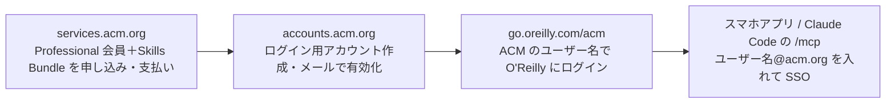

# O'Reilly 学習プラットフォーム（ACM 経由の契約と MCP）

> **TL;DR**: O'Reilly の技術書・動画の読み放題は直契約だと年 $499 だが、計算機科学の国際学会 ACM の Professional 会員に Skills Bundle を足す経路なら年 $174（初年度 $150）で、本・動画・O'Reilly 公式 MCP サーバーまで使える。年に1〜2冊しか本を買わない SonicMoov の Zenn 記事の筆者は、冊数では元が取れなくても「買うほどではない本をつまみ読みできる」価値で ACM 経由を選んだ。

O'Reilly の本は技術書として信頼できるが分厚くて重く、1冊数千円するので気になっても買うまでに至らない本が多い、と筆者は書く。10日間の無料トライアル（クレジットカード不要）から始め、契約方法によって年額が3倍近く違うと知って、料金と使えるものの違い・元が取れるか・日本語の本がどのくらい読めるか・いちばん安い ACM 経由でも MCP が使えるか、の4点を調べた。契約方法を選ぶ条件に「MCP が使えるか」を入れたのは、O'Reilly が公式の MCP サーバーを出していて Claude などから蔵書を検索できるからだ、と筆者は述べる。@matsuu はこの記事を、「O'Reilly が公式の MCP サーバーを出している」「気になる本を気軽に読めることの費用対効果は思っていたより大きい」の2点を引いて紹介した。

## 契約方法と料金（記事からの転記）

個人で使う場合の選択肢は「O'Reilly と直接契約する」か「ACM 経由で使う」かの2つだ、と筆者は整理する。

| 方法 | 料金 | 備考 |
| --- | --- | --- |
| 無料トライアル | 0円 | 10日間。クレジットカード不要 |
| 直契約（月額） | $49/月 | |
| 直契約（3か月） | $129 | |
| 直契約（年額） | $499/年 | |
| 直契約（セール） | $299 前後/年？ | ブラックフライデー〜サイバーマンデー（11月末）ごろ。Web 上の情報による |
| ACM 経由 | $150（初年度）／$174（2年目以降） | ACM Professional 会員 + Skills Bundle（$75/年） |

筆者は 2026年10月中旬のレート（1ドル158円）で、直契約の年額を約78,800円、セールを約47,200円、ACM 経由の2年目以降を約27,500円、初年度を約23,700円と換算している（カード会社の為替手数料や税金は含まない）。3か月プランは以前の調査時にはなかったように思う、セール価格は公式の告知ではなく「例年このくらい」という Web 上の情報で今年も同じとは限らない、と筆者は注記する。

## ACM 経由とは

ACM（Association for Computing Machinery）は計算機科学の国際学会で、Professional 会員になって有料オプションの Skills Bundle を追加すると、会員特典として O'Reilly のプラットフォームが使える。Skills Bundle には Skillsoft Percipio（Codecademy を含む）のコンテンツも入る。ACM の紹介ページには Pluralsight も書かれているが、2026年10月の申し込み画面の説明には無く、契約後に ACM Learning Center から開こうとしても Not Found になったので、Pluralsight 目当ての申し込みはやめた方がよい、と筆者は書く。

| | 初年度 | 2年目以降 |
| --- | --- | --- |
| Professional 会員費 | $75（25%オフ） | $99 |
| Skills Bundle | $75 | $75 |
| 合計 | $150 | $174 |

初年度の25%オフは通常の申し込みページからではなく、キャンペーン用の URL（ACM のトップページからはたどれない）から申し込む必要がある。情報処理学会（IPSJ）の会員なら ACM の会費が $79 になる割引もある（IEEE Computer Society の会員なら $89）。割引は1つしか使えないので初年度は25%オフの方が安いが、2年目以降は年 $154 で済む、と筆者は補足する。

## 元は取れるか

筆者は O'Reilly の技術書を1冊4,000円として「年に何冊読めば買うより安くなるか」を計算する。直契約（$499、約78,800円）は年20冊、セール（$299、約47,200円）は年12冊、ACM 経由（$174、約27,500円）は年7冊である。月に1〜2冊読むなら直契約の通常価格でも元が取れるが、年に数冊なら ACM 経由でないと割高になる。筆者自身はここ数年、平均すると年に1〜2冊しか買っておらず、冊数だけで見ればいちばん安い ACM 経由でも元は取れない。

それでもサブスクに惹かれるのは、買うほどではない本もつまみ読みできるからだ、と筆者は言う。「気になるけど全部は読まないかも」という本には手が出ず、買う本を年1〜2冊に絞っていたのもそのせいで、サブスクなら必要な章だけ読む、目次を見て合わなければやめる、という読み方が気軽にできる。冊数で元を取るより、これまで手を出さなかった本に触れられる方に価値を感じている、と筆者は結論づける。

## 使えるものの違い（記事からの転記）

安いぶん ACM 経由では使えないものがある。筆者は ACM の FAQ に書かれた対象外のものと直契約の個人プランを並べている。

| | 直契約（個人） | ACM 経由 |
| --- | --- | --- |
| 書籍・動画・コース | ○ | ○ |
| スマホアプリ・オフライン閲覧 | ○ | ○ |
| ライブイベント | ○ | × |
| 資格対策（模擬試験など） | ○ | × |
| Superstream の録画 | ○ | × |
| インタラクティブラボ・サンドボックス | ○ | ×（FAQ 上は）※ |
| クラウドラボ | × | × |
| Skillsoft Percipio（Codecademy 含む） | × | ○ |
| Search MCP | ○ | ○（2026年4月から） |

※ ACM の FAQ では対象外だが、筆者が契約後に試すと AWS Sandbox が起動できた。

ラボと呼ばれるものは3種類あり、どれもブラウザを開くだけで使えて環境構築はいらない、と筆者は書く。**ラボ**は Kubernetes・Docker・Python などをブラウザ上の開発環境で手順どおりに動かすもの、**サンドボックス**は Python・Ubuntu・Kubernetes・Java・SQL などの設定済み環境で自由にコードを試すもの、**クラウドラボ**はガイドに沿ってクラウド上で実践的なシナリオを進めるものである。クラウドラボは直契約でも個人プランには入らず Team プラン以上になる。

ACM 経由のラボについては FAQ と実態が食い違っていた、と筆者は書く。ACM の FAQ ではラボとサンドボックスは対象外だが、申し込み画面の Skills Bundle の説明には「interactive sandboxes, practice labs」とあり、契約後に ACM 経由のアカウントで O'Reilly の AWS Sandbox を開くと起動できた。起動するとブラウザ内にターミナルが開き、数十秒で一時的な AWS の認証情報（ユーザー名・パスワード・アクセスキー・アカウント ID）が発行され、AWS CLI が設定済みのターミナルとマネジメントコンソールの両方が使える。使えるのは1時間で、認証情報は切れ、作ったリソースも自動で消える。権限のないサービスや操作は画面に表示される、と筆者は述べる。FAQ と食い違っているので今後使えなくなる可能性はある、とも筆者は注記する。

ログイン方法も違う。ACM 経由では ACM の Web アカウントで SSO して O'Reilly に入る。どちらも個人プランなので、チームでアカウントを共有するのは規約違反だ、と筆者は書く。

## ACM 経由でも MCP は使えるか

ACM は2026年4月に「Skills Bundle でも O'Reilly の MCP サーバーが使えるようになった」と発表しており、5月のフューチャー技術ブログの記事でも ACM 経由の契約で MCP に接続できていた、と筆者は書く。ただしその記事は MCP 用のトークンを発行して接続しており、O'Reilly の公式ガイドが今推奨するのはブラウザでログインするだけの OAuth 認証である。ACM 経由は ACM の SSO でログインするため、OAuth が同じように通るかは契約前には分からなかった。

契約後に筆者がトークンと OAuth の両方を試した結果は次のとおり。

- **トークン**: ACM 経由のアカウントでも O'Reilly の MCP Tokens ページでトークンを発行でき、Claude から検索できた
- **OAuth**: Claude Code の `/mcp` から認証すると O'Reilly のサインイン画面が開く。メールアドレス欄に `<ACM のユーザー名>@acm.org` を入れると ACM の SSO 画面に切り替わり、ACM のアカウントでログインすると接続できた。検索も問題なく使えた

ACM 経由でも、トークンを発行せずブラウザでログインするだけでつながる。スマホアプリと同じで `@acm.org` のアドレスを入れるのがポイントだ、と筆者は書く。

## 日本語の本はどのくらい読めるか

O'Reilly は洋書のイメージが強いが邦訳書もある程度入っている、と筆者は書く。トライアル中に書名で検索して見つかったのは『リーダブルコード』『ソフトウェアアーキテクチャの基礎』『Effective TypeScript 第2版』『AI エンジニアリング』『PHP クックブック』の5冊で、どれも新しい版だった。原題で検索して邦訳書が出てくるものもあり、邦題が原題と離れている本でも検索結果に出てきた。O'Reilly の検索は英語のコンテンツが優先されるので、`Settings → Language Preferences` で日本語を追加してから探すのがおすすめだ、と筆者は述べる。

## 申し込み手順と注意点

申し込みから O'Reilly にログインするまでに使うサイトは3つで、筆者は約10分で終わったと書く。

| 順番 | サイト | やること |
| --- | --- | --- |
| 1 | services.acm.org | 会員と Skills Bundle を申し込んで支払う |
| 2 | accounts.acm.org | ログイン用のアカウントを作り、メールで有効にする |
| 3 | go.oreilly.com/acm | ACM のアカウントで O'Reilly にログインする |

筆者が挙げる注意点は次のとおり。

- 申し込み時に「ACM Skills Bundle Add-On」のチェックを忘れると O'Reilly は使えない
- 「Automatic Renewal Program」は任意で、筆者は1年使ってから決めたいので外した。あとから myACM の「My Wallet」で自動更新に申し込んだり外したりできる。解約は Member Services に連絡する形
- パスワードに使えるのは英字・数字・`-` `_` `.` だけで6〜26文字。貼り付けた場合、26文字を超えた分は切り捨てられるので、パスワード管理ツールで長いものを作ると気づかずログインできなくなる
- ユーザー名は自動で発行され、O'Reilly へのログインにはメールアドレスではなくこのユーザー名を使う
- スマホアプリ（iOS / Android）は、メールアドレス欄に `<ACM のユーザー名>@acm.org` を入れ、「I'm with: ACM」と出たら「Sign in with SSO」を押す。ふだんのメールアドレスでは ACM 経由のアカウントにつながらない
- トライアル中に作ったプレイリストやハイライトは、ACM 経由が別アカウントになるため引き継げないつもりでいた方が安心
- 2年目からは初年度の割引が切れて $174 になる

筆者は 2026年10月13日に申し込み、初年度は $150 だった。1年使って続けるかどうかは1年後にあらためて書くつもりだ、と筆者は書く。

## 観察ログ（未検証）

- 2026-10-19: ブラックフライデー頃のセールで直契約が $299 前後になるという情報は Web 上の記述で、筆者も公式の告知ではないと注記している。11月末に実際の価格を確かめる
- 2026-10-19: ACM 経由のアカウントで AWS Sandbox（1時間の一時 AWS 環境）が起動できたのは ACM の FAQ と食い違う。筆者は今後使えなくなる可能性を指摘しており、1年後の継続判断も書く予定

## 問い

- 自分の年間の技術書購入冊数と「気になって買わなかった本」の数を数えると、年7冊の損益分岐をどちら側に越えるか
- O'Reilly の MCP サーバーを Claude Code につなぐと、この wiki の ingest で技術書の該当章を根拠として引けるようになるか。検索 MCP が返すのは全文か抜粋かを確かめる
- ACM 経由で読める邦訳書の範囲は、オライリー・ジャパンの刊行物のどこまでか。書名検索でなく出版社や言語で絞り込めるか

## 関連

- [[tools/claude-mcp]] — MCP の仕様と Claude 側の展開。O'Reilly 公式 MCP サーバーへの OAuth 接続は Claude Code の `/mcp` から行う
- [[concepts/feynman-technique-ai-era]] — @iwashi86 が O'Reilly 学習プラットフォームで英語技術書の先行リリースを読み AI で噛み砕く勉強法を挙げる。本ページはその契約経路と費用の側
- [[tools/book-to-skill]] — 手元の PDF/EPUB をスキル化するツール。読み放題のサブスクはファイルを手元に持たないため、同じ本を Claude から引く手段は MCP 検索になると考えられる
