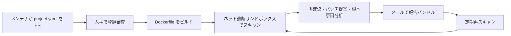

# OSS Scanner

> **TL;DR**: [[companies/anthropic]] が、重要なオープンソースプロジェクトに最強モデルによる脆弱性スキャンの結果（概念実証コードと、可能なら修正パッチつき）を無料・定期で送るオプトイン型サービス。登録はリポジトリへ設定ファイルを PR するだけで、報告は人手レビューを経ないため誤検知を含みうる。

Anthropic は以前からオープンソースを定期的にスキャンし、人手レビューを通した報告を協調的脆弱性開示（CVD）の手順で送っていた。Anthropic によれば 2026 年 10 月までにそうした報告を 6,000 件以上レビューしており、誤検知でメンテナを圧倒せずに済む反面、人手の工程に時間がかかり共有が遅れることがある。OSS Scanner はこの人手レビューを省く「速い経路」として設計されており、[[models/claude-mythos]] を一般公開する代わりに始めた Project Glasswing で Claude に脆弱性を探させた経験が土台だと Anthropic は説明する。Anthropic の Frontier Red Team と Safeguards Research チームの共同プロジェクトで、2026-10-19 に @ClaudeDevs が公開を告知した。

## 対象プロジェクト

Anthropic は受け入れ基準を OSS-Fuzz（Google のファジング基盤）と同様としており、OSS-Fuzz の基準文から「インフラとユーザーのセキュリティに重大な影響を持つ確立したプロジェクト」で、(1) 信頼できない入力を処理するライブラリなど遠隔攻撃への露出、(2) 依存するユーザー・プロジェクトの数を見る、という部分を引いている。総合判断の材料として Anthropic が挙げるのは、プロジェクトの年齢と更新頻度、OpenSSF の criticality score、広く認められたオープンソースライセンスの使用、スター／フォーク数、利用統計、どの分野でどれほどセキュリティ上重要か、申請項目の記入の完全さである。重要性が自明でなければ、なぜ重要かを一文添えることを勧めている。

よくある除外として、できたばかりのプロジェクトと、元と明確に異なるわけではないフォークを挙げる。Anthropic は「対象なら登録の不利益はほぼ無い」としつつ、このサービスは検証済みの high／critical 報告をすでに捌けている体制のプロジェクト向けだと断っている。

## 登録方法と project.yaml

コアメンテナが GitHub の anthropics/oss-scanner リポジトリに PR を出し、`projects/<project>/project.yaml` を追加する。テンプレートが用意されている。項目は次のとおり（FAQ の列挙を転記）。

| 項目 | 必須 | 内容 |
|---|---|---|
| `repo` | 必須 | クローンする git リポジトリの URL（`#branch` 指定可。GitHub 以外でもよい） |
| `primary_contact` | 必須 | 主担当のメールアドレス（すべての連絡と報告の宛先） |
| `Dockerfile` | 必須 | 環境構築・依存の事前導入・ビルドを行う Dockerfile のリポジトリ内パス。`project.yaml` の隣に `Dockerfile` を置く場合はこの項目を省く |
| `auto_ccs` | 任意 | 全報告を CC する追加アドレス |
| `homepage` | 任意 | プロジェクトのホームページ（重要度の理解に使う） |
| `threat_model` | 任意 | 脅威モデルファイルのリポジトリ内パス（既定 `.oss-scanner/threat_model.md`）。`project.yaml` の隣に置いてもよい |
| `pgp` | 任意 | 報告メールの暗号化に使う GPG 公開鍵 |
| `disabled` | 任意 | `true` で報告を一時停止（後で再開可） |

Dockerfile のビルドだけはネットワークありで行い、それ以降はすべてネット遮断で動くため、依存をすべて先に入れておく必要がある。Anthropic はビルドしたコンテナ内でテストが通ることの確認を勧め、PR 前に `tools/validate.py` で設定を検証できる。受理後は Anthropic 側のインフラでビルドし、失敗すればメールで知らせる。GPG 鍵を指定すると CC は使えず、主担当アドレスだけに送られる。登録には Anthropic の利用規約への同意が要る。

## 脅威モデルファイル

形式も必須の節もない自由記述で、エージェントに知らせたいプロジェクト固有の事情を書く。Anthropic が例示する内容は、テスト対象のコードと敵対的とみなす入力と対象外の範囲、critical／high／medium／low の重大度基準、報告の書式と候補パッチの粒度（脆弱性を示す最小限か、マージ可能な完成度か）と有用な概念実証の種類、重複判定の粒度である。ファイルが無くてもスキャナは動くが、境界事例の扱いは推測になる。リポジトリ側に置けばスキャンの合間に書き換えて報告形式を変えられる。人間の監査人に渡す依頼書と同じ構成（範囲・判定基準・納品形式・重複の扱い）をエージェント向けに書く仕組みと読める（推論）。

## 受け取るもの・公開ポリシー

初回登録後にスキャンし、パイプライン内の別エージェントがバグの再確認・パッチ提案・根本原因分析を行ったうえで、報告の束をメールで送る。以後は定期的に再スキャンし、前回以降に入った新しい脆弱性と、以前見落とした脆弱性を探す。頻度はパイプライン上のプロジェクト数や利用の広さなどで変わると Anthropic は述べる。報告媒体は当面メールだが変える可能性がある。

公開ポリシーは、未検証の所見には 90 日の協調開示期間を課さない。誤検知を含みうる報告を、Anthropic 自身が精読していない段階でメンテナに精読を強いるのは不公平だという理由である。後に既存の CVD で人手検証した場合は、検証済みと通知した日から 90 日を起点に CVD ポリシーで開示することがある。将来、スキャナの性能に確信が持てれば高重大度の一部に開示期限を設ける可能性があるが、その際は事前に知らせ、オプトアウトできるようにするとしている。

停止は `disabled: true` の PR、離脱はプロジェクトのディレクトリを削除する PR で行い、離脱後は通常の CVD の報告だけに戻る。所見への意見はメールに返信すればよく、未登録者の質問窓口 oss-scanner-questions@anthropic.com は人間が見ている。修正したときはコミットメッセージなどに `ANT-2026-ABCD1234` の形式の報告 ID を一行添えてほしいと Anthropic は頼んでおり、どの発見が正しく修正まで至ったかを追う手がかりにする。

## 報告先と範囲の保証・データの扱い

登録申請は毎回人間が審査し、申請者が GitHub アカウントかメールでコアメンテナだと確認し、送付先が SECURITY.md などに載る正規のセキュリティ連絡先かを検証する。送付前にも再確認し、資格を失ったメンテナには送らない。Dockerfile が意図したリポジトリだけを対象にしているかを登録時に手動で確認し、Dockerfile が変わるたびに次回実行前に差分を審査する。送付前にはハーネスが、各報告が依存ライブラリではなく対象プロジェクト自体の脆弱性に対応することを自動検証する。

報告は Anthropic のセキュリティ担当者だけが入れる隔離されたクラウド環境に保管し、スキャン用エージェントは強化したサンドボックス内でインターネットを完全に切ってから動かすと説明している。

## Claude Security との違いと周辺プログラム

Anthropic は商用製品 Claude Security を「企業が自社コードの脆弱性を見つけて直すために Claude Mythos を開発ライフサイクルに組み込むもの」と位置づけ、OSS Scanner はそれと別に、すべてのソフトウェアの土台であるオープンソースのメンテナに防御側の優位を広げる目的だとする。違いとして、複数のハーネスと手法に加えトークンを多く使う実験的なハーネスまで投入して深いバグを探すこと、費用を全額 Anthropic が持つことを挙げる。

あわせて案内されるメンテナ支援が二つある。Claude for OSS は修正作業のために Claude Max 20x を無料で提供するプログラムで、Cyber Verification Program は審査を通ったセキュリティ専門家に高度なサイバー能力と緩めた遮断分類器を開放する（[[models/claude-opus-4-7]] の発表時に設置）。Glasswing 初期に発見が万単位に達し、ボトルネックが発見から修正へ移ったという [[concepts/recursive-self-improvement]] の記述と並べると、パッチ提案と修正用サブスクリプションをセットにした今回の設計は「修正側」を埋める意図と考えられる（推論）。

告知が指す Anthropic の launch post（anthropic.com/research 配下）は本 vault では未収集で、本ページは red.anthropic.com の FAQ ページと @ClaudeDevs の告知のみに基づく。FAQ の変更履歴には、公開後に対象基準の説明と「報告がメンテナ本人にだけ届く仕組み」の説明を追加したとある（日付は取得時に欠落）。

## 問い

- 自分が依存・貢献する OSS のうち、外部入力を処理し OpenSSF criticality score が高いものはどれか。登録を勧める前に、そのプロジェクトが検証済み high／critical を捌けている体制かを見る
- 人手レビューなし報告の誤検知率を Anthropic が公表するか。報告 ID `ANT-` の付いたコミットの数が外から追える指標になる
- threat_model.md の構成（範囲・重大度基準・出力形式・重複判定）を、自分のエージェント運用の依頼書テンプレートに流用できるか

## 関連

- [[companies/anthropic]] — 提供元。Frontier Red Team と Safeguards Research の共同
- [[models/claude-mythos]] — 一般公開見送りの代わりに始めた Project Glasswing が本サービスの土台
- [[models/claude-opus-4-7]] — Cyber Verification Program の設置を発表したモデル。OSS Scanner と並ぶメンテナ支援として案内される
- [[concepts/recursive-self-improvement]] — Glasswing で発見が万単位に達しボトルネックが修正側へ移ったとする記述
- [[concepts/cto-ciso-vuln-surge-playbook]] — 受け手側の見立て。米内貴志（GMO Flatt Security 取締役 Co-CTO）は AI で脆弱性発掘が加速するこれからは組織の対応容量が律速になるとして、新機能開発を落としセキュリティに時間・金・トークンを配分せよと CTO/CISO に勧める
