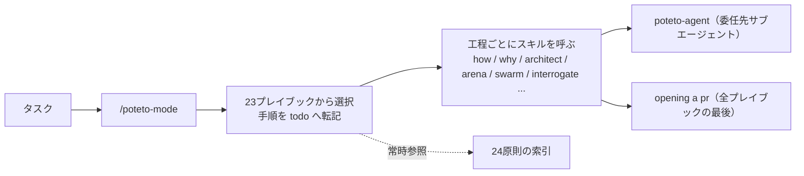

# pstack

> **TL;DR**: @poteto が Cursor で日々使っているスキル群をプラグインにしたもの。入口の `/poteto-mode` がタスクを23のプレイブックに振り分け、工程ごとにスキルを呼び、24の原則の索引を常時参照する。狙いは「少なく、高品質に書く」ことと、検証できるコードを前提にした並列化で、計画スキルは意図的に持たない。cursor/plugins リポジトリで公開され、Claude Code からも同じプラグインを導入できる。



作者の @poteto は README で、自分は「大統領でも CEO でもないが」Meta・Netflix・Cursor で数百万行のコードに関わり、React コアチームで React Compiler を作っていると名乗る。「AI がスロップ（粗悪な）コードを書きすぎる」という感覚には同意したうえで、「20人のスロップ職人のチームのように出荷したくはない。品質なしのスループットは目標ではない。速く行きたいなら、まず深く行け」と書き、pstack をその答えと位置づける。目標はコード行数の最大化の逆で、**より少なく、より高品質なコードを書くこと**だという。並列化については「1体のエージェントに深く取り組ませ、良い・検証できるコードを書くと信頼できるなら、自信を持って本当に並列化できる」として、複数のエージェントを `poteto-mode` で起動する使い方を勧める。モデルは1つに固定せず、多くのスキルが各モデルの強みを使い分ける多モデルのワークフローになっている。

## 導入（Cursor と Claude Code）

Cursor では `/add-plugin pstack` で入る。Claude Code では次の2行で入る（README からの転記）。

```
/plugin marketplace add cursor/plugins
/plugin install pstack@cursor-plugins
```

Claude Code はプラグインのコマンドとエージェントに接頭辞を付けるため、`/poteto-mode` は `/pstack:poteto-mode` になる。他の Cursor 側の名前は claude code adapter（docs/harness/claude-code.md）が対応づける。Claude Code がインストールするのはリポジトリ直下の harness/pstack/ にある生成済みのコピーで、skills/・agents/・adapter 文書・plugin.json を変えたら `node scripts/generate-pstack-harness-trees.mjs` を実行してコミットしないと CI が落ちる、と README は書く。

@cu30rry_ は「pstack 本家が Claude Code でも使えるようになった」と、この install 節のスクリーンショットを添えて投稿した（2,843 ブックマーク、2026-10-17 時点）。投稿本文は感想のみで、内容は README に依る。

## 使い方の骨格

README が示す手順は2つで、`/setup-pstack` で推論予算（reasoning budget）と使うモデルを選び、厳密さが要る作業のたびに `/poteto-mode` を使う。初めてなら pstack guide（docs/guide/README.md）が最初の実タスクをセットアップ・プロンプト・検証・夜間実行まで案内し、どのスキルが合うか迷えば `/poteto-help` に聞く。

既定のモデル分担は「コードの委任（feature・refactoring・bug fix・perf・hillclimb）は grok、最も難しい変更・散文・判断は opus 5.5」で、既定のレビューパネルは opus 5.5 / grok。`/setup-pstack` でどれも変えられる。

`/poteto-mode` は呼ばれると、タスクをプレイブックに照合してその手順をそのまま最初の項目にした todo リストを開き、手順が進むたびに他のスキルへ振り分け、「消費者と保守者の両方に向けた、スロップを除いた返答」を書く。ターンをまたいで有効にしたいときは `/` メニューから選んで option+enter（Mac）または alt+enter（Windows）で送るとカスタムモードになり、毎ターン文脈に残る。Cursor の `/loop` コマンドと組み合わせると、厳密さを犠牲にせず何時間も働かせられると README は書く。

## 23のプレイブック（README からの転記）

| プレイブック | 用途 |
|---|---|
| investigation | 読み取り専用の問い。x はどう動くか・なぜ y はこう作られたか・本当にそうか |
| bug fix | 欠陥を再現し、根本原因を突き止め、実行時の証拠つきで直す |
| perf | 計測された遅さを追跡し、ベースラインに対して改善する |
| hillclimb | 1つの指標を目標に向けて科学的に改善し続ける。仮説と前後計測を回し、採用した勝ちごとに1コミット |
| runtime forensics | 生きた症状（リーク・アイドル時の CPU 空回り・グリッチ）を計装から診断する |
| trace forensics | 取得済みのプロファイル成果物（cpuprofile・trace・spindump・ヒープスナップショット）を診断する |
| feature | 名前のついたデータ形から組み立てる、新しい振る舞い・変更された振る舞い |
| refactoring | 振る舞いを保つ構造や形の変更 |
| prototype | 設計や振る舞いの判断を安く下す、または経験的な分岐を観察して決めるための使い捨てスケッチ |
| visual parity | 2つの実装のピクセル一致の UI 等価性 |
| authoring a skill | SKILL.md の執筆・編集 |
| eval | スキルやプロンプトの変更がエージェントの振る舞いに与える影響を盲検で試す |
| babysit | PR やスタックをマージ可能まで運ぶ。コンフリクト・レビュースレッド・CI |
| shipping | 緑のスタックを独立に検証し、検証済みの連続した区間を下から順に着地させる（既定は GitHub 経由、可能なら origin） |
| autonomous run | 長いタスクを止まらずに完了まで運ぶ |
| orchestrate | 1つのコーディネーターチャットに任せる常設プロジェクト。複数日・多数のスタック PR・サブエージェントの艦隊 |
| autopilot-full | 独立した PR を PR ごとに1オーナーでマージまで運び、各ラウンドでルートの swarm が評決する |
| autopilot-stack | オペレーターがレビューして着地させるための、1本の線形なベースブランチのスタックを組んで検証する |
| session pickup | 前のエージェントの進行中の作業を再開・引き継ぐ |
| pause safely | 進行中の作業を後で再開できるようきれいに中断する |
| multi-phase plan | フェーズやスタック PR にまたがる作業 |
| worktree cleanup | マージ済み・放棄済みの worktree と古い iOS シミュレータを安全ゲートつきで刈り、ディスクを取り戻す |
| opening a pr | 小さな順序つきコミットから、conventional commits のタイトルとブリーフィング形式の本文で PR を開く。他の全プレイブックの最後に呼ばれる |

## スキル（README の一覧からの転記）

`/poteto-mode` が工程に応じて自動で呼ぶものが多いが、直接呼ぶこともできる。

| スキル | 使いどころ |
|---|---|
| `/poteto-mode` | 非自明なタスクの既定の入口 |
| `/poteto-help` | pstack が初めて、またはどのスキル・プレイブック・原則が合うか分からないとき。打つべきプロンプトを渡す。手で打ったときだけ動く |
| `/in-your-own-words` | 始める前にゴールと問題をエージェントに言い直させたいとき。手で打ったときだけ動く |
| `/sharpen` | 一流の専門家のやり方で、本当に欲しいものに照準を合わせつつ、過剰指定も選択の代行もせずに取り組ませたいとき |
| `/how` | サブシステムの動きの解説が欲しいとき |
| `/why` | なぜそう作られたかを知りたいとき。実行時に利用可能な MCP を見つけ、ソース管理・イシュートラッカー・長文ドキュメント・チャット・インフラ観測・エラー追跡・分析ウェアハウスを並列に照会する |
| `/recall` | 作業の開始・再開時に、あるトピックの最近の文脈を自分のチャット履歴と共有記録から再構築し、現状ブリーフとして受け取る |
| `/ketchup` | このチャットで自分の最後の発言以降に何が変わったかを、平易な数文と小さな図で受け取る |
| `/blast-radius` | 小さく見える変更が他に何を壊しうるかを知りたいとき。「安全な理由となる1つの事実」をコードの実行で証明する |
| `/architect` | 関数境界をまたぐコードを書く前に、呼び出し元の使い方・型・モジュールの形を先に決めたいとき |
| `/arena` | 同じことへの N 並列の試みを走らせ、各案の良い部分を取りたいとき |
| `/swarm` | 異なるスライスやレースに N 並列のワーカーを走らせ、1つの集約レポートが欲しいとき |
| `/interrogate` | 差分を複数のモデルに壊させたいとき。厳格なコード品質の観点を含む |
| `/automate-me` | 実際の働き方から下書きした自分用の `-mode` スキルが欲しいとき |
| `/make-bot-ui` | ボタンが webhook で Grok Bot を起こすページやダッシュボードが欲しいとき。送信キーの受け渡しと Tailscale を含む |
| `/setup-pstack` | 役割ごとに pstack が使うモデルを選びたいとき。利用可能なモデルを検出し設定ルールを書く |
| `/reflect` | 長いタスクが着地し、そのレシピをスキル編集として残したいとき |
| `/correct` | 同じ誤りでエージェントを何度も訂正しているとき。履歴から誤りの類型を掘り、効く最上位の層（アーキテクチャ、次に型・lint・CI、次にテスト、最後に文書）で直し、各規則と強制手段の対応表を保つ |
| `/teach` | 変更やサブシステムを要約でなく本当に理解したいとき。how と why を回し、図を1枚ずつ積み上げた1つの平易な説明に織る |
| `/tdd` | バグ修正で安いローカルテスト経路があるとき。落ちるテストを先に書き、次に修正する |
| `/benchmark-checklist` | ベンチマークや高速化・退行を計測したとき。報告や行動の前に、制限要因・チューニング・エラー・反復実行・エンドツーエンドでの意味を精査する |
| `/no-comments` | レビュー前にコメントを剥がす。Comment Sicko を起こし、受け入れた指摘を直し、主張された制約の符号化を提案する |
| `/typescript-best-practices` | TypeScript を読む・編集するとき。型システム規律の原則を構文に落とす |
| `/figure-it-out` | 同梱プレイブックが合わないとき。タスクに合わせた厳密で監査可能なプレイブックを設計する |
| `/show-me-your-work` | レビューできる判断の記録が欲しいとき。判断をコミットできる TSV に記録する |
| `/create-verification-skill` | アプリの振る舞いを証明するスクリプト化された手段がプロジェクトにないとき。機能マップつきのプロジェクト固有の verify スキルを、言語・プラットフォームを問わず生成する |
| `/maintain-verification-skill` | verify スキルの機能マップがアプリからずれたとき。ソースの確認と1回の実走で、証明済みの訂正を最大1 PR にまとめる |
| `/unslop` | 文章を整えるとき。AI の癖（AI tells）を取り除く |
| `/bro` | 直前のメッセージを専門用語なしの平易な言葉で言い直す |
| `/technical-writing` | ドキュメント・RFC・README・PR 説明・コミットメッセージのための層構造の文書標準（Diátaxis、Google developer style、STE、Global English） |

## 24の原則（README からの転記）

1原則1スキルの短いファイル群で、`poteto-mode` はその索引をインラインに持ち、タスク開始時に読む。独立ファイルがあるのは、他のスキルが原則を名前で参照し、索引から各原則の全文へ辿れるようにするためだと README は書く。

| 原則 | 群 | 規則 |
|---|---|---|
| laziness-protocol | core | 削除と、問題を解く最小の変更へ寄せる |
| foundational-thinking | core | ロジックを書く前に、中核の型とデータ構造の選択・足場と機能の順序づけ・並行する主体が何を共有するかを問う。データ構造を正しくすれば下流のコードは自明になる |
| redesign-from-first-principles | core | 要件を後付けせず、初日からの前提だったかのように再設計する |
| attack-the-premise | core | 同じ前提を共有する2つ以上の修正が同じ関門で落ちたら、前提を書き出し、それを前提にした次の修正を書く前に直接検証する |
| subtract-before-you-add | core | 死んだ重み・冗長なバリデータ・スタブ参照を先に除き、単純になった土台の上に作る |
| minimize-reader-load | core | 問いと答えの間の層数と、読み手の頭の中の隠れた状態を数える。呼び出し元が1つのラッパーは潰し、可変スコープを縮める |
| outcome-oriented-execution | core | 明示的なフェーズ境界を持つ書き換え・移行では、目標アーキテクチャへ収束させ、使い捨ての互換コードで滑らかな中間状態を保たない |
| experience-first | core | 実装の都合よりユーザーの喜びを選ぶ。粗い機能を多くより、磨かれた機能を少なく出す |
| exhaust-the-design-space | core | コミットする前に、競合する2〜3のプロトタイプを作って並べて比べる |
| build-the-lever | core | 一括作業に限らず、編集・移行・分析・検査などあらゆる非自明な作業で、手作業でなくそれを実行または証明する道具（codemod・スクリプト・生成器・サブエージェントが従うスキル）を作る。道具はレビュアーが再実行できる成果物になる |
| model-the-domain | architecture | 散在する条件分岐でなく、構造にドメインを符号化する |
| boundary-discipline | architecture | ガードはシステム境界（CLI・設定・ネットワーク・外部 API）に集中させ、内部の型は信頼し、ビジネスロジックは純粋関数に保つ |
| type-system-discipline | architecture | 不正な状態を表現不能にし、意味を持つプリミティブにブランドを付け、外部データは境界でパースし、バリアントを網羅し、権威あるスキーマから導出する |
| make-operations-idempotent | architecture | 部分的な前回実行があっても、同じ終状態に収束させる |
| migrate-callers-then-delete-legacy-apis | architecture | 互換層を残さず、呼び出し元の移行と旧 API の削除を同じ波で行う |
| separate-before-serializing-shared-state | architecture | まず共有をなくす。単一の書き手が本当の不変条件であるときだけ、構造的に直列化する |
| prove-it-works | verification | 完了宣言の前に、代理・自己申告・「コンパイルは通る」でなく、実物（機能を動かす・実際の値を読む・差分を見る）で検証する |
| fix-root-causes | verification | 各症状をシステムが最初に狂った場所まで遡ってそこで直す。ガードが修正になるのは、扱う状態が正当なときだけ |
| sequence-verifiable-units | verification | 複数ステップの作業とコミット・PR の積み方では、各単位が検証可能な状態で終わるよう分け、次へ進む前に確かめ、順序自体がレビュアーへの証明になるよう届ける |
| test-behavior-not-implementation | verification | コードの利用者が観測できることを表明し、振る舞いが壊れたら落ち、内部だけ変わっても通り続けるテストにする |
| explain-the-number | verification | 計測した数値（高速化・退行・スループット・レイテンシ・eval 結果）を信じる・報告する・行動する前に、何が制限しているかを見つけ、意図した作業以外を測っていた可能性を除く |
| guard-the-context-window | delegation | 大量処理はサブエージェントへ回し、メインスレッドには生データでなく要約を置く |
| never-block-on-the-human | delegation | 進めて結果を示し、人間には事後に軌道修正させる。確認は不可逆な操作に限る |
| encode-lessons-in-structure | meta | 規則は文章を増やすのでなく、lint・メタデータフラグ・実行時チェック・スクリプトとして符号化する |

## サブエージェント

`/poteto-mode` はそれを受け取ったチャットの中で動き、そのチャットがプレイブック・todo リスト・すべてのサブエージェント起動を所有する。委任先には `subagent_type: "poteto-agent"` を使う。poteto-agent は作業前に `poteto-mode` を原則の索引まで含めて全文読むので、汎用の generalPurpose で代用するとその読み込みが抜けて逸れる、と README は書く。ただしプレイブック自体を poteto-agent に走らせてはいけない。もう1つの Comment Sicko は読み取り専用のコメントレビュアーで、通常は `/no-comments` 経由で呼ぶ。

## 計画スキルがない理由と、自分用に作り替える方法

README は「Cursor にはすでに優れたプランモードがあり pstack と相性がよい。しかし個人的には計画を信じていない。**最良の仕様はコードだ**」と書き、計画が欲しければ `/poteto-mode` が扱うが既定ではないとする。

`poteto-mode` は @poteto 自身のスタイルなので、`/automate-me` を打つと最近のトランスクリプトを掘って自分の働き方から `<自分の名前>-mode` スキルを下書きし、その下で pstack に振り分ける。モデルも `/setup-pstack` が、使えるモデルを検出して各役割（コード・判断・レビューパネル）をモデルに対応づける常時適用のルールを書く。全スキルがそれを読み、ルールが無ければ既定値に落ちる。既定が変わった後も古いルールは古い既定を固定し続けるので、該当行かファイルを消して `/setup-pstack` をやり直す。

## 同梱されないもの

`/deslop` と `deslop` スキル、CLI・TUI 向けの `control-cli`、ブラウザ・Electron・Web 向けの `control-ui` は別プラグイン cursor-team-kit に入っている。`/create-skill` は Cursor 組み込みで、Cursor 組み込みの `/babysit` は `poteto-mode` の中では babysit プレイブックが優先する。ほかに、Slack のイシュー報告をトリアージし確認済みのバグを実 UI の証拠つきで再現・修正する benny automation pack が休止状態で同梱されるが、Cursor automations 上で動くため Cursor 専用である。

## 他ページとのつながり（wiki 側の推論）

- [[concepts/agent-trust-inverse-pyramid]] は同著者が投稿した「エージェントを信頼する4層」で、pstack の `/correct` の直す順序（アーキテクチャ→型・lint・CI→テスト→文書）と原則 encode-lessons-in-structure は、その配分をスキルに落としたものと読める
- [[tools/gstack]]（Garry Tan）も「エージェントをエンジニアリングチームに変える」スキル群だが、Think→Plan のレビュー工程を先頭に置く。pstack は計画スキルを持たず「最良の仕様はコード」と言う点で対照になる
- このvault が導入している [[tools/superpowers]] は brainstorming を先行させるブートストラップを持つ。pstack と同居させると、どちらの入口が先に効くかが問題になると考えられる
- `/make-bot-ui` が起こす Grok Bot は [[tools/grok-bot]] の対象で、@poteto のプロフィールも Grok Bot に携わると書く。「検証できるコードを前提にした並列化」は、同ページの大量 PR 運用と地続きの発想と考えられる
- `/in-your-own-words` は [[concepts/goal-restatement-prompt]] と同じ内容のスキル化である

## 問い

- Claude Code 側で動かすとき、Cursor 固有の前提（grok と opus 5.5 の既定分担・option+enter のカスタムモード・`/loop`）はどう置き換わるか。adapter 文書は未収集
- 「本家が Claude Code でも」の「本家」は、先に非公式の移植があったことを示唆するが、投稿本文からは確認できない
- 23のプレイブックのうち、このvault の運用（worktree＋PR＋クロスレビュー）に相当するのは babysit と shipping か。superpowers の finishing-a-development-branch と重複する部分はどれか

## 関連

- [[tools/cursor]] — pstack の母体となる IDE。`/add-plugin pstack` で導入
- [[tools/claude-code]] — cursor/plugins マーケットプレイス経由で同じプラグインを導入できる
- [[concepts/agent-trust-inverse-pyramid]] — 同著者の4層指針。pstack を入れて自分のコードを再設計させる手順を含む
- [[concepts/goal-restatement-prompt]] — `/in-your-own-words` の原型となる1文プロンプト
- [[tools/gstack]] — 計画工程を先頭に置く対照的なスキル群
- [[tools/superpowers]] — このvault が導入済みの方法論スキル群。入口の競合が問い
- [[tools/grok-bot]] — `/make-bot-ui` が起こす対象であり、作者の現在の仕事
- [[tools/claude-code-plugins]] — Anthropic 公式マーケットプレイスの一覧。pstack はサードパーティの cursor/plugins マーケットプレイスから入る
- [[tools/no-ai-slop]] — `/unslop` と同じ「AI の癖を除く」目的の別スキル
- [[tools/grok-bot-essential-bots]] — 同じ @cu30rry_ が選んだ Grok Bot 10 体。@poteto 作の dr eggbot（Bot を設計する Bot）と Engineering Lead が入る
