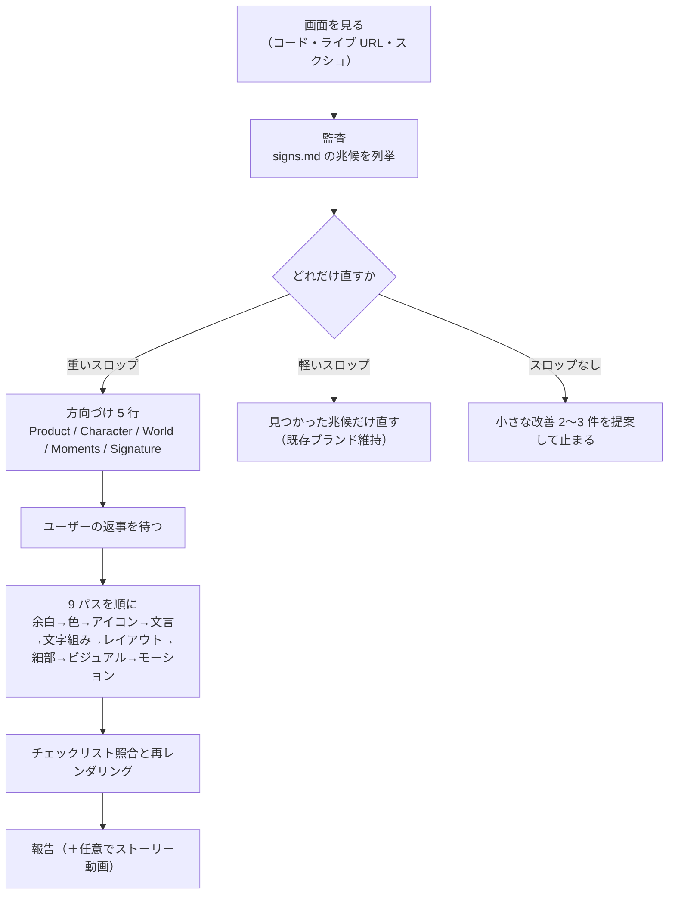

# unslop（AI っぽい UI を「設計された画面」に直す Claude Code／Codex スキル）

> **TL;DR**: デザイナーの Damir Sokolovsky（@heydamir）が、X で続けていた「バイブコーディングした画面の AI っぽさを一つずつ直す」連載を Claude Code／Codex 用スキルに落としたもの。兆候の監査→製品由来の方向づけ→余白・色・アイコン・文言・文字組み・レイアウト・細部・ビジュアル・モーションの 9 パスを順番に当て、整っている画面は「直さない」と言う（CC BY 4.0・2026-10-30 公開）。

Sokolovsky はスキル本文で、バイブコーディングした UI は「同じ予測可能な壊れ方をする」と述べる。あらゆる面が光り、あらゆるラベルに絵文字が付き、余白はモデルがその日に打った値のままで、文言は叫ぶ。unslop はこれを「クラフトを直し、プロダクトは保つ」作業と定義し、機能・内容・セクションの順序は変えず、すべてのサイズ・色・語・画像を意図されたものに置き換える。Sokolovsky によれば、スロップを取るのは仕事の半分で、きれいだがどの製品でもありうる画面は「次のテンプレート」にすぎない。毎回の実行は「この製品にしかありえない画面」で終わらなければならない、というのが設計思想である。

Sokolovsky はスロップとクラフトの差を「豊かさをどこに置くか」で説明する。スロップは色と効果をクローム（ナビ・背景・ボタン・枠線・ラベル）にまき散らし、クラフトはクロームを静かに保って豊かさを「人が覚えている 1〜2 の瞬間」に集中させる。レンダリングされたオブジェクト、美しいチャート、製品の世界から来た画像がその瞬間にあたる。

## 方向づけの 5 行

編集前に、流行ではなく「そのページが何をどんな人のためにしているか」から 5 行を書き、ユーザーに見せて返事を待つ。方向を後から変えると全部やり直しになるためである。

- **Product** 何をするか、誰のためか。平易な一文
- **Character** 具体語 2〜3 個。「clean・modern・sleek・minimal・premium」は全テンプレートに当てはまるので禁止
- **World** 製品が自然に属する場所や素材。ノートアプリは紙とインク、監視ツールは計器と夜勤、旅行アプリは地図と窓の光。これがニュートラルの色味・アクセント・ビジュアルを決める
- **Moments** 画面が濃い色・素材・ディテールを得る 1〜2 箇所。プレビュー内のカードやデバイス、系列ごとに色の意味があるチャートなど
- **Signature** この製品だけが持つ小さなディテール 1 つ。監視ツールのライブ状態ドット、開発者ツールのキーキャップ、配送アプリのルート線

ロゴ・色・書体といった本物のブランドがあれば維持して方向をその上に組むが、紫から青へのグラデーション・きらめき・発光はロゴに入っていてもスロップであり、ユーザーが言わない限りブランドに数えない、と Sokolovsky は書く。

## 9 パスの順序と理由

余白が最初なのは、リズムが正しくなると他の全部の読まれ方が変わるからで、文言が文字組みとレイアウトより前なのは、見出しの長さがサイズと置き場所を決めるからである。ビジュアルとモーションは、それらが無くても機能する画面に後から合わせるため最後に来る。パスごとの具体値は `references/tokens.md` に置かれ、たとえば余白パスは 4px グリッド、同じものは同じサイズ、グループ内の間隔はグループ間より小さく、ナビの行高 32〜36 で間隔 2〜4、`mt-[13px]` のような一回限りの値は除去、と定めている。色パスは「世界」に寄せた 1 本のニュートラルランプから背景・面・枠線・文字を取り、アプリとダッシュボードでは面を灰色に保ち、クロームのアクセントは主要操作・選択・重要な数字の 1 つにだけ使う。面のグラデーション・グラデーション文字・色付きの発光と影・ネオン枠線は除去し、枠線は文字色の 6〜10% 不透明度のヘアラインにする。

## 兆候リスト（signs.md）

監査は `references/signs.md` の全群を回り、兆候と修正を対にした行を列挙する。群は面と色・文字・アイコン・余白・文言・コンポーネント・ランディングページとヒーローの 7 つで、たとえば次が並ぶ。

| 群 | 兆候の例（→ 修正） |
|---|---|
| 面と色 | 紫から青へのグラデーション → ニュートラル 1 面。グラデーション文字 → 単色の主文字色。`shadow-[0_0_20px_rgba(139,92,246,0.5)]` のような発光 → 除去 |
| 文字 | 見出しのウェイト 800〜900 → 400〜500。`NAVIGATION` のような広い字間の大文字ラベル → 文頭だけ大文字 |
| アイコン | ナビの絵文字 🏠 📥 🚀 → 線画アイコン 1 セットか無し。AI を表す ✨ → 除去 |
| 文言 | `Welcome back, Damir! 👋` → ページ名か期間をタイトルに。`+12%!!` → `+12% vs last month`。supercharge・seamless・unlock・magic → 実際にすること |
| コンポーネント | `PRO`・`New ✨`・`Beta 🚀` バッジの乱用 → 除去か静かなテキストバッジ 1 つ。虹色や発光するチャートの棒 → 1〜2 系列と抑えたグリッド |
| ヒーロー | `✨ Introducing X 2.0` のピルバッジ → 除去。`Supercharge your workflow with AI` のような汎用見出し → 誰に何をするか。`Trusted by 10,000+ teams` → 本当か確認し、静かで具体的にするか除去 |

（signs.md の記載から抜粋して転記）

## 導入と実行

Claude Code ではリポジトリの `skills/unslop` を `~/.claude/skills/` か、プロジェクトの `.claude/skills/` にコピーして `/unslop this dashboard` のように呼ぶ。Codex では `$skill-installer install` でリポジトリから入れるか `~/.agents/skills/` にコピーし、`$unslop` で呼ぶ。ライブ URL しか無いときは同梱の `scripts/snapshot.mjs` でページとスクリーンショットを保存して複製に対して作業し、スクリーンショットしか無いときはまず静的 HTML として再構築する。Playwright と Chromium が必要で、画面が自分でアンスロップされていく 10 秒以内の正方形動画（ストーリー動画）を作るには ffmpeg も要る。ヒーローに場面や物体が要るときは fal・Replicate・OpenAI images・Higgsfield などの画像サービスを MCP サーバーとして使い、有料生成の前には必ずプロンプトを見せて確認する。レンダリングして確認するのは 1 回の実行で最大 3 回、と Sokolovsky は速さも規定している。

ライセンスは CC BY 4.0 で、商用を含め改変・再配布できるが、Sokolovsky への帰属とリポジトリへのリンクを残す条件が付く。README 末尾には「デザイナーにやってほしければ、Damir が主要画面 1 枚を 3 日でアンスロップする」という自身のサービス（heydamir.design/unslop）への導線があり、スキル公開が受託の入口を兼ねている。

## そら（@sora_biz）による紹介

@sora_biz（そら。プロフィールでは Windows で AI エージェントを動かす構築・運用を発信、PdM・一級建築士、winsmux 開発、Hermes Agent コントリビューター）は 2026-10-31 の投稿で、数日前に紹介した Sokolovsky の「UI の AI っぽさを一つずつ直していく動画」がスキルになり無料公開されたと伝えた。そらの要約は「まず画面のどこに違和感があるかを洗い出して修正の方向を確認し、余白・色・アイコン・文言・文字組み・レイアウトと順番に整える。すでに整っている画面なら無理に別物へ変えないようになっている。対象はランディングページ・ダッシュボード・アプリの画面」で、SKILL.md の手順と一致する。返信でリポジトリの URL と「Claude Code で使う場合はリポ内の skills/unslop フォルダをプロジェクトの .claude/skills/ にコピーし、導入後は /unslop」と導入手順を補足している。

Sokolovsky 本人は公開ポスト（2026-10-30）で「自分のアンスロップ工程を無料の Claude スキルにした。ランディングページ・ダッシュボード・モバイルアプリで動く」と書き、続く返信で「Claude が良いデザインとは何かをもっと掴めるよう、まだ一部を磨いている」と述べている。

## 他ページとの位置づけ（wiki 側の推論）

[[tools/taste-skill]] の `redesign-existing-projects` も「監査してから直す」だが、taste-skill が 3 つのダイヤルとスタイル変種で出力を振るのに対し、unslop は方向づけを製品側から導き、パスの順序を固定し、「整っていれば直さない」停止条件を持つ点で異なる。[[tools/emil-kowalski-skills]] が原則の蒸留を渡すのに対し、unslop は兆候と修正の対応表で機械的に当てる。[[design/claude-premium-website-build]] の 8 項目採点（Inter フォントは「AI 製」を即座に露呈する、など）は、unslop の signs.md と同じ対象を人間の採点側から見たものと読める。文章側の同型スキルが [[tools/no-ai-slop]] で、unslop はその UI 版にあたる。[[design/layout-as-explanation]] の「レイアウトに説明させる」1 行は、unslop の文言パスと細部パスが扱う説明過多を 1 文で抑える簡易版と考えられる。

## 観察ログ（未検証）

- 2026-11-02: GitHub スター 4,801（リポ作成 2026-10-29・最終 push 2026-11-01）。そらの紹介ポストは 799 ブックマーク（2026-11-01 時点）
- 2026-11-02: Sokolovsky は「まだ磨いている」と述べており、兆候リストとトークン値は今後変わりうる

## 問い

- 日本語 UI に当てたとき、signs.md の文言群（挨拶見出し・感嘆符・hype 語）はどこまで効くか。日本語特有の兆候（「〜しましょう！」調・全角記号の乱用）は自分で足す必要があるか
- このvaultの `wiki/outputs/` の standalone HTML に `/unslop` を当てると、[[concepts/eval-loop]] の採点と比べてどちらが安定して「AI っぽさ」を減らすか
- [[tools/taste-skill]] の生成側スキルで作った画面を unslop の監査に通すと、兆候はいくつ残るか。生成時の規律と事後の監査はどちらが安いか

## 関連

- [[tools/taste-skill]] — 同じ anti-slop 系。ダイヤル調整と変種分割で当たる対照
- [[tools/emil-kowalski-skills]] — 「Agents don't have taste」問題意識の原則蒸留型
- [[design/claude-premium-website-build]] — 「高額に見える」8 項目の人間側採点。Inter フォント等の兆候が重なる
- [[tools/no-ai-slop]] — 文章側の同型スキル（AI スロップ 20 種超の検出と除去）
- [[design/layout-as-explanation]] — UI の説明過多を 1 行で抑える簡易版
- [[design/design-md]] — 参照仕様を常駐させて凡庸さを避ける別解
- [[tools/ui-ux-pro-max]] — 構造化データベースから設計システムを生成する対照アプローチ
